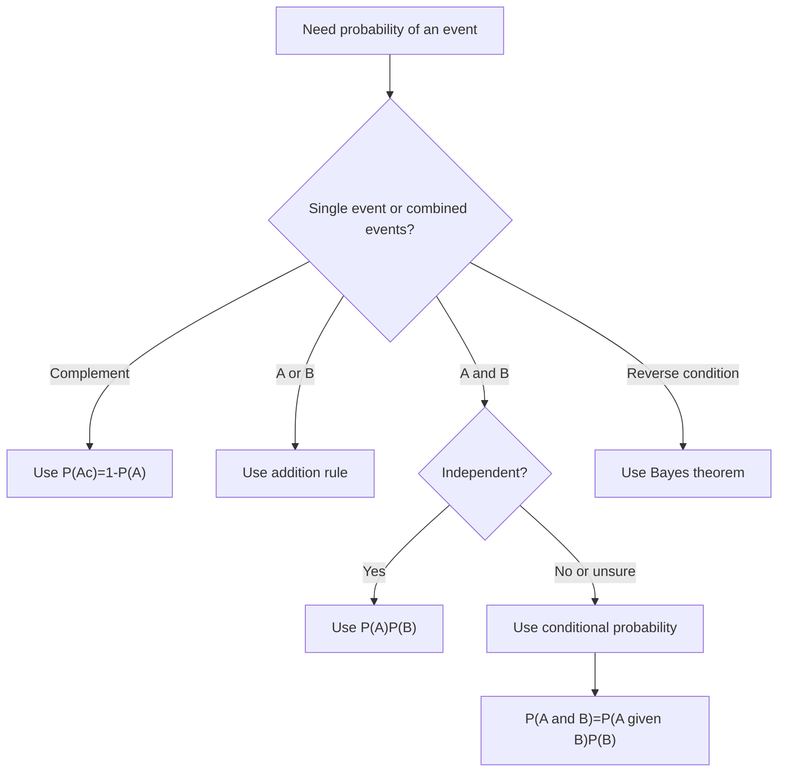

# Probability Basics

Probability supplies the language for uncertainty in statistical inference. A sample result is rarely interpreted as a fixed fact about a population; instead, it is interpreted against a probability model for what could have happened under repeated sampling or repeated trials. The Lane text introduces probability before sampling distributions because confidence intervals, p-values, power, and regression inference all depend on probability statements.

The practical goal is not to memorize gambling examples. It is to learn how events combine, how conditional information changes probabilities, and how independence differs from mutual exclusivity. These ideas appear whenever a researcher asks whether a medical test is reliable, whether two traits are associated, whether a result is surprising under a null hypothesis, or whether base rates change the interpretation of evidence.

## Events and the rules they must obey

A **random experiment** is a process with uncertain outcome but describable possible results. The **sample space** $S$ is the set of all possible outcomes. An **event** is a subset of the sample space. If $A$ is an event, then $P(A)$ is its probability and must satisfy

$$
0 \le P(A) \le 1.
$$

The complement of $A$, written $A^c$, is the event that $A$ does not occur. The complement rule is

$$
P(A^c)=1-P(A).
$$

The union $A\cup B$ is the event that $A$ or $B$ or both occur. The intersection $A\cap B$ is the event that both occur. The general addition rule is

$$
P(A\cup B)=P(A)+P(B)-P(A\cap B).
$$

Events are **mutually exclusive** if they cannot occur together, so $P(A\cap B)=0$. In that special case,

$$
P(A\cup B)=P(A)+P(B).
$$

The **conditional probability** of $A$ given $B$ is

$$
P(A\mid B)=\frac{P(A\cap B)}{P(B)},\quad P(B)>0.
$$

This is not usually equal to $P(B\mid A)$. Conditional probabilities reverse the reference group: $P(A\mid B)$ is among cases where $B$ occurred, while $P(B\mid A)$ is among cases where $A$ occurred.

Events $A$ and $B$ are **independent** if knowing that one occurred does not change the probability of the other:

$$
P(A\mid B)=P(A)
$$

or equivalently

$$
P(A\cap B)=P(A)P(B).
$$

Independence is not the same as mutual exclusivity. If two nonempty events are mutually exclusive, the occurrence of one makes the other impossible, so they are dependent.

The usual rules follow from three axioms: probabilities are nonnegative, $P(S)=1$, and probabilities add over countable collections of disjoint events. For example, $S=A\cup A^c$ is a disjoint union, so

$$
1=P(A)+P(A^c),
$$

which gives the complement rule. For two arbitrary events, split their union into the disjoint pieces $A\setminus B$, $B\setminus A$, and $A\cap B$; the addition rule follows and the overlap must be subtracted once.

For three events, inclusion--exclusion becomes

$$
\begin{aligned}
P(A\cup B\cup C)
={}&P(A)+P(B)+P(C)\\
&-P(A\cap B)-P(A\cap C)-P(B\cap C)\\
&+P(A\cap B\cap C).
\end{aligned}
$$

Pairwise independence is weaker than mutual independence. Three events can be independent in every pair while the occurrence of two together determines the third. Calculations involving several trials need the level of independence actually used by the product.

## Conditioning changes the reference group

From the definition of conditional probability,

$$
P(A\cap B)=P(A\mid B)P(B)=P(B\mid A)P(A).
$$

This multiplication rule does not require independence. Independence is the special case in which the conditional factor can be replaced by a marginal probability.

If events $B_1,\ldots,B_k$ form a partition of $S$, the law of total probability is

$$
P(A)=\sum_{i=1}^kP(A\mid B_i)P(B_i).
$$

It is often easier to compute a marginal probability by dividing the population into meaningful groups. Bayes' theorem reverses those branches.

Bayes' theorem reverses conditional probabilities:

$$
P(A\mid B)=\frac{P(B\mid A)P(A)}{P(B)}.
$$

When $A$ and $A^c$ split the sample space, the denominator can be expanded:

$$
P(A\mid B)=
\frac{P(B\mid A)P(A)}
{P(B\mid A)P(A)+P(B\mid A^c)P(A^c)}.
$$

This form is essential for diagnostic testing and statistical literacy. A rare condition can have a low probability even after a positive test if the false-positive rate is not very small relative to the base rate.

Bayes' theorem has a compact odds form. Posterior odds equal prior odds times a likelihood ratio:

$$
\frac{P(D\mid +)}{P(D^c\mid +)}
=\frac{P(D)}{P(D^c)}
\frac{P(+\mid D)}{P(+\mid D^c)}.
$$

For a positive diagnostic result, the second factor is sensitivity divided by the false-positive rate. It describes how much the observation shifts the odds; the base rate supplies the starting point.

## Counting only after defining equal outcomes

Counting rules support equally likely probability calculations. If a task has $m$ choices followed by $n$ choices, the multiplication rule gives $mn$ ordered outcomes. The number of permutations of $n$ distinct objects taken $r$ at a time is

$$
P(n,r)=\frac{n!}{(n-r)!},
$$

where order matters. The number of combinations is

$$
\binom{n}{r}=\frac{n!}{r!(n-r)!},
$$

where order does not matter.

The combination formula follows by first counting ordered selections. There are $n!/(n-r)!$ ways to choose and order $r$ distinct objects. Each unordered selection appears in $r!$ orders, so division by $r!$ gives $\binom nr$.

Favorable outcomes divided by total outcomes works only when the elementary outcomes are equally likely. The two outcomes “sum is 2” and “sum is not 2” from two dice are not equally likely. The 36 ordered die pairs are equally likely under fair independent dice, and exactly one pair has sum 2.

Sampling without replacement illustrates conditional multiplication. The probability of drawing two aces from a standard deck is

$$
\frac4{52}\frac3{51}=\frac1{221}.
$$

The second factor changes because the first draw changes the deck. The same result follows from combinations, $\binom42/\binom{52}2$, showing two representations of the same sample space.

A probability model must match the mechanism. Drawing cards without replacement creates dependence between draws. Tossing a fair coin repeatedly is often modeled as independent trials. Sampling people from a finite population without replacement is not exactly independent, although independence may be a useful approximation when the population is much larger than the sample.

When solving applied probability problems, translate words into events before computing. Phrases such as "at least one," "exactly two," "given that," and "either" have mathematical meanings. "At least one" is often easiest through the complement rule; "given that" changes the denominator; "either" usually calls for the addition rule; and "exactly" often requires counting the favorable arrangements. Writing the event first prevents many arithmetic errors because the formula then follows the structure of the event rather than the surface wording of the story.

For independent components that each fail with probability $q$,

$$
P(\text{at least one failure})=1-(1-q)^n.
$$

Adding $nq$ double-counts outcomes containing several failures and can even exceed one. For rare failures it is only a first-order approximation.

## A tree for sequential information

Probability trees encode products along a path and sums across disjoint paths. Suppose a supplier provides 70% of parts from plant A and 30% from plant B. Their defect rates are 1% and 4%. Then

$$
P(D)=0.70(0.01)+0.30(0.04)=0.019.
$$

The two products are disjoint ways to reach a defect. Given a defective part,

$$
P(B\mid D)=\frac{0.30(0.04)}{0.019}
\approx0.632.
$$

Plant B supplies a minority of all parts but a majority of defective parts. Drawing the first branch for source and the second for defect status keeps denominators clear.

Sequential events need not have constant conditional probabilities. Without replacement, branches change after every draw. With replacement, the original branch probabilities return. A Markov model sits between these cases: the next distribution depends on the current state but not the entire earlier path.

## Independence can be conditional

Two events may be dependent overall but independent within subgroups, or independent overall but dependent after conditioning. For example, two symptoms can be positively associated in a mixed population because both are more common among older patients. Within narrow age groups they may be unrelated. Conversely, conditioning on admission to a selective program can create an association between otherwise independent qualifications when either qualification helps secure admission.

Statements such as “A and B are independent given C” mean

$$
P(A\cap B\mid C)=P(A\mid C)P(B\mid C).
$$

They do not imply unconditional independence. Statistical models frequently encode conditional independence, so naming what is conditioned on is part of the claim.

## A complete Monty Hall calculation

Let the initially chosen door be 1. The car is equally likely behind doors 1, 2, or 3. If it is behind door 1, a host who knows the locations opens one of doors 2 or 3 and switching loses. If it is behind door 2, the host must open door 3 and switching wins. If it is behind door 3, the host must open door 2 and switching wins. Therefore

$$
P(\text{switch wins})=\frac13+\frac13=\frac23.
$$

The host's rule matters. If someone opens a random unchosen door and happens to reveal a goat, the conditional probabilities differ because revealing a car was possible. Conditional probability describes an information-producing mechanism, not merely the fact that one door now looks unavailable.

## Choosing the rule from the event



| Idea | Formula | Warning |
|---|---|---|
| Complement | $P(A^c)=1-P(A)$ | Only covers "not A" |
| Addition | $P(A\cup B)=P(A)+P(B)-P(A\cap B)$ | Do not double-count overlap |
| Conditional | $P(A\mid B)=P(A\cap B)/P(B)$ | Denominator is the given group |
| Independence | $P(A\cap B)=P(A)P(B)$ | Must be justified, not assumed |
| Bayes | $P(A\mid B)=P(B\mid A)P(A)/P(B)$ | Base rates matter |
| Combination | $\binom{n}{r}$ | Use only when order does not matter |

## Worked example 1: Conditional probability from a two-way table

Problem: A survey of 200 students records whether they commute and whether they work at least 10 hours per week.

| | Work 10+ hours | Work under 10 hours | Total |
|---|---:|---:|---:|
| Commute | 54 | 36 | 90 |
| Do not commute | 26 | 84 | 110 |
| Total | 80 | 120 | 200 |

Find $P(\text{commute})$, $P(\text{work})$, $P(\text{commute and work})$, $P(\text{work}\mid\text{commute})$, and decide whether commuting and working appear independent.

Method:

1. Convert counts to probabilities by dividing by 200:

$$
P(\text{commute})=\frac{90}{200}=0.45.
$$

2. Work probability:

$$
P(\text{work})=\frac{80}{200}=0.40.
$$

3. Joint probability:

$$
P(\text{commute and work})=\frac{54}{200}=0.27.
$$

4. Conditional probability among commuters:

$$
P(\text{work}\mid\text{commute})=\frac{54}{90}=0.60.
$$

5. Check independence. If independent, the joint probability should equal the product of marginal probabilities:

$$
P(\text{commute})P(\text{work})=0.45(0.40)=0.18.
$$

Answer: The observed joint probability is 0.27, not 0.18, and the conditional probability of working among commuters is 0.60, not the overall work probability 0.40. In this sample, commuting and working appear associated rather than independent.

Checked answer: The table totals are consistent: $54+36+26+84=200$. The conditional denominator is 90 because the phrase "given commute" restricts attention to commuters.

## Worked example 2: Bayes' theorem with a medical test

Problem: A condition affects 2% of a population. A screening test has sensitivity 95%, meaning $P(+\mid D)=0.95$, and specificity 90%, meaning $P(-\mid D^c)=0.90$. If a randomly chosen person tests positive, what is the probability they have the condition?

Method:

1. State the base rate:

$$
P(D)=0.02,\quad P(D^c)=0.98.
$$

2. Translate specificity into false-positive probability:

$$
P(+\mid D^c)=1-P(-\mid D^c)=1-0.90=0.10.
$$

3. Compute the positive probability using total probability:

$$
\begin{aligned}
P(+) &= P(+\mid D)P(D)+P(+\mid D^c)P(D^c) \\
&=0.95(0.02)+0.10(0.98) \\
&=0.019+0.098 \\
&=0.117.
\end{aligned}
$$

4. Apply Bayes' theorem:

$$
P(D\mid +)=\frac{0.95(0.02)}{0.117}
=\frac{0.019}{0.117}
\approx 0.162.
$$

Answer: The probability of having the condition after a positive test is about 16.2%. This may seem low because the test is fairly sensitive, but the condition is rare and the false-positive rate applies to the much larger disease-free group.

Checked answer: In 10,000 people, about 200 have the condition and 9,800 do not. The test finds about 190 true positives and 980 false positives. Among $190+980=1,170$ positives, only $190/1,170\approx 0.162$ have the condition.

In odds language, the prior odds are $0.02/0.98=1/49$. The positive likelihood ratio is $0.95/0.10=9.5$, so the posterior odds are $9.5/49$. Converting odds $o$ back to probability with $o/(1+o)$ again gives about $0.162$.

## Sensitivity to the base rate

```python
def bayes_positive(prevalence, sensitivity, specificity):
    p_d = prevalence
    p_not_d = 1 - prevalence
    p_pos_d = sensitivity
    p_pos_not_d = 1 - specificity
    p_pos = p_pos_d * p_d + p_pos_not_d * p_not_d
    return (p_pos_d * p_d) / p_pos

posterior = bayes_positive(prevalence=0.02, sensitivity=0.95, specificity=0.90)
print(f"P(condition | positive) = {posterior:.3f}")

# Two-way table check from worked example 1
commute_work = 54
commuters = 90
workers = 80
total = 200
print("P(work | commute):", commute_work / commuters)
print("P(work):", workers / total)
```

The function exposes the three inputs that drive diagnostic interpretation: prevalence, sensitivity, and specificity. Changing prevalence often changes the answer more dramatically than intuition expects.

## Persistent confusions

- Confusing $P(A\mid B)$ with $P(B\mid A)$.
- Treating mutually exclusive events as independent. Except for impossible events, mutual exclusivity creates dependence.
- Forgetting to subtract the overlap in the addition rule.
- Ignoring base rates when interpreting tests, alarms, and screening tools.
- Assuming sampling without replacement is independent in small populations.
- Using combinations when order matters, or permutations when it does not.

<div className="see-also">

See also: [Random variables and probability distributions](/math/statistics/random-variables-and-distributions) · [Normal, t, chi-square, and F distributions](/math/statistics/normal-t-chi-square-and-f-distributions) · [Sampling distributions and the central limit theorem](/math/statistics/sampling-distributions-and-clt) · [Hypothesis testing logic](/math/statistics/hypothesis-testing-logic) · [Proportions and chi-square tests](/math/statistics/proportions-and-chi-square-tests)

</div>
