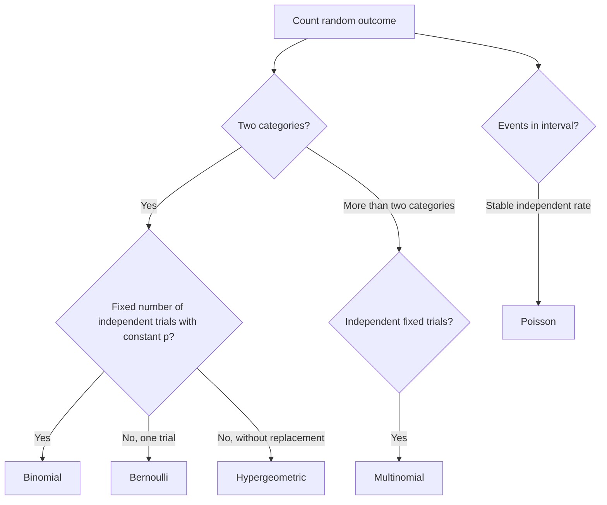

# Random Variables and Probability Distributions

A random variable turns uncertain outcomes into numbers. Once outcomes are numeric, we can describe their long-run behavior with a probability distribution, compute expected values, and model real processes such as successes in repeated trials, arrivals in a time interval, or draws from a finite collection. The Lane text introduces the binomial, Poisson, multinomial, and hypergeometric distributions as probability models that later support inference.

The art is matching assumptions to context. A binomial model is natural for a fixed number of independent success/failure trials with constant success probability. A Poisson model is natural for counts of rare events in a fixed interval when events occur independently at a stable rate. A hypergeometric model is natural for sampling without replacement. When the model assumptions fail, the formula may still produce a number, but the number no longer answers the intended question.

## From outcomes to numerical distributions

A **random variable** $X$ assigns a numerical value to each outcome of a random process. A **discrete random variable** has countable possible values, such as 0, 1, 2, and so on. A **continuous random variable** has possible values over intervals, such as time, length, or measurement error.

A **probability mass function** for a discrete random variable gives

$$
P(X=x)
$$

for each possible value $x$. The probabilities must be nonnegative and sum to 1. A **cumulative distribution function** is

$$
F(x)=P(X\le x).
$$

For continuous variables, probabilities are areas under a density curve rather than heights at individual points. For a continuous random variable, $P(X=a)=0$ for any exact value $a$, even though intervals can have positive probability.

If a continuous variable has density $f$, then

$$
P(a\le X\le b)=\int_a^b f(x)\,dx,
\qquad
F(x)=\int_{-\infty}^x f(t)\,dt.
$$

Density height is not itself a probability and may exceed 1; only area must lie between 0 and 1. For continuous variables, strict or inclusive endpoints give the same probability because single points have probability zero. For discrete variables they can differ by a full mass.

The **expected value** or mean of a discrete random variable is

$$
E(X)=\sum_x xP(X=x).
$$

The **variance** is

$$
\mathrm{Var}(X)=E[(X-\mu)^2],
$$

where $\mu=E(X)$. Standard deviation is $\sqrt{\mathrm{Var}(X)}$.

A **Bernoulli trial** has two outcomes, usually called success and failure, with success probability $p$. If $X$ is 1 for success and 0 for failure, then $X$ has a Bernoulli distribution with $E(X)=p$ and $\mathrm{Var}(X)=p(1-p)$.

If $X$ counts successes in $n$ independent Bernoulli trials with constant success probability $p$, then $X$ has a **binomial distribution**:

$$
P(X=k)=\binom{n}{k}p^k(1-p)^{n-k},\quad k=0,1,\dots,n.
$$

A **Poisson distribution** with rate $\lambda$ models counts in a fixed interval:

$$
P(X=k)=e^{-\lambda}\frac{\lambda^k}{k!},\quad k=0,1,2,\dots.
$$

For a Poisson random variable, $E(X)=\lambda$ and $\mathrm{Var}(X)=\lambda$.

## Expectation and spread

Expectation is linear whether or not variables are independent:

$$
E(aX+bY+c)=aE(X)+bE(Y)+c.
$$

Variance behaves differently. For two variables,

$$
\operatorname{Var}(X+Y)
=\operatorname{Var}(X)+\operatorname{Var}(Y)
+2\operatorname{Cov}(X,Y).
$$

Only when covariance is zero does the cross term disappear. Independence implies zero covariance when moments exist, but zero covariance does not generally imply independence.

The identity

$$
\operatorname{Var}(X)=E(X^2)-[E(X)]^2
$$

comes from expanding $(X-\mu)^2$. It is convenient for hand calculations, although subtracting nearly equal floating-point numbers can be unstable in software. Expectation need not be a possible outcome: an expected count of 2.4 is a long-run average over repetitions, not a prediction that one experiment will produce a fractional event.

## Deriving the binomial moments

The binomial distribution has mean and variance

$$
E(X)=np,
$$

$$
\mathrm{Var}(X)=np(1-p).
$$

These results match the idea that $X$ is the sum of $n$ independent Bernoulli variables. Expected values add, and independent variances add. If $X=X_1+\cdots+X_n$ and each $X_i$ is Bernoulli($p$), then

$$
E(X)=E(X_1)+\cdots+E(X_n)=np.
$$

Since a Bernoulli variable satisfies $X_i^2=X_i$,

$$
\operatorname{Var}(X_i)=E(X_i^2)-E(X_i)^2=p-p^2=p(1-p).
$$

Independence removes all covariance terms, giving

$$
\operatorname{Var}\left(\sum_{i=1}^nX_i\right)
=\sum_{i=1}^n\operatorname{Var}(X_i)
=np(1-p).
$$

The binomial mass has three pieces. $p^k(1-p)^{n-k}$ is the probability of one specified sequence with $k$ successes, and $\binom nk$ counts the positions in which those successes can occur. The formula needs a fixed $n$, two outcomes per trial, constant $p$, and independent trials.

The hypergeometric distribution models the number of successes in $n$ draws without replacement from a population of $N$ objects containing $K$ successes:

$$
P(X=k)=\frac{\binom{K}{k}\binom{N-K}{n-k}}{\binom{N}{n}}.
$$

This distribution differs from the binomial because the draws are dependent: after one success is drawn, fewer successes remain.

Writing $p=K/N$, its mean is still $np$, but its variance is

$$
\operatorname{Var}(X)
=np(1-p)\frac{N-n}{N-1}.
$$

The final factor is the finite-population correction. It is below one because sampling without replacement creates negative dependence: observing a success makes another success slightly less likely. When $n/N$ is tiny, the factor is close to one and the binomial approximation is often adequate.

The multinomial distribution generalizes the binomial to more than two categories. If $n$ independent trials fall into $c$ categories with probabilities $p_1,\dots,p_c$, then counts $X_1,\dots,X_c$ have probability

$$
P(X_1=x_1,\dots,X_c=x_c)=
\frac{n!}{x_1!\cdots x_c!}p_1^{x_1}\cdots p_c^{x_c},
$$

where $x_1+\cdots+x_c=n$.

The Poisson distribution can approximate a binomial distribution when $n$ is large, $p$ is small, and $\lambda=np$ is moderate. This approximation is useful for rare-event counts, but it should not hide the assumptions: events should occur independently and at a stable average rate across the interval.

If counts in disjoint intervals are independent and rates add, then the sum of independent Poisson variables is Poisson with parameter equal to the sum of rates. A rate of 3 calls per half hour corresponds to mean 6 per hour only when the rate is stable over that hour.

The equality of Poisson mean and variance is a useful diagnostic. Count data with variance far above the mean show overdispersion, often caused by changing rates, clustering, or unobserved heterogeneity. A negative-binomial model may then be more suitable. Variance below the mean can arise from spacing or capacity constraints.

Distribution choice is also a modeling claim. If a call center receives more calls during lunch than at midnight, a single Poisson rate for the whole day may be too crude even if the total count is a nonnegative integer. If survey responses are clustered by classroom, a binomial model that treats every student response as independent may underestimate variability. If a quality inspector samples a large warehouse without replacement but the sample is tiny relative to the warehouse, a binomial approximation may be acceptable. The formulas become useful only after the data-generating process has been described clearly enough to defend the assumptions.

## CDFs, tails, and quantiles

Software usually computes cumulative probabilities more accurately than a hand-built sum of many masses. For a discrete variable,

$$
P(X\ge k)=1-P(X\le k-1),
$$

not $1-P(X\le k)$. The one-step distinction causes many off-by-one errors. Survival-function routines calculate upper tails directly and can be more accurate than subtracting a probability extremely close to one.

Quantiles reverse the CDF. A 0.95 quantile is a value $q$ with roughly 95% of the distribution at or below it. For a discrete distribution, no value may give exactly 0.95, so a common convention chooses the smallest $q$ whose CDF reaches the requested level.

## Transformations and joint behavior

For $Y=aX+b$,

$$
E(Y)=aE(X)+b,
\qquad
\operatorname{Var}(Y)=a^2\operatorname{Var}(X).
$$

Adding a constant shifts a distribution without changing spread; multiplying by $a$ scales standard deviation by $\vert a\vert $. The square on variance prevents a negative scale from producing a negative spread.

For a nonlinear transformation $Y=g(X)$, generally $E[g(X)]\ne g(E[X])$. If $X$ is a fair die roll, $E(X)=3.5$ but $E(X^2)=91/6$, not $3.5^2$. Convexity explains the direction of many such differences through Jensen's inequality.

A marginal distribution describes one variable alone. A joint distribution is needed for sums, comparisons, and conditional probabilities involving several variables. Two pairs $(X,Y)$ can have identical marginals but different dependence, leading to different distributions of $X+Y$.

Multinomial counts show this dependence clearly. Since $X_1+\cdots+X_c=n$ is fixed, a large count in one category leaves fewer trials for others. For $i\ne j$,

$$
\operatorname{Cov}(X_i,X_j)=-np_ip_j.
$$

Each individual category count is binomial with parameters $n$ and $p_i$, but the category counts are not independent. Treating them as separate binomials loses the fixed-total constraint.

Conditional distributions answer questions after information arrives. If $X$ and $Y$ are independent, conditioning on $Y$ leaves the distribution of $X$ unchanged. Otherwise the conditional mean $E(X\mid Y)$ can vary with $Y$ and serves as the population target of regression.

## Choosing a count model

| Distribution | Random variable | Parameters | Mean | Variance | Typical setting |
|---|---|---:|---:|---:|---|
| Bernoulli | one success/failure trial | $p$ | $p$ | $p(1-p)$ | one yes/no outcome |
| Binomial | successes in fixed $n$ trials | $n,p$ | $np$ | $np(1-p)$ | independent repeated trials |
| Poisson | events in interval | $\lambda$ | $\lambda$ | $\lambda$ | arrivals, rare counts |
| Hypergeometric | successes without replacement | $N,K,n$ | $nK/N$ | depends on finite correction | finite sampling |
| Multinomial | counts in several categories | $n,p_1,\dots,p_c$ | $np_j$ for category $j$ | category-specific | survey choices |



## Worked example 1: Binomial probability

Problem: A website experiment has a historical conversion probability of $p=0.12$. Suppose 20 independent visitors see a page. Let $X$ be the number who convert. Find $P(X=3)$, $P(X\le 1)$, and the mean and standard deviation.

Method:

1. Identify the model. There are $n=20$ fixed trials, each visitor either converts or does not, and the problem assumes independent visitors with constant $p=0.12$. Thus $X\sim\mathrm{Binomial}(20,0.12)$.
2. Compute $P(X=3)$:

$$
P(X=3)=\binom{20}{3}(0.12)^3(0.88)^{17}.
$$

3. Evaluate the combination:

$$
\binom{20}{3}=\frac{20!}{3!17!}=1140.
$$

4. Substitute:

$$
P(X=3)=1140(0.001728)(0.1142)\approx 0.225.
$$

5. Compute $P(X\le 1)$:

$$
P(X\le 1)=P(X=0)+P(X=1).
$$

6. Calculate terms:

$$
P(X=0)=(0.88)^{20}\approx 0.0776,
$$

$$
P(X=1)=\binom{20}{1}(0.12)(0.88)^{19}\approx 0.2117.
$$

7. Add:

$$
P(X\le 1)\approx 0.0776+0.2117=0.2893.
$$

8. Mean and standard deviation:

$$
E(X)=np=20(0.12)=2.4,
$$

$$
\sigma=\sqrt{np(1-p)}=\sqrt{20(0.12)(0.88)}\approx 1.45.
$$

Answer: $P(X=3)\approx 0.225$, $P(X\le1)\approx 0.289$, the expected number of conversions is 2.4, and the standard deviation is about 1.45.

Checked answer: A value of 3 conversions is near the expected value 2.4, so a probability around 0.225 is plausible. Zero or one conversion is below average but not rare with only 20 visitors.

## Worked example 2: Hypergeometric versus binomial

Problem: A shipment contains 50 devices, 6 of which are defective. An inspector selects 5 devices without replacement. What is the probability that exactly 2 are defective? Why is a binomial model not exact?

Method:

1. Identify parameters: $N=50$ total devices, $K=6$ defectives, $n=5$ draws, and $k=2$ defective draws.
2. Use the hypergeometric formula:

$$
P(X=2)=\frac{\binom{6}{2}\binom{44}{3}}{\binom{50}{5}}.
$$

3. Compute pieces:

$$
\binom{6}{2}=15,
$$

$$
\binom{44}{3}=\frac{44\cdot43\cdot42}{3\cdot2\cdot1}=13244,
$$

$$
\binom{50}{5}=2118760.
$$

4. Substitute:

$$
P(X=2)=\frac{15(13244)}{2118760}
=\frac{198660}{2118760}
\approx 0.0938.
$$

Answer: The exact probability is about 0.094. A binomial model with $p=6/50=0.12$ would treat each draw as independent with constant defect probability. That is not exact because after a defective device is drawn, only 5 defectives remain among 49 devices; the probability changes.

Checked answer: The numerator counts ways to choose 2 defectives and 3 nondefectives. The denominator counts all possible sets of 5 devices, so the ratio matches the sampling mechanism.

## Distribution functions in code

```python
from scipy.stats import binom, hypergeom, poisson

# Binomial conversion example
n, p = 20, 0.12
print("P(X=3):", binom.pmf(3, n, p))
print("P(X<=1):", binom.cdf(1, n, p))
print("mean:", binom.mean(n, p), "sd:", binom.std(n, p))

# Hypergeometric inspection example
N, K, draws = 50, 6, 5
print("P(exactly 2 defective):", hypergeom.pmf(2, N, K, draws))

# Poisson rare-event example: average 4 calls per hour
print("P(6 calls in an hour):", poisson.pmf(6, mu=4))
```

SciPy uses `pmf` for discrete probability mass functions and `cdf` for cumulative probabilities. Naming the parameters in comments is useful because different distributions use different conventions.

## Modeling and arithmetic traps

- Using a binomial model for sampling without replacement from a small finite population.
- Forgetting that "at most 1" means $P(X=0)+P(X=1)$.
- Treating expected value as the most likely exact outcome. The expectation can be non-integer.
- Using the Poisson distribution for counts whose rate changes sharply over time or space.
- Ignoring dependence among trials, such as multiple purchases by the same customer.
- Rounding intermediate probabilities too aggressively.

## Related pages

- [Probability basics](/math/statistics/probability-basics)
- [Normal, t, chi-square, and F distributions](/math/statistics/normal-t-chi-square-and-f-distributions)
- [Sampling distributions and the central limit theorem](/math/statistics/sampling-distributions-and-clt)
- [Proportions and chi-square tests](/math/statistics/proportions-and-chi-square-tests)
- [Hypothesis testing logic](/math/statistics/hypothesis-testing-logic)
