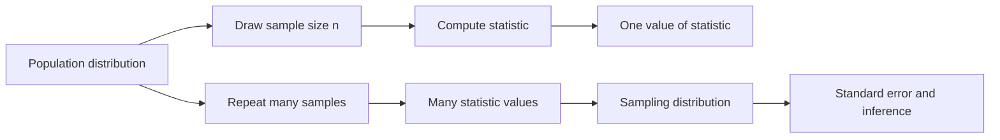

# Sampling Distributions and the Central Limit Theorem

A sampling distribution is the probability distribution of a statistic over repeated samples. This idea is the bridge from descriptive statistics to inference. A single sample mean may be 72.4, but the sampling distribution asks what values the sample mean would take if the same sampling procedure were repeated again and again. The Lane text emphasizes sampling distributions because confidence intervals, hypothesis tests, and standard errors are all built from them.

The central limit theorem is the most important approximation in introductory statistics. It explains why sample means are often approximately normal even when the original observations are not. This is the reason normal and $t$ procedures appear so widely. The theorem does not say that the raw data become normal; it says that the distribution of the sample mean becomes approximately normal under suitable conditions as sample size grows.

## A statistic before the sample is observed

A **statistic** is a number computed from sample data, such as $\bar{X}$, $S$, $\hat{p}$, or $r$. Because samples vary, a statistic is itself a random variable before the data are observed.

The **sampling distribution** of a statistic is the distribution of that statistic across all possible samples of a fixed size drawn by the same method from the same population. For the sample mean, the statistic is

$$
\bar{X}=\frac{1}{n}\sum_{i=1}^{n}X_i.
$$

The **standard error** of a statistic is the standard deviation of its sampling distribution. For the sample mean from independent observations with population standard deviation $\sigma$,

$$
SE(\bar{X})=\frac{\sigma}{\sqrt{n}}.
$$

For a sample proportion,

$$
SE(\hat{p})=\sqrt{\frac{p(1-p)}{n}}.
$$

Unknown population quantities are often replaced by estimates, such as $s$ for $\sigma$ or $\hat{p}$ for $p$.

The **central limit theorem** states that if $X_1,\dots,X_n$ are independent and identically distributed with mean $\mu$ and finite standard deviation $\sigma$, then for large $n$,

$$
\bar{X}\approx N\left(\mu,\frac{\sigma^2}{n}\right).
$$

Equivalently,

$$
Z=\frac{\bar{X}-\mu}{\sigma/\sqrt{n}}
$$

is approximately standard normal for large $n$.

## Center and spread of the sample mean

The mean of the sampling distribution of $\bar{X}$ is

$$
E(\bar{X})=\mu.
$$

This means the sample mean is an unbiased estimator of the population mean under random sampling. The variability of $\bar{X}$ decreases as sample size increases:

$$
SE(\bar{X})=\frac{\sigma}{\sqrt{n}}.
$$

Both statements follow from the rules for sums. Under independent sampling,

$$
\begin{aligned}
E(\bar X)
&=E\left(\frac1n\sum_{i=1}^nX_i\right)
=\frac1n\sum_{i=1}^n\mu=\mu,\\
\operatorname{Var}(\bar X)
&=\operatorname{Var}\left(\frac1n\sum_{i=1}^nX_i\right)
=\frac1{n^2}\sum_{i=1}^n\sigma^2
=\frac{\sigma^2}{n}.
\end{aligned}
$$

If observations are positively correlated, covariance terms remain and the usual $\sigma^2/n$ understates uncertainty. Clustered samples can therefore contain many records but much less information than the record count suggests.

Sampling without replacement from a finite population also creates dependence, but it is negative. For a simple random sample of size $n$ from population size $N$,

$$
SE(\bar X)=\frac{\sigma}{\sqrt n}
\sqrt{\frac{N-n}{N-1}}.
$$

The finite-population correction approaches one when the sampling fraction is small and approaches zero in a census.

## The law of large numbers and the CLT answer different questions

The law of large numbers says that $\bar X$ converges toward $\mu$ as $n$ grows. It explains consistency. The central limit theorem describes the shape and scale of the remaining fluctuation:

$$
\frac{\sqrt n(\bar X-\mu)}{\sigma}
\xrightarrow{d}N(0,1).
$$

The factor $\sqrt n$ prevents the shrinking error from collapsing to zero, revealing a stable limiting distribution. That distribution supplies approximate probabilities, critical values, and confidence intervals.

There is no universal sample size at which the CLT “turns on.” The required $n$ depends on skewness, tail weight, and the statistic. Bounded mild-skew data may look close to normal at modest sizes. Rare-event, heavy-tailed, or contaminated data may converge slowly. If the population lacks a finite variance, the standard form above does not apply.

The square-root relationship is important. To cut the standard error in half, the sample size must be multiplied by four. Doubling the sample size reduces the standard error by a factor of $\sqrt{2}$, not by half.

If the population itself is normal, then the sampling distribution of $\bar{X}$ is exactly normal for any sample size. If the population is not normal, the central limit theorem provides an approximation that improves as $n$ increases. Skewed and heavy-tailed populations require larger sample sizes than symmetric light-tailed populations.

For an exponential population, the sum of $n$ observations has a gamma distribution and remains right-skewed for finite $n$, though its standardized shape becomes more symmetric. For a normal population, closure under linear combinations gives exact normality immediately. These two examples separate an exact sampling result from an asymptotic one.

## Proportions are averages of indicators

For proportions, when $np$ and $n(1-p)$ are sufficiently large, the sampling distribution of $\hat{p}$ is approximately normal:

$$
\hat{p}\approx N\left(p,\frac{p(1-p)}{n}\right).
$$

The same conceptual rule applies: the statistic varies from sample to sample, but its distribution has a predictable center and spread if the sampling process is understood.

Write $X_i=1$ for a success and 0 otherwise. Then

$$
\hat p=\frac1n\sum_{i=1}^nX_i,
$$

so the proportion result is the sample-mean result applied to Bernoulli variables. Since $E(X_i)=p$ and $\operatorname{Var}(X_i)=p(1-p)$,

$$
E(\hat p)=p,
\qquad
\operatorname{Var}(\hat p)=\frac{p(1-p)}n.
$$

When $p$ is very close to 0 or 1, the Bernoulli distribution is highly skewed and the normal approximation needs a larger $n$. The expected-count checks are rough diagnostics for whether both tails contain enough probability mass.

## Simulation, bootstrap, and the target distribution

Sampling distributions should not be confused with bootstrap distributions, simulated histograms of raw data, or the distribution of a population. A sampling distribution is a theoretical repeated-sampling object tied to a statistic and a sample size. In teaching, simulation approximates it by repeatedly drawing samples, computing the statistic, and plotting the results. The target remains the distribution induced by the sampling design. A standard error of 2 grams for a mean does not mean individual packages usually vary by 2 grams; it means sample means of that size usually vary by about 2 grams.

A parametric simulation samples from a specified population model, while a nonparametric bootstrap samples with replacement from the observed cases. Both produce distributions of statistics, but they condition on different information. A bootstrap estimates the sampling distribution using the empirical distribution as a stand-in for the unknown population. It inherits biases and dependence problems in the original sampling process unless the resampling scheme represents them.

The CLT also explains why inference can be more stable for averages than for individual outcomes. Individual delivery times may be right-skewed because unusually long delays are possible, but the average of many deliveries has less relative skew and smaller spread. This does not make every sample size "large enough." A sample of 10 from a mildly skewed population may work reasonably, while a sample of 100 from a population with extreme outliers or strong dependence may still be difficult. The theorem is a guide to approximation, not permission to ignore the data-generating process.

Always pair a CLT approximation with a plot of the original data and a clear statement of sampling independence.

## Standard deviation, standard error, and estimated standard error

Population standard deviation $\sigma$ describes variability among individual observations. The standard error $\sigma/\sqrt n$ describes variability among sample means. Because $\sigma$ is usually unknown, the reported value $s/\sqrt n$ is an estimated standard error. Keeping the three names separate prevents a common reporting mistake.

The realized sample standard deviation does not shrink merely because more observations are collected; it estimates the same population spread more precisely. The standard error shrinks because the statistic averages more information. A future individual remains variable even when the population mean has been estimated very accurately.

For clustered observations, an approximate design effect is

$$
1+(m-1)\rho,
$$

where $m$ is average cluster size and $\rho$ the intracluster correlation. The effective sample size is roughly the nominal size divided by this factor. Even a small positive $\rho$ matters when clusters are large.

## Beyond means

Many statistics have asymptotically normal sampling distributions, but each needs its own standard error. Sample medians, regression slopes, log odds ratios, and maximum-likelihood estimators do not all inherit $\sigma/\sqrt n$. Their variability depends on density near a quantile, predictor spread, cell probabilities, or model curvature.

For a smooth transformation $g(\hat\theta)$, the delta method gives the approximation

$$
\operatorname{Var}(g(\hat\theta))
\approx[g'(\theta)]^2\operatorname{Var}(\hat\theta).
$$

For example, a logarithm turns multiplicative uncertainty into approximately additive uncertainty and often yields better-behaved intervals for positive ratios. If the derivative is zero or the estimator lies near a boundary, the first-order approximation can fail.

The sample variance has a chi-square sampling distribution under normal data, not a normal distribution at small $n$. Ratios of independent variance estimates lead to an $F$ distribution. The CLT's prominence should not erase exact finite-sample results that are available under stronger assumptions.

## Monte Carlo error is another sampling error

A simulation with $M$ independent replications estimates a probability by a sample proportion. If the estimated probability is $\hat p$, its Monte Carlo standard error is about

$$
\sqrt{\frac{\hat p(1-\hat p)}{M}}.
$$

Thus simulation output such as 0.0473 has no claim to four stable decimals unless $M$ is large enough. Increasing the sample size inside each simulated experiment changes the target sampling distribution; increasing the number of replications reduces only Monte Carlo noise in the approximation to that target.

## Population, sample, and repeated samples



| Quantity | Raw-data distribution | Sampling distribution |
|---|---|---|
| What varies? | Individual observations $X$ | Statistic such as $\bar{X}$ |
| Center | Population mean $\mu$ | $E(\bar{X})=\mu$ |
| Spread | Population standard deviation $\sigma$ | $SE(\bar{X})=\sigma/\sqrt{n}$ |
| Shape | Any population shape | Often approximately normal for means |
| Sample-size effect | More observations show more detail | Larger $n$ makes statistic less variable |

## Worked example 1: Standard error of the mean

Problem: A manufacturer knows that fill weights for a product have mean $\mu=500$ grams and standard deviation $\sigma=12$ grams. Random samples of $n=36$ packages are taken. Find the mean and standard error of $\bar{X}$, and compute $P(\bar{X}\gt 503)$ assuming the CLT approximation is appropriate.

Method:

1. The center of the sampling distribution is

$$
E(\bar{X})=\mu=500.
$$

2. The standard error is

$$
SE(\bar{X})=\frac{\sigma}{\sqrt{n}}=\frac{12}{\sqrt{36}}=\frac{12}{6}=2.
$$

3. Standardize $\bar{X}=503$:

$$
z=\frac{503-500}{2}=1.5.
$$

4. Convert to an upper-tail normal probability:

$$
P(\bar{X}>503)=P(Z>1.5)=1-\Phi(1.5).
$$

5. From a standard normal table, $\Phi(1.5)\approx0.9332$.

$$
P(\bar{X}>503)\approx1-0.9332=0.0668.
$$

Answer: The sampling distribution of the mean is centered at 500 grams with standard error 2 grams. The probability that a random sample of 36 packages has mean above 503 grams is about 0.067.

Checked answer: A sample mean of 503 is only 3 grams above the population mean, but because averages of 36 packages vary less than individual packages, that is 1.5 standard errors above the mean.

## Worked example 2: Why increasing sample size stabilizes estimates

Problem: A survey question has true support level $p=0.60$. Compare the standard error of $\hat{p}$ for sample sizes $n=100$, $n=400$, and $n=1600$.

Method:

1. Use

$$
SE(\hat{p})=\sqrt{\frac{p(1-p)}{n}}.
$$

2. For $n=100$:

$$
SE=\sqrt{\frac{0.60(0.40)}{100}}
=\sqrt{0.0024}
\approx0.0490.
$$

3. For $n=400$:

$$
SE=\sqrt{\frac{0.24}{400}}
=\sqrt{0.0006}
\approx0.0245.
$$

4. For $n=1600$:

$$
SE=\sqrt{\frac{0.24}{1600}}
=\sqrt{0.00015}
\approx0.0122.
$$

Answer: The standard errors are about 0.049, 0.0245, and 0.0122. Multiplying sample size by four cuts the standard error in half. Very precise estimates can therefore require very large samples.

Checked answer: The sequence halves each time because $100\to400\to1600$ multiplies sample size by four at each step, and standard error scales as $1/\sqrt{n}$.

## Simulating the convergence in shape

```python
import numpy as np
import matplotlib.pyplot as plt

rng = np.random.default_rng(7)

# Skewed population: exponential with mean 1
population = rng.exponential(scale=1.0, size=200_000)

for n in [5, 30, 100]:
    sample_means = np.array([
        rng.choice(population, size=n, replace=True).mean()
        for _ in range(5000)
    ])
    print(n, sample_means.mean(), sample_means.std(ddof=1))
    plt.hist(sample_means, bins=40, alpha=0.45, density=True, label=f"n={n}")

plt.xlabel("sample mean")
plt.ylabel("density")
plt.legend()
plt.title("Sampling distributions from a skewed population")
plt.show()
```

The simulation shows the distribution of sample means becoming more symmetric and less spread out as $n$ grows. The population remains skewed; only the sampling distribution changes.

## Confusions around “approximately normal”

- Saying the central limit theorem makes the original data normal.
- Forgetting that standard error describes sample-to-sample variation of a statistic, not variation among individuals.
- Expecting standard error to shrink linearly with sample size.
- Applying normal approximations to proportions when expected successes or failures are too small.
- Ignoring dependence. Clustered, repeated, or networked observations can make the usual standard error too small.
- Treating one simulated sampling distribution as a substitute for understanding the sampling design.

## Related pages

- [Summarizing distributions](/math/statistics/summarizing-distributions)
- [Normal, t, chi-square, and F distributions](/math/statistics/normal-t-chi-square-and-f-distributions)
- [Estimation and confidence intervals](/math/statistics/estimation-and-confidence-intervals)
- [Hypothesis testing logic](/math/statistics/hypothesis-testing-logic)
- [Tests for means](/math/statistics/tests-for-means)
