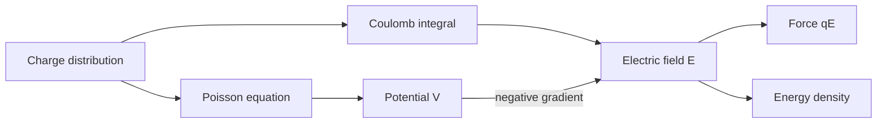

# Electrostatic Fields and Potential

Electrostatics is the time-independent part of electromagnetism. Charges may be distributed through a material, fixed on an insulating surface, or free to rearrange on a conductor, but the macroscopic charge density and fields do not change with time. The main quantities are charge density, electric field intensity $\vec E$, electric flux density $\vec D$, and scalar potential $V$.

The static approximation covers more than isolated charges in vacuum. Capacitors, cable insulation, electrostatic shielding, depletion-layer models, and many sensor geometries are boundary-value problems for the same equations. The approximation fails when magnetic induction contributes appreciably to the electric field; then $\nabla\times\vec E$ need not vanish and a scalar potential alone cannot describe $\vec E$.

## From Coulomb force to a field

Charge is represented at the geometric scale appropriate to the source:

$$
Q=\int_L \rho_l\,dl,
\qquad
Q=\int_S \rho_s\,dS,
\qquad
Q=\int_\mathcal{V} \rho_v\,dv.
$$

Here $\rho_l$, $\rho_s$, and $\rho_v$ have units C/m, C/m$^2$, and C/m$^3$. A point charge is the limiting idealization in which the source size is negligible compared with all observation distances.

For two point charges in a homogeneous medium,

$$
\vec F_{12}=\frac{q_1q_2}{4\pi\epsilon R^2}\hat R,
$$

where $\vec R=\vec r_2-\vec r_1$ points from the source $q_1$ to the charge $q_2$. Dividing by a small positive test charge defines the electric field:

$$
\vec E(\vec r)=\frac{\vec F}{q_{\text{test}}}.
$$

For a source charge $q$ at $\vec r'$, the source-to-observation vector is

$$
\vec R=\vec r-\vec r',
\qquad R=|\vec R|,
\qquad \hat R=\frac{\vec R}{R},
$$

and therefore

$$
\vec E(\vec r)=\frac{q}{4\pi\epsilon}\frac{\vec R}{R^3}.
$$

Writing the result as $\vec R/R^3$ is often safer than writing $\hat R/R^2$: the direction is then carried by the same displacement vector used to compute the distance.

Ordinary linear electrostatics obeys superposition. For point charges,

$$
\vec E(\vec r)=\frac{1}{4\pi\epsilon}
\sum_n q_n\frac{\vec r-\vec r_n}{|\vec r-\vec r_n|^3},
$$

while a volume distribution gives

$$
\vec E(\vec r)=\frac{1}{4\pi\epsilon}
\int_\mathcal{V}
\rho_v(\vec r')
\frac{\vec r-\vec r'}{|\vec r-\vec r'|^3}
\,dv'.
$$

The corresponding line and surface integrals replace $\rho_v,dv'$ by $\rho_l,dl'$ or $\rho_s,dS'$. The permittivity may be taken outside the integral only when the medium is homogeneous. At interfaces between materials, Coulomb's homogeneous-medium formula is usually replaced by field equations plus boundary conditions.

## Potential as accumulated work

The work done by the electric field on charge $q$ along a path is

$$
W_{a\to b}^{\text{field}}
=q\int_a^b \vec E\cdot d\vec l.
$$

In electrostatics the line integral around any closed contour is zero. The work depends only on the endpoints, so one can define potential difference by

$$
V(b)-V(a)=-\int_a^b \vec E\cdot d\vec l.
$$

The minus sign says that $V$ decreases in the direction of $\vec E$. A positive charge released from rest tends to move toward lower potential energy $U=qV$; a negative charge tends the other way because multiplication by $q\lt 0$ reverses the ordering.

Choosing infinity as the zero of potential gives, for a localized point charge,

$$
V(\vec r)=\frac{q}{4\pi\epsilon R}.
$$

Potentials add as scalars:

$$
V(\vec r)=\frac{1}{4\pi\epsilon}
\int_\mathcal{V}\frac{\rho_v(\vec r')}{|\vec r-\vec r'|}\,dv'.
$$

After finding $V$, recover the field from

$$
\vec E=-\nabla V.
$$

This route is often shorter than integrating vectors. Source elements may point in many directions at the observation point, whereas every contribution to $V$ is a signed scalar. The reference value of $V$ remains arbitrary: replacing $V$ by $V+C$ changes neither $\vec E$ nor any measured voltage.

The reference at infinity is unsuitable for every idealized distribution. An infinite line charge has $E\propto 1/\rho$, so integrating the field from a finite radius to infinity diverges logarithmically. One must specify a finite reference radius $\rho_0$, giving a potential difference proportional to $\ln(\rho_0/\rho)$. Infinite planes present a similar issue because their field does not decay with distance.

## Differential equations behind the Coulomb integral

Gauss's law and the electrostatic curl equation are

$$
\nabla\cdot\vec D=\rho_v,
\qquad
\nabla\times\vec E=0.
$$

For a linear isotropic medium, $\vec D=\epsilon\vec E$. Since a curl-free field can locally be written as the gradient of a scalar, substitution of $\vec E=-\nabla V$ gives

$$
\nabla\cdot(\epsilon\nabla V)=-\rho_v.
$$

If $\epsilon$ is constant within the region,

$$
\nabla^2V=-\frac{\rho_v}{\epsilon},
$$

which is Poisson's equation. In a charge-free region it becomes Laplace's equation,

$$
\nabla^2V=0.
$$

Laplace's equation says that the value of $V$ at a point is tied to nearby values; it cannot have an isolated interior maximum or minimum in a charge-free region. Electrostatic trapping of a free charge by a purely static field therefore runs into a structural obstruction, not merely a poor choice of electrode shape.

The Coulomb integral and Poisson equation are two views of the same theory. The integral is convenient when the charge distribution is given in an unbounded homogeneous medium. The differential equation is better when conductor shapes, specified voltages, dielectric interfaces, or finite boundaries dominate the problem.

Uniqueness makes boundary methods dependable. Suppose $V_1$ and $V_2$ satisfy Poisson's equation with the same charge density and the same specified potential on the boundary. Their difference $u=V_1-V_2$ satisfies $\nabla^2u=0$ and vanishes on the boundary. Applying Green's identity shows that the volume integral of $\vert \nabla u\vert ^2$ is zero, so $\nabla u=0$ everywhere and $u=0$. Once a candidate satisfies both the equation and the boundary data, another distinct solution cannot exist.

## Conductors, surfaces, and stored energy

In electrostatic equilibrium the field inside an ideal conductor is zero. Otherwise free carriers would continue moving. It follows that the conductor is an equipotential, and the tangential electric field immediately outside its surface is zero. Excess free charge resides on the surface. A thin Gaussian pillbox across that surface gives the normal boundary condition

$$
\hat n\cdot(\vec D_{\text{out}}-\vec D_{\text{in}})=\rho_s.
$$

With $\vec D_{\text{in}}=0$ for the conductor,

$$
\vec E_{\text{out}}=\frac{\rho_s}{\epsilon}\hat n.
$$

Large surface charge density therefore corresponds to large normal field. Charge crowds near sharp protrusions because a rapidly curving equipotential requires closely spaced neighboring equipotentials. That observation matters in high-voltage design: sharp electrodes promote corona and breakdown.

Energy can be assembled charge by charge. For discrete charges, excluding each charge's divergent self-energy,

$$
U=\frac12\sum_i q_iV_{\text{others}}(\vec r_i).
$$

For a continuous distribution,

$$
U=\frac12\int_\mathcal{V}\rho_v V\,dv.
$$

Using Gauss's law and integration by parts converts this to a field expression. If boundary terms vanish or are handled separately,

$$
U=\frac12\int_\mathcal{V}\vec E\cdot\vec D\,dv.
$$

Thus the electric energy density in a linear medium is $u_e=\tfrac12\vec E\cdot\vec D$. In a nonlinear dielectric the factor $1/2$ generally disappears; the energy density is found from the constitutive curve by integrating $\vec E\cdot d\vec D$.

## The dipole as the first far-field correction

A localized group of charges looks progressively simpler as the observation distance grows. The leading term depends on the net charge. If the net charge vanishes, the next surviving term is usually the electric dipole.

Take charges $+q$ and $-q$ separated by displacement $\vec d$, directed from the negative charge to the positive one. Their dipole moment is

$$
\vec p=q\vec d.
$$

Place the pair near the origin and observe it at $\vec r$, where $r\gg \vert \vec d\vert $. The exact potential is the difference of two point-charge potentials. Expanding each inverse distance to first order in $d/r$ leaves

$$
V(\vec r)\approx
\frac{1}{4\pi\epsilon}
\frac{\vec p\cdot\hat r}{r^2}.
$$

For a dipole aligned with the $z$ axis, $\vec p\cdot\hat r=p\cos\theta$, so

$$
V(r,\theta)=
\frac{p\cos\theta}{4\pi\epsilon r^2}.
$$

Using the spherical-coordinate gradient gives

$$
\begin{aligned}
E_r&=-\frac{\partial V}{\partial r}
=\frac{2p\cos\theta}{4\pi\epsilon r^3},\\
E_\theta&=-\frac{1}{r}\frac{\partial V}{\partial\theta}
=\frac{p\sin\theta}{4\pi\epsilon r^3},\\
E_\phi&=0.
\end{aligned}
$$

The potential falls as $1/r^2$ and the field as $1/r^3$, faster than the monopole terms $1/r$ and $1/r^2$. Distance therefore filters source detail: far away, net charge dominates; if it is zero, dipole moment dominates; still finer structure appears in higher multipoles.

An external uniform field exerts equal and opposite forces on the two charges, producing no net force but generally producing torque

$$
\vec\tau=\vec p\times\vec E.
$$

The associated potential energy is

$$
U=-\vec p\cdot\vec E.
$$

The lowest-energy orientation has $\vec p$ parallel to $\vec E$. In a nonuniform field the forces do not cancel exactly, so a dipole can also experience a net force. This distinction separates orientation effects from translational attraction toward regions of stronger field.

## Choosing a solution route

Several methods can solve the same electrostatic problem, but their workloads differ sharply.

| Given information | Usually start with | Reason |
|---|---|---|
| A few point charges | Coulomb superposition | Each contribution is explicit |
| A continuous source with simple distances | Potential integral | Scalar addition avoids component bookkeeping |
| Strong planar, cylindrical, or spherical symmetry | Gauss's law | The field is constant on a suitable Gaussian surface |
| Conductor voltages and geometry | Laplace or Poisson equation | Boundary values are already stated in terms of $V$ |
| A conductor near a point charge | Image method, when geometry permits | A fictitious source can enforce the boundary potential |

Symmetry should be used before calculation. It can show that components vanish, that a field depends on only one coordinate, or that a surface is equipotential. It cannot by itself set the magnitude. For example, cylindrical symmetry around an infinite line fixes the field direction as $\hat\rho$ and rules out dependence on $\phi$ or $z$; Gauss's law then supplies the remaining $1/\rho$ magnitude.

Boundary conditions also need to match the mathematical problem. Specifying $V$ everywhere on the boundary is a Dirichlet condition. Specifying its normal derivative, equivalently the normal electric field or surface charge, is a Neumann condition. A pure Neumann problem determines $V$ only up to an additive constant, which is physically acceptable because voltage differences remain fixed. Mixed problems specify different types of data on different boundary pieces.

## Worked example: cancellation between unequal point charges

Charges $q_1=4\ \mathrm{nC}$ at $x=0$ and $q_2=-1\ \mathrm{nC}$ at $x=3\ \mathrm{cm}$ lie in free space. Find the field at $x=6\ \mathrm{cm}$.

The observation point is to the right of both charges:

$$
R_1=0.06\ \mathrm{m},
\qquad
R_2=0.03\ \mathrm{m}.
$$

The positive charge produces a field in $+\hat x$:

$$
\begin{aligned}
\vec E_1
&=\frac{1}{4\pi\epsilon_0}
\frac{4\times10^{-9}}{(0.06)^2}\hat x\\
&=(8.99\times10^9)
\frac{4\times10^{-9}}{0.0036}\hat x\\
&=9.99\times10^3\hat x\ \mathrm{V/m}.
\end{aligned}
$$

The field of the negative charge points toward that charge, hence in $-\hat x$ at the observation point:

$$
\begin{aligned}
\vec E_2
&=-\frac{1}{4\pi\epsilon_0}
\frac{1\times10^{-9}}{(0.03)^2}\hat x\\
&=-9.99\times10^3\hat x\ \mathrm{V/m}.
\end{aligned}
$$

Therefore

$$
\vec E=\vec E_1+\vec E_2=0.
$$

There is no symmetry about the observation point. Cancellation occurs because the larger charge is twice as far away, and its fourfold charge is canceled by the fourfold reduction from inverse-square distance. The potential does not cancel there:

$$
V=\frac{1}{4\pi\epsilon_0}
\left(\frac{4\times10^{-9}}{0.06}
-\frac{1\times10^{-9}}{0.03}\right)
\approx 300\ \mathrm{V}.
$$

A zero field at one point does not imply zero potential at that point.

## Worked example: a uniformly charged ring

A ring of radius $a$ carries total charge $Q$ uniformly. Find the potential and axial field at coordinate $z$, taking $V(\infty)=0$.

Every charge element is the same distance from the observation point:

$$
R=\sqrt{a^2+z^2}.
$$

The potential contribution is $dV=dq/(4\pi\epsilon R)$. Since $R$ is constant around the ring,

$$
\begin{aligned}
V(z)
&=\frac{1}{4\pi\epsilon R}\int_{\text{ring}}dq\\
&=\frac{Q}{4\pi\epsilon\sqrt{a^2+z^2}}.
\end{aligned}
$$

Rotational symmetry cancels all transverse field components. The remaining component follows by differentiation:

$$
\begin{aligned}
E_z
&=-\frac{dV}{dz}\\
&=-\frac{Q}{4\pi\epsilon}
\frac{d}{dz}(a^2+z^2)^{-1/2}\\
&=\frac{Qz}{4\pi\epsilon(a^2+z^2)^{3/2}}.
\end{aligned}
$$

At the center, $E_z(0)=0$ although $V(0)=Q/(4\pi\epsilon a)$. Far from the ring, expand in the small ratio $a/z$:

$$
V(z)=\frac{Q}{4\pi\epsilon z}
\left(1+\frac{a^2}{z^2}\right)^{-1/2}
\approx
\frac{Q}{4\pi\epsilon z}
\left(1-\frac{a^2}{2z^2}\right).
$$

The leading term is the potential of a point charge $Q$; finite-size corrections decay faster.

## Worked example: solving Laplace's equation between plates

Two large parallel conducting plates occupy $x=0$ and $x=d$. Their potentials are $V(0)=V_0$ and $V(d)=0$. Ignore fringing.

Translational symmetry in $y$ and $z$ reduces Laplace's equation to

$$
\frac{d^2V}{dx^2}=0.
$$

Integrating twice gives $V(x)=Ax+B$. The first boundary condition gives $B=V_0$, while the second gives

$$
0=Ad+V_0,
\qquad
A=-\frac{V_0}{d}.
$$

Hence

$$
V(x)=V_0\left(1-\frac{x}{d}\right),
\qquad
\vec E=-\frac{dV}{dx}\hat x
=\frac{V_0}{d}\hat x.
$$

The uniform field points from the high-potential plate toward the low-potential plate. The surface charge densities on the facing surfaces are $+\epsilon V_0/d$ and $-\epsilon V_0/d$. If the plate area is $A_p$, then $Q=\epsilon A_pV_0/d$ and the capacitance follows as $C=Q/V_0=\epsilon A_p/d$.

## Checks that catch most errors

- Keep the source point $\vec r'$ separate from the observation point $\vec r$. Reversing $\vec r-\vec r'$ reverses every field contribution.
- Potential is scalar, but it is signed. Negative source charge contributes negative potential when the reference is infinity.
- A field result should have units V/m or N/C; a potential result should have units volts. Density units must cancel the line, area, or volume element used.
- The relation $\vec E=-\nabla V$ contains both a derivative and a minus sign. Omitting either changes the dimensions or direction.
- Do not use $V(\infty)=0$ blindly for infinite source models. Check that the relevant integral converges.
- The formula $\vec D=\epsilon\vec E$ assumes a linear isotropic material. Anisotropic media require a permittivity tensor, and nonlinear media require a constitutive relation rather than one constant.
- A zero field at a point says the local slope of $V$ is zero. It says nothing by itself about the numerical value of $V$ or whether the equilibrium is stable.

See also: [Vector algebra and coordinate systems](/physics/electromagnetics/vector-algebra-coordinate-systems) · [Gradient, divergence, curl, and integral theorems](/physics/electromagnetics/gradient-divergence-curl-integral-theorems) · [Gauss law, dielectrics, and boundaries](/physics/electromagnetics/gauss-law-dielectrics-and-boundaries) · [Capacitance, energy, and image method](/physics/electromagnetics/capacitance-energy-and-image-method)

