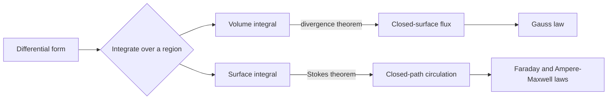

# Gradient, Divergence, Curl, and Integral Theorems

Maxwell's equations use two dialects of vector calculus. The differential dialect describes what fields do at a point: divergence detects sources and sinks, curl detects local circulation, and gradient points in the direction of fastest scalar increase. The integral dialect describes accumulated behavior over paths, surfaces, and volumes: voltage, flux, circulation, and total enclosed charge or current.

The two dialects are equivalent when fields are sufficiently smooth, but each highlights different physics. Gauss's law is often easiest as a flux integral when symmetry is high; Faraday's law is often clearest as a circulation integral when a changing magnetic flux threads a loop. The same tools recur throughout applied electromagnetics and in [vector differential calculus](/math/engineering-math/vector-differential-calculus) and [vector integral calculus](/math/engineering-math/vector-integral-calculus).

## What the operators measure locally

For a scalar field $V(x,y,z)$, the gradient is

$$
\nabla V=\frac{\partial V}{\partial x}\hat x+\frac{\partial V}{\partial y}\hat y+\frac{\partial V}{\partial z}\hat z.
$$

It points in the direction of maximum increase of $V$. The directional derivative in direction $\hat a$ is

$$
\frac{dV}{dl}=\nabla V\cdot\hat a.
$$

For a vector field $\vec A=A_x\hat x+A_y\hat y+A_z\hat z$, divergence is

$$
\nabla\cdot\vec A=
\frac{\partial A_x}{\partial x}
+\frac{\partial A_y}{\partial y}
+\frac{\partial A_z}{\partial z}.
$$

Divergence measures net outward flux density from an infinitesimal volume. Curl is

$$
\nabla\times\vec A=
\begin{vmatrix}
\hat x & \hat y & \hat z\\
\partial/\partial x & \partial/\partial y & \partial/\partial z\\
A_x & A_y & A_z
\end{vmatrix}.
$$

Curl measures local circulation density. The Laplacian of a scalar is

$$
\nabla^2 V=\nabla\cdot(\nabla V).
$$

In Cartesian coordinates,

$$
\nabla^2 V=
\frac{\partial^2 V}{\partial x^2}
+\frac{\partial^2 V}{\partial y^2}
+\frac{\partial^2 V}{\partial z^2}.
$$

The gradient has units of "scalar units per meter." If $V$ is electric potential in volts, then $\nabla V$ has units V/m, matching electric field units. Divergence has units of "vector-field units per meter"; for $\vec D$ in C/m$^2$, $\nabla\cdot\vec D$ has units C/m$^3$, matching volume charge density. Curl also divides by length; for $\vec E$ in V/m, $\nabla\times\vec E$ has units V/m$^2$, matching $-\partial\vec B/\partial t$ because tesla per second is equivalent to V/m$^2$.

Line, surface, and volume integrals are respectively written

$$
\int_C \vec A\cdot d\vec l,\qquad
\int_S \vec A\cdot d\vec S,\qquad
\int_V f\,dv.
$$

The gradient is characterized by the differential

$$
dV=\nabla V\cdot d\vec l.
$$

If $d\vec l$ is constrained to have fixed length, the dot product is largest when the displacement is parallel to $\nabla V$. A level surface satisfies $dV=0$ for every displacement tangent to it, so the gradient is normal to that surface. In electrostatics, $\vec E=-\nabla V$ is therefore perpendicular to equipotential surfaces and points toward decreasing potential.

Divergence can be defined without first choosing coordinates:

$$
\nabla\cdot\vec A=
\lim_{\Delta v\to 0}
\frac{1}{\Delta v}
\oint_{\partial(\Delta v)}\vec A\cdot d\vec S.
$$

It is signed outward flux per unit volume. A spatially uniform field has zero divergence even though the field itself may be large: whatever enters a small box leaves through the opposite face. Conversely, a radial field may have positive divergence because more flux leaves the outer side of a small volume than entered the inner side.

For a surface element with normal $\hat n$, the normal component of curl has the limiting definition

$$
(\nabla\times\vec A)\cdot\hat n=
\lim_{\Delta S\to 0}
\frac{1}{\Delta S}
\oint_{\partial(\Delta S)}\vec A\cdot d\vec l.
$$

Thus curl records oriented circulation per unit area. The paddle-wheel picture is helpful only when used carefully: shear can rotate a small wheel even when field lines are not circular, and circular-looking field lines do not alone determine the value of curl.

## From local measurements to finite regions

The divergence theorem converts a closed-surface flux integral into a volume integral:

$$
\oint_S \vec A\cdot d\vec S=\int_V \nabla\cdot\vec A\,dv.
$$

Stokes's theorem converts a closed-path circulation integral into a surface integral of curl:

$$
\oint_C \vec A\cdot d\vec l=\int_S(\nabla\times\vec A)\cdot d\vec S.
$$

The orientation matters: the direction of $d\vec S$ and the positive traversal direction around $C$ are connected by the right-hand rule.

A useful proof sketch for the divergence theorem starts by dividing a volume into many tiny cells. Flux through every shared interior face appears twice with opposite normals and cancels. Only flux through the exterior boundary remains. Within each small cell, outward flux is approximately $(\nabla\cdot\vec A)\Delta v$. Summing and taking the limit produces the volume integral.

Stokes's theorem has the same cancellation structure one dimension lower. Tile a surface with small oriented patches. Line integrals along shared interior edges cancel because neighboring patches traverse each edge in opposite directions. The surviving edges form the outer boundary $C$. Each small circulation is approximately $(\nabla\times\vec A)\cdot\hat n\,\Delta S$.

The surface spanning $C$ need not be flat. If two surfaces share the same boundary and the field is smooth throughout the volume between them, their curl-flux integrals agree. Applying the divergence theorem to $\nabla\times\vec A$ gives the reason: $\nabla\cdot(\nabla\times\vec A)=0$. A singularity or excluded hole between the surfaces can invalidate that argument.

Integral forms remain meaningful when a field jumps abruptly across an idealized interface. The differential derivative at the jump may fail to exist as an ordinary function, but a thin pillbox or narrow rectangular loop still yields a boundary condition. Shrinking a Gauss-law pillbox across a surface charge gives a jump in the normal field component. Shrinking a Stokes loop across a surface current gives a jump in the tangential magnetic field. The integral law contains the interface statement without pretending the field is smooth there.

The reverse passage, from an integral law to a differential law, requires the law to hold for every sufficiently small region. A single closed surface with zero net flux does not prove zero divergence at every enclosed point; positive and negative contributions can cancel. If the flux is zero for every small volume, however, the divergence theorem forces the local divergence to vanish wherever the field is regular. The same distinction applies to circulation and curl.

Open and closed surfaces also play different roles. A flux through an open surface depends on which surface was chosen. A closed surface has no boundary curve and uses an outward normal by convention. Stokes's theorem applies to an open oriented surface together with its boundary; the divergence theorem applies to the closed boundary of a volume. Confusing those geometries often leads to a missing cap surface or an undefined orientation.

Three identities appear repeatedly in electromagnetics:

$$
\nabla\times(\nabla V)=0,
$$

$$
\nabla\cdot(\nabla\times\vec A)=0,
$$

and

$$
\nabla\cdot(f\vec A)=f\nabla\cdot\vec A+\vec A\cdot\nabla f.
$$

The first identity explains why electrostatic fields can be written as $\vec E=-\nabla V$ when $\nabla\times\vec E=0$. The second identity explains why a magnetic flux density can be written as $\vec B=\nabla\times\vec A$ because it automatically satisfies $\nabla\cdot\vec B=0$.

Both implications have topological qualifications. A smooth curl-free field has a potential globally only on a simply connected region, or more generally when every closed-loop circulation vanishes. On the punctured plane, the azimuthal field $\vec A=\hat\phi/\rho$ has zero curl away from the origin but circulation $2\pi$ around any loop enclosing the missing point. Local differentiation cannot detect a singularity outside its domain.

The product and chain rules remain active whenever $\nabla$ acts. Two identities useful in field derivations are

$$
\nabla\times(f\vec A)=\nabla f\times\vec A+f(\nabla\times\vec A),
$$

and

$$
\nabla^2(fg)=f\nabla^2g+g\nabla^2f+2\nabla f\cdot\nabla g.
$$

Treating $\nabla$ as an ordinary algebraic vector and moving it through spatially varying material parameters loses these terms. For example, $\nabla\cdot(\epsilon\nabla V)$ equals $\epsilon\nabla^2V$ only where $\epsilon$ is constant.

The best way to remember the physical roles is by testing small regions. Divergence asks whether more field leaves a tiny closed surface than enters it. Curl asks whether the field tends to push a tiny paddle wheel into rotation. Gradient asks which direction a scalar increases fastest. These tests are qualitative, but they prevent many sign and operator mistakes when reading Maxwell's equations.

Integral theorems also clarify when local and global statements can be exchanged. If $\nabla\cdot\vec D=\rho_v$ everywhere inside a volume except at an isolated point charge, the point must be handled as a singular source or by enclosing it in a small surface. Smooth-field assumptions are often hidden in short derivations, but electromagnetic point sources and surface currents frequently create discontinuities that need boundary conditions.

Curvilinear coordinates change the formulas because the unit vectors and scale factors vary. For example, cylindrical divergence is

$$
\nabla\cdot\vec A=
\frac{1}{\rho}\frac{\partial}{\partial \rho}(\rho A_\rho)
+\frac{1}{\rho}\frac{\partial A_\phi}{\partial \phi}
+\frac{\partial A_z}{\partial z}.
$$

Spherical divergence is

$$
\nabla\cdot\vec A=
\frac{1}{r^2}\frac{\partial}{\partial r}(r^2 A_r)
+\frac{1}{r\sin\theta}\frac{\partial}{\partial\theta}(A_\theta\sin\theta)
+\frac{1}{r\sin\theta}\frac{\partial A_\phi}{\partial\phi}.
$$

These forms are not memorization trivia; they encode the expanding area of cylindrical and spherical shells.

The limiting definitions connect local operators to measured quantities. Divergence is closed flux divided by shrinking volume. Curl is circulation divided by shrinking area. Gradient is the vector satisfying $dV=\nabla V\cdot d\vec l$. The integral theorems are the finite-region versions of those local measurements.

## An operator map

| Operator | Input | Output | Physical reading in EM |
|---|---|---|---|
| $\nabla V$ | scalar | vector | Field from potential, steepest change |
| $\nabla\cdot\vec A$ | vector | scalar | Source density or flux expansion |
| $\nabla\times\vec A$ | vector | vector | Circulation density |
| $\nabla^2 V$ | scalar | scalar | Curvature, Poisson/Laplace equations |
| $\oint_C\vec A\cdot d\vec l$ | vector on path | scalar | Circulation, voltage-like integral |
| $\oint_S\vec A\cdot d\vec S$ | vector on surface | scalar | Flux through a closed surface |

## Worked example: gradient and directional derivative

Problem: Let $V(x,y,z)=3x^2y+yz^2$. Find $\nabla V$ at $(1,2,-1)$ and the directional derivative in the direction $\hat a=(2\hat x+\hat y+2\hat z)/3$.

Step 1: Differentiate with respect to each coordinate:

$$
\begin{aligned}
\frac{\partial V}{\partial x} &= 6xy,\\
\frac{\partial V}{\partial y} &= 3x^2+z^2,\\
\frac{\partial V}{\partial z} &= 2yz.
\end{aligned}
$$

Step 2: Evaluate at $(1,2,-1)$:

$$
\nabla V=12\hat x+4\hat y-4\hat z.
$$

Step 3: Dot with $\hat a$:

$$
\frac{dV}{dl}=(12\hat x+4\hat y-4\hat z)\cdot
\frac{2\hat x+\hat y+2\hat z}{3}.
$$

Step 4: Compute:

$$
\frac{dV}{dl}=\frac{24+4-8}{3}=\frac{20}{3}.
$$

Check: The maximum possible directional derivative is $\vert \nabla V\vert =\sqrt{12^2+4^2+(-4)^2}=13.3$, and $20/3=6.67$ is less than that.

## Worked example: verify the divergence theorem for a cube

Problem: For $\vec A=x\hat x+y\hat y+z\hat z$, verify the divergence theorem over the cube $0\le x,y,z\le a$.

Step 1: Compute divergence:

$$
\nabla\cdot\vec A=
\frac{\partial x}{\partial x}+\frac{\partial y}{\partial y}+\frac{\partial z}{\partial z}=3.
$$

Step 2: Integrate over the cube volume:

$$
\int_V \nabla\cdot\vec A\,dv=\int_0^a\int_0^a\int_0^a 3\,dx\,dy\,dz=3a^3.
$$

Step 3: Compute flux through faces. At $x=a$, $\vec A\cdot\hat x=a$, so flux is $a\cdot a^2=a^3$. At $x=0$, $\vec A\cdot(-\hat x)=-x=0$, so flux is zero.

Step 4: By symmetry, the $y=a$ and $z=a$ faces each contribute $a^3$, while the $y=0$ and $z=0$ faces contribute zero.

Step 5: Total closed-surface flux:

$$
\oint_S\vec A\cdot d\vec S=a^3+a^3+a^3=3a^3.
$$

Check: The surface and volume results agree, so the divergence theorem holds for this field and region.

## Worked example: verify Stokes's theorem on a disk

Let

$$
\vec A=-y\hat x+x\hat y,
$$

and let $C$ be the circle $x^2+y^2=a^2$ in the $z=0$ plane, traversed counterclockwise when viewed from $+z$. Use the flat disk as the spanning surface.

Parameterize the boundary by

$$
\vec r(\phi)=a\cos\phi\,\hat x+a\sin\phi\,\hat y,
\qquad 0\le\phi\le2\pi.
$$

Then

$$
d\vec l=
(-a\sin\phi\,\hat x+a\cos\phi\,\hat y)d\phi,
$$

and the field along the circle is

$$
\vec A=
-a\sin\phi\,\hat x+a\cos\phi\,\hat y.
$$

The circulation is therefore

$$
\begin{aligned}
\oint_C\vec A\cdot d\vec l
&=\int_0^{2\pi}
a^2(\sin^2\phi+\cos^2\phi)\,d\phi\\
&=2\pi a^2.
\end{aligned}
$$

Now calculate the curl:

$$
\begin{aligned}
\nabla\times\vec A
&=\left(\frac{\partial A_y}{\partial x}
-\frac{\partial A_x}{\partial y}\right)\hat z\\
&=(1-(-1))\hat z=2\hat z.
\end{aligned}
$$

The chosen counterclockwise boundary orientation corresponds by the right-hand rule to $d\vec S=\hat z\,dS$. Hence

$$
\int_S(\nabla\times\vec A)\cdot d\vec S
=\int_S2\,dS
=2\pi a^2,
$$

matching the boundary integral. Reversing the traversal direction would require using the $-\hat z$ surface normal; changing only one of them creates a sign error.

## Curvilinear coordinates without blind memorization

Cartesian formulas are short because the basis vectors have fixed directions and unit scale factors. In orthogonal curvilinear coordinates $(u_1,u_2,u_3)$, a small displacement has the form

$$
d\vec l=h_1du_1\hat a_1+h_2du_2\hat a_2+h_3du_3\hat a_3,
$$

where $h_i$ are scale factors. From $dV=\nabla V\cdot d\vec l$,

$$
\nabla V=
\sum_{i=1}^3\frac{1}{h_i}
\frac{\partial V}{\partial u_i}\hat a_i.
$$

The differential volume is $dv=h_1h_2h_3,du_1du_2du_3$. The face normal to $u_1$ has area $h_2h_3,du_2du_3$, and cyclic permutations give the other faces. Applying the small-volume flux definition yields

$$
\nabla\cdot\vec A=
\frac{1}{h_1h_2h_3}
\left[
\frac{\partial}{\partial u_1}(h_2h_3A_1)
+\frac{\partial}{\partial u_2}(h_3h_1A_2)
+\frac{\partial}{\partial u_3}(h_1h_2A_3)
\right].
$$

For cylindrical coordinates $(\rho,\phi,z)$, the scale factors are $(1,\rho,1)$. The factor $\rho$ accounts for the increasing physical length of an angular interval $d\phi$ at larger radius. For spherical coordinates $(r,\theta,\phi)$, they are $(1,r,r\sin\theta)$; the product $r^2\sin\theta$ produces the familiar volume element. Remembering the geometry of these scale factors is more reliable than treating each operator formula as an unrelated fact.

Coordinate singularities require interpretation. At $\rho=0$, the cylindrical direction $\hat\phi$ is undefined; at the poles, spherical $\hat\phi$ is undefined. A physical vector field can remain smooth there even though one coordinate expression looks singular. Conversely, a field proportional to $1/r^2$ may represent a genuine point singularity. The divergence of $q\hat r/(4\pi r^2)$ is zero for every $r\gt 0$, yet its flux through any sphere enclosing the origin is $q$. In the distributional sense its divergence is $q\delta^{(3)}(\vec r)$.

## Errors that survive algebraic checking

- Using Cartesian formulas in cylindrical or spherical problems without scale factors.
- Forgetting that Stokes's theorem requires a consistent path direction and surface normal.
- Treating $\nabla$ like an ordinary vector in every algebraic context. It is a differential operator, so product rules matter.
- Assuming zero divergence means zero field. It means no local net source, not no field.
- Assuming zero curl means zero field. It means locally conservative in a simply connected region, not necessarily absent.
- Applying integral theorems across singularities without isolating them. Point charges and line currents require care.
- Treating a zero closed integral as proof that the integrand is zero everywhere. Cancellation over a path or surface can hide local structure unless the result holds for every possible region.

See also:

- [Vector differential calculus](/math/engineering-math/vector-differential-calculus) for operator derivations.
- [Vector integral calculus](/math/engineering-math/vector-integral-calculus) for Stokes and divergence theorem details.
- [Gauss law, dielectrics, and boundaries](/physics/electromagnetics/gauss-law-dielectrics-and-boundaries) for flux applications.
- [Maxwell equations for time-varying fields](/physics/electromagnetics/maxwell-equations-time-varying-fields) for the differential and integral Maxwell forms.

