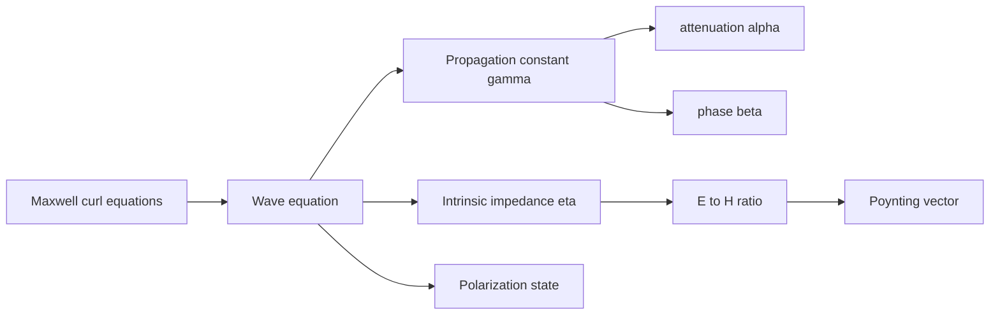

# Plane Waves, Loss, Polarization, and Power

Uniform plane waves are the simplest full electromagnetic waves. The fields are transverse to the direction of propagation, the wavefronts are infinite planes, and the field variation depends on one spatial coordinate. Real antennas and apertures do not create perfect plane waves everywhere, but far from a source or over a small region of a large wavefront, the plane-wave model is often the right local approximation.

The same model connects transmission-line wave impedance to free-space and material intrinsic impedance, and it prepares the calculations used for reflection, refraction, waveguides, antennas, and radar.

## The uniform plane-wave solution

For a time-harmonic uniform plane wave traveling in $+z$ with electric field polarized in $\hat x$,

$$
\tilde{\vec E}(z)=\hat x E_0 e^{-\gamma z},
$$

where

$$
\gamma=\alpha+j\beta.
$$

The magnetic field is

$$
\tilde{\vec H}(z)=\hat y\frac{E_0}{\eta}e^{-\gamma z},
$$

where $\eta$ is the intrinsic impedance:

$$
\eta=\sqrt{\frac{j\omega\mu}{\sigma+j\omega\epsilon}}.
$$

The propagation constant is

$$
\gamma=\sqrt{j\omega\mu(\sigma+j\omega\epsilon)}.
$$

For a lossless medium $(\sigma=0)$,

$$
\alpha=0,\qquad \beta=\omega\sqrt{\mu\epsilon},\qquad
\eta=\sqrt{\frac{\mu}{\epsilon}}.
$$

For a good conductor $(\sigma\gg\omega\epsilon)$,

$$
\alpha\approx\beta\approx\sqrt{\pi f\mu\sigma},
$$

and skin depth is

$$
\delta=\frac{1}{\alpha}.
$$

The time-average Poynting vector is

$$
\langle\vec S\rangle=\frac{1}{2}\mathrm{Re}\{\tilde{\vec E}\times\tilde{\vec H}^*\}.
$$

It gives average power flow density in W/m$^2$.

For a wave traveling in an arbitrary direction $\hat k$, the field directions must satisfy $\tilde{\vec E}\perp\hat k$, $\tilde{\vec H}\perp\hat k$, and $\tilde{\vec H}=(1/\eta)\hat k\times\tilde{\vec E}$ for a lossless medium. This compact vector relation is safer than memorizing separate $x$, $y$, and $z$ cases. It also makes polarization calculations easier because the electric-field vector can be decomposed into any two orthogonal transverse components.

The phasor $e^{-\gamma z}$ corresponds to $e^{j\omega t}$ time dependence. Its real time-domain factor is

$$
e^{-\alpha z}\cos(\omega t-\beta z+\phi).
$$

Constant phase satisfies $\omega t-\beta z=\text{constant}$, so the phase travels toward increasing $z$ at $v_p=\omega/\beta$. Changing the spatial sign to $e^{+\gamma z}$ describes propagation toward decreasing $z$. An inconsistent combination of time convention and spatial sign reverses the inferred direction.

## Obtaining $\gamma$ and $\eta$ from Maxwell's equations

The wave equation in a source-free homogeneous medium follows from the phasor Maxwell curl equations:

$$
\nabla^2\tilde{\vec E}-\gamma^2\tilde{\vec E}=0,
$$

with the same form for $\tilde{\vec H}$. A uniform plane wave is transverse:

$$
\tilde{\vec E}\cdot\hat k=0,\qquad \tilde{\vec H}\cdot\hat k=0,
$$

and the propagation direction is set by

$$
\tilde{\vec E}\times\tilde{\vec H}.
$$

For the $+z$ wave with $\tilde{\vec E}=\hat x E_x(z)$, Faraday's law gives

$$
\frac{dE_x}{dz}=-\gamma E_x
\quad\Longrightarrow\quad
\tilde{\vec H}=\hat y\frac{E_x}{\eta}.
$$

Substitution into both curl equations yields

$$
\gamma^2=j\omega\mu(\sigma+j\omega\epsilon),
\qquad
\eta^2=\frac{j\omega\mu}{\sigma+j\omega\epsilon}.
$$

Writing $\gamma=\alpha+j\beta$ and equating real and imaginary parts gives exact expressions for real $\epsilon$, $\mu$, and $\sigma$:

$$
\alpha=omega\sqrt{\frac{\mu\epsilon}{2}}
\left[
\sqrt{1+\left(\frac{\sigma}{\omega\epsilon}\right)^2}-1
\right]^{1/2},
$$

$$
\beta=omega\sqrt{\frac{\mu\epsilon}{2}}
\left[
\sqrt{1+\left(\frac{\sigma}{\omega\epsilon}\right)^2}+1
\right]^{1/2}.
$$

These reduce smoothly to the lossless and good-conductor limits. For a low-loss dielectric with $\sigma/(\omega\epsilon)\ll1$, a binomial expansion gives

$$
\alpha\approx\frac{\sigma}{2}\sqrt{\frac{\mu}{\epsilon}},
\qquad
\beta\approx\omega\sqrt{\mu\epsilon}.
$$

For a good conductor, the conduction term dominates:

$$
\gamma\approx(1+j)\sqrt{\frac{\omega\mu\sigma}{2}},
\qquad
\eta\approx(1+j)\sqrt{\frac{\omega\mu}{2\sigma}}.
$$

The $45^\circ$ phase of $\eta$ means the electric field leads the magnetic field by $45^\circ$ under the stated convention. The equality $\alpha\approx\beta$ means the amplitude drops by $e^{-2\pi}$ over one wavelength inside a good conductor; very few internal wavelengths survive.

## Power flow and local dissipation

In a lossless medium, $\eta$ is real, so $\vec E$ and $\vec H$ are in time phase. The average power density magnitude is

$$
\langle S\rangle=\frac{|E_0|^2}{2\eta}
$$

for peak phasor amplitude. In a lossy medium, $\eta$ is complex and the fields are not exactly in phase. Power flow decays as $e^{-2\alpha z}$ because power is proportional to field magnitude squared.

Polarization describes the path traced by the electric-field vector at a fixed point. If orthogonal components have zero or $180^\circ$ phase difference, polarization is linear. If equal magnitudes have $\pm90^\circ$ phase difference, it is circular. The general case is elliptical:

$$
\tilde{\vec E}=\hat x E_x+\hat y E_y e^{j\delta}.
$$

The sign of $\delta$ and the viewing convention determine right-hand or left-hand circular polarization. The important engineering rule is to state the convention being used.

Lossy media are often characterized by loss tangent,

$$
\tan\delta_l=\frac{\sigma}{\omega\epsilon}.
$$

Low-loss dielectrics have $\tan\delta_l\ll1$, so conduction current is much smaller than displacement current. Good conductors have $\tan\delta_l\gg1$, so conduction dominates. This ratio is more informative than conductivity alone because the same material can behave differently as frequency changes.

The complex permittivity notation packages conduction loss into an effective material parameter:

$$
\epsilon_c=\epsilon-\frac{j\sigma}{\omega}
$$

for the $e^{j\omega t}$ convention. Then $\sigma+j\omega\epsilon=j\omega\epsilon_c$. This is a bookkeeping device, but it helps compare dielectric and conductive loss in wave equations and reflection formulas.

Polarization mismatch affects received power. If a receiving antenna is linearly polarized along $\hat a_r$ and the incoming electric field is polarized along $\hat a_i$, the received power is multiplied by $\vert \hat a_r\cdot\hat a_i\vert ^2$ for ideal linear polarizations. Orthogonal linear polarizations ideally deliver zero power, while a circularly polarized wave loses half its power into a linearly polarized antenna. Real antennas add axial-ratio and cross-polarization imperfections.

In lossy propagation, phase velocity, attenuation, and impedance can all be frequency dependent. A narrowband sinusoid may be described by one $\gamma$, but a pulse contains many frequencies, each with its own attenuation and phase delay. The resulting waveform distortion is dispersion, and it is important in soil propagation, seawater communication, and broadband dielectric materials.

Attenuation is often reported in dB per meter rather than Np per meter. For field amplitudes,

$$
\alpha_{\mathrm{dB/m}}=20\log_{10}(e)\alpha\approx8.686\alpha.
$$

For power, the same numerical dB loss over distance results from $e^{-2\alpha z}$ because power uses a $10\log_{10}$ ratio. Stating whether $\alpha$ is a field attenuation constant or a power-loss slope prevents double-counting loss.

A final consistency check is the direction of average power flow. For a passive medium with a wave attenuating in $+z$, $\langle\vec S\rangle$ should point in $+z$ and decrease with $z$. If the calculated $\vec E\times\vec H^*$ points backward, the assumed magnetic-field direction or propagation sign is likely reversed.

For the $+z$ wave, average power is

$$
\langle S_z(z)\rangle
=\frac12|E_0|^2e^{-2\alpha z}
\operatorname{Re}\left\{\frac{1}{\eta^*}\right\}.
$$

In a conducting medium, Poynting's theorem relates the decline in this power to Joule heating. For a slab of unit cross-sectional area between $z_1$ and $z_2$, the difference $\langle S_z(z_1)\rangle-\langle S_z(z_2)\rangle$ equals the time-average heat generated in that slab. Attenuation is therefore an energy transfer, not disappearance of energy.

Reactive power also appears when $\eta$ is complex. The imaginary part of the complex Poynting vector describes energy exchanged with local electric and magnetic storage over a cycle. Only its real part is net time-average transport.

## Reading a polarization state

| Medium | Condition | $\alpha$ | $\beta$ | $\eta$ behavior |
|---|---|---:|---:|---|
| Lossless dielectric | $\sigma=0$ | 0 | $\omega\sqrt{\mu\epsilon}$ | real |
| Low-loss dielectric | $\sigma\ll\omega\epsilon$ | small | near lossless value | nearly real |
| Good conductor | $\sigma\gg\omega\epsilon$ | $\sqrt{\pi f\mu\sigma}$ | approximately $\alpha$ | complex, small magnitude |
| Free space | $\epsilon_0,\mu_0,\sigma=0$ | 0 | $\omega/c$ | $377\ \Omega$ |

At a fixed position, write the real electric components as

$$
E_x(t)=A\cos\omega t,
\qquad
E_y(t)=B\cos(\omega t+\delta).
$$

Eliminating time produces the polarization ellipse:

$$
\left(\frac{E_x}{A}\right)^2
+\left(\frac{E_y}{B}\right)^2
-2\frac{E_xE_y}{AB}\cos\delta
=\sin^2\delta.
$$

When $\delta=0$ or $\pi$, the right side vanishes and the ellipse collapses to a line. When $A=B$ and $\delta=\pm\pi/2$, it becomes a circle. Every other nondegenerate case is elliptical. The major-axis direction and axial ratio depend on both amplitude ratio and phase difference; inspecting phase alone is insufficient.

Handedness requires a stated viewpoint. One may describe the rotation seen looking in the direction of propagation or looking back toward the source, and those viewpoints reverse clockwise and counterclockwise. Engineering standards also differ in naming conventions. Recording the phasor, time convention, propagation direction, and viewing direction removes the ambiguity.

Polarization is preserved in a homogeneous isotropic medium because both transverse components see the same propagation constant. Anisotropic materials can give the components different phase velocities, turning linear polarization into elliptical polarization as the wave travels. Differential attenuation can also change the axial ratio.

## Phase, envelopes, and penetration depth

For a single sinusoid, phase velocity is $v_p=\omega/\beta$. A modulated signal or pulse contains a band of frequencies. If the propagation constant varies with frequency, the envelope travels approximately at the group velocity

$$
v_g=\left(\frac{d\beta}{d\omega}\right)^{-1}.
$$

When $\beta$ is proportional to $\omega$, all frequency components accumulate delay in the same proportion and the medium is nondispersive over that band. When $d^2\beta/d\omega^2$ is appreciable, spectral components separate in time and the pulse shape changes. Attenuation that varies with frequency adds another source of distortion. Phase velocity can exceed $c$ in some dispersive ranges without carrying information faster than $c$; causal signal propagation is governed by the full waveform and material response.

Skin depth is an amplitude length scale. At $z=\delta=1/\alpha$, the field amplitude is $e^{-1}$ of its surface value, while the power density is $e^{-2}$ of its surface value. At depth $n\delta$, these factors become $e^{-n}$ and $e^{-2n}$. Calling $\delta$ the depth where current ends is therefore inaccurate; the decay is continuous.

The good-conductor result

$$
\delta=\sqrt{\frac{2}{\omega\mu\sigma}}
$$

shows three trends. Higher frequency confines current nearer the surface. Higher permeability has the same effect. Higher conductivity also reduces penetration even though it reduces resistive loss for a fixed uniform current distribution. At high frequency the available conducting area shrinks, so conductor resistance becomes frequency dependent.

Plane-wave fields inside a good conductor have locally comparable attenuation and phase constants. Over one skin depth, phase advances by roughly one radian as amplitude falls by $e^{-1}$. This coupled phase and amplitude behavior distinguishes diffusion-like penetration into a conductor from propagation in a lossless dielectric.

## Worked example: plane wave in air

Problem: A $300$ MHz uniform plane wave in air has peak electric-field amplitude $E_0=10\ \mathrm{V/m}$ and travels in $+z$ with $\vec E$ along $\hat x$. Find wavelength, $\beta$, magnetic-field amplitude, and average power density.

Step 1: In air, take $u_p\approx c=3.0\times10^8\ \mathrm{m/s}$:

$$
\lambda=\frac{c}{f}=\frac{3.0\times10^8}{300\times10^6}=1.0\ \mathrm{m}.
$$

Step 2: Phase constant:

$$
\beta=\frac{2\pi}{\lambda}=2\pi\ \mathrm{rad/m}.
$$

Step 3: Intrinsic impedance of air is approximately $\eta_0=377\ \Omega$, so

$$
H_0=\frac{E_0}{\eta_0}=\frac{10}{377}=2.65\times10^{-2}\ \mathrm{A/m}.
$$

Step 4: Direction: $\vec E$ is $\hat x$ and propagation is $+\hat z$, so $\vec H$ must be $\hat y$ because $\hat x\times\hat y=\hat z$.

Step 5: Average power density:

$$
\langle S\rangle=\frac{E_0^2}{2\eta_0}
=\frac{100}{754}=0.133\ \mathrm{W/m^2}.
$$

Check: Units are W/m$^2$, and the power direction is $+\hat z$.

## Worked example: skin depth in copper

Problem: Estimate the skin depth in copper at $f=10$ MHz. Use $\sigma=5.8\times10^7\ \mathrm{S/m}$ and $\mu\approx\mu_0$.

Step 1: For a good conductor,

$$
\alpha\approx\sqrt{\pi f\mu\sigma}.
$$

Step 2: Substitute:

$$
\alpha=\sqrt{\pi(10\times10^6)(4\pi\times10^{-7})(5.8\times10^7)}.
$$

Step 3: Compute the product inside the square root:

$$
\pi(10^7)(4\pi\times10^{-7})(5.8\times10^7)
\approx2.29\times10^9.
$$

Step 4: Square root:

$$
\alpha\approx4.79\times10^4\ \mathrm{m^{-1}}.
$$

Step 5: Skin depth:

$$
\delta=\frac{1}{\alpha}=2.09\times10^{-5}\ \mathrm{m}=20.9\ \mu\mathrm{m}.
$$

Check: Radio-frequency currents in copper are confined to a thin surface layer, so tens of micrometers at 10 MHz is plausible.

## Worked example: identify polarization and mismatch loss

At a fixed point, a wave traveling in $+z$ has phasor

$$
\tilde{\vec E}=3\hat x-j3\hat y\ \mathrm{V/m},
$$

with $e^{j\omega t}$ convention. Find the polarization shape and the fraction of power accepted by an ideal $\hat x$-polarized receiving antenna.

The components have equal magnitudes. Their phases are

$$
\angle E_x=0,
\qquad
\angle E_y=-\frac{\pi}{2}.
$$

Equal orthogonal components in quadrature trace a circle, so the wave is circularly polarized. To see the rotation directly,

$$
\vec E(t)=
3\cos\omega t\,\hat x
+3\sin\omega t\,\hat y.
$$

At $t=0$ the vector points along $+\hat x$; shortly afterward it rotates toward $+\hat y$. A handedness label would additionally state the adopted viewing convention.

The total squared field amplitude is

$$
|\tilde{\vec E}|^2=|3|^2+|-j3|^2=18.
$$

The $\hat x$ antenna selects only the $x$ component, whose squared amplitude is $9$. Therefore the polarization coupling factor is

$$
\frac{|E_x|^2}{|\tilde{\vec E}|^2}
=\frac{9}{18}=\frac12.
$$

The antenna accepts half the available power, corresponding to a polarization mismatch loss of $3.01$ dB.

## Checks that prevent convention errors

- Forgetting that $\vec E$, $\vec H$, and propagation direction form a right-handed triad for a forward plane wave.
- Using rms formulas with peak phasors or peak formulas with rms phasors. The factor of $1/2$ depends on convention.
- Treating attenuation of field amplitude and attenuation of power as the same exponent. Power decays as $e^{-2\alpha z}$.
- Calling any two-component field circularly polarized. Circular polarization requires equal magnitudes and a quadrature phase difference.
- Applying good-conductor approximations when $\sigma$ is not much larger than $\omega\epsilon$.
- Assuming plane waves have longitudinal field components. Uniform plane waves in homogeneous source-free media are transverse.
- Comparing penetration depths at different frequencies without noting that $\delta$ decreases as frequency increases in good conductors.

## Related pages

- [Maxwell equations for time-varying fields](/physics/electromagnetics/maxwell-equations-time-varying-fields) for the wave-equation derivation.
- [Waves, phasors, and spectrum](/physics/electromagnetics/waves-phasors-spectrum) for $\alpha$, $\beta$, $\gamma$, and phasor notation.
- [Wave reflection, fibers, and waveguides](/physics/electromagnetics/reflection-transmission-fibers-waveguides) for what happens at material boundaries.
- [Antennas, radiation, and arrays](/physics/electromagnetics/antennas-radiation-arrays) for far-field waves from sources.
