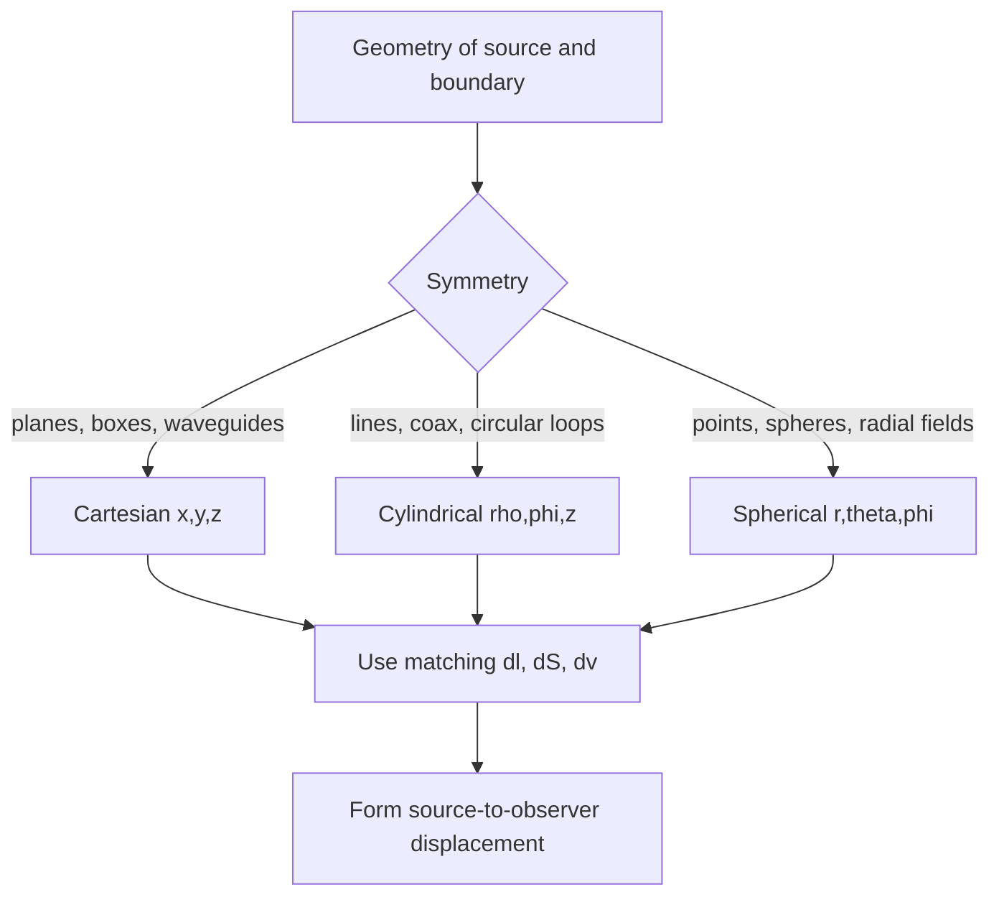

# Vector Algebra and Coordinate Systems

Electromagnetics is a field theory, so most quantities have direction as well as magnitude. The electric field $\vec E$, magnetic field intensity $\vec H$, flux densities $\vec D$ and $\vec B$, current density $\vec J$, force $\vec F$, and area vector $d\vec S$ are all vectors. Before differentiating or integrating fields, we need reliable notation for positions, distances, unit vectors, dot products, cross products, and coordinate transformations.

Multiple coordinate systems are useful because electromagnetic sources have symmetry. A line charge is natural in cylindrical coordinates, a point charge is natural in spherical coordinates, and a rectangular waveguide is natural in Cartesian coordinates. Matching coordinates to geometry can turn a three-component integral into a one-variable calculation. The same notation is developed more formally in [vector differential calculus](/math/engineering-math/vector-differential-calculus).

## Vectors, projections, and orientation

A vector $\vec A$ has magnitude $\vert \vec A\vert $ and direction. In Cartesian coordinates,

$$
\vec A=A_x\hat x+A_y\hat y+A_z\hat z.
$$

The dot product measures projection:

$$
\vec A\cdot \vec B=|\vec A||\vec B|\cos\theta=A_xB_x+A_yB_y+A_zB_z.
$$

The cross product creates a vector normal to the plane of $\vec A$ and $\vec B$:

$$
\vec A\times \vec B=
\begin{vmatrix}
\hat x & \hat y & \hat z\\
A_x & A_y & A_z\\
B_x & B_y & B_z
\end{vmatrix}.
$$

Its magnitude is $\vert \vec A\vert \vert \vec B\vert \sin\theta$, and its direction follows the right-hand rule.

The component of $\vec A$ along a unit vector $\hat u$ is the scalar projection $\vec A\cdot\hat u$. The corresponding vector projection is

$$
\operatorname{proj}_{\hat u}\vec A
=(\vec A\cdot\hat u)\hat u.
$$

Subtracting it leaves the component perpendicular to $\hat u$. This decomposition occurs at material interfaces, where fields are split into normal and tangential parts:

$$
\vec A_n=(\vec A\cdot\hat n)\hat n,
\qquad
\vec A_t=\vec A-\vec A_n.
$$

The cross product is oriented area. If adjacent sides of a parallelogram are $\vec a$ and $\vec b$, then $\vec a\times\vec b$ points normal to the plane and has magnitude equal to the area. Reversing the order reverses the normal. This supplies the direction of differential surface vectors and fixes flux signs.

Dot and cross products are geometric quantities, independent of the coordinate system used to compute them. Components change under a basis transformation, but $\vec A\cdot\vec B$, $\vert \vec A\vert $, and the physical direction of $\vec A\times\vec B$ do not.

## Coordinates and metric factors

The position vector in Cartesian coordinates is

$$
\vec r=x\hat x+y\hat y+z\hat z.
$$

In cylindrical coordinates $(\rho,\phi,z)$,

$$
\vec r=\rho\hat \rho+z\hat z,\qquad x=\rho\cos\phi,\qquad y=\rho\sin\phi.
$$

In spherical coordinates $(r,\theta,\phi)$, where $\theta$ is measured from $+z$ and $\phi$ in the $x$-$y$ plane,

$$
x=r\sin\theta\cos\phi,\qquad y=r\sin\theta\sin\phi,\qquad z=r\cos\theta.
$$

The differential lengths are

$$
\begin{aligned}
d\vec l_{\text{cart}} &= dx\hat x+dy\hat y+dz\hat z,\\
d\vec l_{\text{cyl}} &= d\rho\hat\rho+\rho d\phi\hat\phi+dz\hat z,\\
d\vec l_{\text{sph}} &= dr\hat r+r d\theta\hat\theta+r\sin\theta d\phi\hat\phi.
\end{aligned}
$$

The corresponding volume elements are

$$
dv_{\text{cart}}=dx\,dy\,dz,\qquad
dv_{\text{cyl}}=\rho\,d\rho\,d\phi\,dz,\qquad
dv_{\text{sph}}=r^2\sin\theta\,dr\,d\theta\,d\phi.
$$

These extra factors are scale factors. Cartesian coordinates have scale factors $1,1,1$. Cylindrical coordinates have $1,\rho,1$, because moving through a small azimuthal angle $d\phi$ traces an arc length $\rho d\phi$. Spherical coordinates have $1,r,r\sin\theta$, because angular motion traces arcs whose radii depend on position. Whenever an integral looks suspiciously too simple in cylindrical or spherical coordinates, the missing scale factor is the first thing to check.

Coordinate singularities are not physical singularities by themselves. At $\rho=0$, the unit vectors $\hat\rho$ and $\hat\phi$ are not uniquely defined because every azimuth points to the same axis. At $r=0$, spherical angular directions are undefined. A field may be perfectly finite at these locations even if the coordinate description is awkward, so distinguish coordinate artifacts from actual point sources or infinite field values.

## Rotating bases and component transformations

Coordinate unit vectors in curvilinear systems depend on position. In cylindrical coordinates,

$$
\hat \rho=\cos\phi\hat x+\sin\phi\hat y,\qquad
\hat \phi=-\sin\phi\hat x+\cos\phi\hat y.
$$

In spherical coordinates,

$$
\begin{aligned}
\hat r &= \sin\theta\cos\phi\hat x+\sin\theta\sin\phi\hat y+\cos\theta\hat z,\\
\hat \theta &= \cos\theta\cos\phi\hat x+\cos\theta\sin\phi\hat y-\sin\theta\hat z,\\
\hat \phi &= -\sin\phi\hat x+\cos\phi\hat y.
\end{aligned}
$$

Distance vectors should be built carefully. If a source point is $\vec r'$ and an observation point is $\vec r$, the separation vector is

$$
\vec R=\vec r-\vec r',
$$

with magnitude $R=\vert \vec R\vert $ and direction $\hat R=\vec R/R$. Coulomb and Biot-Savart integrals repeatedly use this construction. A common error is to subtract coordinates in cylindrical or spherical form without accounting for changing unit vectors; when in doubt, convert to Cartesian components, subtract, then convert back if useful.

For areas, the vector direction is essential. Examples include

$$
d\vec S_{\rho}=\rho d\phi dz\,\hat\rho,\qquad
d\vec S_{r}=r^2\sin\theta d\theta d\phi\,\hat r.
$$

The sign of flux integrals depends on choosing the outward normal for closed surfaces or the normal specified by the right-hand rule for open surfaces bounded by a contour.

The unit-vector transformations also provide a reliable way to transform vector components. A physical vector does not change when coordinates change, but its component list does. For example, a vector in the $x$ direction has cylindrical components that vary with $\phi$ because

$$
\hat x=\cos\phi\hat\rho-\sin\phi\hat\phi.
$$

This position dependence explains why differentiating vector fields in cylindrical and spherical coordinates is more complicated than differentiating their scalar component functions.

Component transformations follow from projections. If

$$
\vec A=A_x\hat x+A_y\hat y+A_z\hat z
=A_\rho\hat\rho+A_\phi\hat\phi+A_z\hat z,
$$

then

$$
\begin{aligned}
A_\rho&=\vec A\cdot\hat\rho=A_x\cos\phi+A_y\sin\phi,\\
A_\phi&=\vec A\cdot\hat\phi=-A_x\sin\phi+A_y\cos\phi.
\end{aligned}
$$

The inverse relations are

$$
\begin{aligned}
A_x&=A_\rho\cos\phi-A_\phi\sin\phi,\\
A_y&=A_\rho\sin\phi+A_\phi\cos\phi.
\end{aligned}
$$

These equations form an orthogonal rotation, so they preserve magnitude: $A_x^2+A_y^2=A_\rho^2+A_\phi^2$. The cylindrical components of a fixed Cartesian vector vary with position because the basis rotates, not because the physical vector has changed.

## Differentiating a rotating basis

In Cartesian coordinates the basis vectors are constant. Cylindrical and spherical unit vectors rotate as the angular coordinates change. Differentiating the cylindrical definitions gives

$$
\frac{\partial\hat\rho}{\partial\phi}=\hat\phi,
\qquad
\frac{\partial\hat\phi}{\partial\phi}=-\hat\rho.
$$

Suppose a particle follows a circular path with fixed $\rho$ and $z$, so its velocity is $\vec v=\rho\dot\phi\hat\phi$. Differentiating requires the basis derivative:

$$
\begin{aligned}
\vec a
&=\frac{d}{dt}(\rho\dot\phi\hat\phi)\\
&=\rho\ddot\phi\hat\phi
+\rho\dot\phi\frac{d\hat\phi}{dt}\\
&=\rho\ddot\phi\hat\phi
-\rho\dot\phi^2\hat\rho.
\end{aligned}
$$

The inward centripetal term comes entirely from the changing direction of $\hat\phi$. Similar basis derivatives generate the extra terms in cylindrical and spherical divergence, curl, and vector Laplacian formulas. Differentiating only component functions discards real geometric variation.

The spherical basis depends on both angles. Useful derivatives include

$$
\frac{\partial\hat r}{\partial\theta}=\hat\theta,
\qquad
\frac{\partial\hat r}{\partial\phi}=\sin\theta\,\hat\phi,
$$

$$
\frac{\partial\hat\theta}{\partial\theta}=-\hat r,
\qquad
\frac{\partial\hat\phi}{\partial\phi}
=-\sin\theta\,\hat r-\cos\theta\,\hat\theta.
$$

These relations are better derived from the Cartesian expansions when needed than memorized without context.

## Source and observation points

Field integrals use two positions at once. The primed coordinate $\vec r'$ labels a source element; the unprimed coordinate $\vec r$ is where the field is evaluated. During integration, $\vec r$ is fixed and $\vec r'$ varies across the source. The separation vector

$$
\vec R=\vec r-\vec r'
$$

always points from source to observer. Its sign matters in Coulomb's law and the Biot-Savart law.

For two points expressed in cylindrical coordinates, the squared distance can be found without transforming every component:

$$
R^2=\rho^2+\rho'^2
-2\rho\rho'\cos(\phi-\phi')
+(z-z')^2.
$$

The first three terms are the planar law of cosines. In spherical coordinates, if $\gamma$ is the angle between $\hat r$ and $\hat r'$, then

$$
R^2=r^2+r'^2-2rr'\cos\gamma,
$$

with

$$
\cos\gamma
=\cos\theta\cos\theta'
+\sin\theta\sin\theta'\cos(\phi-\phi').
$$

These formulas give distance, but not the components of $\vec R$. When a vector direction is required, Cartesian subtraction remains the least error-prone route unless symmetry supplies the direction directly.

## Handedness and notation conventions

All three bases used here are right-handed:

$$
\hat x\times\hat y=\hat z,
\qquad
\hat\rho\times\hat\phi=\hat z,
\qquad
\hat r\times\hat\theta=\hat\phi.
$$

Cyclic permutations preserve the sign, while exchanging two factors reverses it. From the spherical relation, for example, $\hat\theta\times\hat\phi=\hat r$ and $\hat r\times\hat\phi=-\hat\theta$. Checking handedness is faster than expanding a determinant for products of local unit vectors.

Spherical angle notation is not universal. Many physics and electromagnetics texts use $\theta$ for polar angle and $\phi$ for azimuth, as done here. Some mathematics sources interchange the symbols. A formula copied across conventions may still look plausible while placing $\sin\theta$ on the wrong coordinate. The defining Cartesian relations should accompany any calculation where the convention is uncertain.

Angles also need ranges. A standard one-to-one representation away from coordinate singularities is

$$
0\le r<\infty,
\qquad
0\le\theta\le\pi,
\qquad
0\le\phi<2\pi.
$$

Allowing negative $r$ or unrestricted angles creates multiple coordinate triples for the same point. Periodicity at $\phi=0$ and $2\pi$ must be respected in boundary conditions.

A basis change is a passive transformation: the geometric vector stays fixed while its components change. An active rotation instead changes the physical vector relative to a fixed basis. The same rotation matrix can describe both operations, often with an inverse or transpose between them. Keeping those interpretations separate prevents sign errors when coordinate transformations are combined with actual rotations of sources or fields.

Orthogonal curvilinear coordinates keep the local basis vectors mutually perpendicular and normalized. They do not make coordinate lines straight or make scale factors equal to one. Dot products of local components retain the Cartesian-looking form only because the basis is orthonormal at each point.

Triple products appear often in force and power manipulations:

$$
\vec A\cdot(\vec B\times\vec C)=\vec B\cdot(\vec C\times\vec A),
$$

and

$$
\vec A\times(\vec B\times\vec C)=\vec B(\vec A\cdot\vec C)-\vec C(\vec A\cdot\vec B).
$$

These identities are not decorative; they simplify torque, magnetic force, and Poynting vector expressions.

As a final check, every coordinate choice should preserve physical length, area, volume, and direction. If two coordinate descriptions give different distances or fluxes for the same geometry, the error is in the representation, not in the physics.

## Choosing coordinates from symmetry

| Coordinate system | Best for | Length element | Volume element |
|---|---|---|---|
| Cartesian | planes, rectangular cavities, waveguides | $dx\hat x+dy\hat y+dz\hat z$ | $dx\,dy\,dz$ |
| Cylindrical | wires, coax, circular loops | $d\rho\hat\rho+\rho d\phi\hat\phi+dz\hat z$ | $\rho\,d\rho\,d\phi\,dz$ |
| Spherical | point charges, spheres, radiation distance | $dr\hat r+r d\theta\hat\theta+r\sin\theta d\phi\hat\phi$ | $r^2\sin\theta\,dr\,d\theta\,d\phi$ |

Coordinate choice should follow both the source and the boundary. A point charge inside a rectangular enclosure has a spherical-looking source but Cartesian boundaries, so no single coordinate system removes all difficulty. Symmetry is useful only when the full problem, including material interfaces and boundary conditions, shares it.

## Building line, area, and volume elements

The differential length element lists the physical displacement caused by changing each coordinate. Setting two coordinate differentials to zero isolates a coordinate line. In cylindrical coordinates, for example, a circle at fixed $\rho$ and $z$ has

$$
d\vec l=\rho,d\phi\,\hat\phi.
$$

Its circumference follows without a memorized formula:

$$
L=\int_0^{2\pi}\rho\,d\phi=2\pi\rho.
$$

An area element comes from the cross product of two differential edge vectors. On the cylindrical surface $\rho=\rho_0$, the edges are $\rho_0d\phi\,\hat\phi$ and $dz\,\hat z$, so

$$
d\vec S=(\rho_0d\phi\,\hat\phi)\times(dz\,\hat z)
=\rho_0d\phi\,dz\,\hat\rho.
$$

On a surface of constant spherical angle $\theta=	heta_0$, the edges along $r$ and $\phi$ give an area magnitude $r\sin\theta_0,dr,d\phi$. Its normal is $\pm\hat\theta$, with sign chosen by the required orientation. Constant-coordinate surfaces therefore have different area factors; there is no single spherical $dS$ valid for every surface.

The volume element is the scalar triple product of the three differential edge vectors. In an orthogonal system with scale factors $h_1,h_2,h_3$,

$$
dv=h_1h_2h_3,du_1du_2du_3.
$$

This product is the Jacobian of the coordinate transformation. In cylindrical coordinates it is $\rho$; in spherical coordinates it is $r^2\sin\theta$. A zero Jacobian at an axis or pole signals coordinate degeneracy.

## Worked example: distance vector in cylindrical coordinates

Problem: A source point is at $(\rho',\phi',z')=(2,30^\circ,1)$ m and an observation point is at $(\rho,\phi,z)=(5,120^\circ,4)$ m. Find $\vec R=\vec r-\vec r'$ and $R$.

Step 1: Convert each point to Cartesian coordinates. For the observation point,

$$
\begin{aligned}
x&=5\cos120^\circ=-2.5,\\
y&=5\sin120^\circ=4.330,\\
z&=4.
\end{aligned}
$$

For the source point,

$$
\begin{aligned}
x'&=2\cos30^\circ=1.732,\\
y'&=2\sin30^\circ=1.000,\\
z'&=1.
\end{aligned}
$$

Step 2: Subtract coordinates:

$$
\vec R=(-2.5-1.732)\hat x+(4.330-1.000)\hat y+(4-1)\hat z.
$$

Thus

$$
\vec R=-4.232\hat x+3.330\hat y+3\hat z\ \mathrm{m}.
$$

Step 3: Compute magnitude:

$$
R=\sqrt{(-4.232)^2+(3.330)^2+3^2}=6.16\ \mathrm{m}.
$$

Check: The vertical difference alone is $3$ m, so a total distance of $6.16$ m is plausible.

## Worked example: surface area of a spherical cap

Problem: Find the area of the spherical surface $r=a$ between $0\le\theta\le\theta_0$ and $0\le\phi\le2\pi$.

Step 1: Use the spherical area element normal to $\hat r$:

$$
dS=a^2\sin\theta\,d\theta\,d\phi.
$$

Step 2: Integrate over the cap:

$$
S=\int_0^{2\pi}\int_0^{\theta_0}a^2\sin\theta\,d\theta\,d\phi.
$$

Step 3: Evaluate the inner integral:

$$
\int_0^{\theta_0}\sin\theta\,d\theta
=\left[-\cos\theta\right]_0^{\theta_0}
=1-\cos\theta_0.
$$

Step 4: Evaluate the outer integral:

$$
S=2\pi a^2(1-\cos\theta_0).
$$

Check: If $\theta_0=\pi$, the cap is the full sphere and $S=2\pi a^2(1-\cos\pi)=4\pi a^2$.

## Worked example: transform vector components

At a point whose cylindrical azimuth is $\phi=60^\circ$, a vector has Cartesian form

$$
\vec A=4\hat x+2\hat y-\hat z.
$$

The radial component is

$$
\begin{aligned}
A_\rho
&=A_x\cos\phi+A_y\sin\phi\\
&=4\left(\frac12\right)
+2\left(\frac{\sqrt3}{2}\right)\\
&=2+\sqrt3.
\end{aligned}
$$

The azimuthal component is

$$
\begin{aligned}
A_\phi
&=-A_x\sin\phi+A_y\cos\phi\\
&=-4\left(\frac{\sqrt3}{2}\right)
+2\left(\frac12\right)\\
&=1-2\sqrt3.
\end{aligned}
$$

The $z$ basis vector is shared by both systems, so $A_z=-1$. Therefore

$$
\vec A=(2+\sqrt3)\hat\rho
+(1-2\sqrt3)\hat\phi-\hat z.
$$

Check magnitude in Cartesian form:

$$
|\vec A|^2=4^2+2^2+(-1)^2=21.
$$

In cylindrical form,

$$
(2+\sqrt3)^2+(1-2\sqrt3)^2+(-1)^2=21.
$$

The preserved norm confirms that the transformation changed only the component description.

## Coordinate mistakes that propagate

- Treating $\hat\rho$, $\hat\phi$, $\hat r$, and $\hat\theta$ as constant everywhere. They rotate with position.
- Omitting metric factors such as $\rho$, $r$, and $r\sin\theta$ from differential lengths, areas, or volumes.
- Using $\theta$ as the azimuth angle in spherical coordinates. In the convention used here, $\theta$ is measured down from $+z$ and $\phi$ is azimuth.
- Forgetting that $d\vec S$ has direction. Flux signs depend on the chosen normal.
- Subtracting curvilinear coordinate triples directly to form distance vectors.
- Reversing cross-product order. $\vec A\times\vec B=-(\vec B\times\vec A)$.
- Assuming a coordinate transformation changes the physical vector. Only the basis and component representation change.

## Related pages

- [Vector differential calculus](/math/engineering-math/vector-differential-calculus) for gradient, divergence, and curl.
- [Vector integral calculus](/math/engineering-math/vector-integral-calculus) for line, surface, and volume integrals.
- [Electrostatic fields and potential](/physics/electromagnetics/electrostatic-fields-and-potential) for source-to-observer vectors in Coulomb integrals.
- [Magnetostatic forces and Ampere law](/physics/electromagnetics/magnetostatic-forces-biot-savart-ampere) for cross products in magnetic force and Biot-Savart law.
