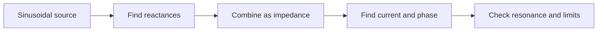

# AC Circuits and Electromagnetic Waves

Sinusoidal sources make circuit response frequency-dependent. Resistors dissipate energy, while inductors and capacitors store energy and return it to the circuit. The same Maxwell equations that describe those circuit elements also admit self-propagating electric and magnetic fields: electromagnetic waves.

## Sinusoidal steady state

Write an AC voltage as

$$
v(t)=V_0\cos(\omega t+\phi),
$$

where $V_0$ is the peak voltage. For a sinusoid,

$$
V_{\mathrm{rms}}=\frac{V_0}{\sqrt{2}},
\qquad
I_{\mathrm{rms}}=\frac{I_0}{\sqrt{2}}.
$$

RMS values give the same average resistive heating as the corresponding DC values. Peak and RMS values cannot be mixed in one calculation.

The RMS rule follows by averaging the square of a sinusoid over one period $T=2\pi/\omega$:

$$
\begin{aligned}
V_{\mathrm{rms}}^2
&=\frac1T\int_0^T V_0^2\cos^2(\omega t+\phi)\,dt\\
&=\frac{V_0^2}{2}.
\end{aligned}
$$

RMS is therefore a square-root-of-mean-square quantity, not an ordinary time average. The ordinary average of $v(t)$ over a cycle is zero.

The frequency-dependent opposition of an ideal inductor or capacitor is its reactance:

$$
X_L=\omega L,
\qquad
X_C=\frac{1}{\omega C}.
$$

Inductive reactance grows with frequency; capacitive reactance falls. In a series RLC circuit the current is common to all three elements, but their voltage drops are not generally in phase and therefore cannot be added as ordinary magnitudes.

## Phasors replace differential equations with algebra

Represent a steady sinusoid by the real part of a complex exponential. If

$$
i(t)=\operatorname{Re}\{I e^{i\omega t}\},
$$

then differentiation multiplies its phasor by $i\omega$ and integration divides by $i\omega$. The element laws become

$$
\begin{array}{c|c|c}
\text{element} & \text{time-domain law} & \text{complex impedance} \\
\hline
R & v=Ri & Z_R=R \\
L & v=L\,di/dt & Z_L=i\omega L \\
C & i=C\,dv/dt & Z_C=1/(i\omega C)=-i/(\omega C)
\end{array}
$$

The imaginary unit records phase. The resistor voltage is in phase with current. The inductor voltage leads current by $90^\circ$, while the capacitor voltage lags current by $90^\circ$. These statements refer to the passive sign convention, with current entering the terminal labeled positive.

Series impedances add as complex numbers:

$$
\mathcal Z=R+i\left(\omega L-\frac1{\omega C}\right).
$$

Its magnitude gives the voltage-to-current amplitude ratio, and its argument gives the phase of source voltage relative to current:

$$
|\mathcal Z|=\sqrt{R^2+(X_L-X_C)^2},
\qquad
\phi=\tan^{-1}\left(\frac{X_L-X_C}{R}\right).
$$

Using $\operatorname{atan2}(X_L-X_C,R)$ rather than an ordinary inverse tangent keeps the quadrant information in more general networks.

## Impedance, phase, and resonance

For a series RLC circuit,

$$
Z=\sqrt{R^2+(X_L-X_C)^2},
\qquad
I_{\mathrm{rms}}=\frac{V_{\mathrm{rms}}}{Z}.
$$

The phase angle between source voltage and current satisfies

$$
\tan\phi=\frac{X_L-X_C}{R}.
$$

At resonance, $X_L=X_C$, so the reactive voltage contributions cancel in the phasor sum. The impedance reaches its minimum value $R$, and the series current reaches its maximum:

$$
\omega_0=\frac{1}{\sqrt{LC}}.
$$

The individual inductor and capacitor voltages need not be small at resonance. They have equal magnitudes and opposite phases, so they cancel at the source terminals. For a lightly damped circuit, each can greatly exceed the applied voltage.

| Quantity | Relation | Quick check |
|---|---|---|
| Inductive reactance | $X_L=\omega L$ | increases with frequency |
| Capacitive reactance | $X_C=1/(\omega C)$ | decreases with frequency |
| Series impedance | $Z=\sqrt{R^2+(X_L-X_C)^2}$ | never smaller than $R$ |
| Resonant frequency | $\omega_0=1/\sqrt{LC}$ | gives $X_L=X_C$ |

Average power is associated with the in-phase part of the response:

$$
P_{\mathrm{avg}}=V_{\mathrm{rms}}I_{\mathrm{rms}}\cos\phi
=I_{\mathrm{rms}}^2R.
$$

An ideal inductor or capacitor has zero average power over a complete cycle even though its instantaneous power is not always zero.

Complex power packages the bookkeeping. With RMS phasors,

$$
\mathcal S=VI^*=P+iQ,
$$

where $P=VI\cos\phi$ is real power in watts and $Q=VI\sin\phi$ is reactive power in volt-amperes reactive. The magnitude $\vert \mathcal S\vert =VI$ is apparent power in volt-amperes. A poor power factor $\cos\phi$ means a larger current is required to deliver the same real power, increasing resistive losses in wiring.

## Resonance width and the quality factor

For a series RLC circuit the current amplitude is

$$
I(\omega)=\frac{V}{\sqrt{R^2+(\omega L-1/\omega C)^2}}.
$$

At the two half-power frequencies, the average resistor power is half its resonant value. Since power is proportional to $I^2$, this occurs when $I=I_{\max}/\sqrt2$, or

$$
\left|\omega L-\frac1{\omega C}\right|=R.
$$

The exact angular-frequency separation is

$$
\Delta\omega=\omega_2-\omega_1=\frac RL.
$$

The series quality factor is

$$
Q=\frac{\omega_0}{\Delta\omega}=\frac{\omega_0L}{R}
=\frac1R\sqrt{\frac LC}.
$$

Large $Q$ means a narrow resonance and large reactive voltages near $\omega_0$. It also means slow decay of the corresponding unforced oscillation. Real coils add winding resistance and parasitic capacitance, so an ideal-element calculation eventually stops matching the hardware.

## A 60 Hz series RLC circuit

A series circuit has $R=40\,\Omega$, $L=0.20\,\mathrm{H}$, $C=50\,\mu\mathrm{F}$, $f=60\,\mathrm{Hz}$, and a $120\,\mathrm{V_{rms}}$ source. With $\omega=2\pi f$,

$$
\begin{aligned}
\omega &=377\,\mathrm{rad/s},\\
X_L&=\omega L=75.4\,\Omega,\\
X_C&=\frac{1}{\omega C}=53.1\,\Omega,\\
Z&=\sqrt{40^2+(75.4-53.1)^2}=45.8\,\Omega.
\end{aligned}
$$

The RMS current is therefore

$$
I_{\mathrm{rms}}=\frac{120}{45.8}=2.62\,\mathrm{A}.
$$

Because $X_L\gt X_C$, the circuit is net inductive and the current lags the source voltage.

Continue the calculation to find the phase, power, and element voltages:

$$
\begin{aligned}
\phi&=\tan^{-1}\left(\frac{75.4-53.1}{40}\right)=29.1^\circ,\\
P_{\mathrm{avg}}&=I_{\mathrm{rms}}^2R=(2.62)^2(40)=275\,\mathrm W,\\
V_R&=IR=(2.62)(40)=104.8\,\mathrm V,\\
V_L&=IX_L=(2.62)(75.4)=197.5\,\mathrm V,\\
V_C&=IX_C=(2.62)(53.1)=139.1\,\mathrm V.
\end{aligned}
$$

The three voltage magnitudes sum to more than $120\,\mathrm V$, which is not a contradiction. Their phasor sum is

$$
\sqrt{V_R^2+(V_L-V_C)^2}
=\sqrt{104.8^2+58.4^2}
\approx120.0\,\mathrm V.
$$

The resonant frequency of the same circuit is

$$
\begin{aligned}
f_0
&=\frac1{2\pi\sqrt{LC}}\\
&=\frac1{2\pi\sqrt{(0.20)(50\times10^{-6})}}\\
&\approx50.3\,\mathrm{Hz}.
\end{aligned}
$$

Since the source is above resonance, the net response is inductive, consistent with the sign of $X_L-X_C$.

## From Maxwell's equations to traveling fields

A changing magnetic field produces an electric field, and a changing electric field produces a magnetic field. In vacuum these coupled fields can propagate without a mechanical medium. Their speed, wavelength, and frequency obey

$$
c=f\lambda,
$$

and the field amplitudes obey

$$
E_0=cB_0.
$$

In empty space, with no free charge or current, Maxwell's curl equations are

$$
\nabla\times\mathbf E=-\frac{\partial\mathbf B}{\partial t},
\qquad
\nabla\times\mathbf B=\mu_0\epsilon_0\frac{\partial\mathbf E}{\partial t}.
$$

Taking the curl of Faraday's law and using $\nabla\cdot\mathbf E=0$ gives

$$
\nabla^2\mathbf E
=\mu_0\epsilon_0\frac{\partial^2\mathbf E}{\partial t^2}.
$$

The magnetic field obeys the same wave equation. Comparison with the standard equation $\nabla^2u=(1/v^2)\partial^2u/\partial t^2$ identifies

$$
c=\frac1{\sqrt{\mu_0\epsilon_0}}.
$$

Maxwell's added displacement-current term $\mu_0\epsilon_0\,\partial\mathbf E/\partial t$ makes Ampère's law consistent with charge conservation and permits this wave solution. Its predicted speed agrees with the measured speed of light, tying optics to electromagnetism.

The electric field, magnetic field, and propagation direction are mutually perpendicular. Radio, microwave, infrared, visible, ultraviolet, X-ray, and gamma radiation differ in frequency and wavelength, not in the basic kind of wave.

For a plane wave moving in the $+x$ direction, one possible polarization is

$$
\mathbf E=E_0\cos(kx-\omega t)\,\hat{\mathbf y},
\qquad
\mathbf B=B_0\cos(kx-\omega t)\,\hat{\mathbf z}.
$$

The direction of energy flow is $\mathbf E\times\mathbf B$. The Poynting vector is

$$
\mathbf S=\frac1{\mu_0}\mathbf E\times\mathbf B,
$$

and the average intensity of a sinusoidal plane wave is

$$
I=\langle S\rangle
=\frac12c\epsilon_0E_0^2
=\frac{c}{2\mu_0}B_0^2.
$$

For a $100\,\mathrm{MHz}$ FM wave,

$$
\lambda=\frac{c}{f}
=\frac{3.00\times10^8\,\mathrm{m/s}}{1.00\times10^8\,\mathrm{Hz}}
=3.00\,\mathrm{m}.
$$

### Worked example: fields from an intensity

Suppose a plane wave has average intensity $I=1.00\,\mathrm{kW/m^2}$. Solve the intensity relation for the peak electric field:

$$
\begin{aligned}
E_0
&=\sqrt{\frac{2I}{c\epsilon_0}}\\
&=\sqrt{\frac{2(1000)}{(3.00\times10^8)(8.85\times10^{-12})}}\\
&\approx868\,\mathrm{V/m}.
\end{aligned}
$$

Then

$$
B_0=\frac{E_0}{c}
=\frac{868}{3.00\times10^8}
\approx2.89\times10^{-6}\,\mathrm T.
$$

Both are peak amplitudes. Replacing $E_0$ by an RMS field removes the factor $1/2$ from the intensity formula.

## Errors that change the physics

- Keep peak quantities with peak quantities and RMS quantities with RMS quantities.
- Add AC voltage drops as phasors; their scalar magnitudes generally do not add to the source magnitude.
- Recompute $X_L$ and $X_C$ when the frequency changes.
- A negative phase angle carries directional information; it is not an arithmetic failure.
- Electromagnetic waves do not require matter, although their speed and wavelength change in a material medium.
- Reactance is measured in ohms, but it is not dissipative resistance. The sign and phase carry the distinction.
- Resonance does not mean every voltage is maximized in every RLC topology. A parallel circuit has a different input-impedance response from a series circuit.

Limiting cases are particularly useful here. As $\omega\to0$, an ideal inductor approaches a short circuit and an ideal capacitor approaches an open circuit. At very high frequency those roles reverse. A computed response that contradicts these limits usually contains a reactance or phase error.

## Simple filters from voltage division

Frequency dependence becomes useful when the output is taken across one element. In a series RC circuit with output across the capacitor, complex voltage division gives

$$
H(\omega)=\frac{V_C}{V_{\mathrm{in}}}
=\frac{1}{1+i\omega RC}.
$$

Its magnitude is

$$
|H|=\frac1{\sqrt{1+(\omega RC)^2}}.
$$

Low frequencies pass with little attenuation, while high frequencies are suppressed; this is a first-order low-pass filter. The cutoff angular frequency is $\omega_c=1/RC$, where the output amplitude is $1/\sqrt2$ of its low-frequency value and the output power ratio is one half.

Taking the output across the resistor instead gives

$$
H(\omega)=\frac{i\omega RC}{1+i\omega RC},
$$

a high-pass response. These descriptions assume the output is not heavily loaded. Connecting a finite load changes the effective impedance and therefore the cutoff.

As a numerical example, choose $R=10\,\mathrm{k\Omega}$ and $C=10\,\mathrm{nF}$. Then

$$
f_c=\frac1{2\pi RC}
=\frac1{2\pi(10^4)(10^{-8})}
=1.59\,\mathrm{kHz}.
$$

At $159\,\mathrm{Hz}$, one decade below cutoff, the low-pass magnitude is about $0.995$. At $15.9\,\mathrm{kHz}$, one decade above it, the magnitude is about $0.0995$. A first-order filter rolls off gradually; “cutoff” is not a brick-wall boundary.

## Steady state is only part of the response

Phasor analysis discards the transient solution. When a sinusoidal source is first connected, capacitor voltages and inductor currents must satisfy their initial conditions. The complete response is the sum of a forced sinusoid and a natural response. Resistance causes the natural part to decay, leaving sinusoidal steady state.

For a series RLC circuit, the unforced charge obeys

$$
L\frac{d^2q}{dt^2}+R\frac{dq}{dt}+\frac qC=0.
$$

The damping ratio determines whether the decay oscillates. With small resistance the circuit is underdamped; at critical resistance it returns without oscillation as quickly as possible; with larger resistance it is overdamped. The resonant frequency derived earlier describes the forced response and should not be confused with the damped natural frequency.

Ideal components also have limits. A real capacitor has leakage, series resistance, and lead inductance. A real inductor has winding resistance, core losses, and parasitic capacitance. Above its self-resonant frequency, an inductor may behave capacitively. Circuit models remain useful because the operating band is chosen where their neglected effects are small.

## Wave polarization, momentum, and material response

The direction in which $\mathbf E$ oscillates defines polarization. A fixed direction gives linear polarization. Equal perpendicular components with a quarter-cycle phase difference give circular polarization; other amplitude and phase combinations give elliptical polarization. An ideal linear polarizer transmits the component along its axis. For incident linear polarization at angle $\theta$, Malus's law gives

$$
I=I_0\cos^2\theta.
$$

Electromagnetic waves carry momentum as well as energy. Complete absorption of normally incident radiation produces average pressure $I/c$; perfect reflection doubles it to $2I/c$. The pressure is tiny at ordinary intensities but measurable and important in systems such as solar sails and optical trapping.

In a simple transparent material, wave speed is $v=1/\sqrt{\mu\epsilon}$ and refractive index is $n=c/v$. Frequency is fixed by the source and remains continuous across a stationary boundary, while wavelength changes to $\lambda=v/f$. Material response usually depends on frequency, producing dispersion. Absorption means the material also removes energy from the wave, so a single real refractive index is no longer a complete description.

At radio frequencies, a circuit description and a wave description overlap. If physical dimensions are much smaller than the wavelength, voltages and currents can be treated as lumped variables. When dimensions become a significant fraction of a wavelength, propagation delay and spatial field structure matter. Wires become transmission lines, reflections occur at impedance discontinuities, and Kirchhoff's instantaneous lumped model loses accuracy.

This scale check explains why a compact audio circuit can ignore wave travel while a microwave layout cannot. At $1\,\mathrm{kHz}$ the free-space wavelength is about $300\,\mathrm{km}$; at $10\,\mathrm{GHz}$ it is $3\,\mathrm{cm}$, comparable with an ordinary circuit board trace.

## Decibels and measured frequency response

Amplitude ratios are often reported in decibels:

$$
G_{\mathrm{dB}}=20\log_{10}\left|\frac{V_{\mathrm{out}}}{V_{\mathrm{in}}}\right|.
$$

For power ratios with equal reference impedance, use $10\log_{10}(P_{\mathrm{out}}/P_{\mathrm{in}})$. The cutoff amplitude $1/\sqrt2$ corresponds to about $-3.01\,\mathrm{dB}$. A factor of ten in amplitude is $20\,\mathrm{dB}$; a factor of ten in power is $10\,\mathrm{dB}$.

A Bode plot places magnitude in decibels and phase against logarithmic frequency. Far below its cutoff, a first-order low-pass filter is nearly flat. Far above cutoff it falls at approximately $20\,\mathrm{dB}$ per decade and approaches a phase lag of $90^\circ$. The asymptotes are approximations; the exact curve rounds smoothly through cutoff.

Measurements introduce source and probe impedance. An oscilloscope probe placed across a high-resistance node adds capacitance and resistance, shifting the response it is supposed to observe. Signal generators commonly specify amplitude for a matched load; an open circuit may show twice the labeled voltage. Recording the reference impedance is part of a reproducible AC measurement.

Noise also occupies a frequency spectrum. A filter changes both desired signal and noise, so greater bandwidth admits more broadband noise power. Resonance can improve selectivity around one frequency but may amplify component tolerances and drift. Choosing $Q$ therefore balances selectivity, transient settling, and robustness rather than maximizing one number.

Component tolerances should be propagated into the predicted cutoff or resonance. A nominal result with three decimal places is misleading when capacitance is specified only within ten percent. Measuring amplitude and phase across several frequencies is usually more informative than checking a single nominal point.

See also: [Current, Resistance, and DC Circuits](/physics/general/current-resistance-and-dc-circuits) · [Geometric Optics](/physics/general/geometric-optics-reflection-and-refraction)

