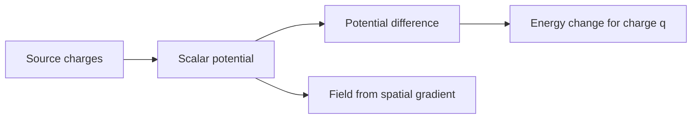

# Electric Potential and Capacitance

Electric potential compresses a vector field problem into a scalar energy description. Capacitance then describes how much separated charge a conductor arrangement stores per unit potential difference.

## Potential as energy per charge

Electric potential is potential energy per unit charge:

$$
V=\frac{U}{q},
\qquad
\Delta U=q\Delta V.
$$

The work done by the electrostatic field is the negative change in potential energy:

$$
W_{a\to b}^{\mathrm{field}}=-\Delta U=q(V_a-V_b).
$$

If an external agent moves the charge slowly enough that kinetic energy does not change, its work is $W^{\mathrm{ext}}=\Delta U$. Keeping these conventions separate prevents sign errors.

Potential is a property of the source configuration and position. Potential energy also depends on the charge placed there. The field and potential difference are related by

$$
\Delta V=-\int_a^b\vec E\cdot d\vec s.
$$

The minus sign says that potential decreases in the direction of the electric field. In one dimension, $E_x=-dV/dx$.

Electrostatic force is conservative, so the integral depends only on endpoints. Around any closed path,

$$
\oint\vec E\cdot d\vec s=0.
$$

This relation fails for the circulating electric field induced by changing magnetic flux. Potential differences completely describe only the electrostatic part of the field.

For point charges, taking $V=0$ at infinity,

$$
V=k\sum_i\frac{q_i}{r_i}.
$$

Unlike electric fields, potentials add as signed scalars.

The point-charge expression follows from the field. Moving radially from infinity to $r$,

$$
\begin{aligned}
V(r)-V(\infty)
&=-\int_\infty^r k\frac q{s^2}\,ds\\
&=k\frac qr.
\end{aligned}
$$

Choosing $V(\infty)=0$ is convenient for localized charge distributions, but only potential differences are measurable. An infinite line or sheet does not have finite potential relative to infinity; choose a finite reference point instead.

## A scalar sum for two source charges

A point is $0.20\,\mathrm m$ from $+5.0\,\mathrm{nC}$ and $0.30\,\mathrm m$ from $-2.0\,\mathrm{nC}$. Its potential is

$$
\begin{aligned}
V
&=k\left(\frac{q_1}{r_1}+\frac{q_2}{r_2}\right)\\
&=(8.99\times10^9)
\left(\frac{5.0\times10^{-9}}{0.20}
-\frac{2.0\times10^{-9}}{0.30}\right)\\
&=165\,\mathrm V.
\end{aligned}
$$

No directional components are needed, but both charge signs must be retained. A positive test charge placed there has positive potential energy relative to infinity; a negative test charge has negative potential energy.

### Worked example: speed gained through a voltage difference

An electron starts from rest and moves through a potential increase of $250\,\mathrm V$. Its charge is $q=-e$, so

$$
\Delta U=q\Delta V=(-e)(250\,\mathrm V)=-250\,\mathrm{eV}.
$$

Energy conservation gives $\Delta K=250\,\mathrm{eV}$. In joules,

$$
K=(250)(1.602\times10^{-19})=4.01\times10^{-17}\,\mathrm J.
$$

Using $K=m_ev^2/2$,

$$
v=\sqrt{\frac{2K}{m_e}}
=9.38\times10^6\,\mathrm{m/s}.
$$

This is about $3.1\%$ of the speed of light, so the nonrelativistic formula is adequate. The electron accelerates toward higher potential because its charge is negative.

## Equipotentials and field direction

Moving along an equipotential gives $\Delta V=0$, so the electric field does no work along that path. Electric-field lines cross equipotential surfaces at right angles. Closely spaced equipotentials indicate a stronger field because the potential changes more rapidly with distance.

| Quantity | Relation | Distinction |
|---|---|---|
| Potential | $V=U/q$ | source configuration and position |
| Potential energy | $U=qV$ | also depends on the placed charge |
| Field | $\vec E=-\nabla V$ | vector pointing toward lower potential |
| Potential difference | $\Delta V=-\int\vec E\cdot d\vec s$ | independent of the integration path in electrostatics |

In three dimensions,

$$
\vec E=-\nabla V
=-\left(\frac{\partial V}{\partial x}\hat{\mathbf i}
+\frac{\partial V}{\partial y}\hat{\mathbf j}
+\frac{\partial V}{\partial z}\hat{\mathbf k}\right).
$$

For a positive test charge, stable equilibrium occurs at a local minimum of $V$ along the allowed directions; for a negative charge it occurs at a local maximum because $U=qV$. A point where $dV/dx=0$ can be a maximum, minimum, or saddle rather than automatically stable.

For a continuous distribution,

$$
V(\vec r)=\frac1{4\pi\epsilon_0}\int\frac{dq}{|\vec r-\vec r'|}.
$$

This scalar integral is often easier than integrating field components. Once $V$ is known, differentiation gives the field.

### Worked example: potential and field of a charged ring

A ring of radius $a$ carries total charge $Q$. Every element is distance $\sqrt{a^2+z^2}$ from a point on the axis, so

$$
V(z)=k\int\frac{dq}{\sqrt{a^2+z^2}}
=k\frac{Q}{\sqrt{a^2+z^2}}.
$$

Differentiate rather than repeat the vector integral:

$$
E_z=-\frac{dV}{dz}
=k\frac{Qz}{(a^2+z^2)^{3/2}}.
$$

At the center, the potential is $kQ/a$ although the field is zero. A zero field and a zero potential are unrelated claims.

## What capacitance measures

Capacitance is defined by

$$
C=\frac{Q}{\Delta V}.
$$

For a linear capacitor, $C$ depends on conductor geometry and the dielectric, not on the present values of $Q$ or $\Delta V$.

Neglecting fringing, a vacuum parallel-plate capacitor has

$$
C=\epsilon_0\frac{A}{d}.
$$

To derive it, put charges $+Q$ and $-Q$ on plates of area $A$. The surface density is $\sigma=Q/A$. Gauss's law gives $E=\sigma/\epsilon_0$ between ideal large plates. The potential difference is $Ed$, hence

$$
\Delta V=\frac{Qd}{\epsilon_0A},
\qquad
C=\frac Q{\Delta V}=\frac{\epsilon_0A}{d}.
$$

The approximation requires $d$ to be small compared with the plate dimensions. Fringing near the edges slightly increases the actual capacitance.

Filling the gap with a linear dielectric of relative permittivity $\kappa$ gives $C=\kappa\epsilon_0A/d$.

Capacitors in parallel share the same voltage and add directly:

$$
C_{\mathrm{eq}}=C_1+C_2+\cdots.
$$

Capacitors in series carry equal-magnitude charge:

$$
\frac{1}{C_{\mathrm{eq}}}
=\frac{1}{C_1}+\frac{1}{C_2}+\cdots.
$$

These rules run opposite to the familiar resistor rules.

### Worked example: a mixed capacitor network

A $6.0\,\mu\mathrm F$ capacitor and a $3.0\,\mu\mathrm F$ capacitor are in parallel, giving

$$
C_p=6.0+3.0=9.0\,\mu\mathrm F.
$$

That group is in series with $18\,\mu\mathrm F$:

$$
\begin{aligned}
\frac1{C_{\mathrm{eq}}}
&=\frac1{9.0}+\frac1{18},\\
C_{\mathrm{eq}}&=6.0\,\mu\mathrm F.
\end{aligned}
$$

Across $12\,\mathrm V$, the series charge is

$$
Q=C_{\mathrm{eq}}V=(6.0\,\mu\mathrm F)(12\,\mathrm V)=72\,\mu\mathrm C.
$$

The $18\,\mu\mathrm F$ capacitor has voltage $72/18=4.0\,\mathrm V$, leaving $8.0\,\mathrm V$ across the parallel group. Its branch charges are

$$
Q_6=(6.0)(8.0)=48\,\mu\mathrm C,
\qquad
Q_3=(3.0)(8.0)=24\,\mu\mathrm C.
$$

They add to the series charge, as required.

## Charge and energy on a capacitor

The energy stored in the electric field can be written in three equivalent ways:

$$
U_C=\frac12C(\Delta V)^2
=\frac{Q^2}{2C}
=\frac12Q\Delta V.
$$

The result follows from assembling charge. When the capacitor holds $q$, its voltage is $q/C$, so

$$
U=\int_0^Q\frac qC\,dq=\frac{Q^2}{2C}.
$$

Which form predicts a geometry change correctly depends on the constraint. If the battery remains connected, $\Delta V$ is fixed. If the capacitor is isolated, $Q$ is fixed.

For a $10\,\mu\mathrm F$ capacitor connected to $9.0\,\mathrm V$,

$$
Q=C\Delta V=(10\times10^{-6})(9.0)=90\,\mu\mathrm C,
$$

and

$$
U_C=\frac12C(\Delta V)^2
=\frac12(10\times10^{-6})(9.0)^2
=4.05\times10^{-4}\,\mathrm J.
$$

For parallel plates, substitute $C=\epsilon_0A/d$, $V=Ed$, and volume $Ad$:

$$
U=\frac12\epsilon_0E^2(Ad).
$$

The vacuum electric-field energy density is therefore

$$
u_E=\frac12\epsilon_0E^2.
$$

The useful accounting places the stored energy in the field rather than on either metal plate.

## What changes when a dielectric is inserted

A dielectric polarizes in an electric field. Its bound charges reduce the internal field for a given free charge, increasing capacitance by a factor $\kappa$ when the material completely fills the gap.

If the capacitor is isolated, $Q$ stays fixed. Then

$$
C'=\kappa C,
\qquad
V'=\frac V\kappa,
\qquad
U'=\frac U\kappa.
$$

If the battery remains connected, $V$ stays fixed. Charge flows until $Q'=\kappa Q$, and

$$
U'=\frac12(\kappa C)V^2=\kappa U.
$$

The battery supplies energy in the second setup, so capacitor energy alone cannot determine the mechanical work. In both arrangements a partly inserted dielectric is pulled farther into the high-field region.

Real dielectrics have a breakdown field above which conduction or permanent damage occurs. Capacitors also have leakage, equivalent series resistance, and manufacturing tolerances absent from the ideal model.

## Sign and constraint checks

- Keep charge signs when summing potential. Taking absolute values destroys cancellation.
- Add potentials as scalars and fields as vectors.
- Do not identify $V$ with $U$; their units are volts and joules, respectively.
- Before changing a capacitor's geometry or dielectric, decide whether the battery fixes voltage or isolation fixes charge.
- For capacitor networks, series reduces the equivalent capacitance below either component, while parallel increases it.
- Capacitance is a positive geometric coefficient. A negative plate charge does not imply negative capacitance.
- The formula $C=\epsilon_0A/d$ belongs to the parallel-plate approximation, not to arbitrary pairs of conductors.

A zero potential does not imply a zero electric field. Equal and opposite source potentials can cancel at a point even when their field vectors add there.

## Potential of conductors and electrostatic shielding

In electrostatic equilibrium a connected conductor is an equipotential. If two points in the metal had different potentials, an internal electric field would drive charge until the difference disappeared. The field immediately outside has no tangential component and points normal to the surface.

Equipotential does not mean uncharged. An isolated charged conductor can sit at a nonzero potential relative to infinity. For a conducting sphere of radius $R$ carrying charge $Q$,

$$
V(r)=
\begin{cases}
kQ/R, & r\leq R,\\
kQ/r, & r\geq R.
\end{cases}
$$

Inside, potential is constant and field is zero. The potential remains continuous at the surface, while its radial derivative changes because surface charge creates a jump in the normal field.

Grounding connects a conductor to a vast charge reservoir conventionally assigned zero potential. Charge may flow until the conductor reaches that potential. “Ground has zero charge” is false; Earth can accept or supply charge with negligible potential change in the model.

A closed conducting shell shields an empty cavity from static external fields. Shielding does not require a thick wall, but apertures and time-varying fields complicate the result. Electrostatic shielding and electromagnetic shielding at finite frequency are related but not identical problems.

## Capacitance beyond parallel plates

Capacitance belongs to a pair or arrangement of conductors. An isolated sphere uses infinity as the second conductor. From $V=kQ/R$,

$$
C=\frac QV=4\pi\epsilon_0R.
$$

Larger radius means greater capacitance because the same charge produces lower surface potential.

A coaxial cylindrical capacitor has inner radius $a$, outer radius $b$, and length $L$ much larger than the gap dimensions. Gauss's law gives the field between conductors as

$$
E(r)=\frac{\lambda}{2\pi\epsilon_0r}.
$$

The potential difference is

$$
\Delta V=\int_a^b E(r)\,dr
=\frac{\lambda}{2\pi\epsilon_0}\ln\frac ba.
$$

Since $Q=\lambda L$,

$$
C=\frac{2\pi\epsilon_0L}{\ln(b/a)}.
$$

This geometry models coaxial cable when end effects are negligible. With dielectric filling the space, replace $\epsilon_0$ by $\epsilon$.

For concentric spherical conductors of radii $a\lt b$, integrating the radial field gives

$$
C=4\pi\epsilon_0\frac{ab}{b-a}.
$$

Letting $b$ tend to infinity recovers the isolated-sphere result.

## Forces from stored energy

Capacitor plates attract because opposite surface charges exert force. Energy gives a clean route when the electrical constraint is known. For an isolated parallel-plate capacitor with fixed $Q$,

$$
U(d)=\frac{Q^2}{2C}
=\frac{Q^2d}{2\epsilon_0A}.
$$

The force in the direction of increasing separation is

$$
F_d=-\frac{dU}{dd}
=-\frac{Q^2}{2\epsilon_0A}.
$$

The negative sign indicates attraction. Its magnitude can also be written as $\tfrac12\epsilon_0E^2A$, field energy density times plate area.

At fixed voltage, using only $U_C=CV^2/2$ and differentiating gives the wrong mechanical sign because the battery exchanges energy as geometry changes. One must include battery energy or use the appropriate fixed-voltage thermodynamic potential. Stating the constraint before differentiating is essential.

## Potential graphs as energy landscapes

In one dimension, the slope of $V(x)$ gives $-E_x$. A steep graph means strong field; a flat point means zero field. For a particle of charge $q$, multiply by $q$ to obtain potential energy. A positive charge accelerates downhill on a $V$ graph, while a negative charge accelerates uphill.

Energy conservation gives

$$
K(x)+qV(x)=E_{\mathrm{mech}}.
$$

Turning points occur where kinetic energy reaches zero. Regions requiring negative kinetic energy are classically forbidden. These graph methods often determine allowed motion and equilibrium without solving the time-dependent equation.

The zero of potential may be shifted by any constant without changing field or motion. Potential energy shifts by $q$ times that constant, but energy differences and turning points remain unchanged. Confusing the chosen zero with a physical boundary leads to needless sign anxiety.

## Capacitance matrices for several conductors

With more than two conductors, one number is not enough to describe charge-potential relations. In a linear medium, conductor charges are linear combinations of conductor potentials relative to a reference:

$$
Q_i=\sum_j C_{ij}V_j.
$$

The diagonal coefficients are positive and mutual coefficients carry signs determined by convention. Circuit “stray capacitance” is the physical coupling represented by off-diagonal terms. Nearby traces, a hand near a sensor, or a cable shield can change these couplings even when no explicit capacitor was installed.

Touchscreens and proximity sensors exploit this dependence. They measure a change in capacitance caused by a conductive object altering the electric-field geometry. The basic definition $C=Q/V$ still applies, but the geometry is too complicated for a parallel-plate formula and is calibrated or solved numerically.

## Leakage and dielectric absorption

An ideal charged capacitor holds voltage forever. A real dielectric has finite resistance, often modeled by a large leakage resistor in parallel. The stored voltage then decays with an effective time constant. Surface contamination and humidity can make external leakage as important as bulk dielectric leakage.

Some dielectrics also show dielectric absorption: after a capacitor is charged for a long time, briefly discharged, and disconnected, a smaller voltage can reappear as slow polarization modes relax. This matters in precision sample-and-hold circuits and in safety procedures for high-voltage capacitors. A single ideal $C$ cannot reproduce the behavior; networks of resistive and capacitive branches approximate it.

Capacitance can depend on voltage, temperature, and frequency. Ceramic capacitors with high permittivity may lose a substantial fraction of nominal capacitance under DC bias. Electrolytic capacitors have appreciable series resistance and inductance. Selecting a component by printed capacitance alone can therefore miss the operating-condition value.

## Numerical field methods

Complicated conductor geometry is often handled by solving Laplace's equation $\nabla^2V=0$ in charge-free regions with specified conductor potentials. Once the potential is known, $\vec E=-\nabla V$ and surface charge follows from the normal field. Finite-difference and finite-element methods turn the region into a mesh.

Numerical results still obey analytic checks: potential must remain between boundary extrema in a charge-free region, field lines meet conductor surfaces normally, and integrated induced charge must match the capacitance relation. Mesh refinement near sharp edges is important because surface charge and field vary rapidly there.

See also: [Coulomb's Law and Electric Fields](/physics/general/coulombs-law-and-electric-fields) · [Current, Resistance, and DC Circuits](/physics/general/current-resistance-and-dc-circuits)

