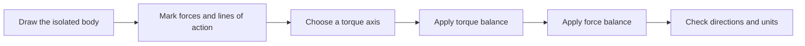

# Equilibrium and Elasticity

A rigid body in static equilibrium has neither translational nor angular acceleration. Real bodies also deform under load, so the equilibrium forces and torques often become inputs to a stress-strain calculation.

Static does not mean force-free. A bridge member may carry a large tension while every point remains at rest. Nor is zero acceleration enough to guarantee stability: a pencil balanced on its tip satisfies the balance equations at one instant but a small disturbance drives it away.

## Two balances, not one

Static equilibrium requires

$$
\sum\vec F=0
$$

and

$$
\sum\vec\tau=0.
$$

In a planar problem these become

$$
\sum F_x=0,
\qquad
\sum F_y=0,
\qquad
\sum\tau_z=0.
$$

Force balance alone prevents translation but not rotation. Torque balance alone prevents angular acceleration but not translation.

For a force applied at displacement $\vec r$ from the chosen axis,

$$
\vec\tau=\vec r\times\vec F,
\qquad
\lvert\tau\rvert=rF\sin\theta=F\ell_\perp,
$$

where $\ell_\perp$ is the perpendicular distance from the axis to the force's line of action. The torque axis may be chosen freely for a body in equilibrium; a convenient choice passes through unknown support forces so that their torques vanish.

The freedom to move the torque axis follows from force balance. If the origin is shifted by $\vec a$, total torque changes by

$$
\vec\tau'_{\mathrm{net}}
=\vec\tau_{\mathrm{net}}-\vec a\times\sum\vec F.
$$

When $\sum\vec F=0$, the total torque is the same about every origin. Before force balance has been established, torques about different points need not agree.

| Part of the model | Equation | Check |
|---|---|---|
| Translation | $\sum\vec F=0$ | resolve every force into components |
| Rotation | $\sum\tau=0$ | use the perpendicular lever arm |
| Axial stress | $\sigma=F/A$ | force is normal to the section |
| Axial strain | $\epsilon=\Delta L/L$ | strain is dimensionless |

## Beam supported by a hinge and cable

A horizontal $4.0\,\mathrm m$ beam weighs $120\,\mathrm N$ and carries a $200\,\mathrm N$ sign at its end. A cable attached at the end runs $30^\circ$ above the beam.

Take torques about the hinge. The hinge forces then have zero lever arm, the beam's weight acts at its center, and only the vertical component of the cable tension contributes:

$$
(T\sin30^\circ)(4.0)
-120(2.0)-200(4.0)=0.
$$

Hence

$$
T=\frac{120(2.0)+200(4.0)}{4.0\sin30^\circ}
=520\,\mathrm N.
$$

The cable components are

$$
T_x=-T\cos30^\circ=-450\,\mathrm N,
\qquad
T_y=T\sin30^\circ=260\,\mathrm N.
$$

Let the hinge force be $(H_x,H_y)$. Force balance gives

$$
\begin{aligned}
\sum F_x=0&:\quad H_x-450=0,\\
\sum F_y=0&:\quad H_y+260-120-200=0.
\end{aligned}
$$

Thus $H_x=450\,\mathrm N$ to the right and $H_y=60\,\mathrm N$ upward. Checking moments about the beam's end now includes the hinge force and reproduces zero net torque. Taking torques about the hinge first merely avoided carrying those unknowns through the tension calculation.

## Supports, free-body diagrams, and determinacy

An ideal cable pulls along its length. A smooth contact supplies a normal force but no tangential force. A pin or hinge in a two-dimensional model supplies two force components but no resisting couple. A fixed support can supply two force components and a reaction torque. These are models of the constraint, not extra forces chosen for convenience.

A free-body diagram should isolate one body and include only forces exerted on it by its surroundings. Internal action-reaction pairs disappear only when the entire combined system is isolated. When two connected bodies are analyzed separately, the interaction force appears on both diagrams with opposite directions.

There are three independent equilibrium equations for a planar rigid body. If the support model introduces more than three independent unknown reactions, statics alone cannot determine them; the structure is **statically indeterminate**. Deformation compatibility and material stiffness must then supplement force and torque balance.

## Stability, tipping, and friction

For a body resting on a base, gravity acts through the center of mass and the distributed normal force can be represented by a resultant acting somewhere inside the contact region. Static equilibrium against tipping is possible while the vertical line through the center of mass intersects the support base. At the tipping threshold, the normal resultant reaches an edge and the body pivots about that edge.

Static friction satisfies

$$
|f_s|\leq\mu_sN.
$$

It equals $\mu_sN$ only at impending slip. Assigning the maximum value at the start of every equilibrium problem overconstrains many setups.

### Worked example: ladder at the verge of slipping

A uniform ladder of length $L$ and weight $W$ leans at angle $\theta$ against a smooth vertical wall. The floor has static-friction coefficient $\mu_s$. The wall exerts horizontal normal force $N_w$ at the top. The floor exerts vertical normal $N_f$ and horizontal friction $f$ at the bottom.

Vertical balance gives

$$
N_f-W=0,
\qquad N_f=W.
$$

Horizontal balance gives $f=N_w$. Take torques about the bottom. The wall force has lever arm $L\sin\theta$, while the weight acts at the midpoint with horizontal lever arm $(L/2)\cos\theta$:

$$
N_wL\sin\theta-W\frac L2\cos\theta=0.
$$

Therefore

$$
N_w=f=\frac W2\cot\theta.
$$

No slip requires

$$
\frac W2\cot\theta\leq\mu_sW.
$$

Canceling $W$ gives

$$
\tan\theta\geq\frac1{2\mu_s}.
$$

For $\mu_s=0.40$, the minimum angle is

$$
\theta_{\min}=\tan^{-1}(1.25)=51.3^\circ.
$$

The ladder length and weight cancel. If the wall also had friction or a person stood on the ladder, the threshold would change.

## Stress, strain, and Young's modulus

Normal stress and longitudinal strain are

$$
\sigma=\frac{F}{A},
\qquad
\epsilon=\frac{\Delta L}{L}.
$$

Within the linear elastic regime, Young's modulus is their ratio:

$$
Y=\frac{\sigma}{\epsilon}.
$$

Solving for extension gives

$$
\Delta L=\frac{FL}{AY}.
$$

This relation assumes a uniform member under axial load, small deformation, and operation below the proportional limit. Young's modulus describes stiffness, not strength: a stiff material can still fail at a comparatively low strain.

Stress has units of pascals, while strain is dimensionless. Young's modulus is therefore measured in pascals. It is a material parameter only after the loading mode and direction are specified; composites and crystals may have direction-dependent elastic constants.

For a steel wire with $L=2.0\,\mathrm m$, $A=1.0\times10^{-6}\,\mathrm{m^2}$, $Y=2.0\times10^{11}\,\mathrm{Pa}$, and $F=50\,\mathrm N$,

$$
\begin{aligned}
\Delta L
&=\frac{(50)(2.0)}{(1.0\times10^{-6})(2.0\times10^{11})}\\
&=5.0\times10^{-4}\,\mathrm m.
\end{aligned}
$$

The $0.50\,\mathrm{mm}$ extension is small compared with the $2.0\,\mathrm m$ original length, consistent with the small-strain model.

The wire behaves like a spring for small extension. Comparing $F=(AY/L)\Delta L$ with Hooke's law $F=k\Delta L$ gives

$$
k_{\mathrm{wire}}=\frac{AY}{L}.
$$

Its stored elastic energy is

$$
U=\frac12F\Delta L
=\frac{F^2L}{2AY}.
$$

Dividing by the original volume $AL$ gives the axial elastic-energy density

$$
u=\frac12\sigma\epsilon.
$$

This is the triangular area under a linear stress-strain curve.

## Shear, volume change, and lateral strain

Young's modulus covers normal loading. Shear modulus $G$ relates shear stress to shear strain:

$$
\tau=G\gamma.
$$

For a block of height $h$ whose top shifts sideways by $\Delta x$, small-angle shear strain is $\gamma\approx\Delta x/h$. The bulk modulus $K$ describes uniform pressure and fractional volume change:

$$
K=-\frac{\Delta p}{\Delta V/V}.
$$

The minus sign makes $K$ positive because increasing pressure usually decreases volume.

An axially stretched specimen usually narrows. Poisson's ratio is

$$
\nu=-\frac{\epsilon_{\mathrm{transverse}}}{\epsilon_{\mathrm{axial}}}.
$$

For a homogeneous isotropic linear elastic material, only two elastic constants are independent. Useful conversions include

$$
Y=2G(1+\nu),
\qquad
Y=3K(1-2\nu).
$$

These identities do not apply unchanged to anisotropic materials.

## Thermal strain and constrained expansion

A freely expanding rod changes length by

$$
\Delta L=\alpha L\Delta T
$$

and develops no thermal stress. If rigid supports prevent any change in length, the mechanical strain must cancel the thermal strain. In the linear model,

$$
\epsilon_{\mathrm{mech}}=-\alpha\Delta T,
\qquad
\sigma=-Y\alpha\Delta T.
$$

For a steel rail with $Y=2.0\times10^{11}\,\mathrm{Pa}$, $\alpha=12\times10^{-6}\,\mathrm{K^{-1}}$, and temperature rise $40\,\mathrm K$, complete restraint would produce compressive stress

$$
|\sigma|=(2.0\times10^{11})(12\times10^{-6})(40)
=9.6\times10^7\,\mathrm{Pa}.
$$

Real joints, gaps, and support flexibility reduce the stress. The example explains why long structures provide expansion joints rather than relying on material strength alone.

## Where the ideal model stops

The linear relation between stress and strain ends at the proportional limit. Beyond the elastic range, unloading may leave permanent deformation; at still larger loads the specimen necks or fractures. A calculation based on $\Delta L=FL/(AY)$ should therefore be paired with a check that the stress lies within the material's linear range.

The elastic limit, yield strength, ultimate tensile strength, and fracture point are distinct. Ductile materials can undergo substantial plastic strain after yielding; brittle materials fracture with little plastic deformation. The area under the entire stress-strain curve to fracture measures energy absorbed per unit volume, often called toughness. Its value should not be confused with stiffness $Y$.

For equilibrium calculations, common failures come earlier:

- A force whose line of action passes through the axis produces zero torque, even when the force itself is large.
- The lever arm is perpendicular distance, not automatically the full length of a beam.
- The body's own weight acts at its center of mass unless the mass distribution says otherwise.
- A negative support component means the actual direction is opposite the assumed arrow.
- The small-deformation assumption lets equilibrium be written using the undeformed geometry. Flexible beams or cables may require the changed geometry.
- Stress concentrations near holes, sharp corners, and attachments make $F/A$ only a nominal average stress.

## Distributed loads and their resultants

A distributed load $w(x)$ on a beam has units of force per length. It can be replaced for rigid-body equilibrium by a resultant

$$
F_R=\int w(x)\,dx
$$

acting at

$$
x_R=\frac{\int xw(x)\,dx}{\int w(x)\,dx}.
$$

These are the area and centroid of the load diagram. A uniform load acts at the interval midpoint. A triangular load increasing from zero to $w_0$ over length $L$ has resultant $w_0L/2$ located two-thirds of the distance from the zero end.

Consider a simply supported beam of length $6\,\mathrm m$ carrying a uniform load $2\,\mathrm{kN/m}$ over its full length and a $6\,\mathrm{kN}$ point load $2\,\mathrm m$ from the left support. Replace the uniform load by $12\,\mathrm{kN}$ at the center. If reactions are $A_y$ and $B_y$, then

$$
A_y+B_y=18\,\mathrm{kN}.
$$

Taking moments about the left support,

$$
B_y(6)-12(3)-6(2)=0,
$$

so $B_y=8\,\mathrm{kN}$ and $A_y=10\,\mathrm{kN}$. Replacing a distributed load by its resultant is valid for external equilibrium, but not for calculating internal shear, bending moment, or local deformation at every section.

## Internal force, shear, and bending moment

Cutting a loaded member exposes internal resultants that keep either piece in equilibrium. In a planar beam these are axial force, shear force, and bending moment. They vary with position even when external reactions are fixed.

For distributed load $w(x)$ under a common sign convention,

$$
\frac{dV}{dx}=-w(x),
\qquad
\frac{dM}{dx}=V(x).
$$

A point load creates a jump in shear; an applied couple creates a jump in bending moment. Maximum bending moment often occurs where shear passes through zero. These relations connect the free-body calculation to stress and deflection design.

Elementary beam theory gives bending stress

$$
\sigma_x=-\frac{My}{I},
$$

where $y$ is distance from the neutral axis and $I$ is the second moment of area. Stress is largest at the outer fibers. Increasing section depth can raise $I$ strongly, explaining the efficiency of I-beams: material is placed far from the neutral axis while the web carries shear.

The formula assumes slender beams, small deflections, linear elasticity, and plane sections remaining plane. Deep beams, plastic bending, or large deflection require richer models.

## Composite members and compatibility

When members share a load, equilibrium alone gives the sum of forces but not always the split. Deformation compatibility supplies the missing equations. Two parallel rods of equal length attached between rigid plates undergo the same extension. Their forces satisfy

$$
F_i=\frac{A_iY_i}{L}\Delta L.
$$

Thus load divides in proportion to axial stiffness $A_iY_i/L$, not merely area.

For two rods in series, the force is the same in both while extensions add:

$$
\Delta L_{\mathrm{total}}
=F\left(\frac{L_1}{A_1Y_1}+\frac{L_2}{A_2Y_2}\right).
$$

This is analogous to springs in series. It also shows how a short soft segment can dominate the extension of a long assembly.

## Safety factors and idealization

Design does not normally set working stress equal to measured failure stress. A safety factor accounts for uncertain loads, material scatter, fatigue, corrosion, manufacturing defects, and consequences of failure. Its selection belongs to engineering standards and the failure mode, not to a universal physics formula.

Repeated loading can cause fatigue below the one-time yield strength. Slender compression members can buckle before material compressive strength is reached. Creep can accumulate under sustained load, especially at high temperature. Static linear elasticity supplies the first estimate, but identifying the governing failure mode is a separate step.

Dimensional checks remain effective: torque has units of force times length, stress and modulus have units of pressure, and strain has no units. A result for extension should scale upward with force and length and downward with area and modulus. Those trends often catch an inverted ratio before numerical substitution hides it.

Equilibrium reactions should also reproduce the total applied load and its moment about a second, unused point. That independent check catches omitted forces and incorrect lever arms.

See also: [Rotation and Angular Momentum](/physics/general/rotation-torque-and-angular-momentum) · [Fluids](/physics/general/fluids-statics-dynamics-and-bernoulli)

