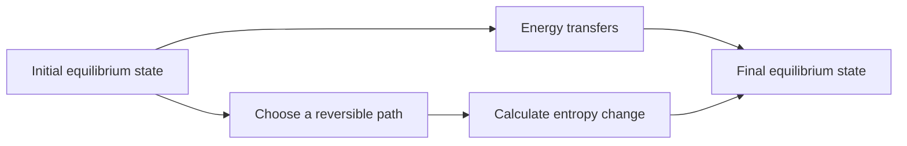

# First Law, Entropy, and Second Law

The first law accounts for energy transferred as heat and work. The second law adds a direction: not every energy-conserving process occurs spontaneously, and no cyclic heat engine can convert all absorbed heat into work.

## Fix the work convention first

Using $W$ for work done by the system,

$$
\Delta E_{\mathrm{int}}=Q-W.
$$

Heat entering the system has $Q\gt 0$; expansion work done by the system has $W\gt 0$. Some texts define work done on the system instead, which changes the sign in the first law. Either convention works if it is used consistently.

Heat and work are modes of energy transfer across the system boundary. They are not state variables stored in the system. Once a transfer is complete, its effect appears in the system's energy. The equation above assumes bulk kinetic and potential energy changes have been separated out or are negligible.

For a quasistatic volume change,

$$
W=\int_{V_i}^{V_f}P\,dV.
$$

On a $P$-$V$ diagram, this work is the signed area under the process path. Heat and work depend on the path between states, while internal energy is a state function.

If a gas absorbs $500\,\mathrm J$ and does $180\,\mathrm J$ of work,

$$
\Delta E_{\mathrm{int}}=500-180=320\,\mathrm J.
$$

The gas ends with $320\,\mathrm J$ more internal energy.

## Ideal-gas energy and common paths

For an ideal gas, internal energy depends only on temperature. For $n$ moles with constant molar heat capacity $C_V$,

$$
\Delta E_{\mathrm{int}}=nC_V\Delta T.
$$

A monatomic ideal gas has $C_V=3R/2$ in the classical range, and $C_P=C_V+R$.

During a quasistatic isothermal expansion, $P=nRT/V$, so

$$
W=\int_{V_i}^{V_f}\frac{nRT}{V}\,dV
=nRT\ln\frac{V_f}{V_i}.
$$

Since $\Delta T=0$, the ideal gas has $\Delta E_{\mathrm{int}}=0$ and absorbs $Q=W$. During an isochoric process $W=0$. During an isobaric process, $W=P(V_f-V_i)=nR\Delta T$.

For a reversible adiabatic process,

$$
PV^\gamma=\text{constant},
\qquad
TV^{\gamma-1}=\text{constant},
$$

where $\gamma=C_P/C_V$. These relations require an ideal gas, quasistatic evolution, and no heat transfer. A rapid free expansion is adiabatic but does not trace the same curve.

### Worked example: compare two expansion paths

One mole of a monatomic ideal gas starts at $300\,\mathrm K$ and expands reversibly from $V_i$ to $2V_i$. For an isothermal path,

$$
\begin{aligned}
W_{\mathrm{iso}}
&=nRT\ln2\\
&=(1)(8.314)(300)(0.693)\\
&=1.73\times10^3\,\mathrm J.
\end{aligned}
$$

The gas absorbs the same heat. For a reversible adiabatic path, $\gamma=5/3$ and

$$
T_f=300(1/2)^{2/3}=189\,\mathrm K.
$$

Because $Q=0$,

$$
\begin{aligned}
W_{\mathrm{ad}}
&=nC_V(T_i-T_f)\\
&=\left(\frac32R\right)(300-189)\\
&=1.38\times10^3\,\mathrm J.
\end{aligned}
$$

The adiabatic gas does less work because it cools and its pressure falls more quickly.

## Entropy separates reversible bookkeeping from real processes

For a reversible transfer,

$$
dS=\frac{\delta Q_{\mathrm{rev}}}{T}.
$$

Entropy is a state function, so the entropy change between two equilibrium states can be calculated along any convenient reversible path, even when the actual process is irreversible. The subscript “rev” belongs to the imagined calculation path; it does not claim that the real process was reversible.

For an isolated system,

$$
\Delta S\ge 0.
$$

For an ideal gas with constant heat capacities, integration along a convenient reversible path gives

$$
\Delta S
=nC_V\ln\frac{T_f}{T_i}
+nR\ln\frac{V_f}{V_i}.
$$

An equivalent form is

$$
\Delta S
=nC_P\ln\frac{T_f}{T_i}
-nR\ln\frac{P_f}{P_i}.
$$

Entropy has units of joules per kelvin. Statistical mechanics interprets it as $S=k_B\ln\Omega$, where $\Omega$ counts compatible microscopic states.

Equality holds for a reversible process and strict inequality for an irreversible one. A subsystem's entropy may decrease if its surroundings gain more entropy, as in a refrigerator. The second law constrains the total entropy change of system plus surroundings.

### Worked example: entropy generation in heat transfer

Let $600\,\mathrm J$ pass from a reservoir at $400\,\mathrm K$ to one at $300\,\mathrm K$. Then

$$
\begin{aligned}
\Delta S_H&=-\frac{600}{400}=-1.50\,\mathrm{J/K},\\
\Delta S_C&=+\frac{600}{300}=+2.00\,\mathrm{J/K},\\
\Delta S_{\mathrm{total}}&=0.50\,\mathrm{J/K}.
\end{aligned}
$$

Energy conservation alone permits either direction. Positive total entropy selects spontaneous flow from hot to cold. Reversing it requires external work.

In free expansion of an ideal gas into vacuum, no boundary work is done and no heat enters. Its temperature stays fixed, yet doubling the volume gives

$$
\Delta S=nR\ln2>0.
$$

Adiabatic does not imply isentropic. Only a reversible adiabatic process has constant entropy.

| Quantity | Type | Relation |
|---|---|---|
| Internal energy $E_{\mathrm{int}}$ | state function | $\Delta E_{\mathrm{int}}=Q-W$ |
| Heat $Q$ | path-dependent transfer | positive into the system |
| Work $W$ | path-dependent transfer | $\int P\,dV$ for quasistatic expansion |
| Entropy $S$ | state function | $dS=\delta Q_{\mathrm{rev}}/T$ |

## Heat engines and the Carnot ceiling

A heat engine absorbs $Q_H$ from a hot reservoir, rejects $Q_C$ to a cold reservoir, and produces net work

$$
W=Q_H-Q_C.
$$

Its efficiency is

$$
e=\frac{W}{Q_H}=1-\frac{Q_C}{Q_H}.
$$

No engine operating between temperatures $T_H$ and $T_C$ can exceed the reversible Carnot efficiency:

$$
e_{\mathrm{Carnot}}=1-\frac{T_C}{T_H}.
$$

Temperatures must be absolute. Celsius ratios do not represent thermodynamic temperature ratios.

The Carnot cycle has two reversible isotherms joined by two reversible adiabats. The working substance returns to its initial entropy, so

$$
\frac{Q_H}{T_H}-\frac{Q_C}{T_C}=0.
$$

Thus $Q_C/Q_H=T_C/T_H$, which yields the Carnot expression. If an engine exceeded it, coupling that engine to a reversed Carnot device would move heat from cold to hot with no net work, contradicting the second law.

For reservoirs at $T_H=600\,\mathrm K$ and $T_C=300\,\mathrm K$,

$$
e_{\mathrm{Carnot}}=1-\frac{300}{600}=0.50.
$$

An engine absorbing $Q_H=2000\,\mathrm J$ can therefore produce at most

$$
W_{max}=e_{\mathrm{Carnot}}Q_H=1000\,\mathrm J
$$

per cycle. Real engines have lower efficiency because friction, finite temperature differences, turbulence, and other irreversible effects generate entropy.

No finite-power engine is exactly reversible. Reversible heat transfer requires an infinitesimal temperature difference and proceeds arbitrarily slowly. Carnot efficiency is a ceiling, not a finite-power design cycle.

## Refrigerators and heat pumps

A refrigerator uses work $W$ to remove $Q_C$ from a cold region and reject $Q_H=Q_C+W$. Its coefficient of performance is

$$
\mathrm{COP}_{R}=\frac{Q_C}{W}.
$$

A heat pump values delivered heat:

$$
\mathrm{COP}_{HP}=\frac{Q_H}{W}=\mathrm{COP}_R+1.
$$

For reversible devices,

$$
\mathrm{COP}_{R,\max}=\frac{T_C}{T_H-T_C},
\qquad
\mathrm{COP}_{HP,\max}=\frac{T_H}{T_H-T_C}.
$$

A COP can exceed one because it measures heat moved per unit work, not heat-to-work efficiency.

Suppose a refrigerator operates between $270\,\mathrm K$ and $300\,\mathrm K$ and removes $900\,\mathrm J$ per cycle. The reversible upper bound is

$$
\mathrm{COP}_{R,\max}=\frac{270}{300-270}=9.0.
$$

Even an ideal device requires

$$
W_{\min}=\frac{900}{9.0}=100\,\mathrm J
$$

and rejects $Q_H=1000\,\mathrm J$.

## Reading special processes from the first law

- At constant volume, $W=0$, so $\Delta E_{\mathrm{int}}=Q$.
- For an adiabatic process, $Q=0$, so $\Delta E_{\mathrm{int}}=-W$ under the chosen convention.
- For a complete cycle, $\Delta E_{\mathrm{int}}=0$, so the net heat absorbed equals the net work done.
- For an ideal gas in an isothermal process, $\Delta E_{\mathrm{int}}=0$, so $Q=W$.

These statements depend on the named constraints. “Adiabatic” means no heat transfer, not constant temperature; “isothermal” means constant temperature, not zero heat transfer.

## Frequent accounting errors

Do not switch work conventions halfway through a calculation. Label heat by direction and work by who does it before inserting signs. Treat $Q$ and $W$ as transfers rather than contents of a state; a system has internal energy and entropy, but it does not “contain work.”

For entropy, include the surroundings whenever judging whether a process is allowed. Local entropy decrease is compatible with the second law when accompanied by a larger increase elsewhere.

Other errors include using a reservoir's fixed temperature for a system whose temperature changes, applying $Q/T$ to an irreversible path without constructing a reversible alternative, and using system pressure in $\int P\,dV$ when a process is not quasistatic. Actual boundary work is controlled by external pressure; replacing it with system pressure requires mechanical equilibrium at each step.

## Reading a cycle on a pressure-volume diagram

Over a complete cycle every state function returns to its initial value, so

$$
\Delta E_{\mathrm{int,cycle}}=0,
\qquad
Q_{\mathrm{net}}=W_{\mathrm{net}}.
$$

The net work is the signed area enclosed on a pressure-volume diagram. A clockwise loop has positive work done by the gas and operates as a heat engine. A counterclockwise loop requires net work input, as in a refrigerator or heat pump.

Consider a rectangular cycle with volumes $V_1=1.0\,\mathrm{m^3}$ and $V_2=3.0\,\mathrm{m^3}$ and pressures $P_L=100\,\mathrm{kPa}$ and $P_H=300\,\mathrm{kPa}$. Traversed clockwise, its net work is

$$
W_{\mathrm{net}}=(P_H-P_L)(V_2-V_1)
=(200\,\mathrm{kPa})(2.0\,\mathrm{m^3})
=400\,\mathrm{kJ}.
$$

Work on the two constant-volume legs is zero. The high-pressure expansion does $600\,\mathrm{kJ}$, and the low-pressure compression does $-200\,\mathrm{kJ}$. The enclosed area gives their sum without needing the details of heat transfer on each leg.

Efficiency still requires total heat input, not merely net heat. If the cycle absorbs $800\,\mathrm{kJ}$ on its heating legs and rejects $400\,\mathrm{kJ}$ elsewhere, its efficiency is $400/800=0.50$. Counting net heat in the denominator would incorrectly give one.

## Entropy balance for open and closed systems

For a closed system exchanging heat $Q_j$ with reservoirs at boundary temperatures $T_j$, the entropy balance can be written

$$
\Delta S_{\mathrm{system}}
=\sum_j\int\frac{\delta Q_j}{T_j}+S_{\mathrm{gen}},
$$

where $S_{\mathrm{gen}}\geq0$. Equality to zero characterizes an internally reversible process. Friction, mixing, electrical resistance, chemical reaction away from equilibrium, and heat transfer across a finite temperature difference all generate entropy.

For steady-flow devices, matter carries entropy in and out as well. Turbines, compressors, nozzles, heat exchangers, and throttling valves are usually analyzed with enthalpy $H=U+PV$ because flow work accompanies mass crossing the boundary. A throttling valve is approximately isenthalpic, not isothermal or isentropic. These distinctions matter in refrigeration cycles.

## Free energy and spontaneous change

The total-entropy criterion can be recast for common laboratory constraints. At fixed temperature and volume, the Helmholtz free energy

$$
F=U-TS
$$

decreases in a spontaneous process and is minimized at equilibrium. At fixed temperature and pressure, the Gibbs free energy

$$
G=H-TS
$$

plays the corresponding role. These potentials combine the system's energy change with the entropy change of a large thermal or pressure reservoir.

The statement “entropy increases” is safest for an isolated total system. A cooling object can lose entropy; a freezing liquid can become more ordered; a living organism can maintain low internal entropy. Each exports enough entropy to its surroundings that the combined change is nonnegative.

## Microscopic reading of irreversibility

Macroscopic equations are approximately time-directed because overwhelmingly more microscopic arrangements correspond to equilibrium macrostates than to specially organized nonequilibrium ones. Gas molecules initially confined to half a box spread through the full volume because almost all accessible microstates look spread out. A spontaneous return to one half is not forbidden by reversible molecular mechanics, but its probability for macroscopic particle numbers is fantastically small.

Entropy is therefore not synonymous with visual disorder. It is a quantitative state function defined by heat transfer thermodynamically and by multiplicity statistically. Mixing distinguishable ideal gases raises entropy; mixing identical gases does not create an observable new state. Careful counting resolves that apparent paradox.

The second law also does not assert that every local quantity becomes uniform immediately. Temperature, pressure, and chemical composition relax on finite time scales. The law constrains the direction of total entropy production while transport equations determine the rate.

## Phase changes and latent heat

During a first-order phase change at fixed pressure, a pure substance can absorb heat while its temperature remains constant. The energy changes molecular organization rather than average kinetic energy. The required heat is

$$
Q=mL,
$$

where $L$ is the latent heat for the transition. Heat capacity formulas such as $Q=mc\Delta T$ do not cover the phase-change interval.

For a reversible phase change at temperature $T$, the entropy change is

$$
\Delta S=\frac{mL}{T}.
$$

Melting raises the substance's entropy, while freezing lowers it. When water freezes in a colder environment, released latent heat raises the surroundings' entropy by more than the water loses, leaving nonnegative total change.

As an example, melting $0.20\,\mathrm{kg}$ of ice at $273\,\mathrm K$ with latent heat $334\,\mathrm{kJ/kg}$ requires $66.8\,\mathrm{kJ}$. The ice-water system's entropy increase is approximately

$$
\Delta S=\frac{66.8\times10^3}{273}=245\,\mathrm{J/K}.
$$

Heating the resulting water above the melting point is a separate sensible-heat step and requires its heat capacity.

## Exergy: work lost to irreversibility

Energy is conserved even when its ability to produce useful work declines. Relative to an environment at temperature $T_0$, entropy generation destroys maximum useful work at rate

$$
W_{\mathrm{lost}}=T_0S_{\mathrm{gen}}.
$$

This Gouy-Stodola relation quantifies the cost of irreversibility. For the earlier heat-transfer example, if the environment is at $300\,\mathrm K$, generating $0.50\,\mathrm{J/K}$ destroys $150\,\mathrm J$ of potential work.

Two devices may conserve the same energy while differing greatly in exergy efficiency. An electric resistance heater converts work completely to heat, satisfying the first law, but using high-grade electrical work to make low-temperature heat destroys more work potential than a heat pump delivering the same heat.

## Quasiequilibrium and reversibility

A quasistatic process passes through states close enough to equilibrium that state variables are defined throughout. It is not automatically reversible. A piston can move slowly while friction converts work to heat, generating entropy. Reversibility additionally requires the absence of dissipative effects and infinitesimal driving differences.

Conversely, a rapid process can connect well-defined initial and final equilibrium states even though intermediate system pressure or temperature is not uniform. State-function changes remain defined between endpoints, but formulas relying on a path of equilibrium states cannot be applied directly to the actual intermediate motion.

See also: [Temperature, Heat, and Kinetic Theory](/physics/general/temperature-heat-and-kinetic-theory) · [Work, Energy, and Conservation](/physics/general/work-energy-and-conservation)

