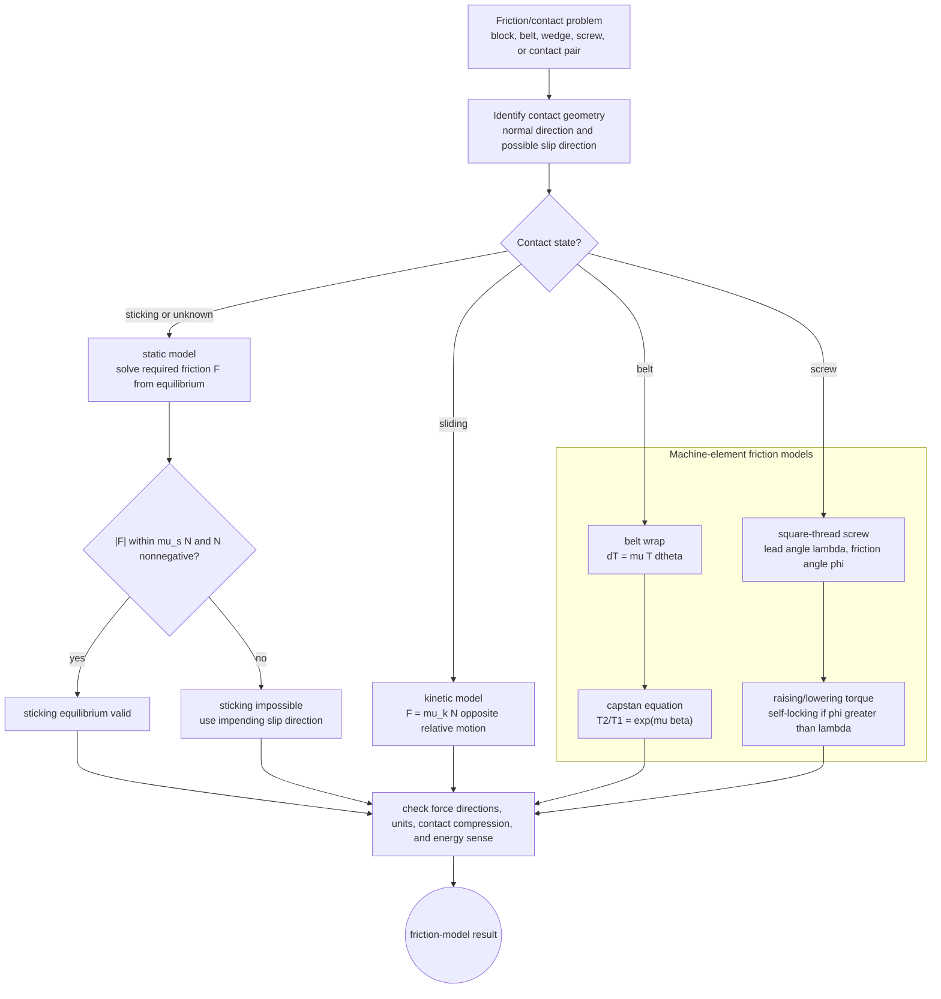

# Friction: Dry Contact, Belts, and Screws

Friction turns statics from pure equality into a problem with inequalities and contact states. A normal force may follow from force balance, but the friction force adjusts only up to a limit. The appropriate model depends on whether surfaces are sticking, sliding, wrapping around a drum, or acting through a screw thread.

The Coulomb, capstan, and square-thread screw models are first-order engineering approximations. They are useful when the surfaces are dry and the contact state is known or can be tested; detailed tribology requires material, lubrication, wear, temperature, and speed data that these models omit.

## Choose the contact state before solving

For dry contact, the normal reaction $N$ acts perpendicular to the surface. The friction force $F$ acts tangent to it and opposes relative motion or the tendency to move.

While the surfaces stick,

$$
|F|\le \mu_s N.
$$

The equilibrium equations determine the required value of $F$. Equality applies only at impending slip:

$$
|F|=\mu_s N.
$$

Once the surfaces slide, the usual kinetic model is

$$
|F|=\mu_k N,
$$

with the force opposite the relative sliding velocity. Usually $\mu_k\lt\mu_s$, although both coefficients vary with material, speed, lubrication, and surface condition.

A reliable static-contact calculation follows this order:

1. Assume the contact sticks.
2. Solve equilibrium for the friction force required by that assumption.
3. Check $\vert F\vert \le\mu_sN$ and $N\ge0$.
4. If either check fails, revise the contact state.

The distinction between actual and limiting friction is easiest to see on a horizontal block. If a horizontal force $P$ is slowly increased from zero, static friction initially has magnitude $F=P$. It grows with the applied force until $P=\mu_sN$. Only then is the limiting value reached. Writing $F=\mu_sN$ at the start would predict nonzero friction even when nothing tries to move the block.

The normal force also has to be solved rather than assumed equal to weight. A pull angled upward reduces $N$; a push angled downward increases it. Since the friction limit is proportional to $N$, the direction of an applied force can change whether motion begins.

| Model | Governing relation | Equality means | Main caution |
|---|---|---|---|
| Static dry friction | $\vert F\vert \le \mu_sN$ | Impending slip only | Do not set equality automatically |
| Kinetic dry friction | $\vert F\vert =\mu_kN$ | Sliding contact | Direction opposes relative motion |
| Belt friction | $T_2/T_1=e^{\mu\beta}$ | Impending slip | $\beta$ must be in radians |
| Screw friction | $M=Wr_m\tan(\lambda+\phi)$ | Raising load, square thread | Collar torque may be separate |

## Dry contact as a friction cone

The friction angle $\phi$ is defined by

$$
\tan\phi=\mu.
$$

At impending slip, the resultant contact force is tilted by $\phi$ from the normal. At a rough point contact, the static resultant must lie inside a cone with half-angle

$$
\phi_s=\tan^{-1}\mu_s.
$$

In two dimensions the cone becomes a wedge. If equilibrium requires a resultant outside it, sticking is impossible. The construction is particularly useful for ladders, wedges, blocks with several contacts, and machine elements whose normal and tangential components are easier to interpret as one reaction.

For a block on an incline of angle $\theta$ with no other applied force, impending downward sliding satisfies

$$
mg\sin\theta=\mu_smg\cos\theta,
$$

and therefore

$$
\tan\theta=\mu_s.
$$

The incline angle at impending motion is the friction angle.

### Pulling a crate at an angle

**Problem.** A $60$ kg crate rests on a horizontal floor with $\mu_s=0.40$ and $\mu_k=0.30$. It is pulled by a force $P$ at $25^\circ$ above horizontal. Find the force required to start motion and the acceleration immediately after motion begins if the applied force remains at that value. Use $g=9.81$ m/s$^2$.

At impending motion, friction acts opposite the expected rightward motion. Vertical equilibrium gives

$$
N=mg-P\sin25^\circ.
$$

Horizontal equilibrium at impending slip is

$$
P\cos25^\circ=\mu_sN.
$$

Substitution and collection of the $P$ terms gives

$$
P(\cos25^\circ+\mu_s\sin25^\circ)=\mu_smg,
$$

so

$$
P=\frac{(0.40)(60)(9.81)}{\cos25^\circ+(0.40)\sin25^\circ}
=218.9\ \text{N}.
$$

The normal force is

$$
N=60(9.81)-218.9\sin25^\circ=496.1\ \text{N}.
$$

Once sliding begins, friction drops to

$$
F_k=\mu_kN=(0.30)(496.1)=148.8\ \text{N}.
$$

The horizontal equation of motion then yields

$$
a=\frac{P\cos25^\circ-F_k}{m}
=\frac{218.9\cos25^\circ-148.8}{60}
=0.827\ \text{m/s}^2.
$$

The upward component remains below the weight, so contact is maintained. The force that was barely sufficient under the static model produces positive acceleration after the friction law changes.

## From belt equilibrium to the capstan equation

For a flexible belt or rope wrapped around a fixed drum through angle $\beta$, a differential belt element at impending slip gives

$$
dT=\mu T\,d\theta.
$$

Integrating over the contact arc yields

$$
\ln\left(\frac{T_2}{T_1}\right)=\mu\beta,
$$

or

$$
\frac{T_{\text{tight}}}{T_{\text{slack}}}=e^{\mu\beta}.
$$

The wrap angle $\beta$ is in radians. The exponential dependence gives a large holding advantage as either friction or wrap increases. The derivation assumes a flexible belt, uniform coefficient of friction, impending slip, and negligible bending stiffness.

To obtain the differential equation, isolate a belt element subtending $d\theta$. The end tensions are $T$ and $T+dT$. Radial equilibrium to first order gives $dN\approx T\,d\theta$. At impending tangential slip, $dF=\mu\,dN$, while tangential equilibrium gives $dT=dF$. Combining these relations yields $dT=\mu T\,d\theta$.

The capstan equation gives a limiting ratio, not a unique pair of tensions. Below impending slip, the belt can support any smaller ratio consistent with the applied loads. For a belt drive with pulley surface speed $v$, the ideal transmitted power is

$$
P=(T_{tight}-T_{slack})v.
$$

The tension ratio is friction-limited, while belt strength and bearing loads limit absolute tension. Centrifugal effects at high belt speed are absent from the elementary static model.

## Lead angle, torque, and self-locking screws

For a square-thread screw with lead $l$ per revolution and mean thread radius $r_m$, define the lead angle by

$$
\tan\lambda=\frac{l}{2\pi r_m}.
$$

With thread friction angle $\phi=\tan^{-1}\mu$, the torque estimates for a load $W$ are

$$
M_{\text{raise}}=Wr_m\tan(\lambda+\phi)
$$

and, when $\phi\gt\lambda$,

$$
M_{\text{lower}}=Wr_m\tan(\phi-\lambda).
$$

If $\phi\gt\lambda$, the simplified model predicts a self-locking screw: the load does not back-drive the screw without an applied torque. If $\phi\lt\lambda$, the screw can overhaul. Self-locking helps a jack hold its load but also increases the torque needed to raise it.

These expressions omit collar friction. A simple mean-radius model adds a collar torque such as

$$
M_c=\mu_cWR_c.
$$

Design calculations also need the actual thread form, bearing friction, strength, wear, lubrication, and an appropriate safety factor.

The square thread can be understood by unwrapping one turn of the helix into an inclined plane. Its rise is $l$ and its horizontal run is $2\pi r_m$. Raising the load is analogous to pushing a block up an incline of angle $\lambda$ with friction angle $\phi$. Ignoring collar friction, the ideal output work per revolution is $Wl$, while input work is $2\pi M_{raise}$. The raising efficiency is therefore

$$
\eta=\frac{Wl}{2\pi M_{raise}}
=\frac{\tan\lambda}{\tan(\lambda+\phi)}.
$$

Self-locking and high efficiency pull in opposite directions. A small lead angle helps prevent back-driving, but it increases the number of turns and the fraction of work dissipated by friction.

### Torque and efficiency of a square-thread jack

**Problem.** A square-thread screw raises a $12$ kN load. Its mean thread radius is $18$ mm, lead is $6$ mm, and thread coefficient of friction is $0.15$. Ignore collar friction. Find the raising torque, lowering torque, efficiency, and whether it is self-locking.

The lead and friction angles are

$$
\tan\lambda=\frac{0.006}{2\pi(0.018)}=0.05305,
\qquad \lambda=3.04^\circ,
$$

$$
\phi=\tan^{-1}(0.15)=8.53^\circ.
$$

Since $\phi\gt\lambda$, the simplified screw is self-locking. The raising torque is

$$
M_{raise}=(12{,}000)(0.018)\tan(11.57^\circ)
=44.2\ \text{N m}.
$$

The steady lowering torque is

$$
M_{lower}=(12{,}000)(0.018)\tan(5.49^\circ)
=20.8\ \text{N m}.
$$

Its positive value means a torque is required to lower the load; the load does not descend by itself. The raising efficiency is

$$
\eta=\frac{\tan3.04^\circ}{\tan11.57^\circ}=0.259.
$$

Only about $25.9\%$ of the idealized input work raises the load. Collar friction would increase both required torques and reduce overall efficiency.

## Checking whether a block can stick

**Problem.** A $40$ kg block rests on a $25^\circ$ incline. The coefficient of static friction is $\mu_s=0.35$. Determine whether it remains at rest. If it does, find the friction force. Use $g=9.81$ m/s$^2$.

Assume static equilibrium and resolve the weight relative to the plane:

$$
W=mg=40(9.81)=392.4\ \text{N},
$$

$$
W_\parallel=W\sin25^\circ=392.4(0.4226)=165.8\ \text{N},
$$

$$
W_\perp=W\cos25^\circ=392.4(0.9063)=355.7\ \text{N}.
$$

Normal equilibrium gives

$$
N=355.7\ \text{N}.
$$

Tangential equilibrium would require friction up the plane with magnitude

$$
F=165.8\ \text{N}.
$$

The available static-friction limit is

$$
F_{\max}=\mu_sN=0.35(355.7)=124.5\ \text{N}.
$$

Since

$$
165.8\ \text{N}\gt124.5\ \text{N},
$$

the assumed sticking state is impossible:

$$
\boxed{\text{The block slides down the incline.}}
$$

At impending slip, friction acts up the incline with magnitude $124.5$ N, which is insufficient to balance the downhill component of weight.

## Holding force on a wrapped rope

**Problem.** A rope wraps around a fixed drum through $210^\circ$. The coefficient of static friction is $\mu_s=0.28$. If the slack-side tension is $150$ N, find the largest tight-side tension that can be held without slipping.

First convert the wrap angle:

$$
\beta=210^\circ\left(\frac{\pi}{180^\circ}\right)=3.665\ \text{rad}.
$$

At impending slip,

$$
T_{\text{tight}}=T_{\text{slack}}e^{\mu\beta}
=150e^{0.28(3.665)}.
$$

The exponent and amplification factor are

$$
0.28(3.665)=1.026,
$$

$$
e^{1.026}=2.790.
$$

Thus

$$
\boxed{T_{\text{tight,max}}=150(2.790)\approx419\ \text{N}.}
$$

Below this value, static friction can support the tension difference. Above it, the rope slips toward the tight side.

## Several contacts and the risk of false uniqueness

With more than one rough contact, every contact has its own normal reaction, friction force, and possible slip direction. The inequalities are coupled through rigid-body equilibrium. It is unsafe to put every contact at its limiting friction value unless the proposed impending motion requires simultaneous slip at all of them.

A ladder against a rough floor and rough wall is a standard example. Three planar equilibrium equations are available, but four contact-force components may be unknown. The problem is statically indeterminate within a rigid Coulomb model until extra information is supplied, such as one smooth contact, an impending-slip pattern, or compliance. Assuming both contacts are limiting can create a solvable algebraic system, but it describes a special impending state rather than arbitrary equilibrium.

Wedges use friction to transform a horizontal input into a large normal force or vertical lift. A clean solution isolates the wedge and the supported body separately, then assigns each friction direction from their relative impending motion. Drawing one combined free body can eliminate the internal contact force, which is helpful for an external reaction but unhelpful when the driving force depends on that contact.

Jamming or self-energizing can occur when geometry makes an applied load increase a normal reaction, which then increases available friction. The resulting force multiplication is useful in brakes and clamps but can make release difficult. The Coulomb equations may admit no finite sliding force in an ideal rigid geometry; real deformation then controls behavior.

## Rolling resistance is a different model

An ideal rigid wheel rolling on an ideal rigid surface needs no horizontal force to maintain constant speed. Real wheels and surfaces deform. The normal pressure distribution shifts ahead of the geometric contact, creating a resisting moment. Bearing losses and material hysteresis add further resistance.

A common engineering approximation replaces these effects by a rolling-resistance force

$$
F_{rr}=C_{rr}N,
$$

where $C_{rr}$ is dimensionless, or by a resisting couple $M_{rr}=Nb$ with length parameter $b$. These are empirical descriptions and should not be confused with kinetic sliding friction. A rolling tire can have static contact locally while still dissipating energy through deformation.

Suppose a $1000$ kg vehicle travels on level ground with $C_{rr}=0.012$ and negligible aerodynamic drag. The required steady tractive force is

$$
F=C_{rr}mg=(0.012)(1000)(9.81)=117.7\ \text{N}.
$$

At $20$ m/s, the mechanical power needed solely for rolling resistance is

$$
P=Fv=(117.7)(20)=2.35\ \text{kW}.
$$

This loss rises linearly with speed under the constant-coefficient model. Aerodynamic drag power grows much faster and usually dominates at sufficiently high road speed.

## Energy and heat at a sliding contact

For steady sliding with friction magnitude $F_k$, the rate of mechanical-energy dissipation is related to relative slip speed:

$$
\dot E_{diss}=F_kv_{rel}.
$$

The generated thermal energy is divided between the bodies according to their thermal properties and contact conditions. The elementary force model says nothing about the interface temperature. Repeated braking, clutch engagement, or belt slip therefore requires a thermal check in addition to a force calculation.

Static friction can transfer energy without local slip when one surface moves. A block accelerated by a conveyor belt receives positive work from friction while it is slipping; after it matches belt speed, ideal static friction may fall to zero. On a driven rolling wheel, static friction can transmit motor work even though the instantaneous material points at an ideal contact have no relative velocity. Careful power accounting uses the velocity of each force's point of application on the chosen body.

## Signs and assumptions that need a second look

- Static friction is an inequality until impending motion has been established.
- The friction direction follows the relative motion or its tendency, not an arbitrary coordinate choice. A negative solved value means the initial directional assumption was reversed.
- A negative normal reaction means the contact has opened; dry friction cannot act there.
- Belt-friction exponents use radians, and the larger tension must be identified as the tight side.
- Screw calculations that specify a collar need its friction torque as well as thread torque.
- Measured friction coefficients have experimental scatter and should not be treated as exact material constants.
- Coulomb friction is largely independent of apparent contact area only within its elementary range. Soft materials, adhesion, lubrication, and high contact pressure can violate that approximation.
- Friction can point in the same direction as a body's center-of-mass motion, as when a driven wheel accelerates a vehicle. It opposes relative slip or impending slip at the contact.

See also: [Rigid-body equilibrium](/physics/mechanics/rigid-body-equilibrium) · [Particle equilibrium](/physics/mechanics/particle-equilibrium) · [Work-energy methods](/physics/mechanics/work-energy-methods) · [Planar rigid-body motion](/physics/mechanics/planar-rigid-body-motion)

