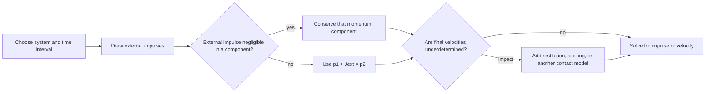

# Impulse, Momentum, and Impact

Newton's second law can be organized around distance, which leads to work and energy, or around time, which leads to impulse and momentum. The time form is natural when a force is known as a time history, when a collision lasts only milliseconds, or when the individual contact forces inside a system are awkward to determine. It keeps direction information throughout: momentum is a vector, and an external impulse can change one component without changing another.

Momentum balance and mechanical-energy balance answer different questions. Momentum can be conserved through a collision while kinetic energy becomes deformation, heat, and sound. Conversely, a body falling under gravity gains momentum because gravity supplies an external impulse, although mechanical energy may be conserved. Many impact problems use momentum for the system motion and a separate contact law for the relative motion.

## From Newton's law to impulse

For a particle of constant mass,

$$
\sum \mathbf F=\frac{d\mathbf p}{dt},
\qquad
\mathbf p=m\mathbf v.
$$

Integrating from $t_1$ to $t_2$ gives

$$
\int_{t_1}^{t_2}\sum \mathbf F\,dt=\mathbf p_2-\mathbf p_1,
$$

or

$$
\boxed{\mathbf p_1+\mathbf J_{\mathrm{ext}}=\mathbf p_2},
\qquad
\mathbf J_{\mathrm{ext}}=\int_{t_1}^{t_2}\sum \mathbf F\,dt.
$$

Impulse has units N s, equal to kg m/s. It is the signed area under a force-time graph. A constant average force is defined by matching that area:

$$
\mathbf F_{\mathrm{avg}}=\frac{1}{\Delta t}
\int_{t_1}^{t_2}\mathbf F(t)\,dt
=\frac{\mathbf J}{\Delta t}.
$$

It says nothing by itself about peak force. Two pulses can have the same impulse and very different maxima, which matters when local stress or injury is the concern.

For a system of particles, summing the particle equations cancels internal action-reaction pairs. Thus

$$
\mathbf P=\sum_i m_i\mathbf v_i=M\mathbf v_G,
$$

and

$$
\mathbf P_1+\mathbf J_{\mathrm{ext}}=\mathbf P_2.
$$

Internal impacts redistribute momentum among particles, but only external impulse changes the motion of the center of mass.

## Choosing the system and time interval

Suppose carts $A$ and $B$ collide. For $A$ alone, the contact impulse from $B$ is external and must appear. For $A+B$, that impulse is internal and disappears from the total balance. The combined system is usually best for finding final velocities; the single-cart system is useful when the contact impulse itself is requested.

Momentum conservation is conditional and componentwise. If

$$
J_{\mathrm{ext},x}=0,
$$

then $P_{1x}=P_{2x}$ even if a large external impulse acts in $y$. A projectile embedding in a block on a rough floor may conserve horizontal momentum during the brief penetration interval if the floor impulse is negligible. During later sliding, friction supplies substantial impulse and horizontal momentum is no longer conserved.

Finite forces are often neglected during a brief impact, but their scale should be checked. The weight impulse is

$$
J_W=mg\Delta t.
$$

For $m=1$ kg and $\Delta t=0.005$ s, it is $0.049$ N s. That is negligible beside a 10 N s collision impulse, but not beside a 0.05 N s impulse. “Short duration” only has meaning relative to the other impulses.

## Direct central impact

### The center-of-mass view

For an isolated pair, total momentum fixes the center-of-mass velocity:

$$
\mathbf v_G=\frac{m_A\mathbf v_A+m_B\mathbf v_B}{m_A+m_B}.
$$

During their collision, internal impulses cannot change $\mathbf v_G$. In a frame translating with the center of mass, the two momenta are equal and opposite at every instant, although their individual values change during contact. The collision then consists entirely of a change in relative motion superposed on unchanged translation of the pair.

This viewpoint provides a quick plausibility check. The final velocities cannot both lie on the same side of $v_G$ if the bodies are separating in one dimension; their mass-weighted deviations from $v_G$ must cancel. In a perfectly inelastic collision, relative motion disappears and both bodies move at $v_G$. In an elastic collision, the relative velocity reverses while retaining its magnitude.

An external impulse shifts the center-of-mass velocity by

$$
M(\mathbf v_{G2}-\mathbf v_{G1})=\mathbf J_{\mathrm{ext}}.
$$

That equation can remain useful even when internal impact details are complicated. It determines the translation of the full system, while restitution or a deformation model determines motion relative to the center of mass.

In direct central impact, both mass centers move along the common normal at contact. Momentum conservation gives one scalar equation for two unknown final velocities, so another relation is needed. Newton's experimental coefficient of restitution supplies it:

$$
e=\frac{\text{relative speed of separation}}
{\text{relative speed of approach}}.
$$

If $A$ approaches $B$ in the positive direction,

$$
\boxed{e=\frac{v_{B2}-v_{A2}}{v_{A1}-v_{B1}}}.
$$

Writing the formula in words before inserting signs prevents a common error. The denominator must describe approach and be positive for an actual closing contact. The numerator describes separation. For ordinary passive bodies, $0\le e\le1$: $e=1$ is the ideal elastic limit, and $e=0$ means zero relative normal speed immediately after impact. Values above one can occur when stored or chemical energy is released during contact, outside the passive model.

Momentum and restitution can be solved once in general:

$$
\begin{aligned}
m_Av_{A1}+m_Bv_{B1}&=m_Av_{A2}+m_Bv_{B2},\\
v_{B2}-v_{A2}&=e(v_{A1}-v_{B1}).
\end{aligned}
$$

The solution is

$$
\begin{aligned}
v_{A2}
&=\frac{m_A-em_B}{m_A+m_B}v_{A1}
+\frac{(1+e)m_B}{m_A+m_B}v_{B1},\\
v_{B2}
&=\frac{(1+e)m_A}{m_A+m_B}v_{A1}
+\frac{m_B-em_A}{m_A+m_B}v_{B1}.
\end{aligned}
$$

When $e=0$, both reduce to the shared velocity

$$
v_2=\frac{m_Av_{A1}+m_Bv_{B1}}{m_A+m_B}.
$$

The kinetic-energy loss also has a compact form. Introduce center-of-mass velocity $V$ and relative velocity $u=v_A-v_B$:

$$
T=\frac12(m_A+m_B)V^2+\frac12\mu u^2,
\qquad
\mu=\frac{m_Am_B}{m_A+m_B}.
$$

Momentum conservation leaves $V$ unchanged. Restitution changes $u_1$ to $u_2=-eu_1$. Therefore

$$
\boxed{T_1-T_2
=\frac12\mu(1-e^2)(v_{A1}-v_{B1})^2}.
$$

The loss depends on relative motion, not on the translational motion of the pair. Two bodies traveling together at high speed have no impact energy to dissipate because their approach speed is zero.

## Oblique contact and friction

At a smooth contact, resolve velocity into a normal direction $\mathbf n$ and a tangential direction $\mathbf t$. The impulsive contact force acts along $\mathbf n$, so each particle's tangential velocity is unchanged during the short collision:

$$
v_{A2,t}=v_{A1,t},
\qquad
v_{B2,t}=v_{B1,t}.
$$

Restitution applies only to normal components:

$$
e=\frac{v_{B2,n}-v_{A2,n}}
{v_{A1,n}-v_{B1,n}}.
$$

System momentum equations still apply in both coordinate directions, subject to external impulse. With rough contact, tangential friction impulse can change tangential velocities and start or alter rotation. A friction law and angular impulse equations are then needed; preserving tangential velocity would be an extra, usually false, assumption.

## Angular impulse and the choice of point

For a particle about a fixed point $O$,

$$
\mathbf H_O=\mathbf r_O\times m\mathbf v,
$$

and

$$
\int_{t_1}^{t_2}\sum\mathbf M_O\,dt
=\mathbf H_{O2}-\mathbf H_{O1}.
$$

For a system, use total angular momentum and include only external moment impulses. The choice of $O$ can remove an unknown impulse whose line of action passes through $O$. During impact on a slender bar pinned at one end, the pin exerts a large impulse, yet its moment about the pin is zero. Angular momentum about that pin can determine the immediate angular velocity without first finding the pin impulse.

Taking moments about a fixed inertial point is safe. A moving reference point generally introduces extra terms unless it is the center of mass or another specially justified choice.

## Worked collision: two carts

A $2$ kg cart $A$ moves right at $5$ m/s. A $3$ kg cart $B$ ahead moves right at $1$ m/s. They collide with $e=0.6$. Find both final velocities and the kinetic-energy loss.

Take right as positive and include both carts. The track has negligible horizontal impulse:

$$
2(5)+3(1)=2v_{A2}+3v_{B2},
$$

so

$$
2v_{A2}+3v_{B2}=13.
$$

The approach speed is $5-1=4$ m/s. Restitution requires

$$
v_{B2}-v_{A2}=0.6(4)=2.4\ \text{m/s}.
$$

Set $v_{B2}=v_{A2}+2.4$ and substitute:

$$
\begin{aligned}
2v_{A2}+3(v_{A2}+2.4)&=13,\\
5v_{A2}&=5.8,\\
v_{A2}&=1.16\ \text{m/s},\\
v_{B2}&=3.56\ \text{m/s}.
\end{aligned}
$$

The momentum check is $2(1.16)+3(3.56)=13.00$ kg m/s. The reduced mass is

$$
\mu=\frac{(2)(3)}{2+3}=1.2\ \text{kg},
$$

and the loss is

$$
T_1-T_2=\frac12(1.2)(1-0.6^2)(4)^2=6.144\ \text{J}.
$$

Direct calculation gives $T_1=26.5$ J and $T_2=20.356$ J, confirming the result.

## Worked impulse: a force pulse and gravity

A $0.50$ kg ball initially moves horizontally at $3$ m/s to the right. During a $0.020$ s contact, a horizontal force rises linearly from zero to $400$ N over $0.008$ s and then falls linearly to zero. Find the final horizontal velocity and estimate the vertical velocity change from gravity.

The horizontal impulse is the area of the triangular graph:

$$
J_x=\frac12(0.020)(400)=4.00\ \text{N s}.
$$

Then

$$
\begin{aligned}
mv_{x1}+J_x&=mv_{x2},\\
0.50(3)+4.00&=0.50v_{x2},\\
v_{x2}&=11.0\ \text{m/s}.
\end{aligned}
$$

The average horizontal force is

$$
F_{\mathrm{avg}}=\frac{4.00}{0.020}=200\ \text{N},
$$

half the peak of the triangular pulse. Gravity produces

$$
J_y=-mg\Delta t=-0.50(9.81)(0.020)=-0.0981\ \text{N s},
$$

so

$$
\Delta v_y=\frac{J_y}{m}=-0.196\ \text{m/s}.
$$

Gravity has no effect on the computed horizontal velocity. The small downward component should remain if the full post-contact velocity is requested.

## Worked impact impulse on one body

A $0.20$ kg ball moving right at $12$ m/s strikes a stationary $0.80$ kg block on a smooth surface. The coefficient of restitution is $0.50$. Find the final velocities and the impulse exerted on the ball.

For the pair,

$$
0.20(12)=0.20v_{A2}+0.80v_{B2},
$$

or

$$
v_{A2}+4v_{B2}=12.
$$

Restitution gives

$$
v_{B2}-v_{A2}=0.50(12)=6.
$$

Using $v_{A2}=v_{B2}-6$,

$$
(v_{B2}-6)+4v_{B2}=12,
$$

so

$$
v_{B2}=3.6\ \text{m/s},
\qquad
v_{A2}=-2.4\ \text{m/s}.
$$

The ball rebounds. Isolating it now makes the block's impulse external:

$$
J_{B\to A}=m_A(v_{A2}-v_{A1})
=0.20(-2.4-12)=-2.88\ \text{N s}.
$$

The impulse on the ball is $2.88$ N s left. The block receives $2.88$ N s right, consistent with $0.80(3.6)=2.88$ kg m/s.

## Reading force-time and momentum-time histories

The integral form remains useful when force is measured rather than described by one average value. A load cell may provide sampled values of $F(t)$. The impulse is then the area under the measured curve, found by numerical quadrature if necessary. A constant baseline or sensor bias must be removed before integration because even a small offset accumulates over time. If the particle mass is constant, the momentum history follows directly:

$$
\mathbf p(t)=\mathbf p(t_0)+\int_{t_0}^{t}\sum\mathbf F(\tau)\,d\tau.
$$

The slope of a momentum-time graph is net force, while the change in momentum between two times is impulse. A sharp but finite force pulse produces a rapid continuous change in momentum. An ideal impulse is the limiting model in which duration tends to zero while area remains finite; momentum then has a jump. Position does not jump during such an idealization because the finite velocity change acts over zero elapsed time.

Sometimes the inverse question is more useful. If high-speed measurements give velocities immediately before and after contact, the net impulse follows from $m(\mathbf v_2-\mathbf v_1)$ even when the detailed contact force is unknown. Dividing by measured contact duration gives average force, but reconstructing the peak or pulse shape requires additional data. Momentum measurements determine area, not the full curve.

For a nonconstant applied force, direction may change during the interval. Integrate components or integrate the vector function; adding magnitudes of small impulses generally overestimates the magnitude of their vector sum. The same warning applies to a force that reverses sign: positive and negative areas cancel in the net impulse, although the body may undergo substantial intermediate velocity changes.

## What the restitution model leaves out

The coefficient $e$ is an empirical relation between normal relative velocities immediately before and after contact. It is not a universal material constant. Its measured value can depend on impact speed, geometry, temperature, surface condition, and how much deformation occurs outside the local contact region. Tabulated values are therefore estimates tied to test conditions, not exact properties like an idealized density.

Restitution says nothing about the duration or peak force. A soft ball and a hard ball can have the same $e$ while producing very different force histories. Nor does one scalar coefficient describe frictional tangential impulse, spin, permanent indentation, or vibration after separation. Those effects require a richer contact model.

The “immediately before” and “immediately after” states should bracket the contact event closely. If velocities are measured after gravity, drag, or rolling resistance has acted for an appreciable time, the inferred $e$ mixes collision behavior with later external impulse. The same timing issue appears in drop tests: the rebound velocity at loss of contact is the relevant value, not a velocity measured much later in the flight.

Multiple contacts need extra care. Three balls touching in a line do not necessarily behave as a sequence of isolated two-body impacts; contact intervals can overlap. Applying the two-body restitution equation repeatedly in an arbitrary order may give order-dependent answers. Rigid-body impact theory also needs angular momentum when the contact line misses a mass center, because the normal impulse then changes both translation and rotation.

Energy checks remain valuable. For a passive direct impact with $0\le e\le1$, the calculated kinetic-energy loss cannot be negative. A negative “loss” usually indicates a sign error in the relative velocities, an inconsistent momentum balance, or an active event that the passive restitution model cannot represent.

## Checks that catch bad impact models

- Confirm that the bodies are approaching before applying restitution. A negative approach speed signals a wrong assumed order or direction.
- Apply restitution along the contact normal only. It is not a vector equation and does not govern tangential motion.
- Keep momentum and energy separate. Momentum conservation does not imply kinetic-energy conservation; ideal elastic impact also needs $e=1$.
- Compare every neglected external impulse with the contact impulse rather than dismissing weight or support forces from duration alone.
- Check the post-impact relative velocity. For passive impact it must represent separation and have magnitude $e$ times the approach speed.
- Treat average force as an impulse-equivalent number. Peak force needs a contact model or a measured force-time curve.

## Related pages

- [Particle kinetics with Newton's second law](/physics/mechanics/particle-kinetics-newton)
- [Work-energy methods](/physics/mechanics/work-energy-methods)
- [Planar rigid-body motion](/physics/mechanics/planar-rigid-body-motion)
- [Linear momentum and collisions](/physics/general/linear-momentum-and-collisions)
