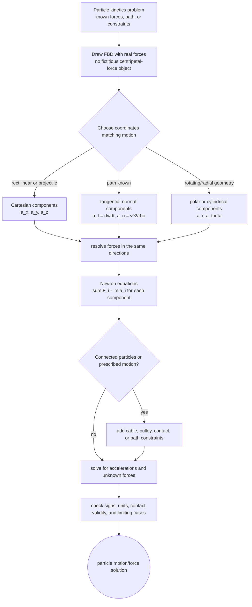

# Particle Kinetics with Newton's Second Law

Particle kinetics connects motion to the forces that produce it. Newton's second law is vectorial, so most of the work lies in choosing coordinates, drawing a complete free-body diagram, and expressing force and acceleration in the same basis.

Static equilibrium is the special case $\mathbf{a}=\mathbf{0}$. With nonzero acceleration the free-body diagram rules do not change: isolate the particle, show the real external forces, and keep $m\mathbf{a}$ on the equation side rather than drawing it as another force.

## Match the coordinates to the motion

For a particle of constant mass,

$$
\sum\mathbf{F}=m\mathbf{a}.
$$

The component form depends on the selected basis.

In fixed Cartesian coordinates,

$$
\sum F_x=ma_x,\qquad \sum F_y=ma_y,\qquad \sum F_z=ma_z.
$$

Along a known curved path, tangential-normal coordinates give

$$
\sum F_t=m\dot{v},
$$

$$
\sum F_n=m\frac{v^2}{\rho}.
$$

The positive normal direction points toward the center of curvature. The magnitude $v^2/\rho$ is nonnegative even when a chosen Cartesian component of the acceleration is negative.

For radial or rotating geometry, polar coordinates give

$$
\sum F_r=m(\ddot{r}-r\dot{\theta}^2),
$$

$$
\sum F_\theta=m(r\ddot{\theta}+2\dot{r}\dot{\theta}).
$$

| Motion description | Best components | Newton equations |
|---|---|---|
| Straight-line block | Along and normal to path | $\sum F_s=ma$, $\sum F_n=0$ |
| Projectile | Cartesian | $\sum F_x=ma_x$, $\sum F_y=ma_y$ |
| Curved path with known speed | Tangential-normal | $\sum F_t=m\dot{v}$, $\sum F_n=mv^2/\rho$ |
| Rotating arm or slot | Polar | $\sum F_r=m(\ddot r-r\dot\theta^2)$ |
| Connected particles | Coordinates along cables or paths | Newton equations plus acceleration constraints |

Resolving forces in $x,y$ while writing acceleration in $t,n$ mixes bases. Either project the forces onto $t,n$ or express the acceleration in $x,y$ before equating components.

The tangential-normal form follows by differentiating $\mathbf v=v\mathbf e_t$. Since the tangent unit vector changes at the rate $d\mathbf e_t/dt=(v/\rho)\mathbf e_n$,

$$
\mathbf a=\frac{dv}{dt}\mathbf e_t
+v\frac{d\mathbf e_t}{dt}
=\dot v\mathbf e_t+\frac{v^2}{\rho}\mathbf e_n.
$$

Tangential force changes speed; normal force bends the path. A force perpendicular to velocity can turn a particle without doing work.

Polar acceleration contains extra terms because both unit vectors rotate. From

$$
\dot{\mathbf e}_r=\dot\theta\mathbf e_\theta,
\qquad
\dot{\mathbf e}_\theta=-\dot\theta\mathbf e_r,
$$

two differentiations of $\mathbf r=r\mathbf e_r$ give

$$
\mathbf v=\dot r\mathbf e_r+r\dot\theta\mathbf e_\theta,
$$

$$
\mathbf a=(\ddot r-r\dot\theta^2)\mathbf e_r
+(r\ddot\theta+2\dot r\dot\theta)\mathbf e_\theta.
$$

The $-r\dot\theta^2$ term is inward acceleration. The $2\dot r\dot\theta$ term appears when radial motion occurs while the radial line rotates.

## What belongs on the free-body diagram

A kinetics free-body diagram contains only external forces. Near Earth's surface, weight is

$$
W=mg
$$

and acts downward, with $g\approx9.81$ m/s$^2$. Contact forces, cable tensions, spring forces, and applied loads are added according to the physical connections.

The quantity $m\mathbf{a}$ is not a separate force in the standard Newton formulation. Likewise, “centripetal force” is not a new object to draw. The inward component of the real forces must equal

$$
m\frac{v^2}{R}.
$$

That inward resultant may come from tension, gravity, a normal reaction, friction, or several forces together. Constant speed only sets $\dot v=0$; it does not remove the normal acceleration on a curved path.

For a particle sliding on a rough surface,

$$
F_k=\mu_kN,
$$

with kinetic friction opposite the relative sliding direction. On a smooth surface there is no tangential contact force, while the normal reaction remains perpendicular to the surface.

## Constraints couple otherwise separate equations

A constraint equation relates positions, velocities, or accelerations through geometry. A particle on a circular path of fixed radius $R$, for example, has $\dot r=\ddot r=0$ in polar coordinates.

For several connected particles, draw one free body and write one equation of motion for each body before eliminating unknowns. A taut massless cable over a frictionless pulley gives equal acceleration magnitudes along the cable and, under the same idealization, equal tension magnitudes. Pulley inertia, cable mass, elasticity, or slip changes those relations.

Combining bodies removes internal connection forces and is useful when those forces are not requested. Keeping bodies separate is necessary when a tension, normal reaction, or friction force must be found.

Apparent weight is another constraint-force calculation. In an elevator, a scale reads the normal force rather than $mg$. With upward positive,

$$
N-mg=ma.
$$

Hence $N=m(g+a)$ during upward acceleration and $N=m(g-a)$ during downward acceleration of magnitude $a$. The mass and gravitational force are unchanged; the support force changes to produce the acceleration.

Newton equations describe an instant. Later speed and position require integration or a kinematic relation. If force depends on position, velocity, or time, the equation of motion is generally a differential equation rather than a constant-acceleration formula.

For one-dimensional motion under a position-dependent force,

$$
m\ddot x=F(x).
$$

Using $\ddot x=v\,dv/dx$ converts the equation to

$$
mv\frac{dv}{dx}=F(x),
$$

which can be integrated between positions. This is the differential form behind work-energy. An instantaneous reaction force still requires the force equation at the state of interest.

## Acceleration of a block on a rough incline

**Problem.** A $25$ kg block slides down a $20^\circ$ incline. The coefficient of kinetic friction is $\mu_k=0.18$. Find its acceleration down the plane. Use $g=9.81$ m/s$^2$.

Choose axes along and normal to the plane. The weight is

$$
W=mg=25(9.81)=245.25\ \text{N}.
$$

There is no normal acceleration, so

$$
\sum F_n=0:\quad N-W\cos20^\circ=0,
$$

and

$$
N=245.25(0.9397)=230.46\ \text{N}.
$$

The kinetic-friction magnitude is

$$
F_k=\mu_kN=0.18(230.46)=41.48\ \text{N}.
$$

Because the block slides down, friction acts up the plane. Taking downhill as positive,

$$
\sum F_t=ma:\quad W\sin20^\circ-F_k=ma.
$$

Substitution gives

$$
245.25(0.3420)-41.48=25a,
$$

$$
42.38=25a,
$$

and therefore

$$
\boxed{a=1.70\ \text{m/s}^2\ \text{down the incline}.}
$$

The result is below the frictionless acceleration $g\sin20^\circ=3.36$ m/s$^2$.

## Cable tension at the bottom of a swing

**Problem.** A $3$ kg particle is attached to a light cable of length $1.2$ m and passes through the bottom of its path at $4.0$ m/s. Find the cable tension at that instant.

At the bottom, the positive normal direction is upward toward the pivot. The normal acceleration is

$$
a_n=\frac{v^2}{R}=\frac{(4.0)^2}{1.2}=13.33\ \text{m/s}^2.
$$

Tension acts upward and weight acts downward, so

$$
\sum F_n=ma_n:\quad T-mg=m\frac{v^2}{R}.
$$

Solving,

$$
T=mg+m\frac{v^2}{R}
=3(9.81)+3(13.33),
$$

$$
\boxed{T=69.4\ \text{N}.}
$$

The tension exceeds the weight because the cable supplies both support and the inward acceleration.

## Connected particles: keep the constraint explicit

**Problem.** Blocks $A$ and $B$ of masses $4$ kg and $7$ kg are connected by a light cable over a frictionless, massless pulley. Block $A$ rests on a horizontal surface with $\mu_k=0.20$; block $B$ hangs vertically. Find the acceleration and cable tension.

The fixed cable length gives equal acceleration magnitudes. Assume $B$ moves downward and $A$ moves toward the pulley. For $A$,

$$
N_A=m_Ag=(4)(9.81)=39.24\ \text{N},
$$

$$
F_k=\mu_kN_A=(0.20)(39.24)=7.848\ \text{N}.
$$

Taking each motion direction as positive, the equation for $A$ is

$$
T-7.848=4a.
$$

For hanging block $B$,

$$
68.67-T=7a.
$$

Adding eliminates the internal tension:

$$
68.67-7.848=11a,
$$

so

$$
a=5.53\ \text{m/s}^2.
$$

Substitution into the first equation gives

$$
T=4(5.53)+7.848=30.0\ \text{N}.
$$

The positive acceleration confirms the assumed direction. The tension is below $m_Bg$ because $B$ accelerates downward. Combining the bodies finds acceleration quickly, but separating them is needed to recover $T$.

## Contact at the top of a circular path

**Problem.** A $0.50$ kg block moves on the inside of a smooth vertical circular track of radius $1.5$ m. At the top, its speed is $5.0$ m/s. Find the normal force and the minimum top speed required to maintain contact.

At the top, inward is downward. Weight and the track's normal force both point inward:

$$
mg+N=m\frac{v^2}{R}.
$$

Therefore

$$
N=m\left(\frac{v^2}{R}-g\right)
=0.50\left(\frac{25}{1.5}-9.81\right)
=3.43\ \text{N}.
$$

Contact is just lost when the surface would otherwise need to pull. Set $N=0$:

$$
mg=m\frac{v_{min}^2}{R},
$$

which gives

$$
v_{min}=\sqrt{gR}=\sqrt{(9.81)(1.5)}=3.84\ \text{m/s}.
$$

A lower speed produces a negative value from the assumed-contact equation. That value signals separation; the particle then follows free flight until another contact occurs.

## Force laws lead to differential equations

Constant acceleration is a special case. A linear spring produces $F_s=-kx$, so a frictionless mass measured from equilibrium obeys

$$
m\ddot x+kx=0.
$$

Its acceleration changes with position and reverses direction across equilibrium. The solution is harmonic,

$$
x(t)=A\cos(\omega_nt+\phi),
\qquad
\omega_n=\sqrt{\frac{k}{m}}.
$$

Newton's law supplies both the trajectory model and the force interpretation. At maximum displacement, speed is zero but acceleration magnitude is largest. At equilibrium, acceleration is zero while speed is largest.

Velocity-dependent resistance gives another common differential equation. With linear drag $F_D=-bv$ and downward positive, a falling body satisfies

$$
m\frac{dv}{dt}=mg-bv.
$$

Terminal speed occurs when acceleration becomes zero:

$$
v_t=\frac{mg}{b}.
$$

Starting from rest, separation or an integrating factor gives

$$
v(t)=v_t\left(1-e^{-t/\tau}\right),
\qquad
\tau=\frac mb.
$$

The time constant $\tau$ sets the approach rate. Terminal speed is an asymptote, not a speed reached suddenly. Quadratic drag produces a different equation and different functional form, so a “terminal velocity formula” must be tied to the drag law.

### Falling with linear resistance

A $2.0$ kg object falls from rest through a fluid with $b=4.0$ N s/m. Its terminal speed and time constant are

$$
v_t=\frac{(2.0)(9.81)}{4.0}=4.905\ \text{m/s},
$$

$$
\tau=\frac{2.0}{4.0}=0.500\ \text{s}.
$$

After $1.0$ s,

$$
v(1.0)=4.905\left(1-e^{-1.0/0.500}\right)
=4.905(1-e^{-2})
=4.24\ \text{m/s}.
$$

Acceleration can be found either by differentiation or directly from the force balance:

$$
a=g-\frac bm v
=9.81-\frac{4.0}{2.0}(4.24)
=1.33\ \text{m/s}^2.
$$

It is still downward but much smaller than $g$. Neglecting drag would predict $9.81$ m/s after one second, already exceeding the model's terminal speed.

## Normal reactions are solved, not prescribed

A normal force enforces a contact constraint while contact exists. It does not automatically equal $mg$. In an accelerating elevator it changes with vertical acceleration; on a curved path it participates in the normal equation; on an incline it balances only the normal component of other forces when normal acceleration is zero.

For a vehicle crossing the crest of a circular hill of radius $\rho$, take inward as downward. The forces give

$$
mg-N=m\frac{v^2}{\rho}.
$$

Thus

$$
N=m\left(g-\frac{v^2}{\rho}\right).
$$

The apparent weight falls as speed rises. At $v=\sqrt{g\rho}$ the normal force reaches zero; beyond that speed the road would have to pull downward to maintain the assumed circular path, so the vehicle loses contact.

At the bottom of a dip the inward direction is upward, giving $N-mg=mv^2/\rho$. The normal force is then greater than weight. Memorizing “add centripetal force” obscures the sign change; drawing the actual forces and choosing inward positive handles both cases.

## Variable mass needs momentum flux

The form $\sum\mathbf F=m\mathbf a$ assumes a particle or fixed collection of matter with constant mass. A rocket loses propellant, and a conveyor or leaking cart exchanges mass with its surroundings. Differentiating $m\mathbf v$ without accounting for the velocity of entering or leaving mass gives the wrong equation.

For an ideal rocket in otherwise force-free space, exhaust leaves at speed $u$ relative to the rocket. Momentum balance leads to

$$
m\,dv=-u\,dm,
$$

where $dm\lt0$ for the rocket. Integration gives the rocket equation

$$
\Delta v=u\ln\left(\frac{m_0}{m_f}\right).
$$

The logarithm expresses diminishing returns: each added increment of propellant must initially accelerate the propellant that will be expelled later. External gravity and drag add forces and generally require time integration. Variable-mass systems should be treated as control-volume momentum problems rather than by casually replacing constant $m$ with $m(t)$ in the particle equation.

## Static, kinetic, and impending contact are different states

Newton's law does not determine a friction model by itself. For a block initially at rest on a rough incline, begin by solving the acceleration required under a sticking assumption, normally zero relative to the surface. The friction force then takes the value needed for that motion if it lies within the static limit. If the required value exceeds $\mu_sN$, sticking is impossible and a sliding model must replace it.

The transition can change acceleration discontinuously in the ideal Coulomb model because kinetic friction is usually smaller than limiting static friction. Real interfaces smooth the transition through deformation and microslip, but the piecewise model remains useful. A calculation should state which side of the transition it represents.

Loss of contact is another state change. While $N\gt0$, a surface constraint supplies a normal force. At $N=0$, the constraint can become inactive. The subsequent acceleration is found from the remaining forces, often gravity alone, and the path no longer follows the original surface. Continuing to impose the old normal acceleration after separation creates a negative reaction that has no physical source.

Taut cables behave similarly: tension is nonnegative and the length constraint applies while taut. A computed negative tension indicates slack cable, after which connected particles may move independently until the cable becomes taut again. These inequalities make contact and cable problems piecewise dynamics problems rather than one global set of equations.

## Checks that catch most setup errors

- Keep $m\mathbf{a}$ off a standard free-body diagram, and do not add a separate centripetal force.
- Resolve force and acceleration in the same directions.
- Determine kinetic-friction direction from relative sliding at the contact.
- Retain $v^2/\rho$ when a particle follows a curved path at constant speed.
- Do not replace a moving cable tension or normal reaction by its static value without checking the acceleration equation.
- Write the geometric constraint explicitly for connected particles.
- Check dimensions: $\text{N}=\text{kg}\cdot\text{m/s}^2$. Mass is not measured in newtons, and weight is not measured in kilograms.
- Compare the solved reactions and tensions with the static limit when $a$ is small, and expect larger departures as $a/g$ grows.
- A negative unilateral contact force means the assumed contact has opened. Replace the model rather than accepting a surface that pulls.
- Newton's law in this form assumes an inertial frame. Accelerating-frame shortcuts require deliberately introduced inertial forces and a stated frame.

See also: [Particle equilibrium](/physics/mechanics/particle-equilibrium) · [Particle kinematics](/physics/mechanics/particle-kinematics) · [Work-energy methods](/physics/mechanics/work-energy-methods) · [Impulse, momentum, and impact](/physics/mechanics/impulse-momentum-impact)

