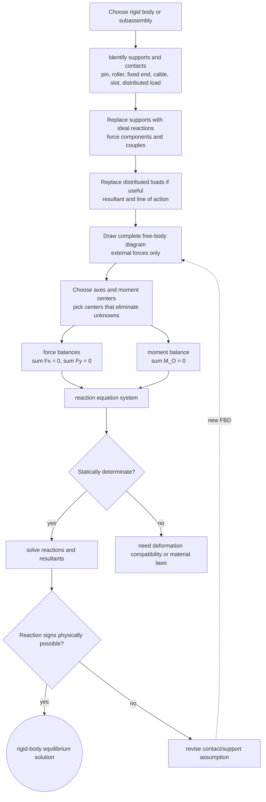

# Rigid-Body Equilibrium

A rigid body can translate and rotate, so force balance alone is insufficient. A beam, bracket, ladder, frame member, or machine link may have zero resultant force and still have a net moment. Equilibrium therefore requires a free-body diagram that preserves both the magnitudes and the points of application of external loads.

The central modeling decisions are which body to isolate, how to replace its supports, and where to take moments. Once those are explicit, the algebra is usually short.

## From supports to a solvable free-body diagram

A rigid body is idealized as maintaining fixed distances between its material points. In static equilibrium,

$$
\sum\mathbf{F}=\mathbf{0},\qquad \sum\mathbf{M}_O=\mathbf{0}
$$

about any point $O$. In two dimensions these vector equations supply three scalar equations:

$$
\sum F_x=0,\qquad \sum F_y=0,\qquad \sum M_O=0.
$$

In three dimensions there are six:

$$
\sum F_x=\sum F_y=\sum F_z=0,
$$

$$
\sum M_x=\sum M_y=\sum M_z=0.
$$

Each support is replaced by the motions it prevents. The standard planar idealizations are:

| 2D support | Reaction components | Allows rotation? | Typical notation |
|---|---:|---:|---|
| Smooth roller on horizontal surface | $R_y$ | Yes | One normal reaction |
| Pin | $A_x,A_y$ | Yes | Two force components |
| Fixed end | $A_x,A_y,M_A$ | No | Two forces and a couple |
| Short cable | $T$ along cable | Yes | One tensile force |
| Smooth slot | Normal to slot | Yes | One constrained direction |

Support models encode assumptions about geometry and friction. A pin prevents translation in two directions but permits rotation, so it supplies no reaction couple in the ideal planar model. A roller reaction is normal to its supporting surface, not always vertical. A cable can pull only along its axis. These restrictions later provide checks on the algebraic signs.

A rigid body may also be isolated as part of a larger assembly. Internal forces between included members disappear when the whole assembly is chosen as the free body. Isolating a single member exposes the joint forces needed for member design. The requested unknowns should guide that choice.

## Moments retain the load geometry

The moment of a force applied at $P$ about $O$ is

$$
\mathbf{M}_O=\mathbf{r}_{OP}\times\mathbf{F}.
$$

For planar components, taking counterclockwise as positive,

$$
M_O=xF_y-yF_x.
$$

If the perpendicular distance from $O$ to the force's line of action is known,

$$
|M_O|=Fd_\perp.
$$

The scalar distance form is fast when the lever arm and sign are obvious. The component form is safer for angled forces and coordinate geometry.

Sliding a force along its own line of action leaves its moment unchanged. Moving the force to a parallel but distinct line does not. A couple, by contrast, is a pure moment generated by equal and opposite parallel forces. Its value is independent of the reference point, so a couple is treated as a free vector and is never multiplied by another lever arm.

A force applied at point $A$ can be moved to point $O$ only by adding a couple:

$$
\mathbf M_O=\mathbf r_{OA}\times\mathbf F.
$$

The force-couple system has the same external effect on a rigid body. Omitting the added couple changes the loading unless the move stays on the original line of action. This equivalence reduces a multi-force system to a resultant force and a resultant moment at a convenient point.

Moments about two points are related by

$$
\mathbf M_B=\mathbf M_A+\mathbf r_{BA}\times\mathbf R,
$$

where $\mathbf R$ is the resultant force. If $\mathbf R=\mathbf0$, the net moment is the same about every point and the load system is a pure couple.

## Selecting equations that eliminate unknowns

The familiar planar set

$$
\sum F_x=0,\qquad \sum F_y=0,\qquad \sum M_O=0
$$

is not the only possible choice. Any three independent equilibrium equations may be used. Two moment equations and one force equation can be efficient, provided the chosen equations do not discard the same unknown information.

A useful moment center lies on the lines of action of unwanted reactions. Those forces then contribute zero moment and disappear from that equation. Forces passing through the center should not be retained with artificial lever arms.

A distributed load may be condensed for external equilibrium. For a vertical distribution $w(x)$ over $a\le x\le b$,

$$
R=\int_a^b w(x)\,dx,
$$

acting at

$$
\bar{x}=\frac{\int_a^b xw(x)\,dx}{\int_a^b w(x)\,dx}.
$$

For a uniform load $w_0$ over length $L$, the resultant is $w_0L$ at the midpoint. This replacement preserves the total external force and moment; it does not reproduce the internal shear or bending distribution.

For a triangular load rising linearly from zero to $w_0$ over length $L$, the resultant is

$$
R=\frac12w_0L,
$$

and acts one-third of the base length from the larger-intensity end. “One-third from the heavy end” prevents the common mistake of placing every distributed load at the midpoint.

### Beam under a triangular distributed load

**Problem.** A simply supported beam of length $6$ m carries a downward triangular load that is zero at pin $A$ and increases to $9$ kN/m at roller $B$. Find the reactions.

The equivalent load is

$$
R=\frac12(9)(6)=27\ \text{kN},
$$

acting $4$ m from $A$. With no horizontal applied load, $A_x=0$. Moment balance about $A$ gives

$$
6B_y-27(4)=0,
$$

so

$$
B_y=18\ \text{kN}.
$$

Vertical balance gives

$$
A_y+B_y-27=0,
$$

$$
A_y=9\ \text{kN}.
$$

The larger reaction occurs at the heavy end. A moment check about $B$ gives $-6(9)+27(2)=0$.

## Determinacy and support engagement

A body is statically determinate when equilibrium supplies enough independent equations for all reaction unknowns. A planar simply supported beam with one pin and one roller has three unknown reactions and three equilibrium equations. A fixed-fixed beam has more reaction unknowns than statics can determine and needs deformation compatibility and material laws.

The solved signs also test the support assumptions. A roller or unilateral contact normally pushes rather than pulls, and a cable carries tension rather than compression. If equilibrium demands the forbidden sense, the assumed connection is not engaged in the proposed configuration. A zero reaction may be a valid unloaded support rather than an algebra error.

Counting unknowns is necessary but not sufficient for determinacy. A planar body with three reaction components may remain unstable if their lines of action are arranged poorly. Three parallel reactions cannot restrain translation perpendicular to them; three concurrent reaction lines cannot generally restrain rotation about their intersection. The equilibrium equations then become dependent or admit a mechanism.

If a member has forces applied only at two pins and carries no other load or couple, it is a two-force member. Equilibrium requires the two forces to be equal, opposite, and collinear with the member. Its action can be represented by one unknown axial force. A member with a third load loses this simplification. For a planar three-force member, three nonparallel equilibrium forces must have concurrent lines of action.

## Reactions of an eccentrically loaded beam

**Problem.** A $6$ m beam is supported by a pin at $A$ and a roller at $B$. A $12$ kN downward point load acts $2$ m from $A$. Find the support reactions.

The pin supplies $A_x$ and $A_y$; the roller supplies $B_y$. Horizontal equilibrium immediately gives

$$
\sum F_x=0:\quad A_x=0.
$$

Taking moments about $A$ eliminates both pin reactions:

$$
\sum M_A=0:\quad 6B_y-12(2)=0.
$$

Thus

$$
B_y=4\ \text{kN}.
$$

Vertical equilibrium gives

$$
\sum F_y=0:\quad A_y+B_y-12=0,
$$

so

$$
A_y=8\ \text{kN}.
$$

An independent moment check about $B$ is

$$
-8(6)+12(4)=0.
$$

Therefore

$$
\boxed{A_x=0,\qquad A_y=8\ \text{kN},\qquad B_y=4\ \text{kN}.}
$$

The support nearer the point load carries the larger vertical reaction.

## An angled load and a free couple on a bracket

**Problem.** A rigid bracket is pinned at $A=(0,0)$ m and contacts a smooth vertical guide at $B=(0,0.8)$ m, which supplies only a horizontal reaction. A $600$ N force acts at $C=(1.2,0.8)$ m, directed $30^\circ$ below the positive $x$ axis. A clockwise couple of $150$ N m is also applied. Find $A_x$, $A_y$, and $B_x$.

Resolve the applied force:

$$
F_x=600\cos30^\circ=519.6\ \text{N},
$$

$$
F_y=-600\sin30^\circ=-300.0\ \text{N}.
$$

Assume $B_x$ acts to the right. The moment of the force at $C$ about $A$ is

$$
M_A(C)=x_CF_y-y_CF_x
=1.2(-300)-0.8(519.6)
=-775.7\ \text{N m}.
$$

The assumed roller reaction contributes

$$
M_A(B_x)=-0.8B_x.
$$

Including the clockwise couple as $-150$ N m,

$$
\sum M_A=0:\quad -0.8B_x-775.7-150=0.
$$

Hence

$$
B_x=-1157.1\ \text{N}.
$$

The negative sign reverses the assumed direction: the roller force acts left. Force balance then gives

$$
\sum F_x=0:\quad A_x+B_x+519.6=0,
$$

$$
A_x=637.5\ \text{N},
$$

and

$$
\sum F_y=0:\quad A_y-300=0,
$$

$$
A_y=300\ \text{N}.
$$

The reaction set is

$$
\boxed{B_x=1157\ \text{N left},\quad A_x=638\ \text{N right},\quad A_y=300\ \text{N up}.}
$$

The negative result for the assumed $B_x$ direction is acceptable only if the guide can supply force in either horizontal sense. If contact exists on only one side of a guide, a reaction requiring tension signals loss of contact and calls for a new free-body diagram.

## Three-dimensional equilibrium without guessed components

In three dimensions, a force at $\mathbf r=(x,y,z)$ has moment

$$
\mathbf M_O=\mathbf r\times\mathbf F
=\begin{vmatrix}
\mathbf i&\mathbf j&\mathbf k\\
x&y&z\\
F_x&F_y&F_z
\end{vmatrix}.
$$

Expansion gives

$$
\mathbf M_O=(yF_z-zF_y)\mathbf i
+(zF_x-xF_z)\mathbf j
+(xF_y-yF_x)\mathbf k.
$$

The six scalar equilibrium equations determine at most six independent reaction unknowns for one rigid body. A ball-and-socket joint supplies three force components but no ideal reaction moments; a fixed support supplies three forces and three moments. Bearing reactions depend on whether thrust or couples are resisted, so the bearing idealization must be stated.

For a cable from $A$ to $B$, first form

$$
\mathbf u_{AB}=\frac{\mathbf r_B-\mathbf r_A}{|\mathbf r_B-\mathbf r_A|},
$$

then write

$$
\mathbf T=T\mathbf u_{AB}.
$$

The single scalar $T$ reflects the cable's one allowable force direction. Treating its Cartesian components as independent would introduce nonexistent unknowns.

### Three-dimensional cable moment

A cable pulls with magnitude $500$ N from point $A=(2,0,1)$ m toward anchor $B=(2,3,5)$ m. Find its moment about the origin.

The direction vector and its magnitude are

$$
\mathbf r_B-\mathbf r_A=(0,3,4),
\qquad |\mathbf r_B-\mathbf r_A|=5.
$$

Therefore

$$
\mathbf T=500\left(0\mathbf i+\frac35\mathbf j+\frac45\mathbf k\right)
=0\mathbf i+300\mathbf j+400\mathbf k\ \text{N}.
$$

Using $\mathbf r_A=2\mathbf i+0\mathbf j+1\mathbf k$ m,

$$
\mathbf M_O=\mathbf r_A\times\mathbf T
=\begin{vmatrix}
\mathbf i&\mathbf j&\mathbf k\\
2&0&1\\
0&300&400
\end{vmatrix}.
$$

Thus

$$
\mathbf M_O=-300\mathbf i-800\mathbf j+600\mathbf k\ \text{N m}.
$$

As a dimensional check, every component is a force times a distance. The moment is perpendicular neither to the position vector alone nor to the force alone by inspection; the cross product supplies the correct orientation.

## Stability, neutral equilibrium, and small disturbances

Satisfying the equilibrium equations at one configuration does not establish stability. A body is stable if a small admissible displacement creates a tendency to return, unstable if the tendency carries it farther away, and neutral if nearby configurations are also equilibria.

For conservative loading, potential energy provides the test. Equilibrium requires the first variation of potential energy to vanish. A local minimum is stable, a local maximum unstable. A ball at the bottom of a bowl and one balanced atop a dome both satisfy force balance at the exact point, but respond oppositely to a small displacement.

For a rigid block on a horizontal plane, tipping begins when the resultant contact force reaches the edge of the base. Before that point the distributed normal pressure shifts within the footprint to supply the required balancing moment. Once the resultant would have to lie outside the base, full-area contact is impossible and the block pivots about an edge.

**Problem.** A uniform rectangular cabinet is $1.8$ m high, $0.60$ m wide in the push direction, and weighs $900$ N. A horizontal force is applied at its top. Neglect sliding and find the force for impending tip.

At impending tip, the cabinet pivots about the lower edge on the far side. The weight acts through the center, $0.30$ m horizontally from that edge. Moment balance about the edge gives

$$
P(1.8)=900(0.30).
$$

Therefore

$$
P=150\ \text{N}.
$$

The ground reaction passes through the pivot at impending tip and contributes no moment there. To decide whether tipping actually occurs before sliding, compare the required horizontal force with the maximum available static friction. If $\mu_s(900)\lt150$ N, the cabinet slides first; if the friction capacity exceeds $150$ N, tipping can occur under the stated rigid model.

## Virtual work as an alternative equilibrium statement

For a system with ideal constraints, equilibrium can sometimes be expressed by zero virtual work for every small kinematically admissible displacement:

$$
\delta W=0.
$$

Ideal constraint reactions do no virtual work, so they disappear from the equation. This is useful for linked mechanisms where coordinate geometry relates several small displacements and the support reactions are not requested. It does not remove the need to understand the constraints; an inadmissible virtual displacement produces a false equation.

For a simple lever, small rotations about the pivot give displacement magnitudes $r_1\delta\theta$ and $r_2\delta\theta$ at the two force points. Zero virtual work gives

$$
F_1r_1\delta\theta-F_2r_2\delta\theta=0,
$$

which reduces to the ordinary moment balance. The method generalizes the same geometry without explicitly retaining the pivot reaction.

## Before accepting a reaction solution

- Confirm that each support has been replaced by the reactions it can actually transmit.
- Keep one moment sign convention throughout the calculation.
- Apply distributed-load resultants at their centroids, not automatically at an endpoint.
- Treat a couple as a moment directly; it has no second lever arm.
- Check whether the equilibrium equations are independent and whether the structure is statically determinate.
- Interpret negative and zero reactions through the physical support model before declaring them erroneous.
- Apply static equilibrium only to a configuration that can remain at rest; an unconstrained mechanism needs a different model.
- Do not replace a distributed load by its resultant when internal shear, bending moment, or local stress is requested. The replacement preserves only total external force and moment.
- A structure can have as many unknowns as equations yet remain unstable when reaction directions make the equations dependent.

See also: [Force vectors, resultants, and components](/physics/mechanics/force-vectors-resultants-components) · [Particle equilibrium](/physics/mechanics/particle-equilibrium) · [Internal forces in beams](/physics/mechanics/internal-forces-beams) · [Friction: dry contact, belts, and screws](/physics/mechanics/friction-dry-belt-screws)

