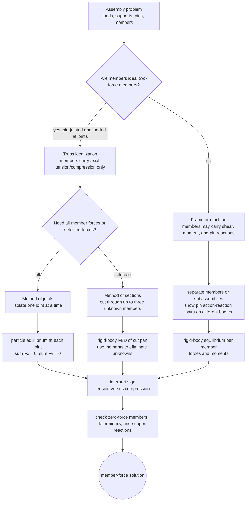

# Trusses, Frames, and Machines

Trusses, frames, and machines are assemblies of connected members. The same equilibrium laws apply to all three, but the useful free body changes: a truss joint may be treated as a particle, a cut section as a rigid body, and a machine link as an individual member carrying pin reactions.

A truss primarily carries load through axial member forces. A frame supports loads through members that may carry several forces and moments. A machine transforms force or motion. The decisive mechanical question is whether a member is a two-force body or a general rigid body.

## Sort the assembly by member behavior

An ideal pin-jointed truss consists of slender members connected at their ends, with external loads and support reactions applied at the joints. Under those assumptions, each member is a two-force body and carries only axial tension or compression.

A frame contains at least one member that is not a two-force member. Loads may act between pins, several connections may meet a member, or a fixed support or distributed load may be present. Machines are analyzed similarly, but the target is often an input force, output force, or mechanical advantage.

| Assembly type | Main free body | Member force type | Best first method |
|---|---|---|---|
| Simple truss | Joints | Axial tension or compression | Method of joints |
| Truss, selected member | Cut section | Cut axial forces | Method of sections |
| Frame | Individual members | Pin forces, loads, moments | Member free-body diagrams |
| Machine | Links and handles | Input/output forces, pin forces | Moment balance by link |

## The two-force member rule

If an isolated member $AB$ has forces only at pins $A$ and $B$, equilibrium requires those forces to be equal, opposite, and collinear with the member. Its internal force is therefore one scalar, usually written $F_{AB}$, rather than two components at each end.

At a joint, draw every unknown member force away from the joint. This is a consistent tensile assumption. A positive solution indicates tension; a negative solution means the member is in compression and the actual force direction is reversed.

The two-force idealization fails when a member has a load applied between its ends, a distributed load, an applied couple, more than two force application points, or a support that transmits a moment. Such a member must be treated as a rigid body.

## Joints for a complete force map

The method of joints isolates one pin at a time. Each planar joint is a particle, so

$$
\sum F_x=0,\qquad \sum F_y=0.
$$

Begin at a joint with no more than two unknown member forces, solve it, and carry the known forces to neighboring joints. This method is well suited to finding every member force.

Two useful zero-force results follow directly from joint equilibrium:

- At an unloaded, unsupported joint with two noncollinear members, both member forces are zero.
- At an unloaded, unsupported joint with three members, two of them collinear, the noncollinear member has zero force.

An external load or support reaction at the joint invalidates these patterns.

## Sections for one or two selected members

The method of sections cuts through chosen members and exposes their axial forces on one part of the truss. The isolated part is a rigid body, so it supplies

$$
\sum F_x=0,\qquad \sum F_y=0,\qquad \sum M_O=0.
$$

A planar cut should ordinarily cross no more than three unknown member forces. If two of those lines of action intersect, taking moments about their intersection removes both and often yields the third force in one equation.

For a planar truss with $m$ members, $j$ joints, and $r$ reaction components,

$$
m+r=2j
$$

is a preliminary count for simple static determinacy. It is neither a proof of geometric stability nor a guarantee that all equilibrium equations are independent.

## Separating frames and machines at their pins

Frames and machines usually require a free-body diagram for each member or a carefully chosen subassembly. A pin between two isolated members produces equal and opposite force components on their separate diagrams. Both halves of that action-reaction pair never belong on the same isolated body.

For an ideal machine, mechanical advantage may be written

$$
MA=\frac{\text{output force magnitude}}{\text{input force magnitude}}.
$$

Moment arms, link geometry, pulleys, gears, or wedges create the force ratio. Friction and deformation reduce the accuracy of a rigid, lossless equilibrium model.

## Joint solution for a triangular truss

**Problem.** A triangular truss has joints $A=(0,0)$, $B=(4,0)$, and $C=(2,3)$ m. A pin at $A$ and a roller at $B$ support the truss. A $10$ kN downward load acts at $C$. Find the forces in $AC$, $BC$, and $AB$.

Whole-truss equilibrium gives the reactions. Taking moments about $A$,

$$
4B_y-10(2)=0,
$$

so

$$
B_y=5\ \text{kN}.
$$

Then

$$
A_y=5\ \text{kN},\qquad A_x=0.
$$

At joint $C$, the member directions are

$$
\mathbf{u}_{CA}=-\frac{2}{\sqrt{13}}\mathbf{i}-\frac{3}{\sqrt{13}}\mathbf{j},
$$

$$
\mathbf{u}_{CB}=\frac{2}{\sqrt{13}}\mathbf{i}-\frac{3}{\sqrt{13}}\mathbf{j}.
$$

Assuming both forces are tensile,

$$
F_{AC}\mathbf{u}_{CA}+F_{BC}\mathbf{u}_{CB}-10\mathbf{j}=\mathbf{0}.
$$

Horizontal equilibrium gives

$$
F_{AC}=F_{BC}=F.
$$

Vertical equilibrium then gives

$$
-\frac{3}{\sqrt{13}}F-\frac{3}{\sqrt{13}}F-10=0,
$$

$$
F=-\frac{10\sqrt{13}}{6}=-6.01\ \text{kN}.
$$

The negative tensile result identifies both sloping members as compressed. To find $AB$, retain $F_{AC}=-6.01$ kN along

$$
\mathbf{u}_{AC}=\frac{2}{\sqrt{13}}\mathbf{i}+\frac{3}{\sqrt{13}}\mathbf{j}
$$

at joint $A$. Horizontal equilibrium is

$$
F_{AB}+(-6.01)\frac{2}{\sqrt{13}}=0,
$$

so

$$
F_{AB}=3.33\ \text{kN}.
$$

The member forces are

$$
\boxed{AC=BC=6.01\ \text{kN compression},\qquad AB=3.33\ \text{kN tension}.}
$$

## Cutting directly to the lower chord force

**Problem.** A simply supported truss has bottom joints $A=(0,0)$, $B=(3,0)$, $C=(6,0)$, $D=(9,0)$ and top joints $E=(3,3)$, $F=(6,3)$. Its members are $AB$, $BC$, $CD$, $AE$, $BE$, $BF$, $CF$, $EF$, and $DF$. A $12$ kN downward load acts at $F$. Supports are a pin at $A$ and a roller at $D$. Find the force in $BC$.

Whole-truss equilibrium gives

$$
9D_y-12(6)=0,
$$

and therefore

$$
D_y=8\ \text{kN},\qquad A_y=4\ \text{kN},\qquad A_x=0.
$$

Cut through $BC$, $BF$, and $EF$, and keep the left part containing $A$, $B$, and $E$. Assume the cut member forces are tensile. Taking moments about $F=(6,3)$ eliminates the forces in $BF$ and $EF$ because their lines of action pass through $F$.

The moment of $A_y$ about $F$ is

$$
M_F(A_y)=(-6)(4)=-24\ \text{kN m}.
$$

The assumed tensile force in $BC$ points right on the left section and acts $3$ m below $F$, giving

$$
M_F(BC)=3F_{BC}.
$$

Moment equilibrium gives

$$
-24+3F_{BC}=0,
$$

so

$$
\boxed{F_{BC}=8\ \text{kN tension}.}
$$

## Where assembly calculations go wrong

- Use one tensile sign convention across all joint diagrams; a negative result is a compression force, not a failed solve.
- Start the method of joints where at most two member forces are unknown, or choose a section that exposes fewer unknowns.
- A planar section with more than three independent unknown member forces cannot be solved from one cut free body alone.
- Do not apply the two-force rule to a frame member carrying a midspan load or couple.
- Label pin forces as equal and opposite when connected machine or frame members are separated.
- Treat $m+r=2j$ as a count only, then inspect the geometry for instability or dependent constraints.

See also: [Particle equilibrium](/physics/mechanics/particle-equilibrium) · [Rigid-body equilibrium](/physics/mechanics/rigid-body-equilibrium) · [Internal forces in beams](/physics/mechanics/internal-forces-beams) · [Work-energy methods](/physics/mechanics/work-energy-methods)

