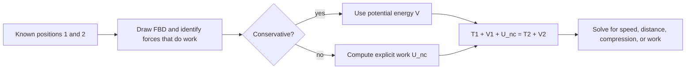

# Work-Energy Methods

Work-energy methods replace a time-resolved force analysis with a balance between work and changes in kinetic and potential energy. They are well suited to finding speed, displacement, spring compression, stopping distance, or required work when the path is known.

The scalar energy equation does not remove the mechanics model. A free-body diagram is still needed to identify forces, and the path determines which forces do work. Ideal constraint forces often disappear from the calculation because their points of application have no velocity component along the force.

## When an endpoint balance is the right tool

For a particle, the work-energy principle is

$$
T_1+U_{1\to2}=T_2,
$$

where

$$
T=\frac{1}{2}mv^2
$$

and the work of a force along the path is

$$
U_{1\to2}=\int_1^2 \mathbf{F}\cdot d\mathbf{r}.
$$

For a constant force and straight displacement,

$$
U=Fs\cos\theta,
$$

with $\theta$ the angle between force and displacement.

The particle theorem follows directly from Newton's second law. Dotting $\sum\mathbf F=m\mathbf a$ with an incremental displacement $d\mathbf r$ gives

$$
\sum\mathbf F\cdot d\mathbf r
=m\frac{d\mathbf v}{dt}\cdot\mathbf v\,dt
=m\mathbf v\cdot d\mathbf v.
$$

Integration between states gives

$$
\int_1^2\sum\mathbf F\cdot d\mathbf r
=\int_{v_1}^{v_2}mv\,dv
=\frac12mv_2^2-\frac12mv_1^2.
$$

Work is therefore the accumulated effect of the force component along displacement. A large perpendicular force may produce no work while still changing the velocity direction.

For a planar rigid body,

$$
T=\frac{1}{2}mv_G^2+\frac{1}{2}I_G\omega^2.
$$

The first term describes translation of the mass center; the second describes rotation about it.

Energy relates two states and usually does not give the elapsed time or the acceleration at an intermediate point. Newton's second law is more direct for instantaneous forces and accelerations, while impulse-momentum is often better for short-duration interactions.

For a rigid body rotating about a fixed axis $O$, the work of a moment is

$$
U_{1\to2}=\int_{\theta_1}^{\theta_2}M_O\,d\theta,
$$

and kinetic energy is $T=\frac12I_O\omega^2$. For general planar motion, the center-of-mass expression already listed separates translation and rotation. Choosing the correct moment of inertia and including both pieces prevents a rolling body from being treated as a particle.

## Conservative forces as stored energy

A conservative force has path-independent work and can be represented by potential energy $V$:

$$
U_{1\to2}=V_1-V_2.
$$

Near Earth's surface,

$$
V_g=mgy,
$$

and an ideal linear spring stores

$$
V_s=\frac{1}{2}kx^2,
$$

where $x$ is measured from the unstretched length.

If only conservative forces do work,

$$
T_1+V_1=T_2+V_2.
$$

When nonconservative forces are present, keep their work explicit:

$$
T_1+V_1+U_{\text{nc}}=T_2+V_2.
$$

Potential energy is defined only up to an additive constant. Replacing $V$ by $V+C$ does not affect a difference, so the gravitational datum can be chosen for convenience. What must remain fixed is the datum throughout one calculation.

In one dimension, conservative force and potential are related by

$$
F_x=-\frac{dV}{dx}.
$$

Equilibrium points occur where $dV/dx=0$. A local minimum of $V$ is stable because a small displacement produces a restoring force; a local maximum is unstable. At total mechanical energy $E$, motion is allowed only where $E\ge V(x)$, since

$$
T=E-V(x)\ge0.
$$

Points where $E=V$ are turning points with instantaneous speed zero. This graphical view often identifies accessible regions before any differential equation is solved.

| Quantity | Formula | Sign or use |
|---|---|---|
| Particle kinetic energy | $T=\frac12 mv^2$ | Always nonnegative |
| Translational plus rotational kinetic energy | $T=\frac12 mv_G^2+\frac12I_G\omega^2$ | Planar rigid body |
| Work of constant force | $U=Fs\cos\theta$ | Positive if force aids motion |
| Gravity potential | $V_g=mgy$ | Higher datum means more potential |
| Spring potential | $V_s=\frac12kx^2$ | Deformation is from natural length |
| Power | $P=\mathbf{F}\cdot\mathbf{v}$ | Rate of doing work |

## Friction and variable forces stay in the work term

Kinetic friction is nonconservative. If a body slides a distance $s$ under constant normal force $N$,

$$
U_f=-\mu_kNs.
$$

The negative sign records mechanical energy dissipated by the contact. Gravity depends only on height change, but friction generally depends on the actual sliding distance.

For variable forces, use the integral rather than a constant-force expression. A spring changing from deformation $x_1$ to $x_2$ does work

$$
U_s=\int_{x_1}^{x_2}(-kx)\,dx
=\frac{1}{2}kx_1^2-\frac{1}{2}kx_2^2.
$$

If the spring is stretched farther, its work on the body is negative. A force whose angle changes along a path is handled safely through $\mathbf{F}\cdot d\mathbf{r}$.

Energy may need a force calculation as an input. When friction depends on an unknown normal reaction, solve the normal equation of motion or equilibrium first, then insert $N$ into the work term.

## Deciding whether a constraint force does work

A force does zero work only when its point of application has no displacement in the force direction. The normal force on a particle moving along a smooth fixed surface is perpendicular to the path and therefore does no work. A fixed ideal pin also has no displacement at its point of application.

Rolling contact requires more care. For ideal rolling without slip on a fixed surface, the instantaneous contact point has zero velocity, so static friction may do zero work there. That conclusion depends on the no-slip and rigid-surface assumptions; it should not be transferred automatically to sliding or deforming contacts.

Power records the rate of energy transfer. For a force,

$$
P=\frac{dU}{dt}=\mathbf{F}\cdot\mathbf{v},
$$

and for a couple moment,

$$
P=M\omega.
$$

These relations are useful for motors, engines, brakes, and steady-rate devices even when an endpoint energy balance is also used.

Power also connects directly to acceleration. For translation,

$$
P=\mathbf F\cdot\mathbf v,
$$

and for fixed-axis rotation,

$$
P=M\omega.
$$

When a machine delivers constant power rather than constant force, its available driving force is $F=P/v$. It is large at low speed in the ideal formula and decreases as speed rises. Real machines have torque and current limits that remove the unphysical divergence at $v=0$.

## Maximum compression with friction

**Problem.** A $10$ kg block moves on a horizontal rough surface with initial speed $6$ m/s. It compresses a spring of stiffness $k=800$ N/m. The coefficient of kinetic friction is $\mu_k=0.20$. Find the maximum spring compression.

At maximum compression the block is momentarily at rest. Its initial kinetic energy is

$$
T_1=\frac{1}{2}mv_1^2
=\frac{1}{2}(10)(6^2)
=180\ \text{J},
$$

and $T_2=0$.

On the horizontal surface,

$$
N=mg=10(9.81)=98.1\ \text{N},
$$

so the kinetic-friction magnitude is

$$
F_k=\mu_kN=0.20(98.1)=19.62\ \text{N}.
$$

If the maximum compression is $x$, friction does work

$$
U_f=-19.62x,
$$

and the spring stores

$$
V_s=\frac{1}{2}kx^2=400x^2.
$$

The endpoint balance is

$$
180-19.62x=400x^2,
$$

or

$$
400x^2+19.62x-180=0.
$$

The positive root is

$$
x=\frac{-19.62+\sqrt{19.62^2+4(400)(180)}}{800},
$$

$$
\boxed{x_{\max}=0.647\ \text{m}.}
$$

The other root is negative and does not describe a compression distance. With no friction, $180=400x^2$ would give $x=0.671$ m, so dissipation has reduced the travel.

## Speed at the bottom of a smooth track

**Problem.** A $2$ kg bead slides without friction on a fixed circular track. It starts from rest $1.5$ m above the lowest point. Find its speed at the lowest point.

The normal force is perpendicular to the bead's displacement and does no work. Choose the lowest point as $y=0$. Initially,

$$
T_1=0,
$$

$$
V_1=mgy_1=2(9.81)(1.5)=29.43\ \text{J}.
$$

At the bottom, $V_2=0$ and

$$
T_2=\frac{1}{2}mv_2^2.
$$

Conservation of mechanical energy gives

$$
29.43=\frac{1}{2}(2)v_2^2,
$$

so

$$
\boxed{v_2=5.43\ \text{m/s}.}
$$

The mass cancels for frictionless motion under uniform gravity.

## Rolling down an incline

**Problem.** A solid sphere of mass $3$ kg and radius $0.20$ m rolls without slipping from rest down a vertical drop of $2.0$ m. Find its speed at the bottom and the fraction of its kinetic energy that is rotational.

For a solid sphere,

$$
I_G=\frac25mR^2.
$$

Pure rolling imposes $\omega=v_G/R$. Static friction at an ideal fixed surface does no work because the instantaneous contact point has zero velocity. Conservation of energy gives

$$
mgh=\frac12mv_G^2+\frac12I_G\omega^2.
$$

Substitute the inertia and rolling constraint:

$$
mgh=\frac12mv_G^2
+\frac12\left(\frac25mR^2\right)\left(\frac{v_G}{R}\right)^2.
$$

After cancellation,

$$
gh=\left(\frac12+\frac15\right)v_G^2
=\frac7{10}v_G^2.
$$

Thus

$$
v_G=\sqrt{\frac{10gh}{7}}
=\sqrt{\frac{10(9.81)(2.0)}7}
=5.29\ \text{m/s}.
$$

The rotational energy fraction is

$$
\frac{T_{rot}}{T}
=\frac{\frac15mv^2}{\frac7{10}mv^2}
=\frac27=0.286.
$$

The radius and mass cancel from the speed. They would still matter for contact stress and rotational inertia separately.

## Motor power during lifting

**Problem.** A hoist raises a $600$ kg load vertically at a steady $1.5$ m/s. The overall efficiency from motor input to mechanical output is $80\%$. Find the required motor input power. Then find the input power while the load accelerates upward at $0.40$ m/s$^2$ at the same instantaneous speed.

At steady speed, the cable force equals the weight:

$$
F=mg=(600)(9.81)=5886\ \text{N}.
$$

Mechanical output power is

$$
P_{out}=Fv=(5886)(1.5)=8829\ \text{W}.
$$

With efficiency $\eta=P_{out}/P_{in}$,

$$
P_{in}=\frac{8829}{0.80}=11.0\ \text{kW}.
$$

During upward acceleration,

$$
F-mg=ma,
$$

so

$$
F=m(g+a)=600(9.81+0.40)=6126\ \text{N}.
$$

At the stated instantaneous speed,

$$
P_{in}=\frac{Fv}{\eta}
=\frac{(6126)(1.5)}{0.80}
=11.5\ \text{kW}.
$$

Power depends on both force and instantaneous velocity. At the start from rest, $Fv$ is zero even though a nonzero force and motor torque are required.

## Work from force-displacement data

When force varies along a straight path, work is the signed area under the force-position curve:

$$
U_{1\to2}=\int_{x_1}^{x_2}F_x(x)\,dx.
$$

Area above the axis is positive for increasing $x$; area below is negative. A force graph can therefore supply work even when no compact force law is given. The average force over the interval is $F_{avg}=U/\Delta x$, which is an energy-equivalent value and need not equal the arithmetic mean of endpoint forces.

**Problem.** A $4$ kg cart starts from rest. Along the first $3$ m, a forward force rises linearly from zero to $12$ N. Along the next $2$ m it remains $12$ N. A constant $4$ N resistance acts over all $5$ m. Find the final speed.

The applied-force work is the area of a triangle plus a rectangle:

$$
U_P=\frac12(3)(12)+(2)(12)=18+24=42\ \text{J}.
$$

Resistance does

$$
U_R=-(4)(5)=-20\ \text{J}.
$$

Net work is $22$ J. Since the cart starts from rest,

$$
22=\frac12(4)v_2^2,
$$

so

$$
v_2=\sqrt{11}=3.32\ \text{m/s}.
$$

Replacing the rising force by its final value over all $5$ m would overestimate work because it would replace the triangular part by a rectangle.

## Path dependence and mechanical-energy loss

Gravity and ideal spring work depend only on endpoint state. Kinetic-friction work normally depends on distance traveled, so two paths between the same elevations can give different final speeds. The statement “friction turns mechanical energy into heat” is useful but incomplete when thermal energy is tracked: some energy can enter internal deformation, sound, wear, or the surroundings. The mechanical balance groups these effects as nonconservative work unless a more detailed thermal system is defined.

Consider sliding down an incline of length $s$ and angle $\theta$ with constant kinetic coefficient. The gravitational potential decrease is $mgs\sin\theta$, while friction removes $\mu_kmgs\cos\theta$. Starting from rest,

$$
\frac12mv^2=mgs(\sin\theta-\mu_k\cos\theta).
$$

The mass cancels. If the expression in parentheses is negative, the assumed spontaneous downhill slide from rest is impossible under the kinetic model; static friction and initial conditions need examination. If an external push starts uphill or downhill motion, friction direction must follow that actual sliding direction.

## Efficiency does not alter energy conservation

Efficiency compares desired output with required input:

$$
\eta=\frac{E_{useful,out}}{E_{in}}
=\frac{P_{useful,out}}{P_{in}}.
$$

For a cyclic machine, efficiency below one records energy transferred into unwanted channels, not destroyed energy. A motor with $90\%$ efficiency delivering $9$ kW mechanically draws $10$ kW electrically; the remaining $1$ kW becomes heat and other losses at that operating point.

Efficiencies cannot always be multiplied without checking boundaries and definitions. A motor efficiency, gearbox efficiency, and lifting efficiency may be multiplied when each output is the next device's input under the same operating condition. Regenerative devices reverse energy flow, and their efficiencies may differ by direction. Peak catalog efficiency should not be assumed across every speed and load.

## Energy methods and force recovery

Energy can find speed as a function of position, after which Newton's law can recover a reaction. For a bead on a smooth circular track, energy gives $v$ at the bottom from height loss. The normal equation then gives $N-mg=mv^2/R$. Trying to find $N$ from energy alone fails because the normal force does no work and therefore does not appear in the energy balance.

This two-stage strategy is common in loops, pendulums, and roller-coaster problems: use energy for speed, then use a normal-direction force equation for tension or contact force. The contact result must be checked for physical sign. If a string tension or normal reaction would be negative, the assumed constrained path ends before the calculated point.

## Consistency checks for an energy balance

- Use work-energy for endpoint quantities, not directly for elapsed time.
- Include only forces whose points of application move in the force direction; ideal normals and fixed-pin reactions often contribute zero work.
- Give kinetic friction negative work when it opposes sliding.
- Measure spring deformation from the spring's natural length.
- Keep one gravitational datum throughout the calculation.
- Add nonconservative work explicitly instead of claiming mechanical-energy conservation.
- A negative value for $T_2$ means the proposed final state cannot be reached under the assumed path and forces.
- Do not assign potential energy to kinetic friction. Its work depends on path length and removes recoverable mechanical energy.
- Static friction can do zero work in ideal rolling, but it can transfer energy when the supporting surface moves or the contacting bodies deform.
- Energy alone cannot normally determine a direction. A speed obtained from $v^2$ must be combined with the known or separately solved direction of motion.

See also: [Particle kinetics with Newton's second law](/physics/mechanics/particle-kinetics-newton) · [Particle kinematics](/physics/mechanics/particle-kinematics) · [Impulse, momentum, and impact](/physics/mechanics/impulse-momentum-impact) · [Planar rigid-body motion](/physics/mechanics/planar-rigid-body-motion)

