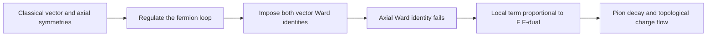

# Chiral Anomalies

A classical symmetry can fail after quantization even when every term in the classical action respects it. Such a failure is an **anomaly**. For chiral fermions the issue is sharp: the regulator needed to define ultraviolet-divergent loop integrals cannot preserve every classical current conservation law at once. If the vector current is kept gauge invariant, the axial current acquires a nonzero divergence.

That statement has several apparently different forms. It appears as an ambiguity in a triangle graph, as a Jacobian of the fermion path-integral measure, and as spectral flow of the Dirac operator in a gauge background. All give the same coefficient. The agreement is important because an anomaly is not a removable regularization artifact; only its assignment among currents can sometimes be changed by local counterterms.

## The classical symmetry and its currents

Consider a Dirac field coupled to electromagnetism,

$$
\mathcal L=\bar\psi(i\gamma^\mu D_\mu-m)\psi-\frac14F_{\mu\nu}F^{\mu\nu},
\qquad D_\mu=\partial_\mu+ieA_\mu.
$$

There are two natural phase rotations. The vector rotation acts equally on left- and right-handed components,

$$
\psi\longrightarrow e^{i\alpha}\psi,
\qquad j^\mu=\bar\psi\gamma^\mu\psi,
$$

whereas the axial rotation acts with opposite phases,

$$
\psi\longrightarrow e^{i\beta\gamma^5}\psi,
\qquad j_5^\mu=\bar\psi\gamma^\mu\gamma^5\psi.
$$

Writing $P_{R,L}=(1\pm\gamma^5)/2$ and $\psi_{R,L}=P_{R,L}\psi$ shows the distinction directly: $\psi_R$ gains phase $e^{i\beta}$ and $\psi_L$ gains $e^{-i\beta}$. The mass term couples the two chiralities, so axial symmetry requires $m=0$.

Using the Dirac equation and its adjoint gives the classical identities

$$
\partial_\mu j^\mu=0,
\qquad
\partial_\mu j_5^\mu=2im\bar\psi\gamma^5\psi.
$$

Thus even before quantization the massive theory does not conserve axial charge. The quantum term is an additional contribution that remains when $m$ vanishes.

## Fixing conventions for the anomaly

Take $\epsilon^{0123}=+1$, metric signature $(+---)$, and

$$
\widetilde F^{\mu\nu}=\frac12\epsilon^{\mu\nu\rho\sigma}F_{\rho\sigma}.
$$

For one Dirac fermion of electric charge $e$, a gauge-invariant regularization gives

$$
\boxed{
\partial_\mu j_5^\mu
=2im\bar\psi\gamma^5\psi
+\frac{e^2}{16\pi^2}\epsilon^{\mu\nu\rho\sigma}
F_{\mu\nu}F_{\rho\sigma}
}
$$

or, with the stated definition of the dual tensor,

$$
\partial_\mu j_5^\mu
=2im\bar\psi\gamma^5\psi
+\frac{e^2}{8\pi^2}F_{\mu\nu}\widetilde F^{\mu\nu}.
$$

Signs in the $\mathbf E\cdot\mathbf B$ version depend on metric and field-strength conventions. With $F^{0i}=-E^i$ and $F^{ij}=-\epsilon^{ijk}B^k$ in the convention above,

$$
F_{\mu\nu}\widetilde F^{\mu\nu}=-4\mathbf E\cdot\mathbf B,
$$

so the massless result is $\partial_\mu j_5^\mu=-e^2\mathbf E\cdot\mathbf B/(2\pi^2)$. Comparing formulas without first comparing conventions is a reliable way to manufacture factors of two and minus signs.

## Where the triangle graph becomes ambiguous

The relevant correlation function contains one axial current and two vector currents. At one loop it is a fermion triangle. Power counting calls the loop integral linearly divergent. Two routings of the loop momentum then differ by a finite surface term: shifting $k$ to $k+a$ inside a linearly divergent integral is not automatically valid.

The three external legs suggest three Ward identities. Requiring both electromagnetic Ward identities,

$$
p_\mu\Gamma^{\lambda\mu\nu}=0,
\qquad
q_\nu\Gamma^{\lambda\mu\nu}=0,
$$

fixes the ambiguous surface term. The remaining contraction with the axial momentum is nonzero. One may instead distribute the anomaly differently by changing momentum routing or adding a local term, but breaking the vector Ward identities would destroy electromagnetic gauge invariance. The physically appropriate choice in QED therefore conserves electric charge and assigns the failure to $j_5^\mu$.

The coefficient is unusually rigid. Once vector gauge invariance and current normalization are fixed, higher perturbative corrections do not alter the one-loop axial-anomaly coefficient. This is the content of the Adler--Bardeen nonrenormalization result. Strong dynamics may affect matrix elements involving the current, but it does not freely dress the local anomaly coefficient.

## The measure calculation

Fujikawa's derivation locates the same effect in the path-integral measure. Under an infinitesimal local chiral rotation,

$$
\psi\to(1+i\alpha(x)\gamma^5)\psi,
\qquad
\bar\psi\to\bar\psi(1+i\alpha(x)\gamma^5),
$$

the massless classical action changes by a term involving $\partial_\mu j_5^\mu$. Formally, one might expect $\mathcal D\bar\psi\,\mathcal D\psi$ to be invariant. To define that infinite product, however, expand the fields in eigenfunctions of the gauge-covariant Dirac operator. The Jacobian contains the ill-defined trace $\operatorname{tr}\gamma^5$ over all modes.

A gauge-covariant heat-kernel regulator defines it as

$$
\lim_{M\to\infty}
\operatorname{tr}\!\left[
\gamma^5 e^{-\slashed D^{\,2}/M^2}
\right].
$$

Expanding $\slashed D^{\,2}$ at large $M$ leaves a finite term containing two field strengths. The regulated Jacobian is

$$
J=\exp\!\left[
i\int d^4x\,\alpha(x)
\frac{e^2}{16\pi^2}
\epsilon^{\mu\nu\rho\sigma}F_{\mu\nu}F_{\rho\sigma}
\right]
$$

up to the sign associated with the chosen transformation convention. Varying the generating functional reproduces the anomalous Ward identity. The regulator respects gauge covariance, and axial invariance is what it sacrifices.

## Topology and chirality flow

For a nonabelian gauge field, write $F_{\mu\nu}=F_{\mu\nu}^aT^a$ and normalize the generators by $\operatorname{tr}(T^aT^b)=\tfrac12\delta^{ab}$. A commonly used topological charge is

$$
Q=\frac{g^2}{32\pi^2}
\int d^4x\,
F_{\mu\nu}^a\widetilde F^{a\mu\nu}.
$$

For finite-action Euclidean configurations approaching a pure gauge at infinity, $Q$ is an integer. Integrating the singlet axial anomaly relates this integer to a change in axial charge. The index theorem states the underlying spectral fact: the difference between left- and right-handed zero modes of the Euclidean Dirac operator equals the topological index, with sign set by conventions.

Perturbative triangle graphs and instantons are therefore not competing explanations. The local divergence is seen perturbatively; backgrounds with nonzero integrated topological density demonstrate that the corresponding charge can actually change. In QCD this breaks the classical singlet $U(1)_A$ symmetry, while nonsinglet chiral symmetries require separate group traces and may remain anomaly-free.

## Worked example: deriving the mass contribution

Start from

$$
(i\gamma^\mu D_\mu-m)\psi=0,
\qquad
i(D_\mu\bar\psi)\gamma^\mu+m\bar\psi=0.
$$

Differentiate the axial current covariantly. Since the current is gauge neutral, the gauge connections cancel:

$$
\partial_\mu j_5^\mu
=(D_\mu\bar\psi)\gamma^\mu\gamma^5\psi
+\bar\psi\gamma^\mu\gamma^5D_\mu\psi.
$$

The adjoint equation gives

$$
(D_\mu\bar\psi)\gamma^\mu=im\bar\psi,
$$

so the first term is $im\bar\psi\gamma^5\psi$. For the second, anticommutation of $\gamma^5$ with $\gamma^\mu$ gives

$$
\bar\psi\gamma^\mu\gamma^5D_\mu\psi
=-\bar\psi\gamma^5\gamma^\mu D_\mu\psi.
$$

The original Dirac equation implies $\gamma^\mu D_\mu\psi=-im\psi$. Hence

$$
-\bar\psi\gamma^5\gamma^\mu D_\mu\psi
=im\bar\psi\gamma^5\psi.
$$

Adding both pieces yields

$$
\partial_\mu j_5^\mu=2im\bar\psi\gamma^5\psi.
$$

Quantization adds the field-strength term derived above. The explicit and anomalous breakings have different origins and should both be retained when $m\ne0$.

## Worked example: anomaly tests for chiral charges

For left-handed Weyl fermions with charges $q_i$ under a proposed $U(1)$ gauge symmetry, the pure cubic and mixed gauge--gravity conditions are

$$
\sum_i q_i^3=0,
\qquad
\sum_i q_i=0.
$$

Test the set $\{1,1,-2\}$. The linear sum vanishes,

$$
1+1-2=0,
$$

but the cubic sum does not:

$$
1^3+1^3+(-2)^3=1+1-8=-6.
$$

It passes the mixed gauge--gravity test and fails the cubic gauge test. Now compare the vectorlike set $\{1,-1\}$:

$$
1+(-1)=0,
\qquad
1^3+(-1)^3=0.
$$

Both vanish. A right-handed field of charge $q$ is counted in these sums as its left-handed charge-conjugate field, whose charge is $-q$. That bookkeeping explains why a Dirac pair with equal physical left- and right-handed charges is anomaly-free.

The conditions extend when several gauge factors are present. In four dimensions one may need to check pure nonabelian anomalies, $U(1)^3$, mixed nonabelian--$U(1)$ terms, and the mixed gravitational term. Real or pseudoreal nonabelian representations have no ordinary perturbative cubic anomaly, although separate global anomalies can still occur.

| Symmetry under discussion | Can its anomaly remain? | Consequence |
|---|---:|---|
| Global axial symmetry | Yes | A genuine selection rule is violated |
| Gauged chiral symmetry | No | Matter content or another sector must cancel it |
| Vector $U(1)$ in QED | Preserved | Charge conservation and photon Ward identities survive |
| Exact global symmetry in the ultraviolet | Must match in the infrared | Massless modes or topological terms reproduce the anomaly |

## Neutral-pion decay and low-energy matching

The neutral pion is associated with an approximate axial symmetry of the light-quark theory. A naive conservation argument would strongly suppress $\pi^0\to\gamma\gamma$. The electromagnetic axial anomaly instead generates the low-energy interaction

$$
\mathcal L_{\pi\gamma\gamma}
\propto
\frac{\pi^0}{f_\pi}
F_{\mu\nu}\widetilde F^{\mu\nu}.
$$

Its coefficient depends on the quark electric charges, color multiplicity, and pion-current normalization. The decay is a direct low-energy trace of quarks running in the ultraviolet triangle loop. One need not resolve the quarks inside the decay process to retain their anomalous contribution.

The same logic underlies 't Hooft anomaly matching. If an exact global symmetry has an anomaly in the ultraviolet, an infrared description must reproduce it even after strong coupling reorganizes the degrees of freedom. Composite massless fermions, Goldstone interactions, or a topological sector can do the job. A trivially gapped infrared theory preserving that symmetry cannot simply discard the anomaly.

## Frequent points of confusion

- A regulator-dependent intermediate expression does not make the final anomaly optional. Regulators can move the anomalous term between currents, but gauge invariance fixes the acceptable assignment in QED.
- $F_{\mu\nu}F^{\mu\nu}$ and $F_{\mu\nu}\widetilde F^{\mu\nu}$ have different symmetry properties. The former is the gauge kinetic density; the latter is parity odd and a total derivative locally in the abelian theory.
- Explicit mass breaking and anomalous breaking coexist. Setting $m=0$ removes only the first term in the axial Ward identity.
- Cancellation must be checked using left-handed Weyl fields in a consistent charge convention. Mixing physical right-handed charges directly into the left-handed sums gives wrong signs.
- Perturbative cancellation does not automatically rule out every global gauge anomaly. Those depend on global properties of the gauge group and require a separate check.

## Consistent and covariant currents

In a chiral gauge theory one encounters two closely related forms of the anomaly. The **consistent current** is obtained by varying the quantum effective action with respect to the gauge potential. Its anomaly satisfies the Wess--Zumino consistency condition, which expresses the gauge algebra at the level of successive variations. The **covariant current** transforms covariantly under gauge transformations and has an anomaly with a different numerical coefficient.

The two currents differ by a local polynomial in the gauge potential, often called a Bardeen--Zumino current. Adding the corresponding local counterterm does not remove a genuine anomaly; it changes how the anomalous variation is distributed among currents. For the axial-vector-vector triangle, the conventional choice preserves both vector Ward identities and places the nonconservation in the axial current. That choice is demanded when the vector field is the electromagnetic gauge field.

This distinction explains why anomaly coefficients quoted in different derivations can seem incompatible even after epsilon-tensor conventions have been aligned. One must also ask which current was defined and which local counterterm was chosen. Observable gauge consistency is unaffected by this bookkeeping: a nonzero anomaly in a dynamical gauge symmetry still has to cancel in the sum over matter.

For left-handed Weyl fermions in representations $R_i$ of a simple group, the perturbative gauge anomaly is controlled by the symmetric trace

$$
\operatorname{tr}_{R_i}
\left(T^a\{T^b,T^c\}\right).
$$

The sum of these tensors over all left-handed fields must vanish. A representation and its complex conjugate contribute with opposite signs, so vectorlike matter cancels pairwise. Real representations have vanishing perturbative cubic anomaly. The statement is representation-theoretic and stronger than merely adding dimensions or quadratic Casimirs.

## A Standard Model cancellation in detail

Consider the mixed $SU(2)_L^2U(1)_Y$ anomaly for one generation. Use $y=Y/2$ and count left-handed Weyl multiplets. Only weak doublets contribute. The quark doublet appears in three colors and has $y=1/6$; the lepton doublet has $y=-1/2$. Since both use the same $SU(2)$ fundamental index, the relevant coefficient is proportional to

$$
3\left(\frac16\right)-\frac12=0.
$$

The cancellation relates colored quarks to colorless leptons. Neither sector cancels alone.

Now check the mixed $SU(3)_c^2U(1)_Y$ anomaly. The left-handed quark doublet contains two color triplets, each with $y=1/6$. Right-handed quarks must be rewritten as left-handed conjugates, with charges $-2/3$ for $u_R^c$ and $+1/3$ for $d_R^c$. After factoring out the common fundamental color index,

$$
2\left(\frac16\right)
-\frac23+\frac13=0.
$$

The pure $SU(3)_c^3$ anomaly also cancels: the two triplets in $Q_L$ are balanced by the two antitriplets $u_R^c$ and $d_R^c$. These calculations depend on multiplicities. Omitting color for the electroweak anomaly or omitting the two weak components for the color anomaly ruins the cancellation.

There is also a global $SU(2)$ anomaly that is not detected by a triangle diagram. An $SU(2)$ gauge theory requires an even number of left-handed fundamental doublets. One Standard Model generation has three colored quark doublets plus one lepton doublet, totaling four. The condition is met generation by generation. This example separates perturbative local anomalies from global gauge anomalies while showing that both constrain the same fermion inventory.

## What anomaly matching rules out

Suppose a strongly coupled ultraviolet theory has an exact global symmetry with a nonzero anomaly. Imagine that the infrared were fully gapped, had a unique vacuum, preserved the symmetry, and had no topological degrees of freedom. Such a low-energy theory would have no mechanism to reproduce the anomalous response to background gauge fields. That infrared proposal is therefore excluded.

Several alternatives remain. The symmetry may break spontaneously, with Goldstone fields carrying a Wess--Zumino term. Massless composite fermions may reproduce the ultraviolet triangle coefficients. A gapped topological sector may encode the response. Matching constrains the possibilities but usually does not choose one unique phase.

Background fields are useful here. A global symmetry is coupled to a nondynamical gauge field, and the anomalous variation of the generating functional is computed. Because no gauge redundancy is being imposed on that background, the anomaly is allowed as a physical response. Promoting the same field to a dynamical gauge field would turn the failed invariance into an inconsistency unless other contributions cancel it.

## Related pages

- [Dirac Fields and Spinors](/physics/quantum-field-theory/dirac-fields-and-spinors)
- [Gauge Invariance and QED](/physics/quantum-field-theory/gauge-invariance-and-qed)
- [Yang--Mills Theory and QCD](/physics/quantum-field-theory/yang-mills-theory-and-qcd)
- [Electroweak Theory and Grand Unification](/physics/quantum-field-theory/electroweak-theory-and-grand-unification)
- [Path Integral Formulation](/physics/quantum-field-theory/path-integral-formulation)

