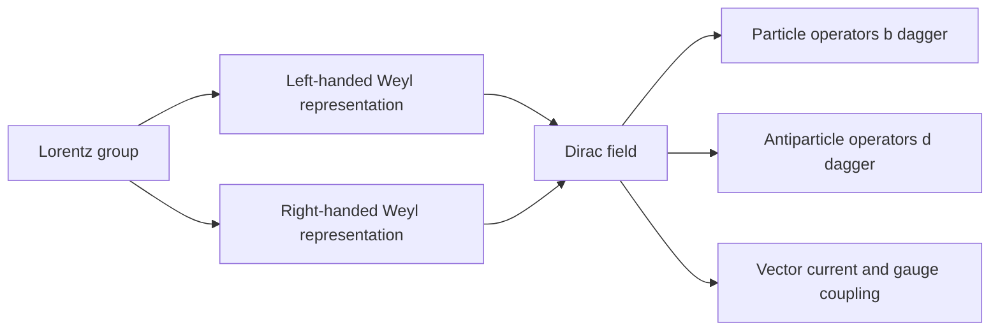

# Dirac Fields and Spinors

Relativistic fermions force two changes at once. Their fields transform in spinor representations of the Lorentz group, and quantization uses anticommutators rather than commutators. The Dirac equation packages the relativistic dispersion relation into a first-order differential equation; its negative-frequency solutions become antiparticle creation operators after quantization.

Throughout, use the metric $\eta^{\mu\nu}=\operatorname{diag}(1,-1,-1,-1)$ and natural units. Different gamma-matrix representations change the appearance of spinors but not observable results.

## Why a first-order relativistic equation needs matrices

The relativistic mass shell condition is

$$
p^2-m^2=E^2-\mathbf p^2-m^2=0.
$$

Dirac sought an equation first order in time and space,

$$
(i\gamma^\mu\partial_\mu-m)\psi=0.
$$

For it to imply the Klein--Gordon equation, the constant matrices must satisfy the Clifford algebra

$$
\{\gamma^\mu,\gamma^\nu\}=2\eta^{\mu\nu}\mathbf 1.
$$

In four spacetime dimensions the smallest complex representation uses four-component spinors. The matrices obey $(\gamma^0)^2=+1$, $(\gamma^i)^2=-1$, and distinct gamma matrices anticommute. A useful Hermiticity convention is

$$
(\gamma^0)^\dagger=\gamma^0,
\qquad
(\gamma^i)^\dagger=-\gamma^i.
$$

Multiplying the Dirac operator by the operator with the opposite mass sign gives

$$
(i\slashed\partial+m)(i\slashed\partial-m)
=-(\Box+m^2),
$$

where $\slashed a=\gamma^\mu a_\mu$. The antisymmetric part of $\gamma^\mu\gamma^\nu$ drops out because ordinary partial derivatives commute. Every component of $\psi$ consequently satisfies the Klein--Gordon equation, but the converse is incomplete: the first-order equation also correlates the components and supplies spin information.

## How spinors transform

A Lorentz transformation sends $x$ to $x'=\Lambda x$. A Dirac field transforms as

$$
\psi'(x')=S(\Lambda)\psi(x),
$$

with $S$ constrained by

$$
S^{-1}\gamma^\mu S=\Lambda^\mu{}_{\nu}\gamma^\nu.
$$

For an infinitesimal transformation with antisymmetric parameters $\omega_{\mu\nu}$,

$$
S(\Lambda)=1-\frac{i}{4}\omega_{\mu\nu}\sigma^{\mu\nu}+O(\omega^2),
\qquad
\sigma^{\mu\nu}=\frac{i}{2}[\gamma^\mu,\gamma^\nu].
$$

Spinors are therefore not four-vectors. Under a spatial rotation by $2\pi$, $S$ changes sign; only a $4\pi$ rotation returns an individual spinor to itself. Bilinears such as $\bar\psi\psi$ are single-valued observables.

The Dirac adjoint

$$
\bar\psi=\psi^\dagger\gamma^0
$$

is chosen so that $\bar\psi' = \bar\psi S^{-1}$. This gives the standard bilinear classification:

| Bilinear | Lorentz character | Typical use |
|---|---|---|
| $\bar\psi\psi$ | scalar | Dirac mass |
| $\bar\psi i\gamma^5\psi$ | pseudoscalar | pseudoscalar coupling |
| $\bar\psi\gamma^\mu\psi$ | vector | electromagnetic current |
| $\bar\psi\gamma^\mu\gamma^5\psi$ | axial vector | chiral current |
| $\bar\psi\sigma^{\mu\nu}\psi$ | antisymmetric tensor | dipole operators |

Here

$$
\gamma^5=i\gamma^0\gamma^1\gamma^2\gamma^3,
\qquad
(\gamma^5)^2=1,
\qquad
\{\gamma^5,\gamma^\mu\}=0.
$$

These identities make the chiral projectors

$$
P_L=\frac{1-\gamma^5}{2},
\qquad
P_R=\frac{1+\gamma^5}{2}
$$

orthogonal and complete: $P_LP_R=0$ and $P_L+P_R=1$.

## The action and its conserved charge

The free action is

$$
S=\int d^4x\,\bar\psi(i\gamma^\mu\partial_\mu-m)\psi.
$$

In the variational calculation, $\psi$ and $\bar\psi$ are treated as independent Grassmann-valued fields. Varying $\bar\psi$ gives the Dirac equation. Varying $\psi$ and integrating by parts gives the adjoint equation,

$$
i(\partial_\mu\bar\psi)\gamma^\mu+m\bar\psi=0.
$$

The global phase transformation $\psi\to e^{i\alpha}\psi$ leads by Noether's theorem to

$$
j^\mu=\bar\psi\gamma^\mu\psi,
\qquad
\partial_\mu j^\mu=0.
$$

Its density is especially simple:

$$
j^0=\bar\psi\gamma^0\psi=\psi^\dagger\psi\geq0.
$$

For a quantum field, the normal-ordered charge counts particles minus antiparticles rather than serving as a one-particle probability normalization. Coupling the current to a gauge potential produces the QED interaction $-e\bar\psi\gamma^\mu A_\mu\psi$ for the convention $D_\mu=\partial_\mu+ieA_\mu$.

## Plane waves, spin sums, and antiparticles

Positive- and negative-frequency solutions are written

$$
\psi(x)\sim u_s(p)e^{-ip\cdot x},
\qquad
\psi(x)\sim v_s(p)e^{+ip\cdot x},
$$

where

$$
(\slashed p-m)u_s(p)=0,
\qquad
(\slashed p+m)v_s(p)=0,
\qquad p^0=E_{\mathbf p}>0.
$$

With the common relativistic normalization,

$$
\bar u_r(p)u_s(p)=2m\delta_{rs},
\qquad
\bar v_r(p)v_s(p)=-2m\delta_{rs},
$$

and the completeness relations are

$$
\sum_s u_s(p)\bar u_s(p)=\slashed p+m,
\qquad
\sum_s v_s(p)\bar v_s(p)=\slashed p-m.
$$

These spin sums explain the numerator of the fermion propagator and turn squared amplitudes into gamma-matrix traces.

The operator expansion is

$$
\psi(x)=
\int\frac{d^3p}{(2\pi)^3}\frac{1}{\sqrt{2E_{\mathbf p}}}
\sum_s\left[
b_s(\mathbf p)u_s(p)e^{-ip\cdot x}
+d_s^\dagger(\mathbf p)v_s(p)e^{+ip\cdot x}
\right].
$$

The $b^\dagger$ operator creates a fermion and $d^\dagger$ creates its antiparticle. Reinterpreting the negative-frequency sector this way produces a Hamiltonian bounded below.

Canonical quantization imposes

$$
\{\psi_\alpha(t,\mathbf x),\psi_\beta^\dagger(t,\mathbf y)\}
=\delta_{\alpha\beta}\delta^{(3)}(\mathbf x-\mathbf y),
$$

with all field--field and adjoint--adjoint equal-time anticommutators zero. Equivalently,

$$
\{b_r(\mathbf p),b_s^\dagger(\mathbf q)\}
=(2\pi)^3\delta_{rs}\delta^{(3)}(\mathbf p-\mathbf q),
$$

and likewise for $d$. A creation operator squares to zero, enforcing Pauli exclusion for an identical one-particle mode. Anticommutation also supplies the minus sign attached to a closed fermion loop and to odd permutations of external fermions.

## Inverting the Dirac operator

The Feynman propagator is the time-ordered two-point function

$$
S_F(x-y)=\langle0|T\psi(x)\bar\psi(y)|0\rangle.
$$

It is a Green function for the Dirac operator:

$$
(i\slashed\partial_x-m)S_F(x-y)
=i\delta^{(4)}(x-y).
$$

In momentum space one needs the inverse of $\slashed p-m$. Multiplying numerator and denominator by $\slashed p+m$ gives

$$
(\slashed p-m)(\slashed p+m)=p^2-m^2,
$$

so

$$
S_F(p)=\frac{i(\slashed p+m)}{p^2-m^2+i\epsilon}.
$$

The compact notation $i/(\slashed p-m+i\epsilon)$ is common but can hide how the pole prescription belongs to the scalar denominator. The numerator carries spin correlations; it is not an optional decoration on a scalar propagator.

## Chirality, helicity, and possible mass terms

Chirality is the eigenvalue of $\gamma^5$. Helicity is the projection of spin along momentum. For massless positive-energy particles, the two labels coincide in the standard convention, while for antiparticles their relation is reversed according to how states are labeled. For a massive particle, a boost can overtake the particle and reverse its momentum without reversing its spin, so helicity is frame-dependent. Chirality remains a Lorentz-representation label, but the mass term couples both chiralities:

$$
m\bar\psi\psi
=m(\bar\psi_L\psi_R+\bar\psi_R\psi_L).
$$

A four-component Dirac field combines two independent Weyl fields in conjugate gauge representations as needed for a gauge-invariant mass. A Majorana condition relates a neutral field to its charge conjugate and removes the distinction between particle and antiparticle. Such a condition is incompatible with an unbroken nonzero $U(1)$ charge. Representation theory, not notation, decides which mass terms are allowed.

## Worked example: rest spinors and normalization

Use the Dirac representation,

$$
\gamma^0=
\begin{pmatrix}
I&0\\
0&-I
\end{pmatrix}.
$$

At rest, $p^\mu=(m,\mathbf0)$, so the positive-energy equation becomes

$$
(\gamma^0m-m)u_s(0)=m(\gamma^0-1)u_s(0)=0.
$$

Writing $u=(\xi,\chi)^T$, this is

$$
\begin{pmatrix}
0&0\\
0&-2I
\end{pmatrix}
\begin{pmatrix}
\xi\\
\chi
\end{pmatrix}
=0,
$$

hence $\chi=0$. Choose two-component basis spinors $\xi_1=(1,0)^T$ and $\xi_2=(0,1)^T$. The normalized rest solutions are

$$
u_s(0)=\sqrt{2m}
\begin{pmatrix}
\xi_s\\
0
\end{pmatrix}.
$$

Their adjoints are $\bar u_s=u_s^\dagger\gamma^0$, so

$$
\bar u_r(0)u_s(0)
=2m\xi_r^\dagger\xi_s
=2m\delta_{rs}.
$$

For negative-energy spinors, $(\slashed p+m)v=0$ at $p=(m,\mathbf0)$ gives $(\gamma^0+1)v=0$. The upper two components vanish:

$$
v_s(0)=\sqrt{2m}
\begin{pmatrix}
0\\
\eta_s
\end{pmatrix},
\qquad
\bar v_r(0)v_s(0)=-2m\delta_{rs}.
$$

The opposite sign comes from the lower block of $\gamma^0$, not from a negative norm $v^\dagger v$.

## Worked example: current conservation step by step

Start with $j^\mu=\bar\psi\gamma^\mu\psi$. Differentiating gives

$$
\partial_\mu j^\mu
=(\partial_\mu\bar\psi)\gamma^\mu\psi
+\bar\psi\gamma^\mu\partial_\mu\psi.
$$

The adjoint equation implies

$$
i(\partial_\mu\bar\psi)\gamma^\mu=-m\bar\psi,
$$

and division by $i$ gives $(\partial_\mu\bar\psi)\gamma^\mu=im\bar\psi$. The original equation implies

$$
i\gamma^\mu\partial_\mu\psi=m\psi,
\qquad
\gamma^\mu\partial_\mu\psi=-im\psi.
$$

Substitution yields

$$
\partial_\mu j^\mu
=im\bar\psi\psi-im\bar\psi\psi=0.
$$

The cancellation uses both equations. Attempting to prove conservation from the equation for $\psi$ alone leaves one derivative term uncontrolled.

## Worked example: obtaining the spin-sum numerator

Lorentz covariance says $\sum_su_s(p)\bar u_s(p)$ can be built from $\slashed p$ and $m$. At rest, the explicit solutions above give

$$
\sum_su_s(0)\bar u_s(0)
=2m
\begin{pmatrix}
I&0\\
0&0
\end{pmatrix}.
$$

But

$$
\slashed p+m=m\gamma^0+m
=2m
\begin{pmatrix}
I&0\\
0&0
\end{pmatrix}
$$

at rest. Both sides transform covariantly under boosts, so

$$
\sum_su_s(p)\bar u_s(p)=\slashed p+m
$$

in every frame. The same calculation for $v$ gives $\slashed p-m$. These identities are the bridge from external spinors to trace methods in scattering calculations.

## Mistakes that propagate into later calculations

- $\psi^\dagger\psi$ is not a Lorentz scalar. The invariant mass term uses $\bar\psi\psi$, while $\psi^\dagger\psi$ is the time component of a vector current.
- Chirality and helicity should not be interchanged for massive states. A mass insertion flips chirality, and a frame change can flip helicity.
- The sign of a closed fermion loop comes from reordering Grassmann objects. Omitting it can reverse interference terms and vacuum-polarization contributions.
- Gamma matrices do not commute. Reversing their order is harmless only after applying the Clifford algebra and retaining the commutator pieces where needed.
- A proposed Majorana mass must respect gauge charges. Charged fermions cannot be their own antiparticles while the charge remains conserved.
- Spinor normalizations differ among books. Mixing $\bar uu=2m$, $u^\dagger u=2E$, and unit normalization within one calculation changes completeness factors.

## Gamma-matrix traces as the working calculus

Unpolarized scattering calculations replace products of external spinors by completeness relations. The remaining expressions are traces of gamma matrices. A small set of identities does most of the work:

$$
\operatorname{tr}(\mathbf1)=4,
\qquad
\operatorname{tr}(\gamma^\mu\gamma^\nu)=4\eta^{\mu\nu},
$$

$$
\operatorname{tr}
(\gamma^\mu\gamma^\nu\gamma^\rho\gamma^\sigma)
=4(
\eta^{\mu\nu}\eta^{\rho\sigma}
-\eta^{\mu\rho}\eta^{\nu\sigma}
+\eta^{\mu\sigma}\eta^{\nu\rho}).
$$

The trace of an odd number of ordinary gamma matrices vanishes in four dimensions. With $\gamma^5$, one must declare an epsilon convention; a common choice gives a trace of four gamma matrices and $\gamma^5$ proportional to $-4i\epsilon^{\mu\nu\rho\sigma}$. Dimensional regularization complicates $\gamma^5$ because its four-dimensional anticommutation properties cannot all be continued naively to arbitrary dimension. Vectorlike calculations are usually straightforward, while chiral loops demand a consistent prescription.

As an example, average the vector current tensor over an incoming spin and sum over an outgoing spin:

$$
L^{\mu\nu}
=\frac12\sum_{r,s}
[\bar u_s(p')\gamma^\mu u_r(p)]
[\bar u_r(p)\gamma^\nu u_s(p')].
$$

Insert the spin sums and use cyclicity:

$$
L^{\mu\nu}
=\frac12\operatorname{tr}
[(\slashed p'+m)\gamma^\mu
(\slashed p+m)\gamma^\nu].
$$

Odd traces vanish. Applying the four-gamma identity gives

$$
L^{\mu\nu}
=2\left[
p'^\mu p^\nu+p'^\nu p^\mu
-(p'\cdot p-m^2)\eta^{\mu\nu}
\right].
$$

Contracting with the momentum transfer verifies current conservation. This trace method scales much better than writing explicit four-component spinors for each polarization.

## Charge conjugation and discrete transformations

Charge conjugation maps a field to

$$
\psi^c=C\bar\psi^T,
$$

where the matrix $C$ may be chosen to satisfy

$$
C^{-1}\gamma^\mu C=-(\gamma^\mu)^T.
$$

The conjugate field transforms in the complex-conjugate gauge representation and carries the opposite abelian charge. A Majorana field obeys $\psi=\psi^c$. Such a condition halves the independent particle--antiparticle degrees of freedom and is possible only when gauge quantum numbers permit the representation to be related to its conjugate.

Parity sends $(t,\mathbf x)$ to $(t,-\mathbf x)$ and may act as $\psi'(t,\mathbf x)=\gamma^0\psi(t,-\mathbf x)$ up to a phase. It exchanges left and right chirality. A theory coupling only to left-handed fields therefore violates parity. Time reversal is antiunitary and requires extra care with complex conjugation. Combining charge conjugation, parity, and time reversal gives the CPT operation, whose invariance follows under broad assumptions of locality, Lorentz symmetry, and a suitable Hermitian quantum theory.

The transformation of bilinears can be derived rather than memorized. Under parity, $\bar\psi\psi$ is even, $\bar\psi i\gamma^5\psi$ is odd, and the temporal and spatial components of $\bar\psi\gamma^\mu\psi$ transform like an ordinary four-vector. These properties decide which interaction terms respect a proposed discrete symmetry.

## Anticommutation and causal propagation

The unequal-time anticommutator of free fields can be expressed through a scalar causal function:

$$
\{\psi_\alpha(x),\bar\psi_\beta(y)\}
=
(i\slashed\partial_x+m)_{\alpha\beta}
\Delta(x-y).
$$

The Pauli--Jordan function $\Delta(x-y)$ vanishes at spacelike separation. Its derivatives vanish there as distributions as well, so fermionic fields anticommute outside the light cone. Bilinear observables built from an even number of fermion fields then commute at spacelike separation.

Using commutators instead would spoil the relation between positive energy, locality, and the statistics of multiparticle states. The spin--statistics theorem is more general than this free-field calculation, but the mode expansion shows the immediate problem: the wrong algebra assigns the antiparticle sector the wrong sign in the Hamiltonian or the state norm.

## Counting degrees of freedom

A Dirac spinor has four complex components, but the first-order equation removes half of the freely specifiable on-shell data. For each momentum there are two particle spin states and two antiparticle spin states. A massive Majorana field retains two spin states total because particle and antiparticle operators are related. A massless Weyl field has one particle helicity and the opposite antiparticle helicity.

Off shell, all components appear in the propagator and path integral. Gauge constraints, equations of motion, and reality conditions reduce physical on-shell degrees of freedom in different ways. Mixing those counts leads to apparent contradictions, especially when comparing two-component and four-component notation.

Two-component Weyl notation is often cleaner for chiral gauge theories because every fundamental field is left-handed. Four-component notation is convenient for parity, massive Dirac propagators, and standard trace technology. Translation between them should preserve the actual independent fields, not merely the number of symbols on the page.

## Hamiltonian and the antiparticle reinterpretation

The canonical momentum derived using Grassmann conventions is proportional to $i\psi^\dagger$. The Hamiltonian density may be written

$$
\mathcal H
=\psi^\dagger
(-i\boldsymbol\alpha\cdot\nabla+\beta m)\psi,
$$

where $\alpha^i=\gamma^0\gamma^i$ and $\beta=\gamma^0$. Substituting the mode expansion gives particle and antiparticle number operators plus a vacuum constant. Before reordering, the antiparticle term appears with operators in the order $d d^\dagger$. Anticommutation gives

$$
d d^\dagger=1-d^\dagger d.
$$

The reordering changes both the sign of the excitation term and the vacuum constant. After normal ordering,

$$
H
=\int\frac{d^3p}{(2\pi)^3}
E_{\mathbf p}
\sum_s
\left[
b_s^\dagger b_s+d_s^\dagger d_s
\right],
$$

so both particles and antiparticles carry positive energy.

The conserved charge behaves differently:

$$
Q
=q\int\frac{d^3p}{(2\pi)^3}
\sum_s
\left[
b_s^\dagger b_s-d_s^\dagger d_s
\right].
$$

The negative-frequency solutions have not become negative-energy states. They create positive-energy states with the opposite charge. This distinction is the clean operator statement behind the older “Dirac sea” picture, without treating an infinite set of occupied one-particle levels as literal observable matter.

Normal ordering is sufficient for the free Hamiltonian and charge bookkeeping shown here. In an interacting theory, vacuum contributions and composite operators require systematic renormalization; moving creation operators left is not a general ultraviolet prescription.

The Hamiltonian form also separates evolution from covariance. Multiplying the Dirac equation by $\gamma^0$ gives

$$
i\partial_t\psi
=(-i\boldsymbol\alpha\cdot\nabla+\beta m)\psi.
$$

The operator on the right is Hermitian under suitable boundary conditions. Lorentz covariance is less manifest than in $i\slashed\partial\psi=m\psi$, but canonical evolution is explicit. Both forms describe the same equation; one should choose according to whether covariance or initial-value evolution is being analyzed.

For external potentials, Hermiticity and gauge coupling can be checked in this form. A real electrostatic potential contributes $qA_0$, while the spatial potential enters through $\mathbf p-q\mathbf A$. Squaring the minimally coupled operator generates not only the kinetic momentum but also a spin coupling to the magnetic field, explaining why the Dirac equation predicts the leading magnetic moment before loop corrections.

## Related pages

- [Motivation, Fields, and Quanta](/physics/quantum-field-theory/motivation-fields-and-quanta)
- [Gauge Invariance and QED](/physics/quantum-field-theory/gauge-invariance-and-qed)
- [Path Integral Formulation](/physics/quantum-field-theory/path-integral-formulation)
- [Chiral Anomalies](/physics/quantum-field-theory/chiral-anomalies)
- [Electroweak Theory and Grand Unification](/physics/quantum-field-theory/electroweak-theory-and-grand-unification)

