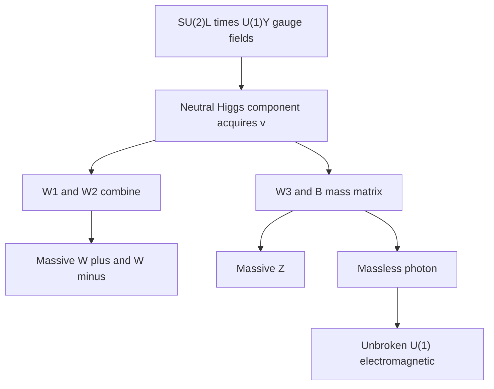

# Electroweak Theory and Grand Unification

The electroweak theory starts from a chiral gauge symmetry,

$$
SU(2)_L\times U(1)_Y,
$$

and ends, after the Higgs field acquires a vacuum expectation value, with unbroken electromagnetism. The gauge fields reorganize into $W^+$, $W^-$, $Z$, and the photon. Three Higgs degrees of freedom supply the longitudinal polarizations of the massive vector bosons; one neutral scalar remains.

Grand unification asks a separate, more speculative question: can $SU(3)_c\times SU(2)_L\times U(1)_Y$ and the fermions of one generation arise from a larger gauge group? The appeal comes from charge quantization and representation structure. The cost is a set of severe tests involving coupling evolution, proton decay, symmetry breaking, and fermion masses.

## Charge assignments before symmetry breaking

Use the convention

$$
Q=T_3+\frac{Y}{2},
\qquad
D_\mu=\partial_\mu
+igT^aW_\mu^a
+ig'\frac{Y}{2}B_\mu.
$$

In one generation, the relevant multiplets are

| Field | $SU(3)_c$ | $SU(2)_L$ | $Y$ | Electric charges |
|---|---:|---:|---:|---|
| $Q_L=(u_L,d_L)^T$ | $\mathbf3$ | $\mathbf2$ | $1/3$ | $2/3,-1/3$ |
| $u_R$ | $\mathbf3$ | $\mathbf1$ | $4/3$ | $2/3$ |
| $d_R$ | $\mathbf3$ | $\mathbf1$ | $-2/3$ | $-1/3$ |
| $L_L=(\nu_L,e_L)^T$ | $\mathbf1$ | $\mathbf2$ | $-1$ | $0,-1$ |
| $e_R$ | $\mathbf1$ | $\mathbf1$ | $-2$ | $-1$ |
| $H=(H^+,H^0)^T$ | $\mathbf1$ | $\mathbf2$ | $1$ | $1,0$ |

The subscript $L$ is structural: only left-handed fermions occupy weak doublets. Right-handed charged fermions are weak singlets. A right-handed neutrino, if included, is neutral under the entire Standard Model gauge group and has $Y=0$.

Checking one entry fixes the normalization. For the upper component of $Q_L$, $T_3=1/2$, hence

$$
Q=\frac12+\frac16=\frac23.
$$

For the lower component, $T_3=-1/2$, giving $Q=-1/3$.

## Choosing the Higgs vacuum

The renormalizable Higgs Lagrangian is

$$
\mathcal L_H=(D_\mu H)^\dagger(D^\mu H)-V(H),
\qquad
V(H)=-\mu^2H^\dagger H+\lambda(H^\dagger H)^2,
$$

with $\mu^2\gt 0$ and $\lambda\gt 0$. The minima satisfy

$$
H^\dagger H=\frac{\mu^2}{2\lambda}=\frac{v^2}{2}.
$$

A gauge transformation can orient the vacuum along the neutral component. In unitary gauge,

$$
H(x)=\frac1{\sqrt2}
\begin{pmatrix}
0\\
v+h(x)
\end{pmatrix},
\qquad
v^2=\frac{\mu^2}{\lambda}.
$$

The vacuum is annihilated by $Q=T_3+Y/2$. On its lower component, $T_3=-1/2$ and $Y/2=+1/2$, so $Q\langle H\rangle=0$. Electromagnetism remains an exact gauge symmetry and its gauge boson remains massless.

The phrase “spontaneously broken gauge symmetry” is shorthand. Gauge redundancy itself is not a physical symmetry acting between distinct observable states. The invariant content is the spectrum and the surviving massless gauge field. Unit gauge displays that spectrum economically, while other gauges retain Goldstone fields and are often better for loop calculations.

## Deriving the vector-boson masses

Insert the vacuum into the Higgs kinetic term. Since the vacuum is constant,

$$
D_\mu\langle H\rangle
=\frac{iv}{\sqrt2}
\left(g\frac{\tau^a}{2}W_\mu^a
+g'\frac12B_\mu\right)
\begin{pmatrix}
0\\
1
\end{pmatrix}.
$$

The resulting quadratic terms are

$$
(D_\mu\langle H\rangle)^\dagger
(D^\mu\langle H\rangle)
=
\frac{g^2v^2}{4}W_\mu^+W^{-\mu}
+\frac{v^2}{8}(gW_\mu^3-g'B_\mu)^2,
$$

where

$$
W_\mu^\pm=\frac{W_\mu^1\mp iW_\mu^2}{\sqrt2}.
$$

The charged-boson mass is therefore

$$
m_W=\frac{gv}{2}.
$$

The neutral mass matrix in the basis $(W^3,B)$ is proportional to

$$
\frac{v^2}{4}
\begin{pmatrix}
g^2&-gg'\\
-gg'&g'^2
\end{pmatrix}.
$$

Its determinant vanishes. The normalized zero eigenvector is the photon, while the orthogonal combination is the $Z$:

$$
\begin{aligned}
A_\mu&=\sin\theta_W W_\mu^3+\cos\theta_W B_\mu,\\
Z_\mu&=\cos\theta_W W_\mu^3-\sin\theta_W B_\mu,
\end{aligned}
$$

with

$$
\sin\theta_W=\frac{g'}{\sqrt{g^2+g'^2}},
\qquad
\cos\theta_W=\frac{g}{\sqrt{g^2+g'^2}}.
$$

Thus

$$
m_Z=\frac v2\sqrt{g^2+g'^2},
\qquad
m_W=m_Z\cos\theta_W.
$$

The electromagnetic coupling follows from the coefficient of $QA_\mu$:

$$
e=g\sin\theta_W=g'\cos\theta_W.
$$

At tree level the ratio

$$
\rho=\frac{m_W^2}{m_Z^2\cos^2\theta_W}
$$

equals one. This reflects the Higgs-doublet structure and its approximate custodial symmetry. Loop effects and other Higgs representations modify the simple relation, so precision fits use renormalized parameters rather than substituting tree-level formulas blindly.

## Fermion masses and what remains unexplained

Gauge invariance forbids a bare electron mass because $L_L$ and $e_R$ transform differently. A Yukawa term is allowed:

$$
\mathcal L_Y\supset
-y_e\bar L_LHe_R+\text{h.c.}
$$

After inserting the vacuum,

$$
\mathcal L_Y\supset
-\frac{y_ev}{\sqrt2}\bar e_Le_R+\text{h.c.},
\qquad
m_e=\frac{y_ev}{\sqrt2}.
$$

Down-type quarks use $H$, while up-type quarks use the conjugate doublet

$$
\widetilde H=i\tau^2H^*,
$$

whose hypercharge is $-1$. With three generations, each Yukawa coupling is a complex matrix. Diagonalizing the up- and down-quark matrices by different left-handed rotations produces the CKM matrix in charged weak currents. The Higgs mechanism explains how gauge-invariant masses arise, but the Yukawa matrices and their hierarchy remain input data.

Neutrino masses require an extension of the minimal field content. A gauge-singlet right-handed neutrino permits a Dirac Yukawa coupling and also a Majorana mass $M_R$. When $M_R$ is much larger than the electroweak scale, diagonalizing the neutrino mass matrix yields a light scale schematically

$$
m_\nu\sim\frac{m_D^2}{M_R}.
$$

This seesaw pattern is compatible with grand-unified constructions, though it is not unique to them.

## One-generation anomaly checks

Because electroweak interactions are chiral, anomaly cancellation is mandatory. Count every fermion as left-handed; replace a physical right-handed field by its left-handed charge conjugate. It is convenient here to use $y=Y/2$.

For the mixed $SU(2)_L^2U(1)_Y$ anomaly, only weak doublets contribute. There are three colored quark doublets with $y=1/6$ and one lepton doublet with $y=-1/2$:

$$
3\left(\frac16\right)+\left(-\frac12\right)=0.
$$

For the cubic $U(1)_Y^3$ anomaly, include multiplicities and flip the charges of conjugated right-handed fields:

$$
\begin{aligned}
\sum y^3
&=6\left(\frac16\right)^3
+2\left(-\frac12\right)^3
+3\left(-\frac23\right)^3\\
&\quad
+3\left(\frac13\right)^3
+(1)^3\\
&=\frac1{36}-\frac14-\frac89+\frac19+1\\
&=0.
\end{aligned}
$$

The cancellation intertwines quarks and leptons. It does not prove grand unification, but it makes the matter content look far less arbitrary than a random list of chiral representations.

## What unification would organize

A simple grand-unified group has a single gauge coupling before breaking. Its representations can combine fields that carry different Standard Model charges. In minimal $SU(5)$, one generation of left-handed fermions fits into $\overline{\mathbf5}\oplus\mathbf{10}$, with a gauge singlet added if a right-handed neutrino is wanted. In $SO(10)$, one generation including that singlet neutrino fits into a single $\mathbf{16}$ spinor representation.

| Question | $SU(5)$ idea | $SO(10)$ idea |
|---|---|---|
| One-generation matter | $\overline{\mathbf5}\oplus\mathbf{10}$ | $\mathbf{16}$ |
| Right-handed neutrino | separate singlet | included in $\mathbf{16}$ |
| Charge quantization | follows from embedding | follows from embedding |
| Baryon violation | heavy gauge and scalar exchange | generally present, model-dependent channels |
| Symmetry breaking | requires chosen Higgs representations | requires a larger breaking sector |

Hypercharge normalization matters when comparing couplings. The $U(1)$ generator may be rescaled together with its coupling, so an embedding fixes the convention. For the standard $SU(5)$ normalization one defines

$$
g_1=\sqrt{\frac53}\,g'.
$$

Only then is it meaningful to ask whether $g_1$, $g_2$, and $g_3$ approach one value under renormalization-group evolution. Thresholds from heavy particles and any intermediate breaking scales alter the extrapolation. Near-convergence is evidence to evaluate, not a derivation of a unique ultraviolet theory.

The most characteristic low-energy danger is baryon-number violation. Heavy gauge bosons connecting quark and lepton components generate dimension-six operators after being integrated out:

$$
\mathcal L_{\text{eff}}
\sim\frac{g_X^2}{M_X^2}(qq)(ql).
$$

Colored scalar exchange can generate additional operators. Their coefficients depend on the model and flavor structure, so a mass scale alone does not determine a lifetime.

## Worked example: diagonalizing the neutral mass matrix

Remove the common factor $v^2/4$ and consider

$$
M^2=
\begin{pmatrix}
g^2&-gg'\\
-gg'&g'^2
\end{pmatrix}.
$$

The characteristic polynomial is

$$
\det(M^2-\lambda I)
=(g^2-\lambda)(g'^2-\lambda)-g^2g'^2
=\lambda[\lambda-(g^2+g'^2)].
$$

The eigenvalues are $0$ and $g^2+g'^2$. For the zero eigenvalue,

$$
g^2a-gg'b=0
\quad\Longrightarrow\quad
\frac ab=\frac{g'}g.
$$

After normalization, $(a,b)=(\sin\theta_W,\cos\theta_W)$, giving $A_\mu$. The orthogonal eigenvector $(\cos\theta_W,-\sin\theta_W)$ gives $Z_\mu$. Restoring the common factor yields

$$
m_A^2=0,
\qquad
m_Z^2=\frac{v^2}{4}(g^2+g'^2).
$$

The zero eigenvalue follows from the unbroken generator, not from a numerical accident.

## Worked example: checking the electron Yukawa term

Under $U(1)_Y$, a field of hypercharge $Y$ transforms with phase $e^{i\alpha Y/2}$. The factors in $\bar L_LHe_R$ have hypercharges

$$
Y(\bar L_L)=+1,
\qquad
Y(H)=+1,
\qquad
Y(e_R)=-2.
$$

Their sum is zero:

$$
1+1-2=0.
$$

For $SU(2)_L$, $\bar L_L$ transforms as a conjugate doublet and its index can contract with the Higgs doublet to a singlet. When

$$
H\to\frac1{\sqrt2}
\begin{pmatrix}
0\\
v+h
\end{pmatrix},
$$

the interaction becomes

$$
-y_e\bar L_LHe_R
=-\frac{y_e(v+h)}{\sqrt2}\bar e_Le_R.
$$

Adding the Hermitian conjugate gives

$$
-m_e\bar ee-\frac{m_e}{v}h\bar ee,
\qquad
m_e=\frac{y_ev}{\sqrt2}.
$$

The mass and the one-Higgs coupling are tied to the same Yukawa parameter.

## Worked example: the scale dependence of proton decay

Suppose heavy gauge exchange gives a dimension-six coefficient $C=g_X^2/M_X^2$. A four-fermion decay amplitude scales as $C$ times a hadronic matrix element. Dimensional analysis then gives

$$
\Gamma_p\sim
\frac{g_X^4}{M_X^4}m_p^5
$$

up to phase space, renormalization, mixing, and nonperturbative matrix elements. Therefore

$$
\tau_p\sim\frac{M_X^4}{g_X^4m_p^5}.
$$

If $M_X$ is raised by a factor of ten while the other quantities are fixed,

$$
\frac{\tau_p(10M_X)}{\tau_p(M_X)}
=\frac{(10M_X)^4}{M_X^4}=10^4.
$$

The fourth-power sensitivity is why proton-decay limits strongly constrain heavy sectors even though the mediators cannot be produced directly.

## Boundaries of the simple picture

- Hypercharge and electric charge are different generators. Before symmetry breaking, $B_\mu$ is not the photon.
- Tree-level identities use tree-level parameters. Precision calculations specify a renormalization scheme and include self-energy, vertex, and box corrections.
- Yukawa couplings are not predicted by electroweak symmetry breaking. The vacuum converts them into masses and Higgs couplings.
- A visual meeting of three plotted couplings depends on normalization, particle content, loop order, and thresholds.
- Anomaly cancellation checks consistency but does not select a unique unified group.
- Proton decay estimates need operator coefficients, flavor rotations, running, and hadronic matrix elements. Dimensional scaling supplies only the first diagnostic.
- Grand unification need not occur in one step. Intermediate gauge groups can change both coupling evolution and low-energy signatures.

## Charged and neutral weak currents

Before symmetry breaking, the interaction of a left-handed doublet with $W^a_\mu$ is fixed by $SU(2)_L$. The combinations $W^\pm$ multiply the raising and lowering generators. For leptons,

$$
\mathcal L_{\mathrm{cc}}
=-\frac g{\sqrt2}
\left(
\bar\nu_L\gamma^\mu e_L W^+_\mu
+\bar e_L\gamma^\mu\nu_L W^-_\mu
\right).
$$

Only left-handed fields appear. At energies much smaller than $m_W$, the propagator may be expanded in powers of momentum over $m_W$. The leading term gives a local four-fermion interaction. Comparing its coefficient with the Fermi constant yields the tree-level relation

$$
\frac{G_F}{\sqrt2}
=\frac{g^2}{8m_W^2}
=\frac1{2v^2}.
$$

Thus the vacuum scale can be determined from low-energy weak decay even without producing a Higgs or a $W$ boson.

The $Z$ couples to a neutral current,

$$
\mathcal L_Z
=-\frac g{\cos\theta_W}
Z_\mu\,
\bar f\gamma^\mu
\left(T_3P_L-Q\sin^2\theta_W\right)f.
$$

Left- and right-handed fermions have different couplings because $T_3$ acts only on the left-handed component. The photon coupling obtained from the orthogonal field combination is simply $-eQ\bar f\gamma^\mu fA_\mu$ and is vectorlike. Neutral-current measurements therefore probe the mixing angle and chiral assignments directly.

## Why the Higgs doublet gives rho equal to one

The relation $\rho=1$ is more than the algebraic identity between $m_W$ and $m_Z$. Package the Higgs doublet and its conjugate into a matrix

$$
\Phi=(\widetilde H,H).
$$

If hypercharge and Yukawa differences are temporarily neglected, the scalar kinetic term and potential possess an approximate global $SU(2)_L\times SU(2)_R$ symmetry acting on this matrix. The vacuum is proportional to the identity and preserves the diagonal subgroup, called custodial $SU(2)$. The three weak bosons then form a custodial triplet before the neutral mixing is restored.

Hypercharge, unequal Yukawa couplings, and quantum corrections break custodial symmetry. New scalar multiplets can also alter the tree-level mass ratio if their vacuum expectation values do not preserve the appropriate diagonal symmetry. Precision measurements of the mass relation consequently constrain more than one number; they test the representation structure of electroweak symmetry breaking.

## Flavor appears after diagonalizing masses

With three generations, the quark Yukawa terms are

$$
\mathcal L_Y
=-\bar Q_LY_dHd_R
-\bar Q_LY_u\widetilde H u_R
+\text{h.c.}
$$

Biunitary transformations diagonalize the two complex mass matrices. The neutral gauge interactions remain diagonal because the same rotation and its adjoint occur together. The charged current connects an up-type rotation with a down-type rotation, leaving

$$
V_{\mathrm{CKM}}=U_{uL}^\dagger U_{dL}.
$$

This matrix contains observable mixing angles and a CP-violating phase for three generations. Flavor-changing neutral currents are absent at tree level in the minimal model because fermions with the same charge share the same neutral-current coupling before diagonalization. Loop processes can generate them, making rare decays sensitive tests of additional flavor structure.

The lepton sector has an analogous mixing matrix once neutrino masses are included. Majorana masses add phases that do not appear in ordinary oscillation probabilities but can matter in lepton-number-violating processes.

## How unified multiplets reproduce hypercharge

In $SU(5)$, the Standard Model subgroup can be represented by block-diagonal transformations acting on three color entries and two weak entries. A properly normalized hypercharge generator is proportional to

$$
Y
=\operatorname{diag}
\left(
-\frac23,-\frac23,-\frac23,1,1
\right)
$$

in the convention $Q=T_3+Y/2$. Its trace vanishes, as required for an $SU(5)$ generator. Components of the $\overline{\mathbf5}$ then have the quantum numbers of $d_R^c$ and the lepton doublet, while the antisymmetric $\mathbf{10}$ contains $Q_L$, $u_R^c$, and $e_R^c$.

Because hypercharge is embedded in a traceless nonabelian generator, its relative values are quantized. The same embedding fixes the normalization factor used in coupling comparisons. It also places quarks and leptons in common representations, so some heavy gauge bosons connect them. Baryon and lepton numbers are not automatic gauge symmetries of the unified theory, and proton-decay operators become possible.

Unification still leaves hard model-building work. The large group must break to the Standard Model without unwanted light fields. The electroweak Higgs doublet may share a unified multiplet with a colored scalar whose mass must be much larger. Fermion mass relations derived from the smallest representation choices are often too restrictive and require additional operators or Higgs representations. These are structural constraints, not details supplied by the group name alone.

## Counting what the Higgs mechanism rearranges

Before symmetry breaking, the complex Higgs doublet has four real field components. The four electroweak gauge bosons are massless and each has two transverse polarizations, giving eight gauge-field degrees of freedom. After the vacuum is chosen, three scalar components are absorbed into $W^+$, $W^-$, and $Z$. Each massive vector then has three polarizations, while the photon keeps two and one real Higgs scalar remains:

$$
4+8=3+3+3+2+1.
$$

No physical degree of freedom has disappeared. In unitary gauge the absorbed Goldstone fields are absent from the field list; in covariant gauges they remain as gauge-dependent scalar fields alongside ghosts. The latter formulation usually gives better ultraviolet behavior for loop calculations even though the intermediate particle list looks larger.

The longitudinal polarization of a high-energy massive vector is closely related to the corresponding Goldstone mode. This equivalence organizes high-energy amplitudes and exposes why Higgs exchange is required to control the growth of longitudinal weak-boson scattering. The statement is an asymptotic relation with normalization and correction terms, not permission to replace vectors by scalars at arbitrary energy.

See also: [Symmetry Breaking, Goldstone Bosons, and Higgs Physics](/physics/quantum-field-theory/symmetry-breaking-goldstone-higgs) · [Chiral Anomalies](/physics/quantum-field-theory/chiral-anomalies) · [Yang--Mills Theory and QCD](/physics/quantum-field-theory/yang-mills-theory-and-qcd) · [Renormalization Group](/physics/quantum-field-theory/renormalization-group) · [Effective Field Theory](/physics/quantum-field-theory/effective-field-theory)

