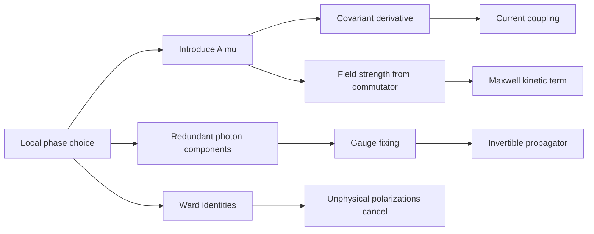

# Gauge Invariance and QED

Quantum electrodynamics is the gauge theory of a charged Dirac field and a massless spin-one field. Its local $U(1)$ redundancy fixes the form of the electron--photon interaction, organizes perturbation theory through Ward identities, and ensures that unphysical photon polarizations cancel from observable quantities.

Calling gauge invariance a redundancy matters. Two potentials related by a gauge transformation describe the same electromagnetic fields. The redundancy does not itself act as a measurable operation on a state, yet requiring a consistent local description has strong consequences for the allowed Lagrangian.

## From a global phase to a gauge connection

The free Dirac Lagrangian,

$$
\mathcal L_0=\bar\psi(i\gamma^\mu\partial_\mu-m)\psi,
$$

is invariant under a constant phase rotation $\psi\to e^{-ie\alpha}\psi$. If $\alpha$ depends on position, differentiation produces an extra term:

$$
\partial_\mu(e^{-ie\alpha(x)}\psi)
=e^{-ie\alpha(x)}
\left(\partial_\mu\psi-ie(\partial_\mu\alpha)\psi\right).
$$

Introduce a gauge potential and the covariant derivative

$$
D_\mu=\partial_\mu+ieA_\mu.
$$

With

$$
\psi\to e^{-ie\alpha(x)}\psi,
\qquad
A_\mu\to A_\mu+\partial_\mu\alpha,
$$

one finds $D_\mu\psi\to e^{-ie\alpha}D_\mu\psi$. The invariant matter Lagrangian is

$$
\bar\psi(i\gamma^\mu D_\mu-m)\psi
=\bar\psi(i\gamma^\mu\partial_\mu-m)\psi
-e\bar\psi\gamma^\mu\psi A_\mu.
$$

Minimal coupling has produced $-ej^\mu A_\mu$. Gauge symmetry determines its Lorentz and charge structure, though the numerical value of $e$ must be measured at a specified energy scale.

The commutator of covariant derivatives gives the curvature:

$$
[D_\mu,D_\nu]\psi=ieF_{\mu\nu}\psi,
\qquad
F_{\mu\nu}=\partial_\mu A_\nu-\partial_\nu A_\mu.
$$

For abelian $U(1)$, $F_{\mu\nu}$ is gauge invariant. The complete renormalizable Lagrangian is

$$
\boxed{
\mathcal L_{\mathrm{QED}}
=-\frac14F_{\mu\nu}F^{\mu\nu}
+\bar\psi(i\gamma^\mu D_\mu-m)\psi
}.
$$

A term $m_\gamma^2A_\mu A^\mu/2$ is not invariant. Ordinary QED contains no photon mass. A massive vector can still arise in a larger gauge-invariant theory through a Higgs or Stueckelberg mechanism; the bare Proca term is what fails the stated symmetry.

## Maxwell equations from the action

Varying the action with respect to $A_\nu$ gives

$$
\partial_\mu F^{\mu\nu}=ej^\nu,
\qquad
j^\nu=\bar\psi\gamma^\nu\psi.
$$

Taking another derivative yields

$$
\partial_\nu\partial_\mu F^{\mu\nu}=0
$$

because $F^{\mu\nu}$ is antisymmetric while the derivatives are symmetric. Hence $\partial_\nu j^\nu=0$. The Dirac equations give the same conservation law. Gauge invariance, current conservation, and consistency of Maxwell's equations are different views of one structure.

The homogeneous equations follow from the definition of $F$:

$$
\partial_\lambda F_{\mu\nu}
+\partial_\mu F_{\nu\lambda}
+\partial_\nu F_{\lambda\mu}=0.
$$

This Bianchi identity does not use an equation of motion.

## Why gauge fixing is needed

After integration by parts, the quadratic photon action contains

$$
\frac12A_\mu
\left(g^{\mu\nu}\Box-\partial^\mu\partial^\nu\right)
A_\nu.
$$

The differential operator has zero modes $A_\mu=\partial_\mu\alpha$, so it cannot be inverted on the full space of potentials. Add

$$
\mathcal L_{\mathrm{gf}}
=-\frac1{2\xi}(\partial_\mu A^\mu)^2.
$$

The momentum-space propagator becomes

$$
D_{\mu\nu}(k)=
\frac{-i}{k^2+i\epsilon}
\left[
g_{\mu\nu}-(1-\xi)
\frac{k_\mu k_\nu}{k^2+i\epsilon}
\right].
$$

Feynman gauge has $\xi=1$; Landau gauge is the $\xi\to0$ limit. Intermediate Green functions depend on $\xi$, while on-shell observables do not.

In the Faddeev--Popov treatment, the determinant for a linear abelian gauge condition is independent of $A_\mu$. Ghost fields have no interaction vertices and can be omitted from QED scattering calculations. Nonabelian theories lose this simplification.

## Feynman rules and momentum flow

For the usual Fourier and metric conventions:

| Element | Momentum-space factor |
|---|---|
| Electron propagator | $i(\slashed p+m)/(p^2-m^2+i\epsilon)$ |
| Photon propagator in Feynman gauge | $-ig_{\mu\nu}/(k^2+i\epsilon)$ |
| Electron--photon vertex | $-ie\gamma^\mu$ |
| Closed fermion loop | extra factor $-1$ |

At each vertex, electric charge and four-momentum are conserved. Arrows on fermion lines track fermion-number flow; momentum arrows are a separate choice. Confusing the two is a common source of sign errors for positrons.

Power counting allows the gauge-invariant Pauli operator $\bar\psi\sigma^{\mu\nu}\psi F_{\mu\nu}$, but it has mass dimension five. It is absent from the renormalizable QED Lagrangian and may appear in an effective theory suppressed by a heavy scale. Loops from minimal QED nevertheless generate a finite anomalous magnetic moment in observables.

## Ward and Ward--Takahashi identities

For an amplitude with an external photon of momentum $k$, gauge invariance implies

$$
k_\mu\mathcal M^\mu=0.
$$

A polarization shift $\epsilon^\mu\to\epsilon^\mu+c k^\mu$ leaves $\epsilon_\mu\mathcal M^\mu$ unchanged. Longitudinal gauge artifacts do not contribute to the measured amplitude.

The off-shell identity for the one-particle-irreducible vertex is

$$
q_\mu\Gamma^\mu(p+q,p)
=e\left[S^{-1}(p+q)-S^{-1}(p)\right],
$$

where placement of $e$ depends on how $\Gamma^\mu$ is defined. At tree level, $\Gamma^\mu=e\gamma^\mu$ and $S^{-1}(p)=\slashed p-m$, so both sides equal $e\slashed q$.

After renormalization, the identity relates the vertex and electron wavefunction constants:

$$
Z_1=Z_2.
$$

It does not set every QED renormalization constant to one. Vacuum polarization renormalizes the photon field and determines the running electric charge.

## Worked example: covariance of the derivative

Apply the transformed derivative:

$$
\begin{aligned}
D'_\mu\psi'
&=(\partial_\mu+ieA'_\mu)(e^{-ie\alpha}\psi)\\
&=(\partial_\mu+ieA_\mu+ie\partial_\mu\alpha)
(e^{-ie\alpha}\psi).
\end{aligned}
$$

Differentiating the product and collecting terms gives

$$
\begin{aligned}
D'_\mu\psi'
&=e^{-ie\alpha}\partial_\mu\psi
-ie(\partial_\mu\alpha)e^{-ie\alpha}\psi\\
&\quad+ieA_\mu e^{-ie\alpha}\psi
+ie(\partial_\mu\alpha)e^{-ie\alpha}\psi.
\end{aligned}
$$

The two terms containing $\partial_\mu\alpha$ cancel:

$$
D'_\mu\psi'=e^{-ie\alpha}D_\mu\psi.
$$

Since $\bar\psi\to\bar\psi e^{ie\alpha}$, the phases in $\bar\psi i\gamma^\mu D_\mu\psi$ cancel.

## Worked example: the on-shell Ward identity

Let a photon of momentum $k=p'-p$ couple between on-shell electron spinors. Then

$$
\begin{aligned}
k_\mu\bar u(p')\gamma^\mu u(p)
&=\bar u(p')\slashed k\,u(p)\\
&=\bar u(p')(\slashed p'-\slashed p)u(p).
\end{aligned}
$$

The on-shell equations are

$$
(\slashed p-m)u(p)=0,
\qquad
\bar u(p')(\slashed p'-m)=0.
$$

Applying them on the appropriate sides gives

$$
\begin{aligned}
\bar u(p')\slashed p' u(p)
-\bar u(p')\slashed p\,u(p)
&=m\bar u(p')u(p)-m\bar u(p')u(p)\\
&=0.
\end{aligned}
$$

The result relies on on-shell external legs. For an off-shell vertex the inverse-propagator terms survive, as the Ward--Takahashi identity records.

## Worked example: cancellation of the gauge parameter

Consider photon exchange between conserved currents $J^\mu$ and $J'^\nu$ with momentum $k$:

$$
\mathcal M\propto
J^\mu D_{\mu\nu}(k)J'^\nu.
$$

The $\xi$-dependent part is

$$
\mathcal M_\xi\propto
(1-\xi)
\frac{(J\cdot k)(k\cdot J')}{(k^2+i\epsilon)^2}.
$$

Current conservation in momentum space gives $k_\mu J^\mu=0$ and $k_\nu J'^\nu=0$. Therefore $\mathcal M_\xi=0$. In more complicated loop processes gauge independence may emerge only after summing every required diagram and counterterm.

## The Coulomb potential from photon exchange

For slowly moving charges, the dominant current components are $J^0$. Static exchange contains $e_1e_2/\mathbf q^2$. Fourier transformation gives

$$
V(\mathbf r)
=e_1e_2
\int\frac{d^3q}{(2\pi)^3}
\frac{e^{i\mathbf q\cdot\mathbf r}}{\mathbf q^2}
=\frac{e_1e_2}{4\pi r}.
$$

The long range follows from the massless pole. Replacing the denominator by $\mathbf q^2+m^2$ gives a Yukawa factor $e^{-mr}/r$, showing how a mediator mass screens a force.

## Infrared observables

A massless photon creates soft singularities. Virtual amplitudes diverge when a photon momentum approaches zero, and real-emission probabilities diverge when an emitted photon becomes arbitrarily soft. A detector cannot distinguish a state with no photon from one containing photons below its resolution. Summing over those experimentally degenerate final states cancels the relevant infrared divergences order by order.

Collinear singularities are softened by a nonzero electron mass but can leave large logarithms such as $\log(E^2/m_e^2)$. Exclusive amplitudes and inclusive cross sections answer different experimental questions; only the latter are generally infrared safe under the appropriate sum over unresolved radiation.

## Checks that catch common errors

- A gauge-fixed Lagrangian need not look invariant under the original transformation. Physical matrix elements, not an individual propagator, carry gauge independence.
- The simple identity $k_\mu\mathcal M^\mu=0$ applies to a complete on-shell amplitude. Off-shell Green functions contain inverse-propagator terms.
- A hard cutoff can violate gauge invariance if used carelessly. Counterterms and momentum routings must preserve or restore the Ward identities.
- Dropping real soft-photon emission while retaining virtual corrections leaves an infrared-divergent quantity that does not match a detector measurement.
- Photon masslessness is protected in unbroken QED, but gauge-invariant mass generation is possible in a different theory.
- Charge conservation does not make the effective charge scale-independent. Vacuum polarization produces running while respecting the Ward identity.

## Counting photon degrees of freedom

A four-vector potential has four components, but a massless photon has two physical helicities. The mismatch is resolved by constraints and gauge redundancy. In canonical language, $A_0$ has no time-derivative kinetic term, so its conjugate momentum vanishes. Its equation of motion imposes Gauss's law rather than evolving an independent oscillator. A residual gauge freedom removes one more component, leaving two transverse modes.

For an external on-shell photon one may choose polarization vectors satisfying

$$
k\cdot\epsilon^{(\lambda)}=0,
\qquad
\lambda=1,2.
$$

The polarization sum is often replaced by $-g_{\mu\nu}$ inside a gauge-invariant amplitude. This replacement formally includes unphysical components, but the Ward identity kills terms proportional to the photon momentum. It is unsafe for an incomplete set of diagrams whose contraction with $k_\mu$ does not vanish.

A massive vector has three physical polarizations. Adding a Proca mass removes gauge redundancy and makes the longitudinal mode physical. The discontinuous change in degree counting is one reason high-energy scattering of massive vectors requires a consistent mass-generation mechanism rather than an arbitrary mass term.

## Vacuum polarization and the measured charge

The one-particle-irreducible photon two-point function has the form

$$
i\Pi^{\mu\nu}(q)
=i(q^\mu q^\nu-q^2g^{\mu\nu})\Pi(q^2).
$$

Transversality,

$$
q_\mu\Pi^{\mu\nu}(q)=0,
$$

follows from the Ward identity. It rules out a loop-generated photon mass in unbroken QED because a mass term would contribute a piece proportional to $g^{\mu\nu}$ without the required factor of $q^2$.

Inserting repeated vacuum-polarization bubbles into the propagator gives a geometric series. Schematically, the transverse part becomes

$$
\frac{-i}{q^2[1-\Pi(q^2)]}.
$$

The definition of the renormalized charge fixes one value of $\Pi$. At larger spacelike momentum, virtual charged pairs screen less of the source and the effective electromagnetic coupling increases. For one Dirac fermion well above its mass, the leading running is

$$
\mu\frac{de}{d\mu}
=\frac{e^3}{12\pi^2}+\cdots.
$$

Charge conservation and charge running are compatible statements. The first concerns the divergence of the current; the second concerns how a measured interaction strength depends on momentum transfer.

## A complete Ward check in Compton scattering

Electron--photon scattering has two tree diagrams. With incoming photon momentum $k$, outgoing photon momentum $k'$, and electron momenta $p,p'$, the amplitude contains

$$
\mathcal M^{\mu\nu}
=-e^2\bar u(p')
\left[
\gamma^\nu
\frac{\slashed p+\slashed k+m}{(p+k)^2-m^2}
\gamma^\mu
+\gamma^\mu
\frac{\slashed p-\slashed k'+m}{(p-k')^2-m^2}
\gamma^\nu
\right]u(p).
$$

Contract the incoming-photon index with $k_\mu$. Use

$$
\slashed k
=(\slashed p+\slashed k-m)
-(\slashed p-m)
$$

in the first diagram. The second term annihilates the incoming spinor, while the first cancels the neighboring propagator denominator and numerator, leaving one contact-like term. In the crossed diagram, momentum conservation and the outgoing Dirac equation produce the same term with the opposite sign. Their sum vanishes:

$$
k_\mu\mathcal M^{\mu\nu}=0.
$$

Neither diagram is gauge invariant separately. Dropping one ordering breaks the cancellation. This provides a useful debugging rule: test the complete amplitude by replacing a polarization vector with its momentum.

## Magnetic moments and higher-dimension structure

The most general on-shell electromagnetic vertex between equal-mass fermions can be written

$$
\bar u(p')
\left[
F_1(q^2)\gamma^\mu
+\frac{iF_2(q^2)}{2m}
\sigma^{\mu\nu}q_\nu
\right]u(p).
$$

Charge normalization gives $F_1(0)$ in units of the particle's charge. The Pauli form factor $F_2(0)$ is the anomalous magnetic moment. At tree level in minimal QED, $F_2(0)=0$; loops generate a finite nonzero result.

The second term is transverse by itself because $q_\mu\sigma^{\mu\nu}q_\nu=0$. It therefore respects the Ward identity. In an effective Lagrangian it corresponds to a dimension-five dipole operator with a coefficient carrying inverse mass dimension. Minimal renormalizable QED predicts that coefficient through loops, while heavy new physics can add further suppressed contributions.

## Infrared cancellation in slightly more detail

Introduce a temporary photon mass or dimensional regulator to track the soft divergence. A virtual correction to a charged external line contains a logarithm of that regulator with a negative contribution to the exclusive probability. Real emission of an unresolved photon contains the matching positive logarithm. When the measurement sums over all photons below an energy resolution $\Delta E$, the regulator cancels and a finite dependence on $\Delta E$ remains.

The finite resolution dependence is physical: changing the detector definition changes which final states are grouped together. Demanding a probability for exactly zero photons at arbitrarily high resolution is not a robust observable because an accelerated charge produces a cloud of soft radiation. More refined treatments reorganize perturbation theory into dressed states or exponentiated soft factors.

## Gauss's law and the nonlocal electric field

Varying $A_0$ gives the constraint

$$
\nabla\cdot\mathbf E=\rho.
$$

In Coulomb gauge, $\nabla\cdot\mathbf A=0$, the longitudinal electric field is fixed instantaneously by the charge density. Solving the constraint produces the Coulomb energy

$$
H_C
=\frac12\int d^3x,d^3y,
\frac{\rho(\mathbf x)\rho(\mathbf y)}
{4\pi|\mathbf x-\mathbf y|}.
$$

Its instantaneous appearance does not permit faster-than-light signaling. The gauge-dependent split into longitudinal constraint fields and transverse radiation is not itself observable; causal commutators and complete electromagnetic fields respect the light cone.

Gauss's law also complicates the idea of a strictly local charged operator. A charged state must be accompanied by an electric flux extending outward. The bare field $\psi(x)$ is gauge covariant rather than gauge invariant. A gauge-invariant charged operator requires a nonlocal dressing, such as a Wilson line or a Coulombic field configuration. Neutral local composites, by contrast, can be gauge invariant without flux reaching infinity.

This global aspect distinguishes gauge charge from a generic internal label. Integrating Gauss's law over space equates total charge to electric flux through the boundary. Boundary conditions and the behavior of gauge transformations at infinity therefore enter the definition of charged sectors.

Gauge-invariant observables can also be extended rather than pointlike. For a closed curve $C$, the abelian Wilson loop

$$
W(C)=\exp\left(ie\oint_C A_\mu dx^\mu\right)
$$

is invariant because the integral of $\partial_\mu\alpha$ around a closed contour vanishes for a single-valued gauge function. By Stokes' theorem it measures electromagnetic flux through a spanning surface. Open Wilson lines transform at their endpoints and can be combined with charged fields there to form a gauge-invariant composite. These objects express the phase accumulated by transporting charge and lead to the Aharonov--Bohm effect even in regions where the local field strength vanishes along the particle paths.

## Related pages

- [Dirac Fields and Spinors](/physics/quantum-field-theory/dirac-fields-and-spinors)
- [Perturbation Theory and Feynman Diagrams](/physics/quantum-field-theory/perturbation-and-feynman-diagrams)
- [Renormalization and Counterterms](/physics/quantum-field-theory/renormalization-and-counterterms)
- [Renormalization Group](/physics/quantum-field-theory/renormalization-group)
- [Yang--Mills Theory and QCD](/physics/quantum-field-theory/yang-mills-theory-and-qcd)

