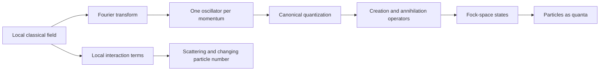

# Motivation, Fields, and Quanta

Relativistic quantum mechanics cannot keep particle number fixed. An energetic collision may create new particles, an unstable particle may decay, and radiation can be emitted in arbitrarily many soft quanta. A one-particle wavefunction has no operators that perform those changes. Quantum field theory instead assigns a quantum degree of freedom to each spatial point, or equivalently to each momentum mode, and lets creation and annihilation arise from the field operator.

The particle picture remains useful. In a free theory it is exact, and in an interacting theory it describes sufficiently stable asymptotic excitations. It is no longer the fundamental bookkeeping device. Fields carry locality and symmetry directly; particles are particular states of those fields.

## Three pressures toward fields

### Relativity allows creation

The relativistic dispersion relation is

$$
E^2=\mathbf p^2+m^2.
$$

Once an interaction concentrates enough center-of-mass energy, additional rest mass can be produced without violating energy or momentum conservation. A Hilbert space with exactly one electron, for example, cannot describe electron--positron pair creation. Fock space handles all allowed occupation numbers,

$$
\mathcal F=\mathcal H_0\oplus\mathcal H_1\oplus\mathcal H_2\oplus\cdots,
$$

and field operators connect its different sectors.

### Relativity favors local interactions

A relativistic theory should not transmit controllable effects outside the light cone. Local fields support a direct condition: bosonic observables commute at spacelike separation,

$$
[\mathcal O(x),\mathcal O(y)]=0
\qquad\text{for}\qquad
(x-y)^2<0.
$$

Fermionic fields anticommute at spacelike separation, while their observable bilinears commute. This microcausality condition is sharper than trying to formulate an instantaneous potential compatible with special relativity.

### Identical particles are already field-like

In many-body quantum mechanics one symmetrizes or antisymmetrizes wavefunctions by hand. Creation operators make the same structure automatic. A bosonic operator may occupy a mode repeatedly; a fermionic creation operator squares to zero. Position-space fields are Fourier transforms of those mode operators. The distinction between “many identical particles” and “one quantized field with many excitations” is then a choice of language, with the latter scaling better when occupation number changes.

## The classical scalar field as the starting model

Take a real scalar field $\phi(x)$ in flat spacetime with metric signature $(+---)$. In natural units, $c=\hbar=1$, the action is

$$
S[\phi]=\int d^4x\,\mathcal L,
\qquad
\mathcal L=
\frac12\partial_\mu\phi\,\partial^\mu\phi
-\frac12m^2\phi^2.
$$

Varying $\phi\to\phi+\delta\phi$ gives

$$
\delta S
=\int d^4x\left[
\partial_\mu\phi\,\partial^\mu\delta\phi
-m^2\phi\,\delta\phi
\right].
$$

Integrating the first term by parts and taking $\delta\phi$ to vanish at the boundary gives

$$
\delta S
=-\int d^4x\,
(\Box\phi+m^2\phi)\delta\phi.
$$

Stationarity for arbitrary $\delta\phi$ yields the Klein--Gordon equation,

$$
(\Box+m^2)\phi=0,
\qquad
\Box=\partial_t^2-\nabla^2.
$$

A plane wave $e^{-ip\cdot x}$ is a solution only if

$$
p^2=m^2,
\qquad
p^0=\pm E_{\mathbf p},
\qquad
E_{\mathbf p}=\sqrt{\mathbf p^2+m^2}.
$$

Both frequency signs are needed for a real classical field. After quantization they become annihilation and creation parts of one Hermitian operator.

## A field is a continuum of oscillators

Put the theory temporarily in a finite periodic box. Expand

$$
\phi(t,\mathbf x)
=\frac1{\sqrt V}\sum_{\mathbf p}
q_{\mathbf p}(t)e^{i\mathbf p\cdot\mathbf x},
$$

with the reality condition $q_{-\mathbf p}=q_{\mathbf p}^*$. Substitution into the action gives a sum of decoupled oscillator terms whose frequencies are

$$
\omega_{\mathbf p}=E_{\mathbf p}.
$$

The continuum has not disappeared; it has been reorganized by Fourier modes. Quantizing the field means quantizing every oscillator. The canonical momentum is

$$
\pi(t,\mathbf x)
=\frac{\partial\mathcal L}{\partial\dot\phi}
=\dot\phi(t,\mathbf x),
$$

and the equal-time commutator is

$$
[\phi(t,\mathbf x),\pi(t,\mathbf y)]
=i\delta^{(3)}(\mathbf x-\mathbf y).
$$

A normalization consistent with this commutator is

$$
\phi(x)=
\int\frac{d^3p}{(2\pi)^3}
\frac1{\sqrt{2E_{\mathbf p}}}
\left[
a(\mathbf p)e^{-ip\cdot x}
+a^\dagger(\mathbf p)e^{ip\cdot x}
\right],
$$

where

$$
[a(\mathbf p),a^\dagger(\mathbf q)]
=(2\pi)^3\delta^{(3)}(\mathbf p-\mathbf q).
$$

The vacuum obeys $a(\mathbf p)\vert 0\rangle=0$. A one-particle momentum eigenstate is $a^\dagger(\mathbf p)\vert 0\rangle$, and repeated action constructs multiparticle states.

The Hamiltonian is

$$
H=\int\frac{d^3p}{(2\pi)^3}
E_{\mathbf p}
\left[
a^\dagger(\mathbf p)a(\mathbf p)
+\frac12(2\pi)^3\delta^{(3)}(0)
\right].
$$

The second term is the sum of zero-point energies. In nongravitational scattering one can normal-order the free Hamiltonian and subtract this constant. In gravity, an absolute vacuum-energy density affects spacetime curvature, so the subtraction is no longer conceptually harmless.

## What a particle means in an interacting theory

For a free field, $a^\dagger(\mathbf p)\vert 0\rangle$ is an exact energy eigenstate. Interactions complicate the statement. The bare field in the Lagrangian can create a superposition containing a one-particle pole and multiparticle states. A stable particle corresponds to an isolated pole of the exact two-point function,

$$
\widetilde G(p)
\sim\frac{iZ}{p^2-m_{\mathrm{phys}}^2+i\epsilon}
+\text{terms regular at the pole}.
$$

Here $m_{\mathrm{phys}}$ is the measured mass and $Z$ measures the overlap between the field and the one-particle state. A resonance that can decay has no normalizable asymptotic one-particle state; its pole moves away from the real axis and its finite width records the lifetime.

The notion of particle can also depend on the background and observer. In ordinary Minkowski scattering there is a preferred time-translation symmetry and an unambiguous positive-frequency split. Curved spacetime or accelerated coordinates may not provide the same split. The local field remains the more durable object.

Condensed-matter examples reinforce the distinction. A phonon is a quantum of lattice displacement, not an elementary constituent of the solid. Magnons and quasiparticles have similar status. QFT applies because quantized collective fields obey the same oscillator and interaction logic.

## Local interactions and an effective expansion

A scalar interaction can be added locally:

$$
\mathcal L_{\mathrm{int}}
=-\frac{\lambda}{4!}\phi^4.
$$

The product occurs at one spacetime point. In perturbation theory it allows two quanta to scatter into two and, when kinematics permits in more general theories, permits particle number to change.

Locality and symmetry do not force a finite list of all possible terms. One may also write operators such as $\phi^6$, $(\partial\phi)^4$, and higher derivatives if the symmetries allow them. Dimensional analysis orders their importance. In four dimensions the Lagrangian density has mass dimension four, while the kinetic term gives

$$
[\phi]=1.
$$

Thus $[\lambda]=0$ for $\phi^4$, whereas the coefficient of $\phi^6$ has dimension $-2$. Writing it as $c_6/\Lambda^2$ shows that its effects are suppressed at characteristic energy $E\ll\Lambda$.

| Feature | Fixed-particle quantum mechanics | Quantum field theory |
|---|---|---|
| State space | chosen particle number | Fock space with many sectors |
| Basic local object | particle coordinate | field operator |
| Creation and decay | outside the original Hilbert space | generated by interactions |
| Relativistic causality | difficult with instantaneous potentials | encoded by local commutators |
| Collective excitations | separate many-body construction | quanta of an effective field |

## Worked example: deriving the dispersion relation

Insert

$$
\phi(x)=A e^{-iEt+i\mathbf p\cdot\mathbf x}
$$

into $(\Box+m^2)\phi=0$. The time derivatives give

$$
\partial_t^2\phi=(-iE)^2\phi=-E^2\phi,
$$

and the spatial Laplacian gives

$$
\nabla^2\phi=(i\mathbf p)^2\phi=-\mathbf p^2\phi.
$$

Therefore

$$
(\partial_t^2-\nabla^2+m^2)\phi
=(-E^2+\mathbf p^2+m^2)\phi=0.
$$

For a nonzero amplitude,

$$
E^2=\mathbf p^2+m^2.
$$

The field equation contains both signs $E=\pm E_{\mathbf p}$. The operator expansion assigns the positive-frequency coefficient to $a$ and the negative-frequency coefficient to $a^\dagger$, so both branches contribute without introducing negative-energy particles.

## Worked example: checking the mode normalization

Start from the field expansion and its time derivative at equal time:

$$
\begin{aligned}
\phi(t,\mathbf x)
&=\int\frac{d^3p}{(2\pi)^3\sqrt{2E_{\mathbf p}}}
\left[
a_{\mathbf p}e^{-ipx}
+a_{\mathbf p}^\dagger e^{ipx}
\right],\\
\pi(t,\mathbf y)
&=\int\frac{d^3q}{(2\pi)^3\sqrt{2E_{\mathbf q}}}
\left[
-iE_{\mathbf q}a_{\mathbf q}e^{-iqy}
+iE_{\mathbf q}a_{\mathbf q}^\dagger e^{iqy}
\right].
\end{aligned}
$$

Only the $[a,a^\dagger]$ and $[a^\dagger,a]$ terms survive. Using the momentum delta function sets $\mathbf q=\mathbf p$, so the energy factors reduce to $1/2$ in each contribution. At equal time,

$$
[\phi(t,\mathbf x),\pi(t,\mathbf y)]
=i\int\frac{d^3p}{(2\pi)^3}
\frac12
\left[
e^{i\mathbf p\cdot(\mathbf x-\mathbf y)}
+e^{-i\mathbf p\cdot(\mathbf x-\mathbf y)}
\right].
$$

Changing $\mathbf p\to-\mathbf p$ in the second integral makes the two terms equal:

$$
[\phi(t,\mathbf x),\pi(t,\mathbf y)]
=i\int\frac{d^3p}{(2\pi)^3}
e^{i\mathbf p\cdot(\mathbf x-\mathbf y)}
=i\delta^{(3)}(\mathbf x-\mathbf y).
$$

The factor $1/\sqrt{2E_{\mathbf p}}$ is fixed by canonical normalization.

## Worked example: dimensions of scalar operators

In $d$ spacetime dimensions, $[d^dx]=-d$ and a dimensionless action requires $[\mathcal L]=d$. From the kinetic term,

$$
2+2[\phi]=d,
$$

so

$$
[\phi]=\frac{d-2}{2}.
$$

For an interaction $g_n\phi^n$,

$$
[g_n]=d-n\frac{d-2}{2}.
$$

Set $d=4$. Then $[\phi]=1$ and

$$
[g_2]=2,\qquad
[g_3]=1,\qquad
[g_4]=0,\qquad
[g_6]=-2.
$$

Positive, zero, and negative coupling dimensions correspond to relevant, marginal, and irrelevant power-counting classifications near the Gaussian fixed point. “Irrelevant” means suppressed at low energy, not physically meaningless.

## Conceptual traps

- A field operator is not a one-particle wavefunction. It acts on the vacuum and on every multiparticle sector of Fock space.
- A mode is not localized at a point; it extends across space. Localized wave packets are superpositions of momentum modes.
- Virtual particles are internal terms in a perturbative expansion, not transient measurable objects that violate energy conservation.
- The classical limit usually involves states with large coherent occupation, not taking $\hbar$ to zero inside one isolated number eigenstate.
- Normal ordering removes the free zero-point constant from selected nongravitational expressions. It does not solve the gravitational vacuum-energy problem.
- An interacting field need not correspond one-to-one with a stable particle. Confining theories and unstable resonances make that limitation explicit.

## Symmetry becomes a local conservation law

Fields make Noether's theorem natural because the action is an integral of a local density. Suppose a continuous transformation changes the field by $\delta\phi=\epsilon\Delta\phi$ and leaves the action invariant. Promoting the constant parameter $\epsilon$ temporarily to a function of position isolates a current:

$$
\delta S
=-\int d^4x\,
(\partial_\mu\epsilon)j^\mu
$$

up to equations of motion and boundary terms. Returning to constant $\epsilon$ gives

$$
\partial_\mu j^\mu=0.
$$

The conserved charge is an integral over space,

$$
Q=\int d^3x,j^0,
$$

and acts as the generator of the symmetry on quantum fields. Translation symmetry gives the stress-energy tensor and conservation of energy--momentum. Internal phase symmetry gives charge conservation. Rotational and Lorentz symmetries give angular-momentum currents containing both orbital and spin pieces.

Local conservation is stronger than a statement about the total charge. It tells how charge flows through a boundary. Integrating over a spatial region gives

$$
\frac{d}{dt}\int_Vd^3x,j^0
=-\int_{\partial V}d\mathbf S\cdot\mathbf j.
$$

Particle language can count charges on asymptotic states, but the field current also describes transport, radiation, and charge density during an interaction.

## Correlators are closer to measurements than field values

A quantum field operator at a point is not itself a classical random number. Observable predictions come from matrix elements and correlation functions. The vacuum two-point function

$$
G(x-y)
=\langle0|T\phi(x)\phi(y)|0\rangle
$$

is an amplitude for a disturbance inserted at one point to be removed at another, with time ordering appropriate to perturbation theory. Its momentum-space pole identifies a stable one-particle mass, while branch cuts begin at multiparticle thresholds.

Higher correlators contain interaction data. After amputation of external propagators and taking momenta on shell, the LSZ reduction procedure relates them to scattering amplitudes. The fields used in a Lagrangian may be changed by local redefinitions; on-shell amplitudes remain the same when the transformation is nonsingular and all induced terms are retained. The field is therefore a coordinate on theory space as well as a local operator, while the scattering data are invariant outputs.

Equal-time expectation values can resemble classical fields in suitable states. A coherent state $\vert \alpha\rangle$ satisfies

$$
a_{\mathbf p}|\alpha\rangle
=\alpha_{\mathbf p}|\alpha\rangle.
$$

Its field expectation value obeys the classical free equation, and relative number fluctuations decrease when occupation is large. Laser light is well described this way. A number eigenstate, by contrast, can have zero field expectation even when it contains many quanta. “Many particles” alone is not enough; phase coherence matters.

## Locality does not mean point particles

Relativistic fields are operator-valued distributions. Products such as $\phi(x)^2$ at exactly the same point are singular before renormalization. One should smear a field with a smooth test function,

$$
\phi(f)=\int d^4x,f(x)\phi(x),
$$

or define composite operators through a regulator and subtraction prescription. The word local means that interactions and observables can be associated with arbitrarily small spacetime regions in the continuum limit, not that unsmeared operator products are ordinary finite numbers.

The Reeh--Schlieder property gives a subtler warning against a naive particle picture: local operators acting on the vacuum can approximate a very large set of states. A sharply localized field operation does not create a state confined forever to that spatial region. Causality is protected by commutators of observables, not by requiring a relativistic one-particle wavefunction to have compact support at every later time.

## Antiparticles from the field expansion

For a complex scalar field, the mode expansion contains independent operators:

$$
\phi(x)
=\int\frac{d^3p}{(2\pi)^3\sqrt{2E_{\mathbf p}}}
\left[
a(\mathbf p)e^{-ipx}
+b^\dagger(\mathbf p)e^{ipx}
\right].
$$

The $a^\dagger$ operators create particles and $b^\dagger$ create antiparticles. A conserved $U(1)$ charge takes the normal-ordered form

$$
Q
=\int\frac{d^3p}{(2\pi)^3}
\left[
a^\dagger a-b^\dagger b
\right].
$$

Negative-frequency solutions have become positive-energy excitations with opposite charge. For a real scalar field, $b$ and $a$ are the same operator and the quanta are their own antiparticles. For Dirac fields, anticommutation changes the algebra but the reinterpretation has the same broad purpose: energy stays bounded below while both charge signs are present.

## Where effective fields come from

The microscopic variables need not resemble the low-energy fields. In a crystal, atomic displacements combine into phonon modes. In a superfluid, the phase of an order parameter becomes the long-wavelength field. In a confining gauge theory, hadron fields may describe the infrared even though quark and gluon fields organize short-distance calculations.

Integrating out high-energy modes changes coefficients and generates additional interactions, but it preserves locality as a derivative expansion when there is a separation of scales. The low-energy observer can work with the fields that create the accessible excitations and include every symmetry-allowed operator to the needed order. Whether a field is “fundamental” cannot usually be decided from low-energy equations alone.

## Related pages

- [Scalar Phi-Four Theory](/physics/quantum-field-theory/scalar-phi-four-theory)
- [Dirac Fields and Spinors](/physics/quantum-field-theory/dirac-fields-and-spinors)
- [Path Integral Formulation](/physics/quantum-field-theory/path-integral-formulation)
- [Perturbation Theory and Feynman Diagrams](/physics/quantum-field-theory/perturbation-and-feynman-diagrams)
- [Effective Field Theory](/physics/quantum-field-theory/effective-field-theory)

