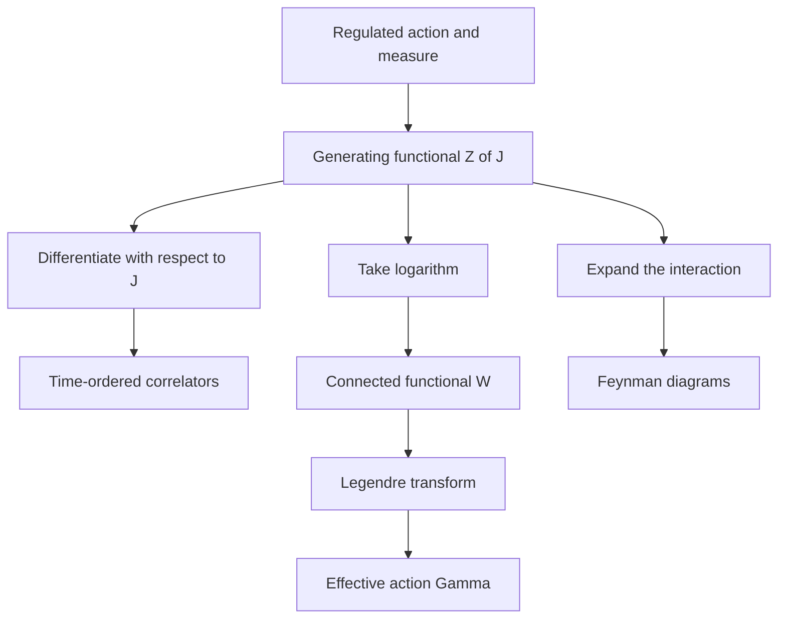

# Path Integral Formulation

The path integral expresses a quantum amplitude as a sum over histories. For a field theory, a “history” is a complete field configuration on spacetime. The classical action supplies a phase $e^{iS}$, and configurations interfere. Correlation functions, perturbative diagrams, tunneling amplitudes, and effective actions can all be obtained from the same construction.

The notation $\mathcal D\phi$ is compact but formal. Its reliable meaning begins with a regulator: discretize time, put spacetime on a lattice, truncate modes, or otherwise reduce the problem to finitely many ordinary integrals. Manipulations of the continuum expression inherit their meaning from that regulated limit.

## From the evolution operator to a sum over paths

For one coordinate with Hamiltonian

$$
H=\frac{p^2}{2m}+V(q),
$$

split the interval $T=t_f-t_i$ into $N$ steps of size $\epsilon=T/N$. Insert position resolutions of the identity between short-time evolution operators:

$$
\langle q_f|e^{-iHT}|q_i\rangle
=\int\prod_{n=1}^{N-1}dq_n
\prod_{n=0}^{N-1}
\langle q_{n+1}|e^{-iH\epsilon}|q_n\rangle.
$$

For small $\epsilon$, separate kinetic and potential evolution up to errors that vanish in the limit. Insert momentum states in each factor:

$$
\langle q_{n+1}|e^{-iH\epsilon}|q_n\rangle
\approx
\int\frac{dp_n}{2\pi}
\exp\left[
ip_n(q_{n+1}-q_n)
-i\epsilon\left(\frac{p_n^2}{2m}+V(q_n)\right)
\right].
$$

The $p_n$ integral is Gaussian. Performing it leaves a normalization times

$$
\exp\left[
i\epsilon\left(
\frac m2\left(\frac{q_{n+1}-q_n}{\epsilon}\right)^2
-V(q_n)
\right)
\right].
$$

Multiplying the slices and taking $N\to\infty$ gives

$$
\langle q_f,t_f|q_i,t_i\rangle
=\int_{q(t_i)=q_i}^{q(t_f)=q_f}
\mathcal Dq\,e^{iS[q]}.
$$

The measure includes normalization factors inherited from every Gaussian momentum integral. They often cancel in normalized expectation values but matter when absolute determinants or vacuum energies are being compared.

## The field generating functional

For a real scalar field, introduce an external source $J(x)$:

$$
Z[J]=
\int\mathcal D\phi\,
\exp\left\{
iS[\phi]+i\int d^4x\,J(x)\phi(x)
\right\}.
$$

It is convenient to normalize $Z[0]=1$ when vacuum bubbles are not of interest. Functional differentiation inserts fields because

$$
\frac1i\frac{\delta}{\delta J(x)}
e^{i\int J\phi}
=\phi(x)e^{i\int J\phi}.
$$

Therefore

$$
\langle0|T\phi(x_1)\cdots\phi(x_n)|0\rangle
=
\left.
\frac1{i^n}
\frac{\delta^n Z[J]}
{\delta J(x_1)\cdots\delta J(x_n)}
\right|_{J=0}.
$$

If $Z$ has not been normalized, divide the right side by $Z[0]$. The time ordering is encoded by the vacuum boundary condition and the Feynman $i\epsilon$ prescription, not added after differentiation.

## Doing the free Gaussian exactly

After integration by parts, write the free action as

$$
S_0[\phi]
=-\frac12\int d^4x\,d^4y\,
\phi(x)K(x,y)\phi(y),
$$

where

$$
K(x,y)=(\Box_x+m^2-i\epsilon)\delta^{(4)}(x-y).
$$

Define the Feynman propagator by

$$
K_x\Delta_F(x-y)=-i\delta^{(4)}(x-y),
$$

so that

$$
\Delta_F(x-y)
=\int\frac{d^4p}{(2\pi)^4}
\frac{i\,e^{-ip\cdot(x-y)}}{p^2-m^2+i\epsilon}.
$$

Completing the functional square gives the normalized free functional

$$
Z_0[J]
=\exp\left[
-\frac i2
\int d^4x\,d^4y\,
J(x)\Delta_F(x-y)J(y)
\right].
$$

With this convention, two source derivatives yield

$$
\left.
\frac1{i^2}
\frac{\delta^2Z_0}
{\delta J(x)\delta J(y)}
\right|_{J=0}
=\Delta_F(x-y).
$$

Books distribute factors of $i$ between the inverse kernel and the symbol $\Delta_F$ differently. A consistent check is more useful than memorizing a sign: differentiating $Z_0$ twice must reproduce the propagator used in the Feynman rules.

## Interactions as source derivatives

For

$$
\mathcal L_{\mathrm{int}}=-\frac{\lambda}{4!}\phi^4,
$$

replace every field in the interaction exponential by $(1/i)\delta/\delta J$:

$$
Z[J]
=
\exp\left[
-i\frac{\lambda}{4!}
\int d^4x
\left(
\frac1i\frac{\delta}{\delta J(x)}
\right)^4
\right]
Z_0[J],
$$

followed by normalization. Expanding the first exponential in powers of $\lambda$ generates vertices. Differentiating the Gaussian pairs source insertions; each pairing is a contraction and supplies a propagator. Feynman diagrams are a compact record of these pairings and their combinatorial multiplicities.

Vacuum bubbles appear in both numerator and denominator of normalized correlation functions and cancel. The logarithm selects connected diagrams:

$$
Z[J]=e^{iW[J]}.
$$

With this convention, derivatives of $W$ generate connected correlators, including the appropriate factors of $i$. A second construction, the Legendre transform, isolates one-particle-irreducible information.

## Connected functions and the effective action

Define the classical or mean field in the presence of the source by

$$
\varphi(x)=\frac{\delta W[J]}{\delta J(x)}.
$$

The effective action is conventionally

$$
\Gamma[\varphi]
=W[J]-\int d^4x\,J(x)\varphi(x),
$$

with $J$ eliminated in favor of $\varphi$. Then

$$
\frac{\delta\Gamma}{\delta\varphi(x)}=-J(x).
$$

At zero source, the quantum expectation value obeys $\delta\Gamma/\delta\varphi=0$. At tree level $\Gamma$ reduces to the classical action. Loop corrections turn it into a quantum-corrected action, and its functional derivatives give one-particle-irreducible vertices.

For a constant field, one writes

$$
\Gamma[\varphi]
=-\int d^4x\,V_{\mathrm{eff}}(\varphi)
+\text{derivative terms}.
$$

Minima of $V_{\mathrm{eff}}$ determine candidate vacuum expectation values after quantum corrections. Gauge theories require care because the off-shell effective potential can depend on gauge choice even though properly defined physical predictions do not.

## Wick rotation and Euclidean fields

The Minkowski weight $e^{iS}$ oscillates and is not an ordinary probability measure. Formally rotating $t=-i\tau$ converts it to

$$
Z_E=\int\mathcal D\phi\,e^{-S_E[\phi]}.
$$

For the scalar theory,

$$
S_E=\int d^4x_E
\left[
\frac12(\partial_\mu\phi)^2
+\frac12m^2\phi^2
+V_{\mathrm{int}}(\phi)
\right].
$$

When $S_E$ is bounded below, the weight is damped. The resemblance to a statistical-mechanical Boltzmann factor enables numerical lattice methods and connects a $d$-dimensional Euclidean field theory to classical critical systems in $d$ dimensions.

The rotation is a contour deformation, not the substitution of $t=-i\tau$ into isolated formulas. Poles, boundary conditions, tensor components, and factors in the measure must be rotated consistently. Real-time observables may require analytic continuation back to Minkowski signature.

## Semiclassical expansion

Restore $\hbar$ temporarily:

$$
Z=\int\mathcal D\phi\,e^{iS[\phi]/\hbar}.
$$

When $S/\hbar$ varies rapidly, nearby configurations cancel except near stationary points satisfying

$$
\frac{\delta S}{\delta\phi}=0.
$$

Write $\phi=\phi_{\mathrm{cl}}+\eta$ and expand:

$$
S[\phi]
=S[\phi_{\mathrm{cl}}]
+\frac12\int\eta K_{\mathrm{cl}}\eta
+O(\eta^3).
$$

The linear term vanishes by the classical equation. Gaussian integration over $\eta$ gives a determinant, which is the one-loop correction. Higher powers produce higher-loop terms. More than one saddle may contribute; Euclidean finite-action saddles describe tunneling and other nonperturbative effects.

## Fermions and gauge fields

Fermionic path integrals use Grassmann-valued fields. Their Gaussian rule reverses the determinant:

$$
\int\mathcal D\bar\psi\,\mathcal D\psi\,
e^{i\bar\psi D\psi}
\propto\det D,
$$

whereas a real bosonic Gaussian gives a power of $(\det K)^{-1/2}$. The Grassmann sign is the path-integral origin of the extra minus sign for a closed fermion loop.

Gauge-field integration requires gauge fixing because gauge-related configurations otherwise appear repeatedly and the quadratic operator has zero modes. The Faddeev--Popov determinant introduces ghost fields in nonabelian theories. In abelian QED with a linear gauge condition, those ghosts decouple.

## Worked example: a one-variable Gaussian with a source

Consider

$$
I(J)=\int_{-\infty}^{\infty}dx\,
\exp\left(\frac i2ax^2+iJx\right),
$$

with a small convergence prescription understood. Complete the square:

$$
\frac i2ax^2+iJx
=\frac i2a\left(x+\frac Ja\right)^2
-\frac i2\frac{J^2}{a}.
$$

Shift $y=x+J/a$. The remaining integral is independent of $J$:

$$
\frac{I(J)}{I(0)}
=\exp\left(-\frac i2\frac{J^2}{a}\right).
$$

Now differentiate:

$$
\left.
\frac1{i^2}\frac{d^2}{dJ^2}
\frac{I(J)}{I(0)}
\right|_{J=0}
=-\left(-\frac ia\right)
=\frac ia.
$$

The result $i/a$ is the inverse quadratic kernel with the Minkowski factor. Replacing $a$ by a differential operator gives the free field propagator.

## Worked example: first-order four-point function in $\phi^4$

To first order in $\lambda$, the connected four-point function contains

$$
-\frac{i\lambda}{4!}
\int d^4z\,
\left\langle
T\phi(x_1)\phi(x_2)\phi(x_3)\phi(x_4)\phi(z)^4
\right\rangle_0.
$$

For the tree contribution, contract each external field with one of the four fields at $z$. There are

$$
4!=24
$$

such pairings. They cancel the $1/4!$ in the interaction. Each contraction supplies a propagator:

$$
G_c^{(4)}(x_1,x_2,x_3,x_4)
=
-i\lambda
\int d^4z\,
\prod_{r=1}^4\Delta_F(x_r-z)
+O(\lambda^2).
$$

After Fourier transformation, integration over $z$ produces the momentum-conserving delta function, and the remaining vertex factor is $-i\lambda$. The factorial in the Lagrangian was chosen so the rule has no leftover combinatorial factor.

## Worked example: Euclidean ground-state projection

Take a Hamiltonian with energy eigenstates $\vert n\rangle$ and energies $E_n$. Euclidean evolution gives

$$
e^{-HT}|\\Psi\rangle
=\sum_n c_n e^{-E_nT}|n\rangle.
$$

Factor out the lowest energy with nonzero overlap:

$$
e^{-HT}|\\Psi\rangle
=e^{-E_0T}
\left[
c_0|0\rangle
+\sum_{n>0}c_ne^{-(E_n-E_0)T}|n\rangle
\right].
$$

As $T\to\infty$, every excited contribution is exponentially suppressed. Euclidean correlation functions exploit the same mechanism: their long-time decay isolates the lightest state carrying the chosen quantum numbers.

## Failure modes in formal manipulations

- $\mathcal D\phi$ is not translation-invariant by decree in every problem. Anomalies can arise because a regulated measure changes under a classical symmetry.
- Omitting $i\epsilon$ leaves the inverse kernel and vacuum boundary condition ambiguous.
- $Z$, $W$, and $\Gamma$ generate all diagrams, connected diagrams, and one-particle-irreducible vertices, respectively.
- Wick rotation can fail when contours cannot be deformed past singularities. Finite density and real-time nonequilibrium problems need additional care.
- A Euclidean weight is not always positive. Fermion determinants, topological terms, and chemical potentials may produce a sign problem.
- Expanding around one saddle misses other saddles and effects nonanalytic in the coupling, such as terms proportional to $e^{-1/g^2}$.

## Schwinger--Dyson equations from a change of variables

Ordinary integration of a total derivative vanishes when boundary terms do. The functional version starts from

$$
0=
\int\mathcal D\phi,
\frac{\delta}{\delta\phi(x)}
\left[
F[\phi]e^{iS[\phi]}
\right].
$$

Expanding the derivative gives

$$
\left\langle
\frac{\delta F}{\delta\phi(x)}
+iF\frac{\delta S}{\delta\phi(x)}
\right\rangle=0.
$$

Choosing different functionals $F$ produces an infinite hierarchy of relations among correlation functions, called the Schwinger--Dyson equations. With $F=1$, the expectation value of the classical equation-of-motion operator vanishes. With $F=\phi(y)$, differentiating the insertion produces a delta-function contact term.

For a scalar action with interaction $V(\phi)$, the source-dependent identity is schematically

$$
\left[
(\Box+m^2)\frac1i\frac{\delta}{\delta J(x)}
+V'\left(\frac1i\frac{\delta}{\delta J(x)}\right)
-J(x)
\right]Z[J]=0.
$$

It is an exact functional differential equation. Perturbation theory solves it as a series, while nonperturbative truncations attempt to close a finite subset. A truncation must respect symmetries or it can violate Ward identities.

## Determinants and one-loop effective actions

Expand a Euclidean action about a background $\varphi$:

$$
S_E[\varphi+\eta]
=S_E[\varphi]
+\frac12\eta K[\varphi]\eta
+O(\eta^3).
$$

The Gaussian fluctuation integral gives

$$
\int\mathcal D\eta,
e^{-\frac12\eta K\eta}
\propto(\det K)^{-1/2}.
$$

Taking a logarithm turns the determinant into a trace:

$$
\Gamma_E^{(1)}[\varphi]
=\frac12\operatorname{Tr}\log K[\varphi].
$$

For Grassmann fields, the Gaussian integral yields $\det D$, so their loop contribution carries the opposite sign in the logarithm. Expanding $\operatorname{Tr}\log$ in the background reproduces the sum of one-loop diagrams with any number of external background insertions.

The determinant is divergent and needs regularization. Heat-kernel, dimensional, zeta-function, or lattice methods define it in different settings. Its local ultraviolet terms renormalize operators in the action, while nonlocal finite terms encode propagation over macroscopic distances.

## A regulated lattice picture of the measure

Discretize a scalar field on $N$ lattice sites. The functional measure becomes

$$
\mathcal D\phi
\longrightarrow
\prod_{n=1}^N d\phi_n,
$$

and the action becomes an ordinary function of $N$ variables. Functional derivatives become partial derivatives divided by lattice-volume factors. The free kinetic operator is an $N\times N$ matrix, and its inverse is the lattice propagator.

The continuum limit is not obtained merely by setting the lattice spacing to zero at fixed bare parameters. Couplings must be tuned along an RG trajectory so physical correlation lengths in lattice units grow. A continuum quantum field theory corresponds to approaching a suitable critical surface where the lattice spacing can be removed while selected physical scales remain fixed.

This finite-dimensional picture also clarifies changes of variables. A linear transformation contributes its determinant to the measure. For an infinite collection of modes, the regulated determinant may leave a finite remnant after the cutoff is removed. Fujikawa's derivation of chiral anomalies uses exactly such a regulated Jacobian.

## Euclidean correlation functions and spectral information

Let an operator $O$ carry chosen quantum numbers. In Euclidean time,

$$
C(\tau)
=\langle0|O(\tau)O^\dagger(0)|0\rangle.
$$

Insert a complete set of energy eigenstates:

$$
C(\tau)
=\sum_n
|\langle0|O|n\rangle|^2
e^{-(E_n-E_0)\tau}.
$$

At large $\tau$, the lightest state with nonzero overlap dominates. The slope of $\log C(\tau)$ approaches minus its energy gap. Lattice calculations use this decay to extract masses.

Choosing $O$ poorly can suppress the desired overlap and leave excited-state contamination at accessible times. Statistical noise may also grow relative to the signal. Operators are therefore designed or combined variationally to isolate states; the formal spectral sum does not guarantee an easy numerical measurement.

## Worked example: Schwinger--Dyson equation for the free propagator

Take the normalized free path integral and choose $F[\phi]=\phi(y)$. The total derivative identity gives

$$
0=
\int\mathcal D\phi
\left[
\delta^{(4)}(x-y)
+i\phi(y)\frac{\delta S_0}{\delta\phi(x)}
\right]e^{iS_0}.
$$

For

$$
S_0
=\frac12\int d^4z\,
\left[
(\partial\phi)^2-m^2\phi^2
\right],
$$

the functional derivative is

$$
\frac{\delta S_0}{\delta\phi(x)}
=-(\Box_x+m^2)\phi(x).
$$

Divide by the vacuum functional and rearrange:

$$
(\Box_x+m^2)
\langle T\phi(x)\phi(y)\rangle
=-i\delta^{(4)}(x-y).
$$

The two-point correlation function is therefore the Green function of the quadratic equation-of-motion operator with Feynman boundary conditions. The contact term came from differentiating the inserted field, not from the classical equation alone.

## Why vacuum bubbles cancel

Expand an interacting expectation value as

$$
\langle T\mathcal O\rangle
=
\frac{
\langle T\mathcal O
\exp(i\int\mathcal L_{\mathrm{int}})\rangle_0
}{
\langle T
\exp(i\int\mathcal L_{\mathrm{int}})\rangle_0
}.
$$

Wick contractions in the numerator separate into components connected to $\mathcal O$ and components connected only to themselves. The latter are vacuum bubbles. Combinatorics exponentiates the sum of connected vacuum diagrams, so the same factor multiplies every numerator and appears in the denominator. It cancels from normalized correlators.

Vacuum diagrams cannot always be discarded. Their logarithm contributes to the vacuum energy and to the partition function in statistical mechanics. When gravity is dynamical, absolute vacuum energy affects the field equations. The cancellation applies to normalized nongravitational correlators, not to every question involving the generating functional.

Similarly, taking $\log Z[J]$ removes disconnected products but retains connected vacuum information at $J=0$. Differentiating $W[J]$ then selects connected correlators because a derivative marks a source insertion inside a connected component. The Legendre transform goes one step further by reorganizing connected graphs into one-particle-irreducible vertices linked by full propagators.

Boundary conditions deserve the same attention as the integrand. A transition kernel fixes field values at initial and final times. An in--out generating functional selects vacuum behavior in the remote past and future and produces time-ordered amplitudes. Expectation values at a finite time in a specified initial state instead require a closed time contour, often called the Schwinger--Keldysh formalism. Its fields run forward and backward in time so the final state is summed rather than fixed.

Using an in--out effective action for a real-time response problem can produce equations that are neither causal nor real. The contour must match the question: scattering amplitudes, thermal equilibrium, and nonequilibrium evolution use related path integrals with different boundary data.

See also: [Motivation, Fields, and Quanta](/physics/quantum-field-theory/motivation-fields-and-quanta) · [Perturbation Theory and Feynman Diagrams](/physics/quantum-field-theory/perturbation-and-feynman-diagrams) · [Scalar Phi-Four Theory](/physics/quantum-field-theory/scalar-phi-four-theory) · [Gauge Invariance and QED](/physics/quantum-field-theory/gauge-invariance-and-qed) · [Chiral Anomalies](/physics/quantum-field-theory/chiral-anomalies)

