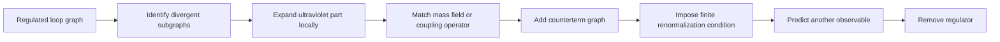

# Renormalization and Counterterms

Loop diagrams sample arbitrarily large virtual momenta. Their ultraviolet divergences say that parameters appearing in a regulated Lagrangian cannot be identified directly with measured masses and couplings. Renormalization separates the short-distance-sensitive pieces, absorbs them into local coefficients, and fixes those coefficients by stated conditions.

The finite prediction is a relation among observables. Bare parameters and counterterms depend on the regulator and convention; neither is measurable on its own. Calling a counterterm “infinite” suppresses the more careful statement that it depends on a regulator which is removed only after renormalized quantities have been held fixed.

## Bare fields and the counterterm split

Start with regulated four-dimensional scalar theory,

$$
\mathcal L_0
=\frac12(\partial\phi_0)^2
-\frac12m_0^2\phi_0^2
-\frac{\lambda_0}{4!}\phi_0^4.
$$

Define

$$
\phi_0=Z_\phi^{1/2}\phi,
\qquad
Z_\phi=1+\delta Z,
$$

and choose a parametrization of $m_0$ and $\lambda_0$ in terms of renormalized quantities. The Lagrangian can be organized as

$$
\begin{aligned}
\mathcal L
&=\frac12(\partial\phi)^2
-\frac12m^2\phi^2
-\frac{\lambda}{4!}\phi^4\\
&\quad
+\frac12\delta Z(\partial\phi)^2
-\frac12\delta m^2\phi^2
-\frac{\delta\lambda}{4!}\phi^4.
\end{aligned}
$$

The first line supplies renormalized propagators and vertices. The second supplies counterterm vertices. This split is an accounting choice; only their sum is the original regulated theory.

In dimensional regularization, $d=4-\epsilon$ changes the coupling dimension. One commonly writes

$$
\lambda_0=\mu^\epsilon Z_\lambda\lambda,
$$

where the arbitrary scale $\mu$ keeps $\lambda$ dimensionless. Poles in $1/\epsilon$ replace cutoff divergences. Dimensional regularization has the advantage of preserving Lorentz invariance and, when applied carefully, gauge symmetry.

## Why divergences are local

At loop momentum much larger than external momenta and masses, expand the integrand in those small external quantities. The ultraviolet divergent terms are polynomials in external momenta. A polynomial in momentum corresponds to derivatives acting on fields at the same point, hence to a local operator.

For example, a divergent scalar two-point function can have the form

$$
A\Lambda^2+B m^2\log\Lambda
+C p^2\log\Lambda.
$$

The constant and mass-dependent pieces multiply $\phi^2$; the $p^2$ piece multiplies $(\partial\phi)^2$. They can be canceled by $\delta m^2$ and $\delta Z$. A nonpolynomial dependence such as $\log(-p^2/m^2)$ generally remains in the finite amplitude and carries real long-distance information. Counterterms cannot erase it with local coefficients.

Locality is the central reason the procedure retains predictive power. If a new arbitrary function of momentum were needed at every order, finitely many measurements would not determine further amplitudes.

## Power counting in four-dimensional phi-four theory

For a graph with $L$ loops, $I$ internal scalar lines, and no derivative vertices, the superficial degree of divergence is

$$
D=4L-2I.
$$

The graph identities for connected $\phi^4$ diagrams are

$$
L=I-V+1,
\qquad
4V=2I+E,
$$

where $V$ is the number of vertices and $E$ the number of external lines. Eliminating $L$, $I$, and $V$ gives

$$
D=4-E.
$$

Only vacuum, two-point, and four-point graphs are superficially divergent. The vacuum term shifts the vacuum energy. Two-point divergences require mass and field-strength counterterms; four-point divergences require a coupling counterterm. Graphs with $E\geq6$ are superficially convergent, though they may contain divergent subgraphs that must first be subtracted.

At one loop, the $\phi^4$ tadpole is independent of external momentum, so it renormalizes the mass but not the field strength. The first nonzero $\delta Z$ appears at two loops in this theory. Power counting says a $p^2$ divergence is allowed; it does not promise that it occurs at the earliest loop order.

## Subdivergences and order-by-order consistency

At higher loops, a graph may contain a divergent lower-loop subgraph. One must subtract the subgraph before treating the remaining overall divergence. Counterterm insertions generated at lower orders perform exactly that job. The recursive structure is captured by procedures such as BPHZ subtraction and the forest formula, though diagrammatic calculations often implement it through familiar counterterm graphs.

This explains why canceling the final overall divergence alone is insufficient. An unsubtracted subgraph can multiply another divergent integration and leave nonlocal-looking regulator dependence. Renormalization works from the inside out: lower-order parameters are already defined before a higher-order graph is made finite.

Symmetry further restricts the allowed local terms. A $Z_2$-symmetric scalar theory cannot acquire a linear or cubic counterterm if the regulator and vacuum preserve $\phi\to-\phi$. Gauge theories require Slavnov--Taylor or Ward identities among counterterms. A regulator that obscures a symmetry may demand symmetry-restoring finite counterterms, provided no anomaly prevents restoration.

## What fixes the finite parts

Canceling divergences does not yet define the renormalized parameters. Their finite definitions come from renormalization conditions.

In an on-shell scalar scheme, one may require the exact propagator to have a pole at $p^2=m_{\mathrm{phys}}^2$ with unit residue. If the renormalized inverse propagator is

$$
G^{-1}(p^2)
=p^2-m^2-\Sigma_{\mathrm{loop}}(p^2)
+\delta Z\,p^2-\delta m^2,
$$

then conditions at $p^2=m^2$ determine $\delta m^2$ and $\delta Z$ in the chosen sign convention. A four-point amplitude at specified external momenta defines $\lambda$.

Minimal subtraction in dimensional regularization removes only the $1/\epsilon$ poles. The modified minimal-subtraction scheme also removes the conventional combination $\log4\pi-\gamma_E$. These schemes are efficient because their counterterms contain little kinematic detail, but the resulting parameters depend on $\mu$ and are not themselves direct observables.

| Scheme | Mass or coupling definition | Main advantage | Main caution |
|---|---|---|---|
| On shell | pole and physical amplitude | immediate interpretation | awkward for confined particles and multi-scale problems |
| Momentum subtraction | Green function at chosen Euclidean momenta | kinematics explicit | often gauge- and momentum-configuration dependent |
| Minimal subtraction | subtract $1/\epsilon$ poles | clean RG algebra | parameters require matching to measurements |
| Modified minimal subtraction | subtract pole plus fixed constants | standard convention in many calculations | still not a physical definition by itself |

Two schemes give the same observable when parameters are translated consistently to the computed order. At finite perturbative order, residual scheme dependence estimates some of the missing higher-order terms.

## Worked example: the cutoff tadpole

Consider the Euclidean integral

$$
I_E(\Lambda)
=\int_{|k|<\Lambda}
\frac{d^4k}{(2\pi)^4}\frac1{k^2+m^2}.
$$

The area of the unit three-sphere is $2\pi^2$, so

$$
I_E(\Lambda)
=\frac1{8\pi^2}
\int_0^\Lambda dk\,
\frac{k^3}{k^2+m^2}.
$$

Rewrite the integrand:

$$
\frac{k^3}{k^2+m^2}
=k-\frac{m^2k}{k^2+m^2}.
$$

Integrating gives

$$
\begin{aligned}
I_E(\Lambda)
&=\frac1{8\pi^2}
\left[
\frac{\Lambda^2}{2}
-\frac{m^2}{2}
\log\left(\frac{\Lambda^2+m^2}{m^2}\right)
\right]\\
&=\frac1{16\pi^2}
\left[
\Lambda^2
-m^2\log\left(1+\frac{\Lambda^2}{m^2}\right)
\right].
\end{aligned}
$$

For $\Lambda\gg m$,

$$
I_E(\Lambda)
=\frac{\Lambda^2}{16\pi^2}
-\frac{m^2}{16\pi^2}
\log\frac{\Lambda^2}{m^2}
+O\left(\frac{m^2}{\Lambda^2}\right).
$$

In $\lambda\phi^4/4!$ theory the one-loop self-energy has a combinatorial factor $\lambda/2$. A mass counterterm cancels the displayed local dependence. No $p^2$ term occurs in the tadpole, so no one-loop field-strength counterterm is needed from this graph.

## Worked example: on-shell subtraction of a self-energy

Suppose a loop calculation gives a self-energy $\Sigma(p^2)$. Write the renormalized self-energy as

$$
\Sigma_R(p^2)
=\Sigma(p^2)+\delta m^2-\delta Z(p^2-m^2),
$$

choosing signs so that the full inverse propagator is

$$
G^{-1}(p^2)=p^2-m^2-\Sigma_R(p^2).
$$

Unit pole location and residue require

$$
\Sigma_R(m^2)=0,
\qquad
\Sigma_R'(m^2)=0.
$$

The first condition gives

$$
0=\Sigma(m^2)+\delta m^2,
\qquad
\delta m^2=-\Sigma(m^2).
$$

Differentiate:

$$
\Sigma_R'(p^2)
=\Sigma'(p^2)-\delta Z.
$$

The residue condition gives

$$
\delta Z=\Sigma'(m^2).
$$

Substitution produces the finite subtracted expression

$$
\boxed{
\Sigma_R(p^2)
=\Sigma(p^2)-\Sigma(m^2)
-(p^2-m^2)\Sigma'(m^2)
}.
$$

The constant and linear Taylor terms at the pole have been absorbed into the definitions of mass and field normalization. Nonpolynomial momentum dependence remains and affects scattering.

## Worked example: the one-loop four-point divergence

At one loop, the four-point function has three bubble channels. A representative Euclidean integral is

$$
B(P)=
\int\frac{d^dk}{(2\pi)^d}
\frac1{(k^2+m^2)[(k+P)^2+m^2]}.
$$

Use a Feynman parameter:

$$
\frac1{AB}
=\int_0^1dx\,\frac1{[xA+(1-x)B]^2}.
$$

Shift $\ell=k+(1-x)P$. Then

$$
B(P)
=\int_0^1dx
\int\frac{d^d\ell}{(2\pi)^d}
\frac1{[\ell^2+\Delta(x,P)]^2},
$$

where

$$
\Delta(x,P)=m^2+x(1-x)P^2.
$$

In $d=4-\epsilon$, the ultraviolet part is

$$
B(P)=\frac1{8\pi^2}\frac1\epsilon+\text{finite}
$$

under a common convention for dimensional regularization. The pole is independent of $P$, as locality predicts, and is canceled by a $\phi^4$ counterterm. Momentum-dependent logarithms remain in the finite part. Exact prefactors in $\delta\lambda$ also include vertex normalizations and all three channels.

## Regulator dependence and physical sensitivity

A hard cutoff exhibits quadratic sensitivity of scalar masses. Dimensional regularization with minimal subtraction does not display a bare $\Lambda^2$ term, but that difference alone does not settle a naturalness question. Matching to an actual heavy particle of mass $M$ can produce a finite threshold correction proportional to $M^2$. Sensitivity to physical heavy scales is scheme-independent after matching; the appearance of a regulator scale is not.

Renormalizable theories are the leading terms of effective field theories. Operators of dimension greater than four require additional coefficients, but at energy $E\ll\Lambda$ their contributions are suppressed by powers of $E/\Lambda$. Only finitely many coefficients are needed for a desired accuracy. “Nonrenormalizable” therefore describes power counting, not a verdict of inconsistency.

## Errors that obscure the logic

- Removing divergent terms without stating a renormalization condition leaves the finite parameter undefined.
- Comparing a minimal-subtraction mass directly with a pole mass mixes conventions. A matching relation is required.
- Superficial convergence does not exclude divergent subgraphs.
- A cutoff may be a regulator or a physical EFT boundary. The interpretation must be stated before drawing conclusions from powers of $\Lambda$.
- Counterterms allowed by power counting may be related or forbidden by symmetry.
- Bare quantities need not approach finite numbers as the regulator is removed. Their job is to combine with loop terms into finite predictions.
- A pole mass is unsuitable for every excitation. Confined quarks and unstable particles require more careful definitions.

## Composite operators need their own renormalization

Making ordinary Green functions finite does not automatically make products of fields at the same point finite. An insertion such as $\phi^2(x)$ creates new ultraviolet singularities when loop vertices approach $x$. One defines a renormalized operator by

$$
[\mathcal O_i]_R
=Z_{ij}\mathcal O_{j,0}.
$$

Operators with the same quantum numbers and compatible dimensions can mix. The matrix $Z_{ij}$ need not be diagonal even if the classical basis looked natural. Equations-of-motion operators and total derivatives can also enter off-shell bases, although their on-shell matrix elements may simplify.

The scale dependence of the mixing matrix defines anomalous dimensions:

$$
\gamma_{ij}
=\left(Z^{-1}\mu\frac{dZ}{d\mu}\right)_{ij}
$$

up to a convention-dependent sign. These anomalous dimensions control the running of Wilson coefficients in effective field theory and the scaling of operators near fixed points. Renormalizing the Lagrangian and renormalizing an operator insertion are related tasks, but they use distinct counterterms.

Currents illustrate the role of symmetry. An exactly conserved vector current may have protected normalization in a symmetry-preserving scheme. A scalar density or tensor current usually runs. An anomalous axial current obeys a modified identity and requires especially careful operator definitions.

## A simple heavy-field matching calculation

Consider light $\phi$ and heavy $\Phi$ fields with

$$
\mathcal L
\supset
-\frac12M^2\Phi^2
-\frac\kappa2\Phi\phi^2.
$$

At momenta much smaller than $M$, neglect derivatives in the heavy equation of motion:

$$
-M^2\Phi-\frac\kappa2\phi^2\approx0,
$$

so

$$
\Phi\approx-\frac\kappa{2M^2}\phi^2.
$$

Substitute into the heavy mass and interaction terms:

$$
-\frac12M^2\Phi^2
-\frac\kappa2\Phi\phi^2
\approx
\frac{\kappa^2}{8M^2}\phi^4.
$$

The low-energy theory contains a local quartic operator even if none was present initially. Keeping the kinetic term in the heavy equation and expanding its inverse produces higher-derivative corrections suppressed by further powers of $1/M^2$.

This tree-level example shows matching without any divergent integral. Counterterms in the low-energy theory are still required because loops containing the induced operator generate ultraviolet dependence. Matching fixes the coefficients at a scale near $M$; RG evolution carries them to lower scales.

## Scaleless integrals and what dimensional regularization hides

In dimensional regularization,

$$
\int\frac{d^dk}{(2\pi)^d}\frac1{k^2}
=0.
$$

The integral has no mass or external momentum from which to build a dimensionful answer. Its ultraviolet and infrared poles cancel under analytic continuation. Saying that it vanishes does not mean that neither region was singular.

This matters when comparing with a cutoff calculation that displays a quadratic term. A massless tadpole may be zero in dimensional regularization and proportional to $\Lambda^2$ with a hard cutoff. Neither expression alone is an observable. Once a physical heavy mass or external scale is introduced and the same renormalization conditions are imposed, predictions agree after parameter translation.

One can separate ultraviolet and infrared roles by introducing an auxiliary mass, keeping external momentum off shell, or labeling poles according to their origin before taking a scaleless limit. Otherwise a canceled infrared pole can be mistaken for an absent ultraviolet counterterm.

## Predictivity as an accuracy statement

Suppose an effective Lagrangian is organized as

$$
\mathcal L
=\mathcal L_{\leq4}
+\sum_i\frac{c_i^{(6)}}{\Lambda^2}\mathcal O_i^{(6)}
+\sum_i\frac{c_i^{(8)}}{\Lambda^4}\mathcal O_i^{(8)}
+\cdots.
$$

For characteristic energy $E$, dimension-six effects commonly scale as $E^2/\Lambda^2$ and dimension-eight effects as $E^4/\Lambda^4$, modulo symmetry and kinematic exceptions. To predict through relative order $E^2/\Lambda^2$, only a finite basis and finite number of coefficients are needed.

Loops mix the counting. A loop of a leading operator may be the same size as a tree contribution from a higher-order operator, depending on the expansion. A consistent calculation declares both the loop order and the power in $E/\Lambda$. Renormalization then closes the operator basis at that declared accuracy.

Counterterms consequently encode two ideas at once: they remove regulator dependence from loops, and they parameterize short-distance physics allowed by symmetry. The first determines their divergent pieces; measurement or matching determines the finite information not predicted by the low-energy theory.

Regularization and renormalization should remain separate in the calculation log. The regulator defines otherwise ill-posed integrals; renormalization defines parameters by conditions. One may change the regulator while retaining the same renormalization scheme, or change schemes while using the same regulator. Agreement after translating inputs is a strong check. Agreement of two unrenormalized loop expressions is not required, and disagreement of their power-divergent pieces need not signal different physics.

The order of limits matters as well. Remove the regulator only after all counterterms needed at the chosen perturbative order have been included and parameters have been fixed. Taking a cutoff to infinity graph by graph can discard cancellations enforced by symmetry or by lower-order counterterm insertions.

See also: [Scalar Phi-Four Theory](/physics/quantum-field-theory/scalar-phi-four-theory) · [Perturbation Theory and Feynman Diagrams](/physics/quantum-field-theory/perturbation-and-feynman-diagrams) · [Renormalization Group](/physics/quantum-field-theory/renormalization-group) · [Effective Field Theory](/physics/quantum-field-theory/effective-field-theory) · [Gauge Invariance and QED](/physics/quantum-field-theory/gauge-invariance-and-qed)

