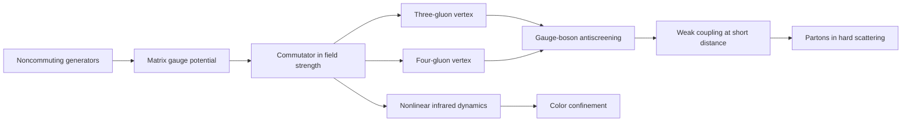

# Yang-Mills Theory and QCD

Yang--Mills theory replaces the abelian phase group of electromagnetism by a noncommuting gauge group. The gauge potential is matrix-valued, and the field strength contains a commutator. That one algebraic change gives gauge bosons their own gauge charge, produces cubic and quartic self-interactions, changes the sign of the running coupling, and makes confinement possible.

Quantum chromodynamics is the $SU(3)$ Yang--Mills theory coupled to quarks. High-energy processes can be computed with quarks and gluons because the coupling becomes weak. At long distances the useful states are color-singlet hadrons, and perturbation theory must give way to lattice calculations or effective descriptions.

## Connections valued in a Lie algebra

Let Hermitian generators $T^a$ satisfy

$$
[T^a,T^b]=if^{abc}T^c,
\qquad
\operatorname{tr}(T^aT^b)=\frac12\delta^{ab}
$$

in the fundamental representation of $SU(N)$. Write

$$
A_\mu=A_\mu^aT^a,
\qquad
D_\mu=\partial_\mu+igA_\mu.
$$

A matter field transforms as $\psi\to U(x)\psi$. Requiring $D_\mu\psi\to U D_\mu\psi$ fixes

$$
A_\mu\to
UA_\mu U^{-1}
+\frac{i}{g}(\partial_\mu U)U^{-1}.
$$

The inhomogeneous derivative term resembles QED; the conjugation term records noncommutativity.

Define the field strength by

$$
[D_\mu,D_\nu]=igF_{\mu\nu}.
$$

For the convention above,

$$
F_{\mu\nu}
=\partial_\mu A_\nu-\partial_\nu A_\mu
+ig[A_\mu,A_\nu],
$$

and therefore

$$
F_{\mu\nu}^a
=\partial_\mu A_\nu^a-\partial_\nu A_\mu^a
-gf^{abc}A_\mu^bA_\nu^c.
$$

Changing the sign in $D_\mu$ changes corresponding signs in these formulas but no observable result. Under a gauge transformation,

$$
F_{\mu\nu}\to UF_{\mu\nu}U^{-1}.
$$

The trace of $F_{\mu\nu}F^{\mu\nu}$ is invariant. The pure action is

$$
\mathcal L_{\mathrm{YM}}
=-\frac14F_{\mu\nu}^aF^{a\mu\nu}.
$$

## Reading the interactions out of the curvature

Separate $F$ into a derivative part and a term quadratic in $A$. Squaring gives

$$
F^2
=(\partial A)^2
+g(\partial A)AA
+g^2A^4
$$

schematically. The first term is the kinetic operator, the second produces a three-gauge-boson vertex, and the third produces a four-gauge-boson vertex. Their Lorentz and group factors are fixed by gauge symmetry.

In QED the photon carries no electric charge and has no such tree-level self-vertices. In Yang--Mills theory the gauge bosons transform in the adjoint representation. One can see their charge directly from the covariant derivative acting on an adjoint field:

$$
(D_\mu X)^a
=\partial_\mu X^a-gf^{abc}A_\mu^bX^c
$$

for the present convention.

The classical field equation with a matter current is

$$
(D_\mu F^{\mu\nu})^a=gJ^{a\nu}.
$$

Unlike the abelian equation, it is nonlinear even when $J=0$. The Bianchi identity is also covariant:

$$
D_{[\lambda}F_{\mu\nu]}=0.
$$

## Gauge fixing, ghosts, and physical states

The Yang--Mills kinetic operator has gauge zero modes, so perturbative quantization requires gauge fixing. In a covariant gauge one adds

$$
\mathcal L_{\mathrm{gf}}
=-\frac1{2\xi}(\partial^\mu A_\mu^a)^2.
$$

The Faddeev--Popov determinant now depends on $A_\mu$. Representing it with Grassmann scalar fields gives

$$
\mathcal L_{\mathrm{gh}}
=\bar c^a\,\partial^\mu(D_\mu c)^a
$$

up to sign and integration-by-parts conventions. Ghosts have scalar Lorentz transformation but fermionic statistics. They appear only on internal lines and cancel unphysical gauge contributions. Omitting them in a covariant-gauge loop calculation gives incorrect Ward identities and an incorrect beta function.

Gauge fixing preserves a nilpotent BRST symmetry. Physical states are BRST-closed modulo BRST-exact states, which removes longitudinal, timelike, and ghost excitations from the observable spectrum. BRST language also yields Slavnov--Taylor identities, the nonabelian generalization of QED Ward identities.

## The QCD Lagrangian and its symmetries

For quark flavors $q_f$ in the fundamental representation,

$$
\mathcal L_{\mathrm{QCD}}
=-\frac14G_{\mu\nu}^aG^{a\mu\nu}
+\sum_f\bar q_f(i\gamma^\mu D_\mu-m_f)q_f.
$$

There are eight gluon fields because $SU(3)$ has eight generators. Quarks come in three colors. Color is a gauge label, not a visible three-valued property of an isolated particle.

If $n_f$ quark masses vanish, the classical matter sector has an approximate

$$
SU(n_f)_L\times SU(n_f)_R\times U(1)_V\times U(1)_A
$$

symmetry, with qualifications from global identifications. The $U(1)_A$ current is anomalous. The nonabelian chiral symmetry is spontaneously broken in the vacuum to its vector subgroup, producing light pseudoscalar mesons when quark masses are small. Confinement and chiral symmetry breaking are distinct phenomena even though both occur at strong coupling in QCD.

## Asymptotic freedom

For $SU(N_c)$ with $n_f$ Dirac fermions in the fundamental representation,

$$
\beta(g)
=-\frac{g^3}{16\pi^2}
\left(
\frac{11}{3}N_c-\frac{2}{3}n_f
\right)
+O(g^5).
$$

Fermion vacuum polarization screens color charge, contributing the $-2n_f/3$ inside the bracket. Gauge and ghost loops give the larger $11N_c/3$ antiscreening term. If

$$
n_f<\frac{11}{2}N_c,
$$

the beta function is negative at weak coupling.

It is common to use

$$
\alpha_s=\frac{g^2}{4\pi}.
$$

At one loop,

$$
\alpha_s(Q)
=\frac{4\pi}
{\beta_0\log(Q^2/\Lambda_{\mathrm{QCD}}^2)},
\qquad
\beta_0=11-\frac23n_f
$$

for $SU(3)$. Quark thresholds change $n_f$, so precise evolution matches effective theories across those masses.

Small $\alpha_s(Q)$ permits hard-scattering expansions. Hadrons still enter through nonperturbative parton distribution or fragmentation functions. Factorization separates those long-distance objects from short-distance coefficients, and RG evolution connects measurements at different scales.

## Wilson loops and the static potential

For a closed contour $C$,

$$
W(C)
=\frac1{N_c}\operatorname{tr}\,
\mathcal P\exp\left(
ig\oint_C A_\mu dx^\mu
\right).
$$

Path ordering is necessary because matrices at different points need not commute. Under a gauge transformation, the parallel transporter around the loop changes by conjugation; the trace is invariant.

Take a large rectangle of spatial width $R$ and Euclidean time length $T$. Its expectation value behaves as

$$
\langle W(R,T)\rangle
\sim e^{-TV(R)}
\qquad (T\to\infty).
$$

An area law,

$$
\langle W(R,T)\rangle
\sim e^{-\sigma RT},
$$

implies

$$
V(R)\sim\sigma R,
$$

where $\sigma$ is the string tension. A perimeter law instead scales with $R+T$ and does not give a linearly rising potential. With dynamical fundamental quarks, the flux tube can break by pair creation, so the Wilson-loop criterion needs qualifications; confinement is more generally expressed by the absence of colored asymptotic states.

## Lattice gauge fields

A naive lattice derivative of $A_\mu$ obscures exact gauge invariance. Lattice gauge theory places group elements on links:

$$
U_\mu(x)\approx e^{iagA_\mu(x)},
$$

where $a$ is the lattice spacing. Under site transformations,

$$
U_\mu(x)\to
\Omega(x)U_\mu(x)\Omega^{-1}(x+a\hat\mu).
$$

The ordered product around a plaquette,

$$
U_{\mu\nu}(x)
=U_\mu(x)U_\nu(x+a\hat\mu)
U_\mu^{-1}(x+a\hat\nu)U_\nu^{-1}(x),
$$

transforms by conjugation at $x$. Its trace is gauge invariant. For small $a$,

$$
U_{\mu\nu}(x)
=\exp\left(ia^2gF_{\mu\nu}(x)+O(a^3)\right).
$$

The Wilson lattice action sums $1-\operatorname{Re}\operatorname{tr}U_{\mu\nu}/N_c$ over plaquettes and approaches the continuum Yang--Mills action. It supplies both a nonperturbative regulator and a route to numerical estimates of hadron masses and matrix elements.

## Worked example: deriving the field strength

Act on $\psi$ with the commutator:

$$
\begin{aligned}
[D_\mu,D_\nu]\psi
&=(\partial_\mu+igA_\mu)
(\partial_\nu+igA_\nu)\psi
-(\mu\leftrightarrow\nu).
\end{aligned}
$$

Expanding the first product gives

$$
\partial_\mu\partial_\nu\psi
+ig(\partial_\mu A_\nu)\psi
+igA_\nu\partial_\mu\psi
+igA_\mu\partial_\nu\psi
-g^2A_\mu A_\nu\psi.
$$

After antisymmetrizing in $\mu,\nu$, the second derivatives and terms differentiating $\psi$ cancel. The remainder is

$$
ig(\partial_\mu A_\nu-\partial_\nu A_\mu)\psi
-g^2[A_\mu,A_\nu]\psi.
$$

Factor out $ig$:

$$
[D_\mu,D_\nu]\psi
=ig\left(
\partial_\mu A_\nu-\partial_\nu A_\mu
+ig[A_\mu,A_\nu]
\right)\psi.
$$

Now insert $A_\mu=A_\mu^aT^a$ and $[T^b,T^c]=if^{bca}T^a$:

$$
ig[A_\mu,A_\nu]
=-gA_\mu^bA_\nu^c f^{bca}T^a.
$$

Relabeling cyclic indices yields

$$
F_{\mu\nu}^a
=\partial_\mu A_\nu^a-\partial_\nu A_\mu^a
-gf^{abc}A_\mu^bA_\nu^c.
$$

## Worked example: when $SU(3)$ is asymptotically free

For $N_c=3$,

$$
\beta_0
=\frac{11}{3}N_c-\frac23n_f
=11-\frac23n_f.
$$

Asymptotic freedom requires $\beta_0\gt 0$:

$$
11-\frac23n_f>0.
$$

Multiply by three:

$$
33-2n_f>0,
$$

so

$$
n_f<16.5.
$$

For integer $n_f$, the one-loop condition is $n_f\leq16$. This statement concerns a formal $SU(3)$ theory with that many sufficiently light fundamental flavors. The observed QCD theory has at most six quark flavors active, depending on the energy scale, and lies safely within the asymptotically free range.

## Worked example: extracting a potential from a loop

Suppose a rectangular Wilson loop obeys

$$
\langle W(R,T)\rangle
=A(R)e^{-TV(R)}
+\text{excited contributions}.
$$

Take the logarithm:

$$
-\frac1T\log\langle W(R,T)\rangle
=V(R)-\frac1T\log A(R)+\cdots.
$$

In the large-$T$ limit,

$$
V(R)
=-\lim_{T\to\infty}
\frac1T\log\langle W(R,T)\rangle.
$$

If numerical data give

$$
\log\langle W(R,T)\rangle
\approx-\sigma RT-\mu(2R+2T),
$$

then

$$
-\frac1T\log\langle W\rangle
\approx\sigma R+2\mu+\frac{2\mu R}{T}.
$$

Taking $T\to\infty$ gives $V(R)=\sigma R+2\mu$. The additive constant depends on the source self-energy, while the slope $\sigma$ is the physical string tension in the idealized static-source setting.

## Large color number

For $SU(N_c)$, take $N_c\to\infty$ while holding

$$
\lambda_{\mathrm{'t\ Hooft}}=g^2N_c
$$

fixed. Double-line notation tracks color indices. A connected vacuum diagram scales with a power of $N_c$ determined by the topology of the surface on which it can be drawn; planar diagrams dominate, and handles are suppressed by $1/N_c^2$. Quark loops are additionally suppressed when $n_f$ is held fixed.

The expansion does not solve four-dimensional QCD by itself, but it organizes approximations and explains why some hadronic features vary smoothly from $N_c=3$.

## Boundaries of perturbative intuition

- Colored quarks and gluons are useful short-distance fields but are not observed as isolated asymptotic states.
- Ghosts are required internal fields in covariant gauges, never physical external particles.
- A growing perturbative coupling signals loss of the weak-coupling expansion. It does not by itself derive confinement.
- An area law is cleanest in pure gauge theory with external static sources. Dynamical quarks allow string breaking.
- Gauge-dependent propagators and vertices are not observables; Slavnov--Taylor identities control how their dependence cancels.
- The number of active quark flavors depends on scale, and crossing a mass threshold requires matching.
- Confinement and spontaneous chiral symmetry breaking should not be treated as synonyms.

## Group factors that enter calculations

Three invariants recur in loop calculations. For a representation $R$,

$$
\operatorname{tr}_R(T^aT^b)
=T_R\delta^{ab},
$$

$$
T_R^aT_R^a=C_R\mathbf1,
$$

and for the adjoint representation,

$$
f^{acd}f^{bcd}=C_A\delta^{ab}.
$$

Taking a trace of the second identity relates them:

$$
C_Rd_R=T_Rd_A,
$$

where $d_R$ and $d_A$ are representation dimensions. For the fundamental representation of $SU(N_c)$ under the normalization used above,

$$
T_F=\frac12,
\qquad
C_F=\frac{N_c^2-1}{2N_c},
\qquad
C_A=N_c.
$$

Thus QCD has $C_F=4/3$ and $C_A=3$. Quark emission probabilities carry $C_F$, gluon self-processes carry $C_A$, and a fermion loop carries $T_Fn_f$. The one-loop beta function in a general representation reads

$$
\beta_0
=\frac{11}{3}C_A
-\frac{4}{3}T_Rn_f.
$$

Representation labels are therefore numerical inputs to dynamics, not decorative group theory.

## Jets and the parton picture

Asymptotic freedom permits a short-distance collision to be computed using nearly free partons. A high-energy quark or gluon cannot emerge as an isolated colored particle. It radiates and hadronizes into a collimated jet of color-singlet particles.

Soft and collinear radiation produces large logarithms. Inclusive observables designed to be insensitive to arbitrarily soft emissions and collinear splittings are infrared safe and can be expanded perturbatively. A jet definition must preserve that safety: adding a zero-energy particle or splitting one particle into two collinear particles should not discontinuously change the observable.

Parton distribution functions describe the probability density, in a factorization sense, for finding a parton carrying a fraction of a fast hadron's momentum. They are not ordinary fixed-scale constituent probabilities. They depend on a factorization scale and evolve according to equations derived from collinear radiation. A cross section takes the schematic form

$$
\sigma
=\sum_{ij}
f_i(\mu_F)\otimes f_j(\mu_F)
\otimes\hat\sigma_{ij}
(\mu_F,\mu_R).
$$

Factorization-scale dependence cancels between the distributions and the short-distance coefficient to the computed order. Renormalization-scale dependence cancels through the running coupling. Residual dependence after truncation is used as one diagnostic of missing higher orders.

## Chiral symmetry and the light hadron spectrum

For two light quarks, the approximate symmetry is

$$
SU(2)_L\times SU(2)_R.
$$

The vacuum preserves the vector subgroup $SU(2)_V$ but not the axial generators. Three broken generators give three pions as approximate Goldstone bosons. Their nonzero masses arise from explicit breaking by the light quark masses.

At energies below typical hadronic scales, an effective field

$$
U(x)=\exp\left(
\frac{i\pi^a(x)\tau^a}{f_\pi}
\right)
$$

organizes interactions in a derivative and quark-mass expansion. The leading Lagrangian contains

$$
\mathcal L
=\frac{f_\pi^2}{4}
\operatorname{tr}
(\partial_\mu U\partial^\mu U^\dagger)
+\text{mass terms}.
$$

The low-energy constants are not fixed by symmetry alone; they are measured or computed nonperturbatively. This description and perturbative quark--gluon QCD apply in different energy ranges and must agree where matching statements are available.

The singlet axial rotation would predict an additional light Goldstone mode if it were an exact symmetry. The chiral anomaly removes that conclusion. Topological gauge configurations and the anomalous divergence play a direct role in the singlet pseudoscalar sector.

## Center symmetry in pure gauge theory

Pure $SU(N_c)$ Yang--Mills theory at finite temperature has a global center symmetry acting on Wilson lines that wind around Euclidean time. The traced Polyakov loop,

$$
P(\mathbf x)
=\frac1{N_c}
\operatorname{tr}\,
\mathcal P
\exp\left(
ig\int_0^\beta d\tau,A_0
\right),
$$

transforms under the center and serves as an order parameter in the pure gauge theory. A vanishing expectation value corresponds to an infinite free energy for an isolated static fundamental color source.

Dynamical fundamental quarks explicitly break center symmetry because their boundary conditions and gauge coupling distinguish center-related configurations. The Polyakov loop then ceases to be an exact order parameter, although it remains diagnostically useful. Finite-temperature QCD with physical quark masses can exhibit a crossover rather than the sharp transition of an idealized symmetry limit.

## The theta term

Gauge invariance also permits

$$
\mathcal L_\theta
=\theta\frac{g^2}{32\pi^2}
G_{\mu\nu}^a\widetilde G^{a\mu\nu}.
$$

The density is a total derivative locally, so it does not alter perturbative equations around topologically trivial fields. Its spacetime integral can distinguish sectors of different topological charge, and the term can affect nonperturbative physics. It violates parity and CP for generic $\theta$.

A chiral rotation of massive quarks shifts $\theta$ because the fermion measure is anomalous. The physical parameter combines the gauge angle with phases in the quark mass matrix. Its observed smallness is the strong CP problem; the Yang--Mills Lagrangian itself does not explain it.

## Building color singlets

Gauge-invariant hadron operators follow from $SU(3)$ tensor products. A quark and antiquark combine as

$$
\mathbf3\otimes\overline{\mathbf3}
=\mathbf1\oplus\mathbf8.
$$

Contracting color indices with $\delta^i{}_j$ selects a meson singlet. Three quarks contain a singlet formed with the invariant antisymmetric tensor:

$$
B\sim\epsilon_{ijk}q^iq^jq^k.
$$

These local operators create superpositions of every physical state sharing their quantum numbers, not rigid constituent configurations. Correlation functions isolate the lightest states at long Euclidean time. More complicated singlets can contain additional quark pairs or gluonic field strengths, so color confinement does not restrict the spectrum to a naive two- or three-body model.

An isolated quark field is gauge covariant and cannot create a physical color-singlet asymptotic state by itself. Gauge fixing permits quark and gluon propagators as useful intermediate quantities, while the observable spectrum is extracted from gauge-invariant operators and scattering involving hadrons or infrared-safe jets.

## Related pages

- [Gauge Invariance and QED](/physics/quantum-field-theory/gauge-invariance-and-qed)
- [Renormalization Group](/physics/quantum-field-theory/renormalization-group)
- [Chiral Anomalies](/physics/quantum-field-theory/chiral-anomalies)
- [Electroweak Theory and Grand Unification](/physics/quantum-field-theory/electroweak-theory-and-grand-unification)
- [Effective Field Theory](/physics/quantum-field-theory/effective-field-theory)

