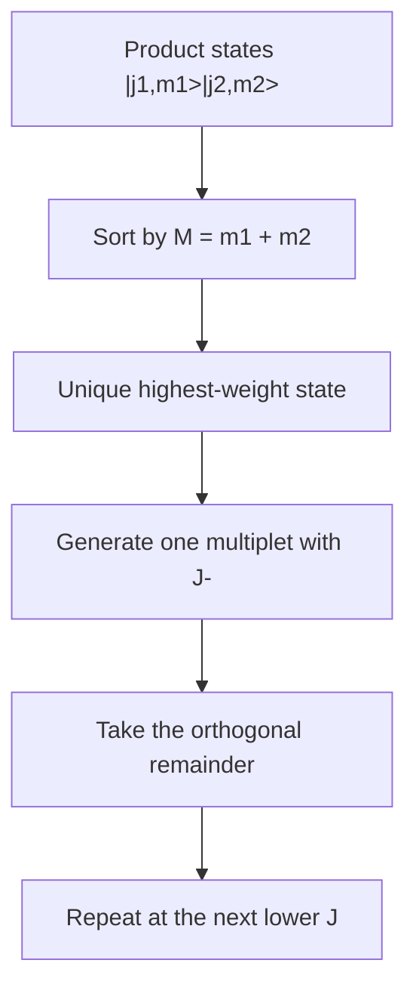

# Addition of Angular Momentum

Angular momentum becomes especially useful when several parts of a system rotate. An electron has orbital and spin angular momentum; an atom may also have nuclear spin; a collision can leave two outgoing particles carrying separate orbital and intrinsic contributions. Each contribution is a good observable only when the Hamiltonian respects the corresponding symmetry. The total angular momentum remains the natural quantity whenever the full system is rotationally invariant.

The mathematical problem is a change of basis in a tensor-product space. One basis records what each subsystem does separately. Another organizes the same states into irreducible multiplets of the total rotation group. Clebsch–Gordan coefficients are the matrix elements of that change of basis.

## Two complete sets of commuting observables

Let $\mathbf J_1$ and $\mathbf J_2$ act on Hilbert spaces $\mathcal H_1$ and $\mathcal H_2$. On the product space $\mathcal H_1\otimes\mathcal H_2$, define

$$
\mathbf J=\mathbf J_1+\mathbf J_2.
$$

Operators belonging to different factors commute, so $[J_{1i},J_{2j}]=0$. It follows directly that the components of $\mathbf J$ obey the angular-momentum algebra. There are then two standard complete sets of commuting observables:

| Basis | Simultaneously diagonal operators | State notation |
|---|---|---|
| uncoupled | $J_1^2,J_{1z},J_2^2,J_{2z}$ | $\vert j_1,m_1\rangle\vert j_2,m_2\rangle$ |
| coupled | $J_1^2,J_2^2,J^2,J_z$ | $\vert j_1,j_2;J,M\rangle$ |

The shared labels $j_1$ and $j_2$ do not change under the basis transformation. The differing labels satisfy

$$
M=m_1+m_2,
$$

because $J_z=J_{1z}+J_{2z}$. The allowed total angular momenta are

$$
J=|j_1-j_2|,\ |j_1-j_2|+1,\ldots,j_1+j_2.
$$

Clebsch–Gordan coefficients give the expansion

$$
|j_1,j_2;J,M\rangle
=\sum_{m_1,m_2}
|j_1,m_1\rangle|j_2,m_2\rangle
\langle j_1m_1;j_2m_2|JM\rangle,
$$

where only terms with $m_1+m_2=M$ survive. The inverse transformation uses the complex conjugate coefficients. With the usual Condon–Shortley convention the coefficients are real, but their signs still depend on phase conventions for the basis states.

## Why the triangle rule appears

The product space has dimension $(2j_1+1)(2j_2+1)$. Its states can be placed on rows of fixed $M$. The largest possible projection is $M=j_1+j_2$, and there is only one state with that projection. Since an angular-momentum multiplet cannot have $\vert M\vert \gt J$, that state must be the top of a multiplet with $J=j_1+j_2$.

Applying $J_-=J_{1-}+J_{2-}$ produces all $2(j_1+j_2)+1$ members of this multiplet. Remove them from the product space. Among the remaining states, the largest available projection is one unit lower, so a multiplet with $J=j_1+j_2-1$ begins there. Repeating the argument ends at $J=\vert j_1-j_2\vert $. It cannot continue lower because one factor then has no projection states left to pair with the other.

The dimension identity checks the result:

$$
(2j_1+1)(2j_2+1)
=\sum_{J=|j_1-j_2|}^{j_1+j_2}(2J+1).
$$

Suppose $j_1\geq j_2$. There are $2j_2+1$ terms in the sum. Their first and last dimensions are $2(j_1-j_2)+1$ and $2(j_1+j_2)+1$, so the arithmetic-series sum is

$$
{2j_2+1\over2}
\left([2(j_1-j_2)+1]+[2(j_1+j_2)+1]\right)
=(2j_2+1)(2j_1+1).
$$

Equivalently,

$$
\mathcal H_{j_1}\otimes\mathcal H_{j_2}
\cong\bigoplus_{J=|j_1-j_2|}^{j_1+j_2}\mathcal H_J.
$$

Each $J$ occurs once when only two irreducible angular momenta are combined. Multiplicities do occur for three or more; three spin-$1/2$ particles contain two distinct $J=1/2$ subspaces.

## Worked construction: two spin-$1/2$ particles

Write $\vert +\rangle$ and $\vert -\rangle$ for the $m=\pm1/2$ eigenstates. The four-dimensional product space must split as

$$
{1\over2}\otimes{1\over2}=1\oplus0,
$$

since $4=3+1$. The unique $M=1$ state is

$$
|1,1\rangle=|+\rangle|+\rangle.
$$

Lowering it in the coupled basis gives

$$
J_-|1,1\rangle=\hbar\sqrt2|1,0\rangle.
$$

Acting on the product factors instead gives

$$
\begin{aligned}
J_-|+\rangle|+\rangle
&=(S_{1-}+S_{2-})|+\rangle|+\rangle\\
&=\hbar|-\rangle|+\rangle+\hbar|+\rangle|-\rangle.
\end{aligned}
$$

Equating the two expressions fixes

$$
|1,0\rangle={1\over\sqrt2}
\left(|+\rangle|-\rangle+|-\rangle|+\rangle\right).
$$

One more lowering operation gives $\vert 1,-1\rangle=\vert -\rangle\vert -\rangle$. The $M=0$ sector was two-dimensional, so one normalized state remains. Orthogonality fixes it up to an overall phase:

$$
|0,0\rangle={1\over\sqrt2}
\left(|+\rangle|-\rangle-|-\rangle|+\rangle\right).
$$

The three $J=1$ states form the triplet and are symmetric under exchange. The $J=0$ singlet is antisymmetric. Direct application of $J_z$, $J_+$, and $J_-$ annihilates the singlet. Therefore $J^2\vert 0,0\rangle=0$.

Rotations act on it as

$$
U(R)|0,0\rangle
=\exp\left(-{i\over\hbar}\boldsymbol\theta\cdot\mathbf J\right)|0,0\rangle
=|0,0\rangle.
$$

There is no preferred direction in the singlet. Measurements along any common axis give opposite spin results, though each local outcome is random.

## Worked construction: $1\otimes\tfrac12$

For $j_1=1$ and $j_2=1/2$, the six product states split into $J=3/2$ and $J=1/2$ multiplets:

$$
1\otimes{1\over2}={3\over2}\oplus{1\over2}.
$$

Use $\vert m_1,m_2\rangle$ as shorthand. The highest state is

$$
\left|{3\over2},{3\over2}\right\rangle
=\left|1,{1\over2}\right\rangle.
$$

The coupled-basis ladder formula gives

$$
J_-\left|{3\over2},{3\over2}\right\rangle
=\hbar\sqrt3\left|{3\over2},{1\over2}\right\rangle.
$$

On the product state,

$$
\begin{aligned}
J_-\left|1,{1\over2}\right\rangle
&=J_{1-}\left|1,{1\over2}\right\rangle
+J_{2-}\left|1,{1\over2}\right\rangle\\
&=\hbar\sqrt2\left|0,{1\over2}\right\rangle
+\hbar\left|1,-{1\over2}\right\rangle.
\end{aligned}
$$

Hence

$$
\left|{3\over2},{1\over2}\right\rangle
=\sqrt{2\over3}\left|0,{1\over2}\right\rangle
+{1\over\sqrt3}\left|1,-{1\over2}\right\rangle.
$$

The other normalized vector in the $M=1/2$ sector must be orthogonal:

$$
\left|{1\over2},{1\over2}\right\rangle
={1\over\sqrt3}\left|0,{1\over2}\right\rangle
-\sqrt{2\over3}\left|1,-{1\over2}\right\rangle.
$$

The relative minus sign follows the standard convention. Lowering either state supplies its negative-$M$ partner. These coefficients recur when a $p$ orbital, $\ell=1$, is coupled to electron spin.

## Scalar couplings choose the coupled basis

A rotational scalar made from the two momenta satisfies

$$
J^2=J_1^2+J_2^2+2\mathbf J_1\cdot\mathbf J_2,
$$

so

$$
\mathbf J_1\cdot\mathbf J_2
={1\over2}(J^2-J_1^2-J_2^2).
$$

For $H=A\mathbf J_1\cdot\mathbf J_2$, a coupled state has energy

$$
E_J={A\hbar^2\over2}
\left[J(J+1)-j_1(j_1+1)-j_2(j_2+1)\right].
$$

Take $\ell=1$ and $s=1/2$. For $j=3/2$,

$$
\begin{aligned}
E_{3/2}
&={A\hbar^2\over2}
\left({15\over4}-2-{3\over4}\right)\\
&={A\hbar^2\over2}.
\end{aligned}
$$

For $j=1/2$,

$$
\begin{aligned}
E_{1/2}
&={A\hbar^2\over2}
\left({3\over4}-2-{3\over4}\right)\\
&=-A\hbar^2.
\end{aligned}
$$

The separation is $3A\hbar^2/2$. If $A\gt 0$, the $j=1/2$ level lies lower; the order reverses when $A\lt 0$. Rotational symmetry has replaced a $6\times6$ diagonalization with two eigenvalue evaluations.

The same basis need not suit every term. A strong field proportional to $L_z+2S_z$ is diagonal in $\vert \ell,m_\ell\rangle\vert s,m_s\rangle$, whereas spin–orbit coupling is diagonal in $\vert \ell,s;j,m_j\rangle$. Intermediate-field problems require a matrix diagonalization within each conserved-$M$ block.

## Exchange symmetry and coupling schemes

For identical particles, exchange symmetry imposes a separate condition on the total state. Two identical spin-$1/2$ fermions require an antisymmetric full wavefunction. A symmetric triplet spin factor must be paired with an antisymmetric spatial factor, while the antisymmetric singlet pairs with a symmetric spatial factor. Angular-momentum coupling and particle exchange are different operations, even though similar symmetric and antisymmetric combinations occur.

Many-electron atoms also admit more than one order of coupling. In $LS$ coupling, individual orbital momenta first form $\mathbf L$, individual spins form $\mathbf S$, and then $\mathbf J=\mathbf L+\mathbf S$. In $jj$ coupling, each electron first forms $\mathbf j_i=\mathbf l_i+\mathbf s_i$, after which the $\mathbf j_i$ are combined. The dominant Hamiltonian terms determine which labels are approximately good quantum numbers. Moving between schemes is a unitary recoupling of the same Hilbert space.

## Checks that catch coefficient errors

- A component may appear only when $m_1+m_2=M$.
- Coefficients in a normalized state obey $\sum_{m_1,m_2}\vert C_{m_1m_2}\vert ^2=1$.
- States with the same $M$ and different $J$ are orthogonal.
- The multiplet dimensions account for all $(2j_1+1)(2j_2+1)$ product states.
- A sign disagreement with a table may be a harmless overall phase. Relative signs affect interference and matrix elements.
- $\mathbf J_1\cdot\mathbf J_2$ is not diagonal in the uncoupled basis because it contains $J_{1+}J_{2-}$ and $J_{1-}J_{2+}$.

For low angular momenta, highest-weight construction plus orthogonality is usually safer than memorizing a table. Tables become useful when one convention is used consistently across matrix elements, spherical harmonics, and tensor operators.

## Reading Clebsch–Gordan tables without losing the physics

A table entry is best read as an overlap between two measurement descriptions. In the uncoupled description, one measures the squared angular momentum and a chosen projection for each subsystem. In the coupled description, one measures each squared angular momentum together with the square and projection of the total. Both sets are complete, but several uncoupled product states can share the same total projection. The coefficients tell how those states interfere when total angular momentum is measured.

Only a few structural facts need to be remembered. A coefficient vanishes unless the two subsystem projections add to the total projection. Coefficients belonging to one coupled state form a normalized vector. Coupled states with different total angular momentum are orthogonal even if they share the same projection. Starting at the highest projection fixes the top multiplet, and lowering fixes all relative coefficients within it. What remains is obtained by orthogonalization. These constraints reconstruct many small tables with less risk than recalling isolated square roots.

The exchange of the two subsystem columns has a convention-dependent sign. Under the standard convention, swapping the order of coupling multiplies a coefficient by a phase determined by the difference between the two input angular momenta and the total. That phase has no effect on a probability attached to a single coefficient, but relative phases matter in matrix elements and recoupling calculations. Software packages may order arguments differently, so checking one known highest-weight entry is a quick convention test.

Probabilities derived from a coupled state have a direct experimental reading. If a system is prepared with definite total angular momentum and then both subsystem projections are measured along the same axis, the squared Clebsch–Gordan coefficients are the joint probabilities. Conversely, a product state prepared with definite subsystem projections is generally a superposition of several total-angular-momentum sectors. Measuring the total square then gives the squared inverse-transformation coefficients.

## Adding three angular momenta

For three subsystems, addition must be performed in stages. One may first combine the first two momenta into an intermediate value and then add the third, or first combine the last two and then add the first. The final allowed total values agree, but the intermediate labels and basis vectors differ. The unitary transformation between the two coupling orders is described by recoupling coefficients, commonly organized as Wigner six-j symbols.

The order of coupling is physically useful when the Hamiltonian contains a dominant pairwise interaction. If the strongest term couples the first and second subsystems through their dot product, their intermediate total is an approximately good quantum number. A weaker interaction with the third subsystem can then be handled within that basis. Choosing another order would remain valid but would hide the dominant diagonal structure.

Three spin-half particles illustrate multiplicity. The first pair can be a singlet or triplet. Coupling a singlet pair to the third spin produces one total spin-half doublet. Coupling the triplet to the third spin produces a spin-three-half quartet and another spin-half doublet. The product space has eight dimensions, accounted for by four plus two plus two. The repeated spin-half representation means that total spin and its projection no longer identify a unique state; an intermediate-coupling label is also required.

This multiplicity matters in systems of several identical particles. Permutation symmetry acts within the repeated subspaces, and the allowed combinations are constrained by whether the particles are bosons or fermions. Angular momentum labels alone do not settle the exchange symmetry of a many-particle state.

## Spectroscopic labels are approximation labels

Atomic term symbols compress a chosen coupling scheme. In light atoms, electrostatic interactions between electrons often establish total orbital and total spin angular momentum before the weaker spin–orbit interaction combines them into total electronic angular momentum. The resulting labels are reliable only to the degree that those operators commute with the dominant Hamiltonian. Configuration mixing can combine states with the same exactly conserved quantum numbers while spoiling the simpler intermediate labels.

In heavier atoms, individual spin–orbit interactions can become competitive with the residual electrostatic coupling. Coupling each electron's orbital and spin angular momentum first may then organize the spectrum more cleanly. Neither scheme changes the exact state space. They are limiting bases selected by different energy hierarchies, and real atoms can lie between them.

The same warning applies outside atomic physics. Nuclear shell-model states, molecular rotations, and partial waves in scattering use coupled labels because symmetry reduces the calculation. A label should be treated as exact only when its operator commutes with the Hamiltonian. Otherwise it records the largest component or the basis used for an approximation.

Selection rules also become easier to read in a coupled basis. A rotational scalar cannot connect states of different total angular momentum. A vector perturbation can change total angular momentum only within the triangle constraints associated with coupling the state to a rank-one object, with the familiar exclusion of a zero-to-zero vector transition. These statements come from the same representation decomposition as ordinary angular-momentum addition; they are not separate empirical rules.

## A reliable workflow for hand calculations

Begin by listing the dimensions of the subsystem spaces and the allowed total values. Check that the multiplet dimensions exhaust the product space before computing any coefficient. Next divide product states by their total projection. The unique state at the largest projection fixes the top multiplet. Lower it, normalize at every step, and use orthogonality to identify the highest state of the next multiplet.

After constructing the states, test one operator identity rather than trusting appearances. Applying the total square verifies the assigned total label, while applying the vertical component verifies the projection. Exchange symmetry can supply another check when the two subsystems are identical, but it should not replace the angular-momentum test because distinguishable subsystems obey the same coupling algebra.

When a Hamiltonian is supplied, compare its largest terms with the available commuting sets before choosing a basis. A dot product favors coupled states; separate projection terms favor product states. If neither dominates, retain the conserved total projection to block-diagonalize the matrix and diagonalize within each block. This procedure keeps the symmetry savings even when no standard coupling scheme diagonalizes the entire Hamiltonian.

## Related pages

- [Angular momentum algebra](/physics/quantum-mechanics/angular-momentum-algebra)
- [Spin-$1/2$ systems](/physics/quantum-mechanics/spin-one-half-systems)
- [Central potentials and the hydrogen atom](/physics/quantum-mechanics/central-potentials-hydrogen-atom)
- [Identical particles and symmetrization](/physics/quantum-mechanics/identical-particles-symmetrization)
- [Time-independent perturbation theory](/physics/quantum-mechanics/time-independent-perturbation-theory)
