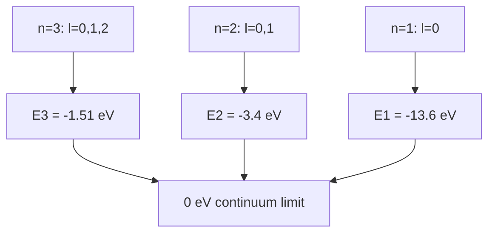

# Central Potentials and the Hydrogen Atom

The hydrogen atom is the central bound-state problem of nonrelativistic quantum mechanics. It combines rotational symmetry, separation of variables, angular momentum, radial boundary conditions, degeneracy, and perturbative corrections. It also explains why spectroscopy became one of the first precision tests of quantum theory.

Sakurai treats hydrogen and hydrogenlike atoms after angular momentum and again in approximation methods through fine structure and Zeeman effects. Ballentine's bound-state chapter emphasizes estimates, variational reasoning, and perturbative corrections. The Gottfried-named notes use hydrogen as a perturbation-theory example. Schiff's traditional wave-mechanics approach is the classic separation into radial and angular equations.

## Separating a central-force problem

A **central potential** depends only on radius:

$$
V(\mathbf r)=V(r).
$$

Then

$$
[H,L^2]=0,\qquad [H,L_z]=0,
$$

so stationary states can be labeled by angular momentum quantum numbers.

For hydrogen,

$$
V(r)=-{e^2\over 4\pi\epsilon_0 r}.
$$

The Hamiltonian for the relative coordinate is

$$
H=-{\hbar^2\over 2\mu}\nabla^2-{e^2\over 4\pi\epsilon_0 r},
$$

where $\mu$ is the electron-proton reduced mass.

Separation of variables gives

$$
\psi_{n\ell m}(r,\theta,\phi)=R_{n\ell}(r)Y_\ell^m(\theta,\phi).
$$

Using the reduced mass, the natural Coulomb length is

$$
a_0={4\pi\epsilon_0\hbar^2\over \mu e^2}.
$$

Strictly, the conventional Bohr radius uses the electron mass $m_e$; replacing it by $\mu$ gives the reduced-mass Bohr radius. The distinction is small for ordinary hydrogen but important in precision comparisons and large in muonic atoms.

The principal quantum number is

$$
n=1,2,3,\ldots,
$$

with

$$
\ell=0,1,\ldots,n-1,
\qquad
m=-\ell,\ldots,\ell.
$$

Substitution of $\psi=R(r)Y_\ell^m(\theta,\phi)$ into the Schrödinger equation gives

$$
-{\hbar^2\over2\mu}
\left[{1\over r^2}{d\over dr}\left(r^2{dR\over dr}\right)
-{\ell(\ell+1)\over r^2}R\right]+V(r)R=ER.
$$

The first derivative is removed by defining $u(r)=rR(r)$. The normalization becomes $\int_0^\infty\vert u(r)\vert ^2dr=1$, and the equation becomes a one-dimensional problem on the half-line:

$$
-{\hbar^2\over2\mu}{d^2u\over dr^2}
+\left[V(r)+{\hbar^2\ell(\ell+1)\over2\mu r^2}\right]u=Eu.
$$

The second term in brackets is the centrifugal barrier. It is absent for $\ell=0$ and repels higher-$\ell$ probability from the origin. Regularity of $R=u/r$ requires $u(0)=0$ for the usual nonsingular solutions.

## How the Coulomb spectrum is quantized

For $E\lt 0$, write $\kappa=\sqrt{-2\mu E}/\hbar$ and $\rho=2\kappa r$. At large $r$, the radial equation gives $u\sim e^{-\kappa r}$; the growing exponential is not normalizable. Near the origin, the regular solution behaves as $u\sim r^{\ell+1}$. Factoring out both endpoint behaviors,

$$
u(\rho)=\rho^{\ell+1}e^{-\rho/2}v(\rho),
$$

leaves a confluent hypergeometric equation for $v$. Its generic solution grows exponentially and would undo the chosen decay. Normalizability therefore requires the power series for $v$ to terminate, making it an associated Laguerre polynomial. The termination condition is

$$
{1\over\kappa a_0}=n,
\qquad n=n_r+\ell+1,
$$

where the radial quantum number $n_r=0,1,2,\ldots$ counts radial nodes. Substituting $\kappa=1/(na_0)$ gives

$$
E_n=-{\mu e^4\over 2(4\pi\epsilon_0)^2\hbar^2}{1\over n^2}
\simeq-{13.6\,\mathrm{eV}\over n^2}
$$

for hydrogen to the usual reduced-mass approximation.

The energy depends only on $n$ in the nonrelativistic Coulomb problem. Since $n_r=n-\ell-1$ cannot be negative, $\ell$ runs from $0$ to $n-1$. For a fixed $n$, the degeneracy without spin is

$$
\sum_{\ell=0}^{n-1}(2\ell+1)=n^2.
$$

Including electron spin doubles it to $2n^2$ before fine structure, hyperfine structure, or external fields are included.

The normalized ground-state wave function is

$$
\psi_{100}(r,\theta,\phi)={1\over \sqrt{\pi a_0^3}}e^{-r/a_0}.
$$

The radial probability density for the ground state is

$$
P(r)=4\pi r^2|\psi_{100}(r)|^2
={4r^2\over a_0^3}e^{-2r/a_0}.
$$

It is largest at $r=a_0$, even though the wave function itself is largest at $r=0$. This distinction between amplitude density and radial shell probability is a common conceptual test.

The $n$-only spectrum is more degenerate than rotational invariance alone requires. Rotations explain degeneracy in $m$ for fixed $\ell$, but they do not relate different $\ell$ values. The extra Coulomb degeneracy is associated with conservation of the quantum Runge–Lenz vector. Perturbations such as fine structure or an external field generally break part of that larger symmetry.

## Reading the level scheme

| Quantum number | Allowed values | Physical meaning |
|---|---|---|
| $n$ | $1,2,3,\ldots$ | energy shell in Coulomb problem |
| $\ell$ | $0,\ldots,n-1$ | orbital angular momentum magnitude |
| $m$ | $-\ell,\ldots,\ell$ | $z$ projection of orbital angular momentum |
| $s$ | $1/2$ for electron | intrinsic spin |
| $j$ | $\ell\pm1/2$ | total electronic angular momentum |

## Worked example: most probable and mean ground-state radii

**Problem.** Show that the most probable radius in the hydrogen ground state is $a_0$.

**Method.**

1. Start from

$$
\psi_{100}={1\over \sqrt{\pi a_0^3}}e^{-r/a_0}.
$$

2. The probability of finding the electron between $r$ and $r+dr$ is

$$
P(r)dr=4\pi r^2|\psi_{100}|^2dr.
$$

3. Substitute:

$$
P(r)={4r^2\over a_0^3}e^{-2r/a_0}.
$$

4. Differentiate:

$$
{dP\over dr}={4\over a_0^3}
\left(2r e^{-2r/a_0}-{2r^2\over a_0}e^{-2r/a_0}\right).
$$

5. Factor:

$$
{dP\over dr}={8r\over a_0^3}e^{-2r/a_0}\left(1-{r\over a_0}\right).
$$

6. Critical points are $r=0$ and $r=a_0$. Since $P(0)=0$ and $P(r)$ rises then falls, the maximum is

$$
r=a_0.
$$

The expectation value answers a different question:

$$
\begin{aligned}
\langle r\rangle
&=\int_0^\infty rP(r)\,dr\\
&={4\over a_0^3}\int_0^\infty r^3e^{-2r/a_0}\,dr.
\end{aligned}
$$

Using $\int_0^\infty r^ne^{-\alpha r}dr=n!/\alpha^{n+1}$,

$$
\langle r\rangle
={4\over a_0^3}{3!\over(2/a_0)^4}
={3a_0\over2}.
$$

The most probable radius is $a_0$, while the mean is $3a_0/2$. The long exponential tail pulls the mean outward.

## Worked example: energy of a Lyman-$\alpha$ photon

**Problem.** Find the photon energy for the transition $n=2\to n=1$ in hydrogen using the nonrelativistic formula.

**Method.**

1. Use

$$
E_n=-{13.6\,\mathrm{eV}\over n^2}.
$$

2. Compute the initial energy:

$$
E_2=-{13.6\over 4}\,\mathrm{eV}=-3.4\,\mathrm{eV}.
$$

3. Compute the final energy:

$$
E_1=-13.6\,\mathrm{eV}.
$$

4. The emitted photon energy is the lost atomic energy:

$$
E_\gamma=E_2-E_1=(-3.4)-(-13.6)=10.2\,\mathrm{eV}.
$$

5. A wavelength estimate is

$$
\lambda={hc\over E_\gamma}
\approx {1240\,\mathrm{eV\,nm}\over 10.2\,\mathrm{eV}}
\approx 122\,\mathrm{nm}.
$$

**Checked answer.** This is ultraviolet light, consistent with the Lyman series.

## What changes outside the ideal Coulomb model

The sequence of corrections matters. The Coulomb Hamiltonian with reduced mass sets the gross spectrum. Relativistic kinetic energy, spin–orbit coupling, and the Darwin term produce fine structure. Nuclear spin produces hyperfine structure. The Lamb shift comes from quantum electrodynamics and lies outside ordinary Schrödinger theory. Electric and magnetic fields add Stark and Zeeman terms. Each interaction preserves a different subset of the original quantum numbers.

For a generic central potential, only rotational degeneracy is guaranteed. Energies are commonly labeled by $n_r$ and $\ell$, and different $\ell$ values need not coincide. The isotropic harmonic oscillator has its own enlarged degeneracy, but with a pattern different from the Coulomb problem.

## Frequent sources of wrong answers

- Confusing $R_{n\ell}(r)$, $\psi_{n\ell m}$, and radial probability density. The shell factor matters.
- Forgetting reduced mass. Precision spectroscopy needs $\mu$, not exactly the electron mass.
- Assuming the Coulomb degeneracy is generic. Most central potentials have energies depending on both $n$ and $\ell$.
- Treating $m$ degeneracy as permanent. External fields split projection degeneracies.
- Mixing orbital and total angular momentum labels when spin-orbit coupling is present.
- Calling $a_0$ the average radius. In the ground state, the most probable radius is $a_0$, while the expectation value is $3a_0/2$.
- Applying nonrelativistic hydrogen energies to fine spectral details without corrections.

Central-potential problems reward using symmetry before solving equations. Rotational invariance says that $L^2$ and $L_z$ commute with the Hamiltonian, so spherical harmonics organize the angular dependence and leave a radial equation. The separation expresses the absence of a preferred direction in $V(r)$.

The Coulomb potential has an additional hidden symmetry, so the nonrelativistic energy depends only on $n$ rather than on $\ell$. That degeneracy is special. Fine structure, the Lamb shift, hyperfine coupling, and external fields partially or fully lift it. The $-13.6/n^2$ formula is the leading idealization for real hydrogen spectroscopy.

Radial probability is another conceptual trap. The probability density in three dimensions is $\vert \psi(\mathbf r)\vert ^2$, but the probability for a radius interval includes the volume element $4\pi r^2dr$ for spherically symmetric states. The ground-state wave function is largest at the origin while the most probable radius is $a_0$. When a problem asks where the electron is most likely to be found, check whether it means a point density or a radial shell probability.

Hydrogen also functions as a meeting point for later approximation methods. The Stark effect uses degenerate perturbation theory in excited shells. The Zeeman effect uses angular momentum and magnetic moments. Variational estimates reproduce the ground energy when the trial family contains the exact exponential form. Scattering from Coulomb-like potentials requires special care because the potential is long-ranged. One atom therefore exercises nearly the whole nonrelativistic toolkit.

When doing hydrogen calculations, keep the hierarchy of approximations explicit. The simplest Hamiltonian uses a Coulomb potential and reduced mass. Fine structure adds relativistic kinetic correction, spin-orbit coupling, and Darwin terms. Hyperfine structure adds nuclear spin. The Lamb shift requires quantum-field effects beyond ordinary nonrelativistic quantum mechanics. External electric and magnetic fields add Stark and Zeeman perturbations. Mixing formulas from different levels of this hierarchy without stating the approximation leads to inconsistent spectroscopic predictions.

The radial equation is also a good place to practice dimensional reasoning. Lengths should naturally appear in units of $a_0$, energies in Rydberg-scale units, and angular parts should be dimensionless spherical harmonics. If a radial wave function normalization produces a dimensionless $R(r)$, something is wrong: because $\int \vert R\vert ^2r^2dr=1$, $R$ has dimensions of length to the power $-3/2$.

For problem solving, start by identifying which labels remain good quantum numbers after each added interaction. Pure Coulomb hydrogen uses $n,\ell,m$ and spin separately. Spin-orbit coupling favors $j,m_j$. A magnetic field may make a projection quantum number central. Choosing labels before calculating keeps degeneracy splitting organized.

## Radial nodes and the shape of orbitals

The principal quantum number does not by itself describe spatial shape. The orbital label controls the centrifugal barrier and angular nodes, while the radial quantum number counts nodes away from the origin. Their relation says that the number of radial nodes is the principal label minus the orbital label minus one. A ground-state orbital has no node. A higher state with zero orbital angular momentum can pass through several sign changes in radius, while a state with larger orbital angular momentum may have fewer radial nodes but more angular structure.

Nodes matter because probability vanishes there even though neighboring regions may carry substantial density. A node is also a phase boundary: the real radial wavefunction changes sign across a simple node. Probability density alone hides that sign, but interference and matrix elements retain it. Radial integrals can be small because positive and negative regions cancel, not because the wavefunctions barely overlap in magnitude.

The centrifugal barrier gives regular radial solutions their near-origin behavior. For positive orbital angular momentum, the radial wavefunction vanishes as a power of radius. Only zero-orbital states have nonzero density at the origin. The Darwin correction and contact hyperfine interactions therefore affect those states especially strongly. This qualitative conclusion follows before any detailed integral is evaluated.

The familiar orbital pictures are angular probability plots, often multiplied by an arbitrary radial surface. They should not be read as electron trajectories or hard boundaries. A stationary orbital is a complex probability amplitude; a measurement samples a position according to its density. Different real linear combinations within a degenerate subspace can produce differently oriented lobes without changing the energy.

## Scaling and virial checks

The Coulomb problem has a useful scale argument. Localizing a state to size $a$ gives kinetic energy of order $\hbar^2/(2\mu a^2)$ and potential energy of order $-e^2/(4\pi\epsilon_0 a)$. Minimizing their sum gives a length of the order of the reduced-mass Bohr radius and an energy of the order of the Rydberg scale. The estimate misses numerical details but explains why the characteristic size and binding energy have their particular dependence on mass, charge, and Planck's constant.

For any bound eigenstate in an inverse-radius potential, the virial theorem gives twice the mean kinetic energy plus the mean potential energy equal to zero. Consequently the mean potential energy is twice the total energy and the mean kinetic energy is minus the total energy. These relations provide strong checks on expectation-value calculations. A proposed hydrogen ground state with negative mean kinetic energy or with the wrong ratio cannot be correct.

The scaling also extends to hydrogenlike ions. Replacing the nuclear charge by $Z$ multiplies binding energies by $Z^2$ in the nonrelativistic point-nucleus model and contracts characteristic radii by $1/Z$. Reduced mass must still be used. At large nuclear charge, relativistic and finite-nuclear-size corrections grow and the simple scaling loses precision.

## Spectral lines and selection rules

An energy difference determines a possible photon frequency, but a nonzero transition matrix element determines whether the line appears strongly. In the electric-dipole approximation, the perturbation is proportional to the position operator. Its odd parity connects states of opposite orbital parity, and its vector character restricts changes of orbital angular momentum and projection. Energy conservation alone would predict many lines that are absent or extremely weak.

Degenerate states require special care in external fields. The first excited Coulomb shell contains states with different orbital labels at the same unperturbed energy. An electric field can mix states within that shell at first order, so nondegenerate perturbation theory gives the wrong Stark effect. The perturbation must first be diagonalized inside the degenerate subspace.

Magnetic fields expose a different hierarchy. When spin–orbit coupling dominates the field interaction, total electronic angular momentum remains the useful approximate label and the field splits its projections. In a much stronger field, orbital and spin projections can decouple and become the more useful labels. The crossover is a basis-change problem governed by competing energy scales.

Real spectra also depend on nuclear motion. Using the reduced mass already shifts every gross-structure level relative to the infinite-mass result and creates isotope shifts. Nuclear size, nuclear spin, radiative effects, and relativistic dynamics add smaller corrections. Stating the Hamiltonian is therefore part of stating any quoted hydrogen energy.

## Related pages

- [Angular momentum algebra](/physics/quantum-mechanics/angular-momentum-algebra)
- [Addition of angular momentum](/physics/quantum-mechanics/addition-of-angular-momentum)
- [Time-independent perturbation theory](/physics/quantum-mechanics/time-independent-perturbation-theory)
- [Variational principle and WKB](/physics/quantum-mechanics/variational-principle-wkb)
- [Symmetries and conservation laws](/physics/quantum-mechanics/symmetries-conservation-laws)
