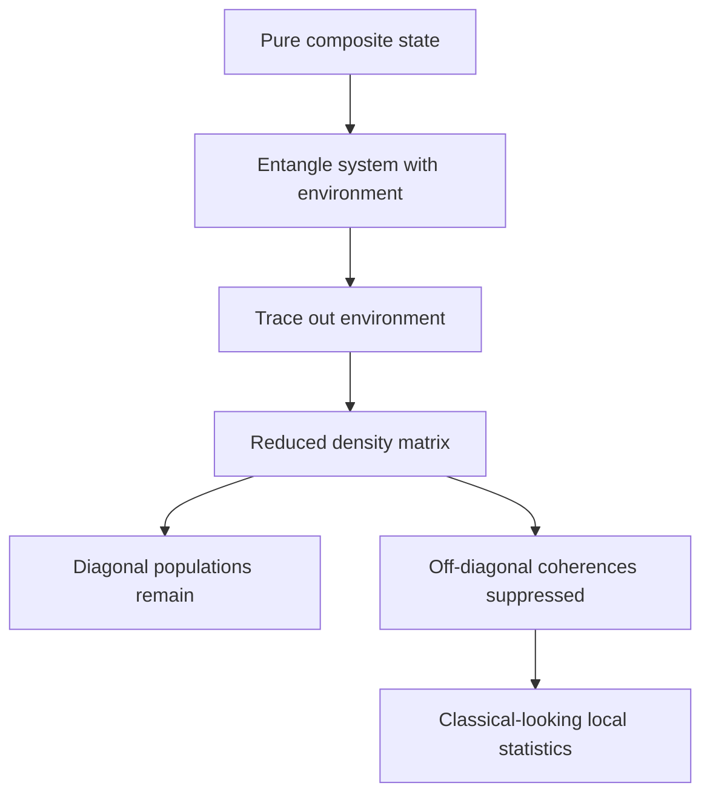

# Density Operator, Entanglement, and Decoherence

The density operator is the language of incomplete information, subsystems, statistical mixtures, and open-system behavior. State vectors are enough for isolated pure states, but experiments usually involve preparation uncertainty, unobserved environments, or composite systems whose parts do not have their own pure states.

Sakurai introduces density operators in the angular-momentum chapter through pure versus mixed ensembles and later uses spin correlations and Bell inequalities. Ballentine gives extensive attention to pure and general states, measurement, and ensemble interpretation. The Gottfried-named notes develop density matrices for spin-1/2 and mixed beams. Schiff's older treatment is less centered on density operators, reflecting the historical emphasis on wave functions.

## States when a ket is insufficient

A density operator $\rho$ is a positive semidefinite, trace-one operator:

$$
\rho\geq0,\qquad \mathrm{Tr}\rho=1.
$$

For a pure state,

$$
\rho=|\psi\rangle\langle\psi|.
$$

For a classical mixture of preparations $\vert \psi_i\rangle$ with probabilities $p_i$,

$$
\rho=\sum_i p_i|\psi_i\rangle\langle\psi_i|,
\qquad p_i\geq0,\quad \sum_i p_i=1.
$$

Expectation values are

$$
\langle A\rangle=\mathrm{Tr}(\rho A).
$$

Unitary evolution is

$$
\rho(t)=U(t)\rho(0)U^\dagger(t),
$$

or

$$
i\hbar {d\rho\over dt}=[H,\rho].
$$

For a composite system $AB$, the reduced density operator of subsystem $A$ is

$$
\rho_A=\mathrm{Tr}_B(\rho_{AB}).
$$

The von Neumann entropy is

$$
S(\rho)=-\mathrm{Tr}(\rho\ln\rho).
$$

## Purity, Bloch vectors, and spectral form

A state is pure if and only if

$$
\rho^2=\rho,
$$

equivalently

$$
\mathrm{Tr}(\rho^2)=1.
$$

For a mixed state,

$$
\mathrm{Tr}(\rho^2)<1.
$$

For spin-1/2,

$$
\rho={1\over2}(I+\mathbf r\cdot\boldsymbol{\sigma}),
$$

where $\mathbf r$ is the Bloch vector. Positivity requires

$$
|\mathbf r|\leq1.
$$

Pure states sit on the Bloch sphere, and mixed states sit inside it.

The eigenvalues of the qubit state are

$$
\lambda_\pm={1\pm|\mathbf r|\over2}.
$$

This immediately gives

$$
\mathrm{Tr}(\rho^2)={1+|\mathbf r|^2\over2}.
$$

The center of the Bloch ball is maximally mixed, while points on the surface have one eigenvalue zero. A general finite-dimensional density operator likewise has a spectral decomposition

$$
\rho=\sum_k\lambda_k|k\rangle\langle k|,
\qquad \lambda_k\geq0,quad\sum_k\lambda_k=1.
$$

Its eigenvalues, not a particular ensemble decomposition, determine purity and entropy. Distinct ensembles can produce the same operator and are indistinguishable by any measurement performed on that system.

## Reduced states and entanglement

Entanglement means that a composite pure state cannot be factored into subsystem states. The Bell state

$$
|\Phi^+\rangle={1\over\sqrt2}(|00\rangle+|11\rangle)
$$

has total density operator

$$
\rho_{AB}=|\Phi^+\rangle\langle\Phi^+|.
$$

Tracing out $B$ gives

$$
\rho_A={1\over2}I.
$$

Thus the whole state is pure while each subsystem is maximally mixed. This is not ignorance about which pure state $A$ "really has"; it is a structural feature of entanglement.

For any bipartite pure state, the Schmidt decomposition gives

$$
|\Psi\rangle=\sum_k\sqrt{\lambda_k}
|a_k\rangle|b_k\rangle.
$$

The reduced operators have the same nonzero eigenvalues:

$$
\rho_A=\sum_k\lambda_k|a_k\rangle\langle a_k|,
\qquad
\rho_B=\sum_k\lambda_k|b_k\rangle\langle b_k|.
$$

One Schmidt coefficient means a product state. More than one means entanglement. For a bipartite pure state, $S(\rho_A)=S(\rho_B)$ measures entanglement; for a mixed joint state, entropy also contains ordinary mixing and is no longer an entanglement measure by itself.

## How environmental entanglement removes local interference

Begin with a system superposition and an environment reference state:

$$
|\Psi(0)\rangle=(\alpha|0\rangle+\beta|1\rangle)|E_*\rangle.
$$

An interaction that records the system basis in the environment produces

$$
|\Psi(t)\rangle
=\alpha|0\rangle|E_0(t)\rangle
+\beta|1\rangle|E_1(t)\rangle.
$$

Tracing over the environment gives

$$
\rho_S=
\begin{pmatrix}
|\alpha|^2 & \alpha\beta^*\langle E_1|E_0\rangle\\
\alpha^*\beta\langle E_0|E_1\rangle & |\beta|^2
\end{pmatrix}.
$$

The overlap $D(t)=\langle E_1(t)\vert E_0(t)\rangle$ is a decoherence factor. When the two environment records become nearly orthogonal, $\vert D(t)\vert \ll1$, local interference is suppressed. The joint state has not become a classical mixture; it remains a coherent entangled state if the total evolution is unitary. Recovering the phase would require a measurement controlling the relevant environment degrees of freedom.

The basis recorded by a stable system–environment interaction is called a pointer basis. Decoherence is basis-dependent because the interaction Hamiltonian selects which system observable is redundantly imprinted in the environment. It does not, on its own, select one term as the observed outcome.



| Concept | Mathematical test | Interpretation |
|---|---|---|
| Pure state | $\mathrm{Tr}(\rho^2)=1$ | one ray description |
| Mixed state | $\mathrm{Tr}(\rho^2)\lt 1$ | statistical or reduced description |
| Entangled pure state | cannot factor $\vert \psi\rangle_A\vert \phi\rangle_B$ | subsystems need density operators |
| Decoherence | local off-diagonal terms shrink | interference becomes inaccessible |

## Worked example: purity and entropy of a spin state

**Problem.** Consider

$$
\rho={1\over2}
\begin{pmatrix}
1+r&0\\
0&1-r
\end{pmatrix}.
$$

Find when it is pure.

**Method.**

1. The eigenvalues are visible:

$$
\lambda_+= {1+r\over2},
\qquad
\lambda_-={1-r\over2}.
$$

2. Positivity requires

$$
-1\leq r\leq1.
$$

3. Compute purity:

$$
\mathrm{Tr}(\rho^2)=\lambda_+^2+\lambda_-^2.
$$

4. Substitute:

$$
\begin{aligned}
\mathrm{Tr}(\rho^2)
&={ (1+r)^2+(1-r)^2\over4}\\
&={2+2r^2\over4}\\
&={1+r^2\over2}.
\end{aligned}
$$

5. Set this equal to $1$:

$$
{1+r^2\over2}=1\Rightarrow r^2=1.
$$

**Checked answer.** The state is pure only for $r=\pm1$. For $r=0$, it is maximally mixed: $\rho=I/2$.

Its von Neumann entropy is

$$
S(\rho)=-{1+r\over2}\ln{1+r\over2}
-{1-r\over2}\ln{1-r\over2}.
$$

At $r=\pm1$, one eigenvalue is one and the other is zero, with the convention $0\ln0=0$, so $S=0$. At $r=0$, both eigenvalues are $1/2$ and $S=\ln2$.

## Worked example: partial trace of a Bell state

**Problem.** For

$$
|\Phi^+\rangle={1\over\sqrt2}(|00\rangle+|11\rangle),
$$

compute $\rho_A$.

**Method.**

1. Form the total density operator:

$$
\rho_{AB}={1\over2}
\left(|00\rangle\langle00|
+|00\rangle\langle11|
+|11\rangle\langle00|
+|11\rangle\langle11|\right).
$$

2. Trace over subsystem $B$ using

$$
\mathrm{Tr}_B(|a b\rangle\langle a' b'|)
=|a\rangle\langle a'|\langle b'|b\rangle.
$$

3. Apply this term by term:

$$
\mathrm{Tr}_B(|00\rangle\langle00|)=|0\rangle\langle0|,
$$

$$
\mathrm{Tr}_B(|00\rangle\langle11|)=|0\rangle\langle1|\langle1|0\rangle=0,
$$

$$
\mathrm{Tr}_B(|11\rangle\langle00|)=0,
$$

$$
\mathrm{Tr}_B(|11\rangle\langle11|)=|1\rangle\langle1|.
$$

4. Therefore

$$
\rho_A={1\over2}\left(|0\rangle\langle0|+|1\rangle\langle1|\right)={I\over2}.
$$

**Checked answer.** The subsystem is maximally mixed even though the joint state is pure.

## Checking a partial trace by reshaping indices

```python
import numpy as np

phi = np.array([1, 0, 0, 1], dtype=complex) / np.sqrt(2)
rho = np.outer(phi, phi.conj()).reshape(2, 2, 2, 2)
rho_a = np.trace(rho, axis1=1, axis2=3)

print(rho_a)
print("purity subsystem:", np.trace(rho_a @ rho_a).real)
```

## Distinctions that matter

- Confusing a mixed state with a superposition. A mixture has probabilities over preparations; a superposition has coherent amplitudes.
- Assuming every density matrix decomposition into pure states is unique. It is not.
- Treating subsystem mixedness as necessarily ignorance. For entangled pure states, reduced mixedness is intrinsic to the subsystem description.
- Forgetting the trace in expectation values. With density operators, use $\mathrm{Tr}(\rho A)$.
- Thinking decoherence alone solves every measurement problem. It suppresses local interference but does not by itself select a unique experienced outcome.
- Ignoring positivity. Trace one is not enough for a valid density matrix.
- Confusing classical correlation with entanglement. Entanglement is nonseparability of the joint state, not merely a large correlation coefficient.

Density matrices separate coherent superposition from probabilistic mixing. Off-diagonal entries in a basis represent coherence relative to that basis; diagonal entries represent populations. A unitary basis change can move coherence around, so a claim that a density matrix is diagonal must name the basis. Decoherence suppresses off-diagonal terms in a dynamically selected pointer basis, not in every basis at once.

Purity is a quick diagnostic but not a complete interpretation. If $\mathrm{Tr}(\rho^2)=1$, the state is pure. If it is less than one, the state is mixed. The same mixed density operator may describe ignorance about a preparation procedure or the reduced state of an entangled subsystem. These two cases can be operationally identical for measurements on the subsystem alone, but they differ when joint measurements or purification questions are considered.

The partial trace is often the first place tensor-product bookkeeping becomes unavoidable. With explicit basis indices, $\rho_{aa',bb'}$ becomes $(\rho_A)_{aa'}=\sum_b \rho_{aa',bb}$. This index contraction does not physically destroy information; it represents choosing not to access subsystem $B$. An environment has many degrees of freedom, so recovering the full phase information can be infeasible even while the total system evolves unitarily.

Ballentine's ensemble emphasis and Sakurai's density-operator spin examples complement each other. Ballentine keeps the statistical meaning of $\rho$ explicit. Sakurai shows how $\rho$ handles pure and mixed spin beams in the same algebraic language. Together they make density operators feel less like an advanced add-on and more like the natural generalization of the Born rule.

A useful computational habit is to diagonalize $\rho$ when interpreting a state. Its eigenvalues are probabilities in the basis that makes the mixture look classical, and they determine entropy and purity. But the eigenbasis of $\rho$ is not automatically the measurement basis of interest. A detector measuring $S_z$ cares about diagonal entries in the $z$ basis, while entropy cares about the eigenvalues of $\rho$ itself. Confusing these two diagonalizations leads to wrong statements about coherence.

For entanglement, avoid relying only on visual inspection of a state vector. A two-qubit pure state is entangled if the reduced density matrix of either qubit is mixed, or equivalently if the coefficient matrix has rank greater than one. One direct test reshapes the coefficient vector into a matrix and checks whether it factors into one column times one row. The Bell examples are maximally entangled, but partially entangled states require this more careful diagnosis.

In calculations involving measurement, density operators also prevent accidental conditioning. If the outcome is known, update with the corresponding normalized branch. If the outcome is not known or is deliberately ignored, sum over all branches. Both are legitimate operations, but they answer different experimental questions. This distinction is central to interpreting decoherence and mixed spin beams.

Whenever a problem mentions an unobserved subsystem, an imperfect preparation, or discarded measurement records, switch to density-operator language early rather than trying to force a single ket to carry missing information.

## Proper and improper mixtures

A preparation mixture can arise because a source deliberately chooses among several pure states and discards the classical record. A reduced state can arise because the system is entangled with another system that is not measured. The same density operator may result in both cases, so no experiment confined to the subsystem can distinguish them. The distinction concerns how the state was prepared and which larger measurements remain possible.

Calling the reduced case an improper mixture is a reminder that the joint system has not secretly selected one member of the subsystem ensemble. If the purifying subsystem becomes accessible, joint interference measurements can reveal phase relations absent from the reduced description. In a preparation mixture with an irretrievably randomized classical choice, no analogous purification is available unless the choice record is included as another physical system.

Ensemble decompositions are nonunique. The maximally mixed qubit can be written as an equal mixture of vertical spin states, horizontal spin states, or the two eigenstates along any axis. These are not different density operators. A measurement on the qubit sees identical statistics. If a preparation label is retained and correlated with another register, the enlarged joint density operators differ and the label can be used to sort the data.

## Measurement maps and discarded outcomes

For a projective measurement with projectors $P_a$, the probability of outcome $a$ is the trace of the product of the state and the projector. Conditional on observing that outcome, the normalized post-measurement state is obtained by placing the projector on both sides of the density operator and dividing by the probability. This is the density-operator form of the usual projection rule.

If the apparatus performs the measurement but the outcome record is ignored, the correct state is the sum of all unnormalized branches. Off-diagonal terms between different projected sectors disappear. This nonselective update differs from conditioning on a known result. It also differs from unitary evolution of the system alone, although a larger unitary model including the apparatus can produce it after the apparatus is traced out.

More general measurements use positive operators that sum to the identity, together with measurement operators describing the state update. The probability operators alone determine outcome statistics, while different physical instruments can share those statistics and disturb the state differently. Keeping probability and disturbance separate prevents an overgeneralization of the simple projection postulate.

## Entropy, correlations, and what they do not prove

Von Neumann entropy is invariant under unitary changes of basis because unitary conjugation preserves the eigenvalues of a density operator. Closed-system evolution therefore preserves entropy. A subsystem's entropy may increase or decrease as it exchanges correlations with another subsystem even while the entropy of the joint pure state remains zero.

For a bipartite pure state, nonzero reduced entropy is equivalent to entanglement. For a mixed joint state, the same conclusion does not follow. Classical correlations can make each subsystem uncertain while the joint state remains separable. Determining mixed-state entanglement generally needs a more specialized criterion, and no single entropy of one subsystem settles every case.

Mutual information compares the entropy of the parts with the entropy of the whole and counts total correlations, both classical and quantum. It vanishes for a product state. A nonzero value proves correlation but does not by itself prove entanglement. This distinction matters when environmental decoherence creates strong classical records of a system observable.

Decoherence rates depend on how distinguishable the environment records become. A large environment is not sufficient by itself; the interaction must correlate different system alternatives with different environmental states. If both alternatives produce the same environment state, their overlap remains one and no local coherence is lost. Conversely, many weakly affected environmental degrees of freedom can make the total overlap decay rapidly because their individual overlaps multiply.

Recoherence is allowed by unitary dynamics. In a small controlled environment, records can return to overlap and interference can revive. Macroscopic irreversibility comes from the huge number of degrees of freedom, uncontrolled phases, and recurrence times, rather than from an exact nonunitary law for the total isolated system.

<div className="see-also">

See also: [Spin-1/2 systems](/physics/quantum-mechanics/spin-one-half-systems) · [Postulates of quantum mechanics](/physics/quantum-mechanics/postulates-of-quantum-mechanics) · [Identical particles and symmetrization](/physics/quantum-mechanics/identical-particles-symmetrization) · [Measurement and interpretation](/physics/quantum-mechanics/measurement-interpretation) · [Symmetries and conservation laws](/physics/quantum-mechanics/symmetries-conservation-laws)

</div>
