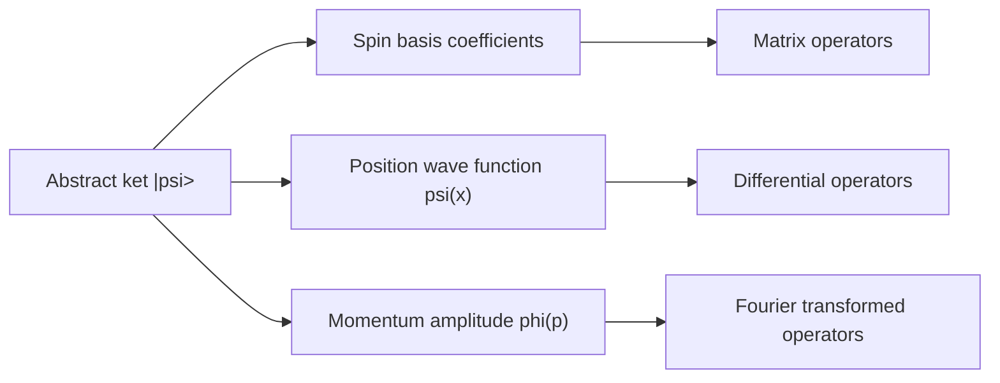

# Dirac Notation and Hilbert Spaces

Dirac notation separates a state from any coordinate system used to describe it. The same ket can appear as a column vector in a spin basis, a square-integrable wave function in position space, or a momentum-space amplitude after a Fourier transform.

Sakurai introduces bras, kets, and operators before wave mechanics, making Hilbert space the native language. Ballentine begins with a more explicit mathematical account of vector spaces, self-adjointness, probability, and rigged Hilbert spaces. The Gottfried-named notes move between wave functions and Dirac notation, which is useful for seeing how the abstract and coordinate pictures translate. Schiff's older style corresponds mostly to choosing the position representation early.

## Abstract states and their coordinates

A **ket** $\vert \psi\rangle$ is a vector in a complex Hilbert space. A **bra** $\langle \psi\vert $ is its dual vector. The inner product $\langle \phi\vert \psi\rangle$ is linear in the ket argument and conjugate-linear in the bra argument under the physics convention.

The norm is

$$
\|\psi\|=\sqrt{\langle \psi|\psi\rangle}.
$$

A **linear operator** $A$ maps kets to kets:

$$
A(\alpha|\psi\rangle+\beta|\phi\rangle)=\alpha A|\psi\rangle+\beta A|\phi\rangle.
$$

The **adjoint** $A^\dagger$ is defined by

$$
\langle \phi|A|\psi\rangle=\langle A^\dagger\phi|\psi\rangle.
$$

An **orthonormal discrete basis** $\{\vert n\rangle\}$ satisfies

$$
\langle m|n\rangle=\delta_{mn},
\qquad
\sum_n |n\rangle\langle n|=I.
$$

For a continuous basis such as position,

$$
\langle x|x'\rangle=\delta(x-x'),
\qquad
\int_{-\infty}^{\infty}|x\rangle\langle x|\,dx=I.
$$

The **wave function** is the coordinate representation of the ket:

$$
\psi(x)=\langle x|\psi\rangle.
$$

The **momentum-space wave function** is

$$
\phi(p)=\langle p|\psi\rangle.
$$

The position and momentum representations are connected by the convention-dependent Fourier kernel. With

$$
\langle x|p\rangle={1\over \sqrt{2\pi\hbar}}e^{ipx/\hbar},
$$

we have

$$
\psi(x)=\int {dp\over \sqrt{2\pi\hbar}}e^{ipx/\hbar}\phi(p).
$$

## Inserting a basis

In a discrete basis, a ket becomes a column of coefficients:

$$
|\psi\rangle=\sum_n c_n|n\rangle,\qquad c_n=\langle n|\psi\rangle.
$$

An operator becomes a matrix:

$$
A_{mn}=\langle m|A|n\rangle.
$$

The expectation value then looks like ordinary matrix algebra:

$$
\langle A\rangle=\sum_{m,n}c_m^*A_{mn}c_n.
$$

This formula follows by inserting the identity on both sides of the operator:

$$
\begin{aligned}
\langle\psi|A|\psi\rangle
&=\langle\psi|\left(\sum_m|m\rangle\langle m|\right)
A\left(\sum_n|n\rangle\langle n|\right)|\psi\rangle\\
&=\sum_{m,n}\langle\psi|m\rangle
\langle m|A|n\rangle\langle n|\psi\rangle.
\end{aligned}
$$

The same move in position space produces an operator kernel:

$$
(A\psi)(x)=\langle x|A|\psi\rangle
=\int dx'\,\langle x|A|x'\rangle\psi(x').
$$

For a local potential, $\langle x\vert V\vert x'\rangle=V(x)\delta(x-x')$. Momentum has a distributional kernel corresponding to differentiation. Integral and differential operators are two coordinate forms of the same abstract construction.

A change of orthonormal basis is unitary. If

$$
|e'_j\rangle=\sum_i |e_i\rangle U_{ij},
$$

then $U^\dagger U=I$ and the same abstract vector has transformed components

$$
c'_j=\langle e'_j|\psi\rangle=\sum_i U_{ij}^*c_i.
$$

The spectral theorem represents a self-adjoint operator through real spectral values and mutually orthogonal projectors. For a discrete, nondegenerate spectrum,

$$
A=\sum_a a|a\rangle\langle a|.
$$

Degeneracy replaces each rank-one projector by a projector onto an eigenspace. A continuous spectral part is written formally as an integral. Generalized eigenvectors such as $\vert x\rangle$ are distributions rather than normalizable Hilbert-space vectors; a rigged Hilbert space gives them a precise setting.

Tensor products describe composite systems:

$$
|\psi\rangle_A\otimes|\phi\rangle_B \equiv |\psi\rangle_A|\phi\rangle_B.
$$

Not every vector in a tensor product factors. For example,

$$
|\Phi^+\rangle={1\over \sqrt{2}}\left(|0\rangle_A|0\rangle_B+|1\rangle_A|1\rangle_B\right)
$$

is entangled. The state space of a pair is the tensor product rather than the Cartesian product of the two state spaces.

In position representation, the momentum operator is

$$
P=-i\hbar {d\over dx},
$$

because it generates translations:

$$
T(a)=\exp(-iaP/\hbar),\qquad T(a)^\dagger X T(a)=X+aI.
$$

This result connects Sakurai's generator-first derivation with Schiff's traditional differential-operator wave mechanics.

## One ket, several useful representations

| Object | Abstract notation | Discrete representation | Position representation |
|---|---|---|---|
| State | $\vert \psi\rangle$ | column vector $c_n$ | $\psi(x)=\langle x\vert \psi\rangle$ |
| Bra | $\langle\psi\vert $ | conjugate row $c_n^*$ | $\psi^*(x)$ under integrals |
| Identity | $I$ | $\sum_n \vert n\rangle\langle n\vert $ | $\int dx\,\vert x\rangle\langle x\vert $ |
| Momentum | $P$ | matrix $P_{mn}$ | $-i\hbar d/dx$ |
| Probability | projector $P_a$ | $\vert c_a\vert ^2$ | $\int_R \vert \psi(x)\vert ^2 dx$ |

## Worked example: changing from the $z$ basis to the $x$ basis

**Problem.** In the $S_z$ basis, let

$$
|\psi\rangle={1\over \sqrt{5}}\begin{pmatrix}1\\2\end{pmatrix}.
$$

Find the amplitudes in the $S_x$ basis, where

$$
|+x\rangle={1\over \sqrt{2}}\begin{pmatrix}1\\1\end{pmatrix},
\qquad
|-x\rangle={1\over \sqrt{2}}\begin{pmatrix}1\\-1\end{pmatrix}.
$$

**Method.**

1. Compute the $+x$ amplitude:

$$
\begin{aligned}
c_{+x}
&=\langle +x|\psi\rangle\\
&={1\over \sqrt{2}}\begin{pmatrix}1&1\end{pmatrix}
{1\over \sqrt{5}}\begin{pmatrix}1\\2\end{pmatrix}\\
&={3\over \sqrt{10}}.
\end{aligned}
$$

2. Compute the $-x$ amplitude:

$$
\begin{aligned}
c_{-x}
&=\langle -x|\psi\rangle\\
&={1\over \sqrt{2}}\begin{pmatrix}1&-1\end{pmatrix}
{1\over \sqrt{5}}\begin{pmatrix}1\\2\end{pmatrix}\\
&=-{1\over \sqrt{10}}.
\end{aligned}
$$

3. Check probabilities:

$$
|c_{+x}|^2+|c_{-x}|^2={9\over 10}+{1\over 10}=1.
$$

**Checked answer.** The same ket is

$$
|\psi\rangle={3\over \sqrt{10}}|+x\rangle-{1\over \sqrt{10}}|-x\rangle.
$$

The negative sign is a relative phase and affects later interference, even though its probability contribution is positive.

## Worked example: a Gaussian in position representation

**Problem.** Let

$$
\psi(x)=N e^{-x^2/(2a^2)}.
$$

Find $N$ and compute $\langle P\rangle$.

**Method.**

1. Normalize:

$$
1=\int_{-\infty}^{\infty}|\psi(x)|^2dx
=|N|^2\int_{-\infty}^{\infty}e^{-x^2/a^2}dx.
$$

2. Use

$$
\int_{-\infty}^{\infty}e^{-x^2/a^2}dx=a\sqrt{\pi},
$$

so

$$
|N|^2={1\over a\sqrt{\pi}},\qquad N={1\over \pi^{1/4}\sqrt{a}}
$$

for real positive $N$.

3. Apply $P=-i\hbar d/dx$:

$$
{d\psi\over dx}=-{x\over a^2}\psi(x).
$$

4. Compute

$$
\begin{aligned}
\langle P\rangle
&=\int_{-\infty}^{\infty}\psi^*(x)\left(-i\hbar {d\over dx}\right)\psi(x)\,dx\\
&={i\hbar\over a^2}\int_{-\infty}^{\infty}x|\psi(x)|^2dx.
\end{aligned}
$$

5. The integrand $x\vert \psi(x)\vert ^2$ is odd, so the integral is zero.

**Checked answer.** $\langle P\rangle=0$, consistent with a real, even wave packet centered at zero momentum.

The momentum variance follows without Fourier transforming. Since

$$
{d^2\psi\over dx^2}
=\left({x^2\over a^4}-{1\over a^2}\right)\psi,
$$

we have

$$
\begin{aligned}
\langle P^2\rangle
&=\int dx\,\psi^*\left(-\hbar^2{d^2\over dx^2}\right)\psi\\
&=\hbar^2\left({1\over a^2}-{\langle x^2\rangle\over a^4}\right).
\end{aligned}
$$

The density proportional to $e^{-x^2/a^2}$ has $\langle x^2\rangle=a^2/2$. Therefore

$$
(\Delta P)^2={\hbar^2\over2a^2},
\qquad
(\Delta X)^2={a^2\over2},
$$

and $\Delta X\Delta P=\hbar/2$. Here $a$ is $\sqrt2$ times the position standard deviation.

## Where formal notation needs care

- Confusing a ket with one of its representations. A column vector is basis-dependent; the ket is not.
- Forgetting complex conjugation in bras. $\langle \psi\vert \phi\rangle$ is not usually the same as $\langle \phi\vert \psi\rangle$.
- Treating continuous eigenkets as normalizable vectors. Position eigenkets are distributions with delta normalization.
- Dropping the identity resolution. Most useful calculations start by inserting $I=\sum_n \vert n\rangle\langle n\vert $ or $I=\int dx\,\vert x\rangle\langle x\vert $.
- Mixing Fourier conventions. If the factor $1/\sqrt{2\pi\hbar}$ changes, the inverse transform must change consistently.
- Ignoring operator domains. Ballentine's rigged-Hilbert-space discussion exists because unbounded operators such as $X$ and $P$ require care.
- Thinking tensor products are optional notation. Composite systems require tensor products, and entanglement is impossible to describe with ordinary scalar multiplication.

The safest way to work with Dirac notation is to delay choosing a basis until the calculation tells you which basis is natural. If the Hamiltonian is diagonal in energy eigenstates, expand in energy eigenstates. If the question asks for a position probability over an interval, insert the position identity. If spin analyzers are involved, use the relevant spin basis. This habit is exactly the advantage of Sakurai's order: the abstract vector comes first, and representations are chosen as tools rather than mistaken for the underlying object.

Continuous spectra deserve special care. Expressions such as $\vert x\rangle$ and $\vert p\rangle$ are extremely useful, but they are not normalizable vectors in the same Hilbert space sense as a bound-state ket. Their inner products are delta functions, and physical states are wave packets built by integrating them with square-integrable amplitudes. Ballentine's rigged-Hilbert-space discussion is meant to discipline this formalism, not to make elementary calculations impossible. The practical rule is to use delta-normalized states as distributions and return to normalizable packets when probabilities for real preparations are required.

Matrix representations also hide basis dependence. A diagonal matrix in one basis may be dense in another, and a column vector with entries $(1,0)$ does not mean "the state is intrinsically simple"; it means the chosen first basis vector is the state. Change-of-basis matrices must be unitary for orthonormal bases, and probabilities should remain unchanged after the transformation. If a basis change changes a norm or a probability, the conjugation or inverse convention has likely been mishandled.

For composite systems, tensor-product notation does more than produce longer columns. A product state assigns each subsystem its own pure state, but a general vector in the product space need not factor. That difference leads to entanglement, reduced density matrices, exchange symmetry, and Bell correlations.

Self-adjointness also carries more information than a formally Hermitian differential expression. An unbounded operator needs a specified domain, and its adjoint depends on that domain. Integration by parts may generate boundary terms; only suitable boundary conditions remove them and make the proposed Hamiltonian self-adjoint. On the full real line, sufficiently well-behaved wavefunctions yield the familiar momentum operator $-i\hbar d/dx$. On a half-line or finite interval, the boundary conditions require separate analysis.

## Rays, phases, and normalization

A physical pure state is represented by a ray rather than by one particular normalized vector. Multiplying a ket by a nonzero complex scalar does not change the ray; after normalization, the remaining freedom is a global phase. Probabilities and expectation values contain one ket and one bra, so that phase cancels. Relative phases between components do not cancel and control interference.

Normalization is therefore a convenient representative choice, not an extra physical property. During an intermediate calculation an unnormalized vector may be used, provided probabilities are divided by its norm or the state is normalized before applying the Born rule. After a selective measurement, the projected branch has a norm whose square is the branch probability; dividing by that norm gives the conditional state.

Orthogonality has an operational meaning. Perfectly distinguishable pure states can be associated with orthogonal vectors. Nonorthogonal states cannot be identified without error by a single measurement on one copy. Their overlap is invariant under unitary evolution, so closed dynamics cannot turn two nonorthogonal inputs into perfectly distinguishable outputs.

## Projectors and spectral measurements

A normalized eigenket for a nondegenerate discrete eigenvalue defines a rank-one projector. For a degenerate eigenvalue, the appropriate projector covers the entire eigenspace and does not choose a preferred basis within it. The probability of that measurement result is the expectation value of the projector. Conditioning on the outcome projects the state into the eigenspace and renormalizes it.

Projectors satisfy idempotence and self-adjointness. Mutually exclusive spectral projectors multiply to zero, and a complete collection sums to the identity. These properties encode ordinary probability additivity for disjoint outcomes. If several degenerate alternatives are not resolved by the apparatus, amplitudes inside their common subspace remain coherent; replacing the projector by separate rank-one outcomes would describe a more discriminating measurement.

Continuous spectra are handled with projection-valued measures rather than literal probabilities for one exact generalized eigenvalue. The probability of finding position in an interval is an integral of the density over that interval. An exact point has zero probability for a square-integrable wavefunction even though a probability density at the point is well defined.

## Active transformations and passive basis changes

The same unitary matrix can appear in two conceptually different calculations. An active transformation changes the physical state while the measuring basis is held fixed. A passive transformation changes the coordinate basis while leaving the abstract state fixed. Their component formulas use inverse matrices, which explains many apparent sign and conjugation disagreements.

Under an active unitary transformation, a state becomes $U\vert \psi\rangle$ and an expectation value of a fixed observable generally changes. Under a passive basis change, both state components and operator matrices transform so that every expectation value remains identical. Writing one complete expression before manipulating components usually reveals which interpretation is intended.

Symmetry operations are active transformations that preserve the relevant physical structure. If a unitary symmetry commutes with the Hamiltonian, it maps an energy eigenspace into itself. Continuous symmetries have self-adjoint generators, connecting unitary transformations back to momentum, angular momentum, and conservation laws.

## Tensor-product bookkeeping

Dimensions multiply under tensor products. Two qubits span a four-dimensional space, while three span an eight-dimensional space. Operators acting only on one factor carry an identity on every other factor. Omitting those identities is harmless shorthand only after the factor order has been declared.

The order of factors is part of the notation. A coefficient array may be reshaped differently depending on which index belongs to which subsystem. Partial traces, controlled gates, and exchange operations all depend on that convention. A basis listing at the start of a matrix calculation prevents silent permutations of rows and columns.

Product states form only a small subset of the full tensor-product space. A sum of product terms may still factor after algebraic rearrangement, so the number of written terms is not a reliable entanglement test. For two finite subsystems, arranging coefficients into a matrix and checking its rank gives a direct criterion for pure-state factorization.

Completeness also deserves attention in infinite-dimensional spaces. A proposed basis must span the states of interest, not merely be orthogonal. Fourier modes on a finite interval, bound and scattering eigenstates of a potential, and spherical harmonics on a sphere each come with their own domain and completeness statement. Formal identity resolutions are powerful precisely because they encode that spanning property.

Notation should remain subordinate to the experiment. A ket label may name an eigenvalue, a preparation setting, or several commuting quantum numbers. The label is meaningful only after the corresponding operators and conventions are stated. Reusing the same symbol for an abstract operator, its matrix, and its differential representation is common and usually harmless, but a derivation should make the representation change explicit at least once. That small discipline prevents basis-dependent columns from being mistaken for basis-independent states.

See also: [Postulates of quantum mechanics](/physics/quantum-mechanics/postulates-of-quantum-mechanics) · [Spin-1/2 systems](/physics/quantum-mechanics/spin-one-half-systems) · [Quantum dynamics and pictures](/physics/quantum-mechanics/quantum-dynamics-pictures) · [Density operator, entanglement, and decoherence](/physics/quantum-mechanics/density-operator-entanglement-decoherence) · [Symmetries and conservation laws](/physics/quantum-mechanics/symmetries-conservation-laws)

