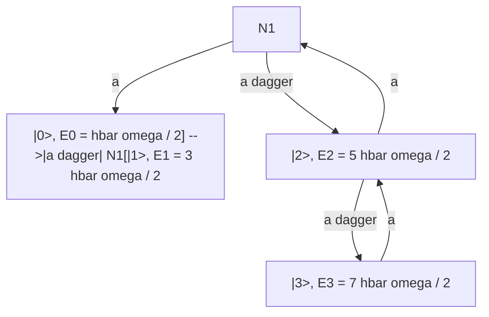

# Harmonic Oscillator with Ladder Operators

The harmonic oscillator is the exactly solvable model that reappears everywhere: molecular vibrations, electromagnetic field modes, phonons, small oscillations near stable equilibria, and coherent states. Its algebraic solution also shows why operators are more than a notation for differential equations.

Sakurai solves the oscillator with ladder operators after developing time evolution and the Heisenberg picture. Ballentine gives both algebraic and coordinate-representation treatments. The Gottfried-named notes include coherent states and uncertainty discussion. Schiff's classic treatment is the differential-equation counterpart, often emphasizing Hermite polynomials and wave functions.

## Factoring the Hamiltonian

The one-dimensional oscillator Hamiltonian is

$$
H={P^2\over 2m}+{1\over 2}m\omega^2X^2.
$$

Define the ladder operators

$$
a=\sqrt{m\omega\over 2\hbar}X+{i\over \sqrt{2m\hbar\omega}}P,
$$

and

$$
a^\dagger=\sqrt{m\omega\over 2\hbar}X-{i\over \sqrt{2m\hbar\omega}}P.
$$

They satisfy

$$
[a,a^\dagger]=1.
$$

The number operator is

$$
N=a^\dagger a.
$$

Solving for $X$ and $P$ gives

$$
X=\sqrt{\hbar\over 2m\omega}(a+a^\dagger),
$$

and

$$
P=-i\sqrt{m\hbar\omega\over 2}(a-a^\dagger).
$$

The Hamiltonian becomes

$$
H=\hbar\omega\left(N+{1\over 2}\right).
$$

The ground state is defined algebraically by

$$
a|0\rangle=0.
$$

## Why the ladder has a bottom

The energy eigenstates $\vert n\rangle$ obey

$$
N|n\rangle=n|n\rangle,
\qquad
H|n\rangle=\hbar\omega\left(n+{1\over 2}\right)|n\rangle,
$$

where $n=0,1,2,\ldots$.

The quantization follows from positivity. For any normalized state,

$$
\langle N\rangle=\langle\psi|a^\dagger a|\psi\rangle
=\|a|\psi\rangle\|^2\geq0.
$$

The commutators

$$
[N,a]=-a,
\qquad
[N,a^\dagger]=a^\dagger
$$

show that $a$ lowers an eigenvalue of $N$ by one and $a^\dagger$ raises it by one. Repeated lowering cannot pass below zero. If the lowest eigenvalue were a noninteger $\nu\gt 0$, another lowering step would eventually produce a negative eigenvalue. Hence the lowest value is zero and every value above it is a nonnegative integer.

The ladder action is

$$
a|n\rangle=\sqrt{n}|n-1\rangle,
\qquad
a^\dagger|n\rangle=\sqrt{n+1}|n+1\rangle.
$$

The zero-point energy

$$
E_0={1\over 2}\hbar\omega
$$

is not optional. If $E_0$ were zero, both kinetic and potential energy expectations would vanish, forcing $\Delta X=\Delta P=0$, which contradicts the uncertainty relation.

In the ground state,

$$
\Delta X=\sqrt{\hbar\over 2m\omega},
\qquad
\Delta P=\sqrt{m\hbar\omega\over 2},
$$

so

$$
\Delta X\Delta P={\hbar\over 2}.
$$

Thus the ground state is a minimum-uncertainty state.

A coherent state $\vert \alpha\rangle$ is an eigenstate of $a$:

$$
a|\alpha\rangle=\alpha|\alpha\rangle.
$$

It can be expanded as

$$
|\alpha\rangle=e^{-|\alpha|^2/2}\sum_{n=0}^{\infty}{\alpha^n\over \sqrt{n!}}|n\rangle.
$$

Under oscillator evolution, $\alpha$ rotates in the complex plane:

$$
\alpha(t)=\alpha(0)e^{-i\omega t}.
$$

Their position and momentum expectation values trace the classical sinusoidal orbit while the quantum widths remain fixed.

## The equally spaced ladder



| Quantity | Expression | Meaning |
|---|---|---|
| Energy | $E_n=\hbar\omega(n+1/2)$ | evenly spaced spectrum |
| Raising | $a^\dagger\vert n\rangle=\sqrt{n+1}\vert n+1\rangle$ | adds one quantum |
| Lowering | $a\vert n\rangle=\sqrt n\vert n-1\rangle$ | removes one quantum |
| Position scale | $\sqrt{\hbar/(m\omega)}$ | natural width scale |
| Coherent probabilities | $P_n=e^{-\vert \alpha\vert ^2}\vert \alpha\vert ^{2n}/n!$ | Poisson number distribution |

## Worked example: matrix element of position

**Problem.** Compute $\langle n+1\vert X\vert n\rangle$ for the oscillator.

**Method.**

1. Use the ladder form of $X$:

$$
X=\sqrt{\hbar\over 2m\omega}(a+a^\dagger).
$$

2. Insert between $\langle n+1\vert $ and $\vert n\rangle$:

$$
\langle n+1|X|n\rangle
=\sqrt{\hbar\over 2m\omega}
\left(\langle n+1|a|n\rangle+\langle n+1|a^\dagger|n\rangle\right).
$$

3. The lowering term gives

$$
a|n\rangle=\sqrt n|n-1\rangle,
$$

so

$$
\langle n+1|a|n\rangle=\sqrt n\langle n+1|n-1\rangle=0.
$$

4. The raising term gives

$$
a^\dagger|n\rangle=\sqrt{n+1}|n+1\rangle,
$$

so

$$
\langle n+1|a^\dagger|n\rangle=\sqrt{n+1}.
$$

5. Therefore

$$
\langle n+1|X|n\rangle
=\sqrt{\hbar\over 2m\omega}\sqrt{n+1}.
$$

**Checked answer.** $X$ only connects neighboring oscillator levels because it is linear in $a$ and $a^\dagger$.

## Worked example: ground-state wavefunction and uncertainty

**Problem.** Show that the oscillator ground state saturates the uncertainty relation.

**Method.**

1. In $\vert 0\rangle$, $a\vert 0\rangle=0$.

In position representation the same condition reads

$$
\left(\sqrt{m\omega\over2\hbar}x
+\sqrt{\hbar\over2m\omega}{d\over dx}\right)\psi_0(x)=0.
$$

Multiplying through by $\sqrt{2m\omega/\hbar}$ gives

$$
{d\psi_0\over dx}=-{m\omega\over\hbar}x\psi_0.
$$

Integration and Gaussian normalization yield

$$
\psi_0(x)=\left({m\omega\over\pi\hbar}\right)^{1/4}
\exp\left(-{m\omega x^2\over2\hbar}\right).
$$

2. Since

$$
X=\sqrt{\hbar\over 2m\omega}(a+a^\dagger),
$$

the mean position is

$$
\langle X\rangle=0
$$

because $\langle0\vert a\vert 0\rangle=\langle0\vert a^\dagger\vert 0\rangle=0$.

3. Compute $X^2$:

$$
X^2={\hbar\over 2m\omega}(a^2+aa^\dagger+a^\dagger a+(a^\dagger)^2).
$$

4. Only $aa^\dagger$ contributes:

$$
\langle0|aa^\dagger|0\rangle=\langle0|(N+1)|0\rangle=1.
$$

Thus

$$
\Delta X=\sqrt{\langle X^2\rangle}=\sqrt{\hbar\over 2m\omega}.
$$

5. Similarly,

$$
P=-i\sqrt{m\hbar\omega\over 2}(a-a^\dagger),
$$

which gives

$$
\Delta P=\sqrt{m\hbar\omega\over 2}.
$$

6. Multiply:

$$
\Delta X\Delta P={\hbar\over 2}.
$$

**Checked answer.** The result reaches the lower bound for $[X,P]=i\hbar$.

## Finite matrix checks and their boundary artifact

```python
import numpy as np

dim = 6
a = np.zeros((dim, dim), dtype=complex)
for n in range(1, dim):
    a[n - 1, n] = np.sqrt(n)
adag = a.conj().T
n_op = adag @ a
h = n_op + 0.5 * np.eye(dim)

print("energies:", np.diag(h).real)
print("<2|a^dagger|1> =", adag[2, 1])
```

The truncated matrices reproduce low-lying elements, but they cannot satisfy $[a,a^\dagger]=I$ exactly in finite dimension. The trace of any finite matrix commutator is zero, while $\mathrm{Tr}(I)$ is nonzero. The discrepancy appears at the highest retained state, so numerical calculations keep that artificial boundary well above the populated levels.

## Algebraic slips to watch for

- Forgetting the zero-point energy. The lowest oscillator energy is not zero.
- Treating $a$ and $a^\dagger$ as commuting variables. Their commutator is the whole reason the spectrum is shifted.
- Applying $a\vert 0\rangle=\sqrt0\vert -1\rangle$ as if $\vert -1\rangle$ were a physical state. The ladder stops at the ground state.
- Losing square-root factors in ladder actions. These factors control transition strengths and normalization.
- Confusing coherent states with number states. Coherent states have uncertain number but classical-like phase-space motion.
- Assuming the oscillator is only a mechanics example. It is the template for quantized normal modes in many-body physics and fields.
- Mixing dimensionless and dimensional $X$, $P$, $a$, and $a^\dagger$ conventions.

The ladder-operator solution is a model for how algebra can replace differential equations. Once $[a,a^\dagger]=1$ is established, the spectrum follows from positivity of $a^\dagger a$, the existence of a lowest state, and repeated laddering. The Hermite-polynomial wave functions are still important, especially for coordinate-space integrals, but they are no longer the only route to the physics. This is the contrast between Sakurai's operator-first style and the older Schiff-style wave-equation path.

Selection rules are another reason the oscillator matters. Since $X$ is proportional to $a+a^\dagger$, a perturbation linear in $X$ connects only neighboring number states. Since $X^2$ contains $a^2$, $(a^\dagger)^2$, and number-conserving terms, it connects states with $\Delta n=0,\pm2$. These rules are not memorized separately; they follow from ladder algebra. Later, angular-momentum selection rules work in a similar way, with ladder operators and tensor structure controlling which matrix elements vanish.

Coherent states should be understood as superpositions rather than slightly fuzzy number states. A coherent state has a Poisson distribution over number eigenstates and a complex amplitude that rotates in time. Its expectation values follow classical oscillator motion while its uncertainties remain minimal, a combination suited to quantum optics and semiclassical field modes.

When checking oscillator calculations, use dimensions. $X$ should scale like $\sqrt{\hbar/(m\omega)}$, $P$ like $\sqrt{m\hbar\omega}$, and energy like $\hbar\omega$. If a matrix element of $X$ is dimensionless or an energy correction has units of length, the algebra has lost a scale factor. Dimensionless oscillator variables are convenient, but they must be declared before use.

The oscillator is also the prototype for normal-mode quantization. A complicated coupled system can often be diagonalized into independent quadratic modes, and each mode behaves like its own oscillator with its own creation and annihilation operators. This is the conceptual bridge to phonons in solids, photons in cavities, and small oscillations in quantum fields. The single-particle oscillator page therefore carries more weight than its elementary appearance suggests.

For perturbation theory, oscillator matrix elements are best computed algebraically. Expand the perturbing power of $X$ in $a$ and $a^\dagger$, commute operators until they act on number states cleanly, and use orthogonality. Coordinate-space integrals with Hermite polynomials are valid, but they are often slower and more error-prone for low-order polynomial perturbations.

As a final check, remember that number states have definite energy but not definite phase, while coherent states have a classical-like phase but uncertain number. Many conceptual errors in oscillator physics come from trying to assign both at once. The algebra makes the tradeoff explicit through noncommuting quadratures and the number-phase structure.

## Number-state wavefunctions and parity

Once the ground-state Gaussian is known, every excited coordinate wavefunction follows by applying the raising operator. In coordinate space that operator combines multiplication by position with differentiation. Repeated application produces a polynomial times the same Gaussian envelope. The polynomials are Hermite polynomials, and their degree equals the number label.

Each raising operation reverses parity because both position and differentiation change parity. The ground state is even, so even number states are even functions and odd number states are odd functions. The number of real-axis nodes equals the excitation number. These facts can be read from the algebra without solving a new differential equation at every energy.

Parity immediately explains many vanishing matrix elements. Position is odd, so its expectation value in any number state is zero. More generally, an odd power of position connects states of opposite parity, while an even power connects states of the same parity. Ladder operators refine the statement by limiting how far the number label can change for a polynomial of a given degree.

The virial theorem supplies another check. In every stationary oscillator state, mean kinetic and mean potential energies are equal. Since their sum is the total energy, each contributes half. A coordinate-space integral that assigns unequal shares to an exact number state contains an algebra or normalization error.

## Coherent states from the displacement operator

A coherent state can be generated by translating the vacuum in phase space. The displacement operator is unitary and contains the raising and lowering operators in an anti-Hermitian combination. Acting on the vacuum and using the Baker–Campbell–Hausdorff relation produces the Poisson-weighted number-state expansion.

The mean occupation in a coherent state is the squared magnitude of its complex amplitude, and the variance has the same value. Consequently the relative number fluctuation decreases as the mean occupation grows. A highly occupied coherent state can have a stable classical amplitude while retaining quantum shot noise.

Its two quadrature variances equal those of the vacuum. Time evolution rotates the center of the Gaussian packet in phase space without changing its shape. In coordinate space, the packet oscillates back and forth with the classical frequency and without spreading. That exceptional lack of spreading relies on the exactly quadratic potential; an anharmonic spectrum gives number components unequal phase advances and distorts the packet.

Coherent states are not mutually orthogonal. Their overlap decays as the phase-space separation grows, but remains nonzero at finite separation. They also form an overcomplete family, so a state can have more than one continuous coherent-state representation. This overcompleteness is useful in quantum optics and path integrals but means coherent states are not an ordinary orthonormal basis.

## Squeezing and unequal quadrature noise

Minimum uncertainty does not require equal position and momentum uncertainties. Squeezed states reduce one quadrature below its vacuum width while increasing the conjugate quadrature so that the uncertainty product respects the lower bound. They can be produced by Hamiltonians quadratic in the raising and lowering operators that do not conserve number.

The phase-space uncertainty region of a coherent state is circular in suitably scaled variables; squeezing turns it into an ellipse. Under ordinary oscillator evolution the ellipse rotates. Under a change of oscillator frequency, a state that was a vacuum for the old frequency can appear squeezed relative to the new ladder operators.

Squeezing clarifies why the ground state is special but not unique as a minimum-uncertainty state. Coherent states share its equal variances and displaced mean values. Squeezed Gaussian states share saturation of the bound with unequal variances. Excited number states have larger uncertainty products and non-Gaussian coordinate densities.

## Perturbations and normal ordering

Polynomial perturbations are handled by rewriting position in ladder form. Noncommutativity means an expression cannot be expanded as if the raising and lowering operators were ordinary variables. Normal ordering moves all raising operators to the left, accumulating commutator terms along the way. Those extra terms contribute to diagonal matrix elements and energy shifts.

For a quartic perturbation, parity eliminates matrix elements between states of opposite parity, while the four ladder factors limit changes in number to a finite set of even steps. The first-order energy correction needs only the diagonal matrix element. Higher orders sample the off-diagonal connections and energy denominators. The algebra exposes the selection pattern before any coefficient is calculated.

Coupled quadratic oscillators follow the same logic after a normal-mode transformation. Diagonalizing the classical quadratic form identifies independent coordinates and frequencies. Quantizing each mode produces one ladder algebra per mode, and the total energy is the sum of their number contributions and zero-point terms. If a frequency tends to zero, the corresponding mode ceases to behave as a confined oscillator and needs separate treatment.

## Sanity checks for oscillator work

Three checks catch most mistakes. Dimensional factors must give position, momentum, and energy their proper units. A polynomial in position must obey the expected parity selection rule. Finally, a matrix element obtained by raising and lowering should have a sensible large-number scaling; position amplitudes grow like the square root of the occupation number, matching the growth of the classical oscillation amplitude at fixed frequency.

Truncated numerical bases need an additional convergence check. Increasing the cutoff should leave the low-energy eigenvalues and observables unchanged. Strong driving, large coherent amplitudes, or anharmonic interactions populate higher number states and demand a larger cutoff. Apparent reflection from the top state or violation of the canonical commutator indicates that the artificial boundary has entered the dynamics.

That tradeoff is why the oscillator remains central in quantum optics.

<div className="see-also">

See also: [One-dimensional Schrodinger systems](/physics/quantum-mechanics/one-dimensional-schrodinger-systems) · [Quantum dynamics and pictures](/physics/quantum-mechanics/quantum-dynamics-pictures) · [Time-independent perturbation theory](/physics/quantum-mechanics/time-independent-perturbation-theory) · [Path integral formulation](/physics/quantum-mechanics/path-integral-formulation) · [Density operator, entanglement, and decoherence](/physics/quantum-mechanics/density-operator-entanglement-decoherence)

</div>
