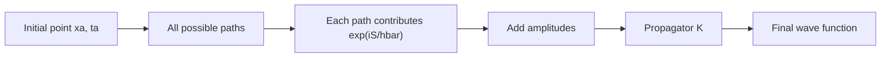

# Path Integral Formulation

The path integral reformulates quantum mechanics as a sum over histories. Instead of solving a differential equation for a wave function or evolving a ket with an operator, one computes an amplitude by adding phase contributions from all paths connecting an initial point to a final point.

Sakurai sketches propagators, composition, and Feynman's formulation after Schrodinger dynamics and WKB. Ballentine introduces path integrals in coordinate-representation applications. The Gottfried-named notes discuss propagators and Feynman's formulation in the dynamics chapter. Schiff's classic book predates the modern path-integral-first style, so its closest connection is through propagators and semiclassical wave mechanics.

## From the propagator to histories

The propagator is the position-space transition amplitude

$$
K(x_b,t_b;x_a,t_a)=\langle x_b|U(t_b,t_a)|x_a\rangle.
$$

It evolves wave functions by

$$
\psi(x_b,t_b)=\int K(x_b,t_b;x_a,t_a)\psi(x_a,t_a)\,dx_a.
$$

The propagator composition law is

$$
K(x_b,t_b;x_a,t_a)=\int dx_c\,
K(x_b,t_b;x_c,t_c)K(x_c,t_c;x_a,t_a)
$$

for $t_a\lt t_c\lt t_b$.

For a Lagrangian

$$
L(x,\dot x,t)=T-V,
$$

the action is

$$
S[x(t)]=\int_{t_a}^{t_b}L(x,\dot x,t)\,dt.
$$

Feynman's formal expression is

$$
K(x_b,t_b;x_a,t_a)=\int \mathcal D[x(t)]\,e^{iS[x(t)]/\hbar}.
$$

The integral is over all paths satisfying the endpoint conditions

$$
x(t_a)=x_a,\qquad x(t_b)=x_b.
$$

## Time slicing and the short-time kernel

Write $T=t_b-t_a=N\epsilon$. For $H=P^2/(2m)+V(X)$, the Trotter product gives

$$
e^{-iH\epsilon/\hbar}
=e^{-iP^2\epsilon/(2m\hbar)}e^{-iV(X)\epsilon/\hbar}
+O(\epsilon^2).
$$

Inserting a momentum identity between the factors and doing the Gaussian momentum integral gives the one-step kernel

$$
K(x_{j+1},t+\epsilon;x_j,t)
\approx
\left({m\over 2\pi i\hbar\epsilon}\right)^{1/2}
\exp\left[{i\epsilon\over\hbar}
\left({m\over2}\left({x_{j+1}-x_j\over\epsilon}\right)^2
-V(x_j)\right)\right].
$$

Multiplying the kernels and integrating over $x_1,\ldots,x_{N-1}$ gives

$$
K=\lim_{N\to\infty}
\left({m\over2\pi i\hbar\epsilon}\right)^{N/2}
\int\prod_{j=1}^{N-1}dx_j\,
\exp\left[{i\epsilon\over\hbar}\sum_{j=0}^{N-1}
\left({m\over2}{(x_{j+1}-x_j)^2\over\epsilon^2}-V(x_j)\right)\right].
$$

The symbols $\mathcal D[x(t)]$ abbreviate this regulated limit; they are not an ordinary translation-invariant measure on an infinite-dimensional space.

For a free particle in one dimension, the exact propagator is

$$
K_0(x_b,t;x_a,0)
=\sqrt{m\over 2\pi i\hbar t}
\exp\left[{im(x_b-x_a)^2\over 2\hbar t}\right].
$$

The exponent is the classical free-particle action divided by $\hbar$:

$$
S_{\mathrm{cl}}={m(x_b-x_a)^2\over 2t}.
$$

In the semiclassical limit, rapidly oscillating phases cancel except near stationary-action paths. This recovers the classical principle

$$
\delta S=0.
$$

That is the conceptual bridge between WKB, classical mechanics, and Feynman's formulation. Sakurai emphasizes this physical meaning: classical motion emerges not because nonclassical paths are absent, but because their phases destructively interfere.

## What interferes in the classical limit

| Formulation | Basic object | Strength | Typical calculation |
|---|---|---|---|
| Schrodinger | wave function $\psi(x,t)$ | differential equations | bound states, direct evolution |
| Heisenberg | operators $A(t)$ | symmetries and conservation | commutators, equations of motion |
| Path integral | histories with $e^{iS/\hbar}$ | semiclassical intuition, field theory | propagators, tunneling estimates |
| WKB | local action phase | approximate spectra and tunneling | slowly varying potentials |

## Worked example: free-particle action and kernel

**Problem.** Find the classical action for a free particle moving from $x_a$ at $t=0$ to $x_b$ at time $t$.

**Method.**

1. The free Lagrangian is

$$
L={1\over2}m\dot x^2.
$$

2. The classical path has constant velocity:

$$
\dot x={x_b-x_a\over t}.
$$

3. Substitute into the Lagrangian:

$$
L_{\mathrm{cl}}={1\over2}m\left({x_b-x_a\over t}\right)^2.
$$

4. Integrate over time:

$$
S_{\mathrm{cl}}=\int_0^t L_{\mathrm{cl}}\,dt'
=t\,{1\over2}m\left({x_b-x_a\over t}\right)^2.
$$

5. Simplify:

$$
S_{\mathrm{cl}}={m(x_b-x_a)^2\over2t}.
$$

**Checked answer.** This is exactly the phase in the free-particle propagator exponent, $e^{iS_{\mathrm{cl}}/\hbar}$.

The prefactor can be fixed without evaluating every sliced integral. Translation invariance and the quadratic action suggest

$$
K_0(x_b,T;x_a,0)=A(T)
\exp\left[{im(x_b-x_a)^2\over2\hbar T}\right].
$$

Requiring the kernel to approach $\delta(x_b-x_a)$ as $T\to0^+$ fixes

$$
A(T)=\sqrt{m\over2\pi i\hbar T},
$$

with the square-root branch chosen continuously from positive time. Direct substitution verifies that $K_0$ satisfies the Schrödinger equation in its final coordinate.

## Worked example: composition as a Gaussian integral

**Problem.** Explain why the free propagator composition integrates over all intermediate positions.

**Method.**

1. Insert an identity at intermediate time $t_c$:

$$
I=\int dx_c\,|x_c\rangle\langle x_c|.
$$

2. Start from

$$
K(x_b,t_b;x_a,t_a)=\langle x_b|U(t_b,t_a)|x_a\rangle.
$$

3. Use time-evolution composition:

$$
U(t_b,t_a)=U(t_b,t_c)U(t_c,t_a).
$$

4. Insert identity:

$$
\begin{aligned}
K
&=\int dx_c\,\langle x_b|U(t_b,t_c)|x_c\rangle
\langle x_c|U(t_c,t_a)|x_a\rangle\\
&=\int dx_c\,K(x_b,t_b;x_c,t_c)K(x_c,t_c;x_a,t_a).
\end{aligned}
$$

5. Repeating this insertion for many time slices gives the path-integral construction.

**Checked answer.** The sum over paths is the repeated resolution of the identity in the position basis.

For free propagation, the integral can be evaluated explicitly. Let $T_1=t_c-t_a$ and $T_2=t_b-t_c$. The exponent is quadratic in $x_c$:

$$
{im\over2\hbar}
\left[{(x_b-x_c)^2\over T_2}+{(x_c-x_a)^2\over T_1}\right].
$$

Completing the square centers the intermediate point at

$$
\bar x_c={T_1x_b+T_2x_a\over T_1+T_2},
$$

the point reached by the classical straight path. The Gaussian integral combines the two prefactors into $\sqrt{m/[2\pi i\hbar(T_1+T_2)]}$ and leaves the phase $im(x_b-x_a)^2/[2\hbar(T_1+T_2)]$. Composition therefore reproduces the free kernel at the total time.

## Where the formalism needs restraint

- Thinking particles literally take every path as a classical trajectory. The path integral is an amplitude rule, not a collection of observed paths.
- Forgetting that the measure $\mathcal D[x(t)]$ is formal in elementary presentations.
- Treating the classical path as the only path. It dominates only in a stationary-phase or semiclassical approximation.
- Dropping normalization factors in propagators when checking unitarity.
- Mixing real-time and imaginary-time path integrals. Wick rotation changes oscillatory phases into exponential weights.
- Applying a naive path integral in coordinates with nontrivial measure without accounting for Jacobians or operator-ordering subtleties.
- Assuming path integrals replace operator methods. They are equivalent when defined carefully and useful for different questions.

The path integral is easiest to trust when it is tied back to operator identities. The repeated insertion of position resolutions of the identity is the concrete origin of the "sum over paths." Each intermediate position is integrated over, and in the limit of many slices the sequence of positions becomes a path. This derivation keeps the formal expression from sounding mystical and shows why the propagator composition law is central.

Stationary phase is the key semiclassical idea. When the action is large compared with $\hbar$, nearby nonstationary paths have rapidly changing phases and cancel in the sum. Paths near $\delta S=0$ have phases that vary slowly, so they contribute coherently. Classical mechanics therefore emerges from interference, not from deleting nonclassical paths by hand. This connects the path-integral page directly to WKB and to the action principle in classical mechanics.

Real-time path integrals are oscillatory and mathematically delicate. Imaginary-time path integrals, obtained by a Wick rotation in suitable systems, replace $e^{iS/\hbar}$ with a decaying exponential weight resembling statistical mechanics. This is powerful for ground-state projection and quantum field theory, but it is not the same object as the real-time transition amplitude. Confusing the two can lead to wrong signs, wrong normalization, and wrong physical interpretation.

Path integrals become indispensable in field theory and many-body physics because they handle perturbation expansions and collective variables naturally. In elementary quantum mechanics they tie amplitudes, action, propagators, and the classical limit into one construction.

A useful way to read the free-particle kernel is to separate phase from normalization. The exponential contains the classical action. The prefactor carries normalization and spreading with time, and its complex phase is needed for exact composition and unitarity. Dropping it may be harmless for rough stationary-phase intuition, but it fails when evolving a normalized wave packet.

Potential terms enter the sliced path integral through short-time approximations, so operator-ordering subtleties can appear when the Hamiltonian is more complicated than $P^2/2m+V(X)$. This is one reason operator methods remain important. A path-integral expression should be checked against the Hamiltonian it claims to represent. In simple Cartesian problems the correspondence is direct; in curved coordinates, constrained systems, or systems with gauge fields, the measure and phase require more care.

Path integrals also clarify tunneling. In real time, tunneling is encoded in oscillatory amplitudes and analytic continuation. In imaginary time, classically forbidden motion can be described by instanton-like paths contributing exponentially small factors. The WKB tunneling exponent then has an action interpretation. Instanton machinery is unnecessary for the elementary construction, but the connection explains why action integrals appear in both WKB and Feynman's formulation.

For ordinary homework problems, the path integral is often most useful as a check on propagators. Verify endpoint limits, composition, and the classical-action phase. If those three features are present, the expression is usually consistent with the operator evolution it represents.

If any one of those checks fails, return to the short-time kernel before trusting the continuum notation.

Normalization matters because amplitudes must compose consistently in time.

## Quadratic actions and fluctuations around the classical path

For a quadratic Lagrangian, write every path as the classical path plus a fluctuation that vanishes at both endpoints. The action separates into the classical action and a quadratic fluctuation term. The linear term vanishes because the classical path satisfies the Euler–Lagrange equation and the endpoint variation is zero.

The fluctuation integral depends on the elapsed time and system parameters but not on the endpoint values. The entire endpoint-dependent phase is therefore the classical action. This explains why both the free-particle and harmonic-oscillator propagators have an exponential of the classical action multiplied by a determinant-like prefactor. For genuinely quadratic systems the stationary-phase result is exact, not merely an asymptotic approximation.

For a nonquadratic potential, expanding around a stationary path generates cubic and higher fluctuation terms. Keeping only the quadratic term gives the semiclassical propagator. Its prefactor measures how nearby classical trajectories spread or focus. At caustics that prefactor needs careful phase tracking, an issue related to the turning-point phases found in WKB.

There may be several classical paths between fixed endpoints. The semiclassical kernel then sums a contribution from each one. Their phases can interfere, so the classical limit need not mean that one path is selected. Optics provides a close analogy: several stationary optical paths can create interference even when the wavelength is short.

## Imaginary time and ground-state projection

Set real time equal to minus an imaginary interval. The oscillatory evolution operator becomes a decaying exponential of the Hamiltonian. Expanding an initial state in energy eigenstates shows that every excited component is suppressed relative to the ground state as the imaginary interval grows, provided the initial state has nonzero ground-state overlap.

This gives a route to ground-state calculations. The imaginary-time kernel resembles a statistical-mechanical Boltzmann weight, with the Euclidean action replacing energy divided by temperature. The correspondence connects a quantum system in one spatial dimension to a classical statistical system with one additional Euclidean-time dimension.

The rotation is more than a substitution in a final formula. Boundary conditions, convergence prescriptions, and analytic structure must permit the continuation. Returning to real time can be ill-conditioned because exponential data do not retain oscillatory phase information in a numerically stable way.

Tunneling becomes geometrically clearer in Euclidean time. Motion through a classically forbidden region can correspond to a real stationary path of the Euclidean action. Its positive action supplies an exponentially small weight. The exponent agrees with the leading WKB barrier integral when both approximations apply.

## Sources and correlation functions

Adding an external source linearly coupled to the coordinate creates a generating functional. Differentiating it with respect to the source inserts coordinate factors into the path integral. Repeated derivatives produce time-ordered correlation functions. This bookkeeping device becomes central in field theory, where the coordinate is replaced by a field and correlations encode propagation and response.

The time ordering appears automatically because the path integral represents the time-evolution operator split into ordered slices. Equal-time conventions can still matter, especially when momenta or derivative couplings are present. Operator derivations remain the safest reference for resolving such contact terms.

Perturbation theory can also be organized by expanding the exponential of the interaction action around a solvable quadratic theory. Gaussian averages pair fields or coordinates, producing the same series as the interaction-picture Dyson expansion. Diagrammatic methods are compact records of those pairings rather than an additional dynamical postulate.

## Coordinate choices and measures

Cartesian coordinates with a standard kinetic term hide many measure issues. In polar or curved coordinates, the configuration-space volume element carries coordinate-dependent factors. A careless continuum symbol can miss those Jacobians or generate an incorrect quantum potential. Deriving the sliced measure from a known operator Hamiltonian avoids guessing.

Gauge systems introduce redundancy: different paths in configuration space may represent the same physical history. Integrating over all redundant descriptions multiplies the result by an infinite gauge volume unless a gauge condition and its associated measure are supplied. Ordinary particle mechanics with an electromagnetic vector potential already hints at the issue through path-dependent phases, while full gauge fixing belongs to field theory.

The path integral and canonical quantization are equivalent only after their domains, measures, ordering, and boundary conditions are matched. In simple one-dimensional Cartesian problems those choices are nearly invisible. Their reappearance in more complicated systems is a warning against treating the formal continuum notation as self-defining.

See also: [Quantum dynamics and pictures](/physics/quantum-mechanics/quantum-dynamics-pictures) · [One-dimensional Schrodinger systems](/physics/quantum-mechanics/one-dimensional-schrodinger-systems) · [Variational principle and WKB](/physics/quantum-mechanics/variational-principle-wkb) · [Scattering theory](/physics/quantum-mechanics/scattering-theory) · [Measurement and interpretation](/physics/quantum-mechanics/measurement-interpretation)

