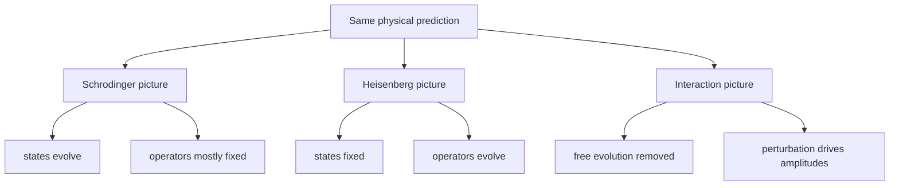

# Quantum Dynamics and Pictures

Quantum dynamics describes how probability amplitudes change between preparations and measurements. The same physics can be represented in several pictures: in the Schrodinger picture states move, in the Heisenberg picture operators move, and in the interaction picture both share the work in a way designed for perturbation theory.

Sakurai develops the time-evolution operator first, then compares pictures and applies the result to spin precession, Ehrenfest's theorem, and transition amplitudes. Ballentine puts dynamics inside a broader symmetry and transformation framework. The Gottfried-named notes emphasize propagators and density operators soon after the picture change. Schiff's wave-mechanics tradition corresponds most directly to Schrodinger's differential equation in coordinate representation.

## Unitary evolution before choosing a picture

The **time-evolution operator** satisfies

$$
|\psi(t)\rangle=U(t,t_0)|\psi(t_0)\rangle.
$$

For a closed system,

$$
U^\dagger(t,t_0)U(t,t_0)=I.
$$

If the Hamiltonian is time independent,

$$
U(t,t_0)=e^{-iH(t-t_0)/\hbar}.
$$

If $H(t)$ depends on time and does not commute with itself at different times, the formal solution uses time ordering:

$$
U(t,t_0)=\mathcal T\exp\left[-{i\over\hbar}\int_{t_0}^{t}H(t')\,dt'\right].
$$

The need for $\mathcal T$ appears already at second order. Direct iteration of the Schrödinger equation produces

$$
U(t,t_0)=I-{i\over\hbar}\int_{t_0}^t dt_1H(t_1)
+\left(-{i\over\hbar}\right)^2
\int_{t_0}^t dt_1\int_{t_0}^{t_1}dt_2H(t_1)H(t_2)+\cdots.
$$

The later-time operator stands to the left. If all $H(t)$ commute, the triangular integration regions combine into the ordinary exponential of the integral. Otherwise, exchanging the order changes the product.

## Moving time dependence between states and operators

In the **Schrodinger picture**, states carry time dependence:

$$
i\hbar {d\over dt}|\psi_S(t)\rangle=H_S|\psi_S(t)\rangle,
$$

while operators are fixed unless they have explicit time dependence.

In the **Heisenberg picture**,

$$
|\psi_H\rangle=|\psi_S(t_0)\rangle,
\qquad
A_H(t)=U^\dagger(t,t_0)A_S U(t,t_0).
$$

In the **interaction picture**, split $H=H_0+V(t)$ and define

$$
|\psi_I(t)\rangle=e^{iH_0(t-t_0)/\hbar}|\psi_S(t)\rangle,
$$

with

$$
V_I(t)=e^{iH_0(t-t_0)/\hbar}V(t)e^{-iH_0(t-t_0)/\hbar}.
$$

## Equations of motion and conserved quantities

The Heisenberg equation of motion is

$$
{dA_H\over dt}={i\over\hbar}[H_H,A_H]+\left({\partial A_S\over\partial t}\right)_H.
$$

If $A$ has no explicit time dependence and $[A,H]=0$, then $A$ is conserved. This is the operator version of conservation laws, and it prepares the later symmetry page.

Expectation values are picture independent:

$$
\langle \psi_S(t)|A_S|\psi_S(t)\rangle
=\langle \psi_H|A_H(t)|\psi_H\rangle.
$$

Ehrenfest's theorem follows by applying the Heisenberg equation to $X$ and $P$ for

$$
H={P^2\over 2m}+V(X).
$$

The result is

$$
{d\over dt}\langle X\rangle={\langle P\rangle\over m},
\qquad
{d\over dt}\langle P\rangle=-\left\langle {dV\over dX}\right\rangle.
$$

This resembles Newton's law, but it is not identical unless the wave packet is narrow enough or the force is linear.

The interaction-picture state obeys

$$
i\hbar {d\over dt}|\psi_I(t)\rangle=V_I(t)|\psi_I(t)\rangle.
$$

Iterating this integral equation gives the Dyson series:

$$
\begin{aligned}
|\psi_I(t)\rangle
&=|\psi_I(t_0)\rangle
-{i\over\hbar}\int_{t_0}^{t}dt_1\,V_I(t_1)|\psi_I(t_0)\rangle\\
&\quad+\left(-{i\over\hbar}\right)^2
\int_{t_0}^{t}dt_1\int_{t_0}^{t_1}dt_2\,V_I(t_1)V_I(t_2)|\psi_I(t_0)\rangle+\cdots.
\end{aligned}
$$

Changing pictures does not change the experiment; it changes where the time dependence is stored. More generally, for a time-dependent unitary change of representation $W(t)$,

$$
|\psi'\rangle=W|\psi\rangle,
$$

the transformed Hamiltonian is

$$
H'=WHW^\dagger+i\hbar\dot W W^\dagger.
$$

The second term is easy to miss. Taking $W=e^{iH_0(t-t_0)/\hbar}$ gives the interaction-picture Hamiltonian $V_I(t)$ after cancellation of the free part.

## Comparing the three standard pictures

| Picture | State | Operator | Best use |
|---|---|---|---|
| Schrodinger | $\vert \psi_S(t)\rangle$ | $A_S$ | wave functions, spectra, direct time evolution |
| Heisenberg | fixed $\vert \psi_H\rangle$ | $A_H(t)$ | conservation laws, commutators, field theory style |
| Interaction | $\vert \psi_I(t)\rangle$ from $V_I$ | $A_I(t)$ from $H_0$ | perturbation theory and transitions |

## Worked example: free-particle motion in the Heisenberg picture

**Problem.** For

$$
H={P^2\over 2m},
$$

show that the Heisenberg operator $X_H(t)$ moves linearly in time.

**Method.**

1. Use the Heisenberg equation:

$$
{dX_H\over dt}={i\over\hbar}[H,X_H].
$$

2. Compute the commutator using $[X,P]=i\hbar$ or $[P,X]=-i\hbar$:

$$
[P^2,X]=P[P,X]+[P,X]P=-2i\hbar P.
$$

3. Therefore

$$
[H,X]={1\over 2m}[P^2,X]=-{i\hbar\over m}P.
$$

4. Substitute:

$$
{dX_H\over dt}={i\over\hbar}\left(-{i\hbar\over m}P_H\right)={P_H\over m}.
$$

5. Since

$$
{dP_H\over dt}={i\over\hbar}[H,P_H]=0,
$$

integrate:

$$
X_H(t)=X_H(0)+{P_H(0)\over m}t.
$$

**Checked answer.** Taking expectation values gives $\langle X\rangle(t)=\langle X\rangle(0)+\langle P\rangle t/m$, the quantum analogue of uniform classical motion.

## Worked example: two-level phase evolution

**Problem.** Let

$$
H={\hbar\Omega\over 2}\sigma_z,
\qquad
|\psi(0)\rangle={1\over \sqrt2}(|+z\rangle+|-z\rangle).
$$

Find $\vert \psi(t)\rangle$ and $\langle S_x\rangle(t)$.

**Method.**

1. The time-evolution operator is

$$
U(t)=\begin{pmatrix}e^{-i\Omega t/2}&0\\0&e^{i\Omega t/2}\end{pmatrix}.
$$

2. Apply it to the initial state:

$$
|\psi(t)\rangle={1\over \sqrt2}\left(e^{-i\Omega t/2}|+z\rangle+e^{i\Omega t/2}|-z\rangle\right).
$$

3. Use

$$
S_x={\hbar\over 2}\begin{pmatrix}0&1\\1&0\end{pmatrix}.
$$

4. Compute the expectation:

$$
\begin{aligned}
\langle S_x\rangle
&={\hbar\over 2}\left({1\over 2}e^{i\Omega t}+{1\over 2}e^{-i\Omega t}\right)\\
&={\hbar\over 2}\cos(\Omega t).
\end{aligned}
$$

**Checked answer.** The $z$ probabilities remain $1/2$ and $1/2$, while the relative phase produces oscillation in the $x$ expectation value.

The same result can be obtained with a fixed state and evolving operator. Since

$$
S_{x,H}(t)=e^{i\Omega t\sigma_z/2}S_xe^{-i\Omega t\sigma_z/2},
$$

Pauli-matrix multiplication gives

$$
S_{x,H}(t)=S_x\cos\Omega t-S_y\sin\Omega t.
$$

The initial $\vert +x\rangle$ state has $\langle S_x\rangle=\hbar/2$ and $\langle S_y\rangle=0$, reproducing the Schrödinger-picture answer.

## Sign and ordering errors

- Thinking the three pictures are different theories. They are equivalent representations of the same amplitudes.
- Applying $e^{-iHt/\hbar}$ when $H(t_1)$ and $H(t_2)$ do not commute. Time ordering is then required.
- Dropping explicit time dependence in the Heisenberg equation. The partial derivative term matters for driven observables.
- Assuming Ehrenfest's theorem always reproduces one exact classical trajectory. It does so only in special limits.
- Forgetting that interaction-picture operators evolve with $H_0$, not the full Hamiltonian.
- Confusing conservation of an operator with conservation of a particular measurement outcome. Conservation means the distribution is stationary for that observable under the stated Hamiltonian.
- Losing unitarity in numerical time stepping. If a simulation changes the norm of a closed-system state, the integrator or approximation needs checking.

The most practical way to choose a picture is to identify what is simple. If the state has a simple initial expansion and the Hamiltonian is diagonal, the Schrodinger picture is usually direct. If the question asks how observables move or whether a quantity is conserved, the Heisenberg picture exposes the commutator structure. If the Hamiltonian splits into a solvable large part plus a weak time-dependent part, the interaction picture removes the trivial phases and leaves only transition-producing terms.

Picture independence is a useful error check. If a probability or expectation value is physical, it cannot depend on where the time dependence was placed. For example, a spin precession result computed by evolving the spinor must agree with the result computed by rotating the spin operator. If the answers differ, common causes include using $U$ instead of $U^\dagger$ in the Heisenberg operator, losing a sign in the exponent, or forgetting that bras evolve with the adjoint.

Time-dependent Hamiltonians require more care than the compact notation suggests. The expression $e^{-i\int Hdt/\hbar}$ is valid only when Hamiltonians at different times commute or when time ordering is included. This issue is not pedantic: driven two-level systems, magnetic resonance, and perturbation theory all involve operators whose values at different times may fail to commute. Sakurai's development of the time-evolution operator makes this point structurally clear.

Numerical dynamics should respect the same structure. Exact closed-system evolution is unitary, so a finite-step approximation that steadily changes the norm violates a core physical constraint. For small matrices, exponentiating a Hermitian Hamiltonian gives a unitary step. For differential wave equations, unitary or norm-preserving schemes are preferable when long-time phase accuracy matters.

A final check is to distinguish time dependence of phases from time dependence of probabilities. Energy eigenstates acquire phases, but their energy measurement probabilities do not change under a time-independent Hamiltonian. Superpositions acquire relative phases, and those phases can change probabilities for other observables. Spin precession and two-level interference are direct manifestations of that evolution.

When a problem includes measurement at an intermediate time, split the calculation into unitary pieces separated by state-update rules. Do not evolve through a measurement as if it were just another Hamiltonian interval unless the measurement interaction is explicitly modeled.

## Propagators and spectral evolution

For a time-independent Hamiltonian with a complete energy basis, the evolution operator has a spectral expansion in which each energy projector acquires its own phase. Expanding an initial state in that basis therefore reduces evolution to phase bookkeeping. Energy probabilities remain fixed, while observables that connect different energies can oscillate at their energy-difference frequencies.

The position-space matrix element of the evolution operator is the propagator. Inserting a position identity lets it evolve a wavefunction; inserting an energy identity expresses it as a sum or integral over stationary states. These two expansions are useful in different regimes. The energy sum is efficient when the spectrum is known, while direct propagation may be better for a localized packet or a time-dependent potential.

Composition in time follows from operator multiplication. The propagator over a long interval equals an integral over every intermediate position of the product of two shorter propagators. Unitarity gives a second identity: integrating a kernel times its complex conjugate over the final coordinate returns a delta function in the initial coordinates. These are strong checks on proposed kernels.

An overall phase on a state has no observable effect, but dynamical phases become relative when several energy components are present. Degenerate components acquire the same phase under the unperturbed Hamiltonian and do not dephase relative to one another. A perturbation that splits the degeneracy introduces new beat frequencies.

## Ehrenfest's theorem and its limits

The first Ehrenfest equation has the classical form for the standard kinetic energy. The second contains the expectation value of the force, not necessarily the force evaluated at the mean position. They agree for constant or linear forces, and also for a quadratic potential because its force is linear. The center of a harmonic-oscillator packet consequently follows the exact classical equation even when the packet is broad.

For a nonlinear force, expand it around the mean position. Corrections involve the position variance and higher central moments. A narrow packet can follow an approximately classical trajectory for a while, but spreading and nonlinear dynamics can eventually invalidate the approximation. Classical motion of the mean is therefore a controlled statement about both the potential and the state.

Quantum dynamics also governs the moments themselves. The time derivative of the position variance couples to a position–momentum covariance, and the covariance couples to momentum variance and force gradients. For quadratic Hamiltonians this hierarchy closes at second order; for nonquadratic systems it extends to higher moments. Gaussian states remain Gaussian under quadratic evolution because of that closure.

## Sudden and adiabatic changes

Two opposite time scales organize many driven problems. In a sudden change, the Hamiltonian varies so quickly that the state has little time to evolve during the switch. Immediately afterward the ket is essentially unchanged, but its expansion in the new energy basis can contain many levels. Subsequent phases then produce nontrivial motion.

In an adiabatic change, a nondegenerate eigenstate follows the corresponding instantaneous eigenspace when the Hamiltonian varies slowly compared with the relevant inverse gaps. Besides the ordinary dynamical phase, the state can acquire a geometric phase determined by the path of the eigenspace in parameter space. Near degeneracies the required slowness becomes more demanding.

Slow does not mean that the perturbation is weak, and sudden does not mean that its final size is small. These approximations concern switching time relative to internal dynamical scales. A large Hamiltonian change can be adiabatic if performed sufficiently slowly, while a tiny change can be sudden if applied sufficiently fast.

## Density operators in different pictures

Mixed states transform between pictures by the same unitary conjugations as pure-state projectors. In the Schrödinger picture the density operator obeys the von Neumann equation. In the Heisenberg picture a closed-system density operator is fixed and observables evolve. The trace of their product gives the same expectation value in either description.

Unitary evolution preserves the eigenvalues of the density operator and hence its entropy and purity. Apparent loss of purity for a subsystem arises after another subsystem is traced out, not from the unitary picture change. Open-system master equations can produce nonunitary reduced evolution, but their generators must preserve trace and positivity if they are to describe valid states.

Correlation functions often favor the Heisenberg picture. A two-time expression contains operators at different times acting on one fixed state. Its time ordering and commutators encode response and fluctuations. Equal-time expectation values alone do not determine such dynamical correlations.

## Choosing a numerical propagator

A first-order Euler step applied to the Schrödinger equation is generally not unitary and accumulates norm error. Exponentiating a Hermitian matrix gives an exactly unitary finite step when the Hamiltonian is constant over that step. For large sparse systems, Krylov methods approximate the action of the exponential without forming a dense matrix.

Split-operator methods alternate kinetic and potential exponentials and use Fourier transforms to move between their diagonal representations. Their error comes from noncommutativity and can be reduced with a symmetric ordering. Time-dependent Hamiltonians require steps short enough to resolve the drive and may need midpoint or Magnus-based approximations to retain geometric structure.

Norm conservation alone is not a complete accuracy test. A unitary method can still accumulate phase error or fail to resolve a resonance. Convergence should be checked by reducing the time step and monitoring the observables relevant to the problem, along with any exactly conserved quantities.

## Related pages

- [Postulates of quantum mechanics](/physics/quantum-mechanics/postulates-of-quantum-mechanics)
- [Spin-1/2 systems](/physics/quantum-mechanics/spin-one-half-systems)
- [Symmetries and conservation laws](/physics/quantum-mechanics/symmetries-conservation-laws)
- [Time-dependent perturbation theory](/physics/quantum-mechanics/time-dependent-perturbation-theory)
- [Path integral formulation](/physics/quantum-mechanics/path-integral-formulation)
