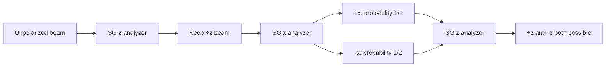

# Spin-1/2 Systems

Spin-1/2 is the smallest nontrivial quantum laboratory. Its Hilbert space is two-dimensional, but it already contains incompatible observables, sequential measurement effects, unitary rotations, density matrices, entanglement, and the difference between amplitudes and probabilities. Stern–Gerlach analyzers expose that structure without a differential equation.

Sakurai's treatment is operational and experimental: beams split, recombine, and reveal the logic of spin states. Ballentine returns to spin for measurement and state preparation, emphasizing what is inferred from repeated preparations. The Gottfried-named notes use spin-1/2 as a clean illustration of the postulates and density matrices. Schiff's older notation usually reaches spin after wave mechanics, so the contrast is mainly pedagogical.

## Pauli algebra and spin directions

The standard $S_z$ basis is

$$
|+z\rangle=\begin{pmatrix}1\\0\end{pmatrix},
\qquad
|-z\rangle=\begin{pmatrix}0\\1\end{pmatrix}.
$$

The Pauli matrices are

$$
\sigma_x=\begin{pmatrix}0&1\\1&0\end{pmatrix},\quad
\sigma_y=\begin{pmatrix}0&-i\\i&0\end{pmatrix},\quad
\sigma_z=\begin{pmatrix}1&0\\0&-1\end{pmatrix}.
$$

Spin operators are

$$
S_i={\hbar\over 2}\sigma_i,\qquad i=x,y,z.
$$

They satisfy

$$
[S_i,S_j]=i\hbar\epsilon_{ijk}S_k,
$$

and

$$
S^2=S_x^2+S_y^2+S_z^2={3\hbar^2\over 4}I.
$$

A general normalized spinor can be written, up to global phase, as

$$
|\mathbf n,+\rangle
=\cos{\theta\over 2}|+z\rangle
 +e^{i\phi}\sin{\theta\over 2}|-z\rangle,
$$

where $\mathbf n$ is a unit vector on the Bloch sphere:

$$
\mathbf n=(\sin\theta\cos\phi,\sin\theta\sin\phi,\cos\theta).
$$

The observable for spin along $\mathbf n$ is

$$
S_{\mathbf n}={\hbar\over 2}\mathbf n\cdot\boldsymbol{\sigma}.
$$

To verify the quoted spinor, write

$$
\mathbf n\cdot\boldsymbol\sigma=
\begin{pmatrix}
\cos\theta&e^{-i\phi}\sin\theta\\
e^{i\phi}\sin\theta&-\cos\theta
\end{pmatrix}.
$$

Multiplication by the column $(\cos(\theta/2),e^{i\phi}\sin(\theta/2))^T$ returns the same column. The half-angles follow from the identities $1+\cos\theta=2\cos^2(\theta/2)$ and $\sin\theta=2\sin(\theta/2)\cos(\theta/2)$. An orthogonal eigenvector with eigenvalue $-1$ is

$$
|\mathbf n,-\rangle
=-e^{-i\phi}\sin{\theta\over2}|+z\rangle
+\cos{\theta\over2}|-z\rangle,
$$

up to an overall phase.

## Projectors, probabilities, and rotations

The Pauli matrices obey

$$
\sigma_i\sigma_j=\delta_{ij}I+i\epsilon_{ijk}\sigma_k.
$$

This identity makes two-level calculations compact. For any unit vector $\mathbf n$,

$$
(\mathbf n\cdot\boldsymbol{\sigma})^2=I,
$$

so $S_{\mathbf n}$ has eigenvalues $\pm\hbar/2$.

The projectors onto spin up and down along $\mathbf n$ are

$$
P_{\mathbf n,\pm}={1\over 2}(I\pm \mathbf n\cdot\boldsymbol{\sigma}).
$$

If a state has Bloch vector $\mathbf r$, with density matrix

$$
\rho={1\over 2}(I+\mathbf r\cdot\boldsymbol{\sigma}),
$$

then

$$
P(+\mathbf n)=\mathrm{Tr}(\rho P_{\mathbf n,+})={1+\mathbf r\cdot \mathbf n\over 2}.
$$

The trace formula follows from

$$
\mathrm{Tr}(\sigma_i)=0,
\qquad
\mathrm{Tr}(\sigma_i\sigma_j)=2\delta_{ij}.
$$

Expanding the product of $\rho$ and $P_{\mathbf n,+}$ leaves a constant term $1/2$ and the scalar product $\mathbf r\cdot\mathbf n/2$. For two pure directions $\mathbf r$ and $\mathbf n$ separated by an angle $\gamma$,

$$
P(+\mathbf n|+\mathbf r)={1+\cos\gamma\over2}=\cos^2{\gamma\over2}.
$$

The angular separation of Bloch vectors is therefore twice the angle that appears in spinor amplitudes.

For a pure state, $\vert \mathbf r\vert =1$. For a mixed state, $0\leq \vert \mathbf r\vert \lt 1$. The completely unpolarized beam has $\rho=I/2$ and gives $P(+\mathbf n)=1/2$ for every analyzer direction.

Rotations are represented by

$$
U(R_{\mathbf n}(\theta))=\exp\left(-{i\theta\over 2}\mathbf n\cdot\boldsymbol{\sigma}\right)
=I\cos{\theta\over 2}-i(\mathbf n\cdot\boldsymbol{\sigma})\sin{\theta\over 2}.
$$

The half-angle is essential. A $2\pi$ rotation changes a spinor sign, although all single-state probabilities remain unchanged. Sakurai uses this feature to emphasize that spin is not a tiny classical spinning ball.

The closed form for $U$ follows by expanding the exponential. Even powers of $\mathbf n\cdot\boldsymbol\sigma$ equal $I$ and odd powers equal $\mathbf n\cdot\boldsymbol\sigma$, so the series groups into cosine and sine. At $\theta=2\pi$, $U=-I$; at $4\pi$, $U=I$. A global minus sign cannot be seen in measurements on one branch, but a relative sign can be detected interferometrically.

In a magnetic field with Hamiltonian

$$
H=-\boldsymbol{\mu}\cdot\mathbf B=-\gamma\mathbf S\cdot\mathbf B,
$$

the Bloch vector precesses about $\mathbf B$ at the Larmor frequency $\omega=\vert \gamma\vert B$ up to sign convention. This connects the algebra of Pauli matrices to magnetic resonance and two-level dynamics.

## Sequential analyzers as state preparation

| Direction | Spin-up ket in $S_z$ basis | Spin-down ket in $S_z$ basis |
|---|---|---|
| $z$ | $\begin{pmatrix}1\\0\end{pmatrix}$ | $\begin{pmatrix}0\\1\end{pmatrix}$ |
| $x$ | ${1\over\sqrt2}\begin{pmatrix}1\\1\end{pmatrix}$ | ${1\over\sqrt2}\begin{pmatrix}1\\-1\end{pmatrix}$ |
| $y$ | ${1\over\sqrt2}\begin{pmatrix}1\\i\end{pmatrix}$ | ${1\over\sqrt2}\begin{pmatrix}1\\-i\end{pmatrix}$ |

## Worked example: sequential Stern–Gerlach analyzers

**Problem.** A beam is prepared in $\vert +z\rangle$. It passes through an $S_x$ analyzer, and only the $+x$ output is kept. That beam then passes through an $S_z$ analyzer. What are the final $S_z$ probabilities?

**Method.**

1. Express $\vert +z\rangle$ in the $x$ basis:

$$
|+z\rangle={1\over \sqrt2}|+x\rangle+{1\over \sqrt2}|-x\rangle.
$$

2. The probability to pass the $+x$ selection is

$$
P(+x|+z)=|\langle +x|+z\rangle|^2={1\over 2}.
$$

3. Conditional on being selected, the state is now $\vert +x\rangle$.

4. Expand $\vert +x\rangle$ in the $z$ basis:

$$
|+x\rangle={1\over \sqrt2}|+z\rangle+{1\over \sqrt2}|-z\rangle.
$$

5. Therefore

$$
P(+z|+x)=P(-z|+x)={1\over 2}.
$$

**Checked answer.** The final $S_z$ result is not certainly $+\hbar/2$. The intermediate incompatible $S_x$ selection changed the state. This is the central lesson of Sakurai's sequential Stern-Gerlach discussion.

## Worked example: precession in a $z$-directed magnetic field

**Problem.** A spin starts in $\vert +x\rangle$ and evolves under

$$
H={\hbar\omega\over 2}\sigma_z.
$$

Find the probability of measuring $+x$ at time $t$.

**Method.**

1. Write the initial state:

$$
|+x\rangle={1\over \sqrt2}\begin{pmatrix}1\\1\end{pmatrix}.
$$

2. The evolution operator is

$$
U(t)=e^{-iHt/\hbar}
=\begin{pmatrix}e^{-i\omega t/2}&0\\0&e^{i\omega t/2}\end{pmatrix}.
$$

3. Evolve the state:

$$
|\psi(t)\rangle={1\over \sqrt2}\begin{pmatrix}e^{-i\omega t/2}\\e^{i\omega t/2}\end{pmatrix}.
$$

4. Project onto $\vert +x\rangle$:

$$
\begin{aligned}
\langle +x|\psi(t)\rangle
&={1\over 2}\left(e^{-i\omega t/2}+e^{i\omega t/2}\right)\\
&=\cos{\omega t\over 2}.
\end{aligned}
$$

5. Square the modulus:

$$
P(+x,t)=\cos^2{\omega t\over 2}.
$$

**Checked answer.** At $t=0$, the probability is $1$. At $\omega t=\pi$, the spin has rotated to $\vert -x\rangle$ and the probability is $0$.

## Basis and phase mistakes

- Calling spin-up along one axis the same state as spin-up along another axis. $\vert +z\rangle$ and $\vert +x\rangle$ are different states.
- Forgetting that Stern-Gerlach selection is state preparation, not passive observation.
- Losing the factor of $1/2$ in spin rotations. Spinors rotate with $e^{-i\theta\sigma/2}$.
- Treating the sign change under a $2\pi$ spinor rotation as directly observable for a single isolated spin state. It becomes observable through interference.
- Using Pauli matrices without the $\hbar/2$ factor when computing physical angular momentum.
- Confusing a mixed unpolarized beam with a coherent superposition. $\rho=I/2$ is not the same preparation as $(\vert +z\rangle+\vert -z\rangle)/\sqrt2$.
- Expecting repeated incompatible measurements to preserve earlier information. An $S_x$ selection erases definite $S_z$ preparation in the projective model.

Spin-1/2 calculations are often short enough that students skip the physical story, but the story is what prevents sign and basis errors. Always name the preparation axis, the measurement axis, and whether a beam is selected or recombined. A selected $+x$ beam is a new preparation. A recombined pair of beams can restore interference if relative phase information has been preserved. Sakurai's sequential Stern-Gerlach examples are built around exactly this distinction.

The Bloch-sphere picture is powerful but has limits. Every pure spin-1/2 state corresponds to a point on the sphere, and every mixed spin-1/2 state corresponds to a point inside it. That picture does not mean the spin is a tiny arrow already pointing in that direction before measurement. It means the state assigns probabilities for all possible spin-axis measurements by the rule $P(+\mathbf n)=(1+\mathbf r\cdot\mathbf n)/2$. Ballentine's ensemble language is a useful guardrail: the vector summarizes preparation statistics, not necessarily hidden classical orientation.

When using Pauli matrices, keep track of whether you are computing dimensionless matrix algebra or physical angular momentum. The matrices $\sigma_i$ have eigenvalues $\pm1$, while $S_i$ has eigenvalues $\pm\hbar/2$. Rotation operators use $\sigma_i/2$ in the exponent for spin-1/2, and Hamiltonians use the physical magnetic moment, which may introduce signs through charge and gyromagnetic ratio. Many wrong Larmor-precession answers are only sign-convention mistakes, but those signs matter when comparing to an experiment.

Spin also previews later themes. Two spin-$1/2$ systems decompose into singlet and triplet sectors, giving the simplest nontrivial example of angular-momentum addition. The singlet supplies a clean Bell-correlation example, while mixed spin beams give the shortest introduction to density matrices.

One must also distinguish an unpolarized ensemble from a beam with an unknown but fixed polarization. The former is represented by $I/2$ and remains unpolarized under every unitary rotation. The latter carries classical uncertainty about a definite preparation parameter and may reveal correlations across repeated trials. Density operators coincide only when the averaging procedure erases every operational distinction available to the experimenter.

## What a Stern–Gerlach apparatus measures

The magnetic force in an inhomogeneous field depends on the component of magnetic moment along the field gradient. A spin-half beam therefore separates into two spatial packets. The apparatus correlates an internal spin alternative with a path, after which blocking one path prepares the corresponding spin state.

An ideal analyzer is often drawn as if it instantaneously reads a preexisting component. The more accurate quantum model is a unitary correlation between spin and apparatus position followed, if a path is selected or detected, by conditioning on that record. If the paths are recombined coherently with their relative phase preserved, the splitting need not act as an irreversible measurement.

Sequential analyzers distinguish compatible repetition from incompatible preparation. Passing a selected vertical-up beam through another vertical analyzer repeats the same result with certainty. Inserting a horizontal selection creates a new state and restores equal vertical probabilities. An analyzer with a general relative angle gives a cosine-squared half-angle probability, directly matching the Bloch-sphere overlap formula.

The spatial separation also carries momentum and phase information that idealized spin-only diagrams suppress. Poorly recombined paths can lose interference because the spin becomes entangled with uncontrolled spatial degrees of freedom. The resulting reduced spin state may look mixed even though the full spin-position state remains pure.

## Rotations as physical dynamics

A static magnetic field generates a rotation about its direction. The sign of the precession depends on the gyromagnetic ratio, which includes the sign of the particle's magnetic moment. It is safer to derive the evolution from the stated Hamiltonian than to memorize a clockwise or counterclockwise rule.

A pulse perpendicular to the static field rotates the Bloch vector by an angle set by pulse area. A pulse producing a half turn exchanges the two basis populations, while a quarter-turn pulse creates an equal superposition with a phase fixed by the pulse axis. Magnetic-resonance sequences are built by composing such rotations with free precession.

Rotations about different axes do not commute. Performing a horizontal rotation and then a vertical rotation generally differs from reversing the order. For small angles, the difference is controlled by the Pauli commutator and corresponds geometrically to a rotation about the third axis. This gives a direct two-dimensional representation of the noncommutative rotation group.

Any two-level Hamiltonian can be written as a scalar multiple of the identity plus an effective vector dotted into the Pauli matrices. The scalar contributes only a common phase. The vector sets both the energy splitting and the rotation axis on the Bloch sphere. Many systems with no literal spin, including two atomic levels or coupled modes, therefore use spin-half mathematics.

## Expectation values and uncertainty

For a pure state with Bloch direction $\mathbf r$, the mean spin vector is $\hbar\mathbf r/2$. The variance of a component along a unit direction $\mathbf n$ is determined by one minus the squared projection of the two directions. The component parallel to the Bloch vector is sharp; every perpendicular component has zero mean and maximal spin-half variance.

The uncertainty relation between two components contains the mean of the third. A vertical-up state saturates the relation for the two transverse components. A state with zero mean along the commutator direction can make the lower bound vanish even though both observables remain uncertain, so the inequality's lower bound is not always an informative measure of incompatibility.

State tomography reconstructs the Bloch vector by measuring ensembles along three independent axes. The sample mean of each Pauli measurement estimates one Cartesian component. Finite data may produce a raw vector slightly outside the Bloch ball, signaling statistical noise and the need for a constrained estimator rather than a physical state beyond the positivity bound.

## Global phase, relative phase, and the double cover

Two spinors differing by a global phase describe the same ray. The sign acquired by rotating an isolated spinor through a full turn is therefore absent from ordinary single-branch probabilities. To observe it, an experiment must compare a rotated branch with a reference branch that did not acquire the same sign.

The need for two full turns to restore the vector representative reflects the relation between the groups that describe spinors and ordinary spatial rotations. Two distinct spinor transformations correspond to one spatial rotation. Integer-spin representations identify those two transformations, while half-integer representations assign them opposite signs.

The Bloch sphere can obscure this distinction because it represents rays, not spinor phases. A full spatial turn returns the Bloch vector to its starting point even when the underlying spinor changes sign. The sphere faithfully encodes all single-qubit density matrices, but a path on it can carry geometric phase information not specified by the endpoint alone.

For a closed loop of a pure-state Bloch vector, the geometric phase is related to the solid angle enclosed by the loop. The phase becomes observable relative to another path. This extends the half-angle structure from static state coordinates to dynamical interference.

See also: [Postulates of quantum mechanics](/physics/quantum-mechanics/postulates-of-quantum-mechanics) · [Dirac notation and Hilbert spaces](/physics/quantum-mechanics/dirac-notation-hilbert-spaces) · [Quantum dynamics and pictures](/physics/quantum-mechanics/quantum-dynamics-pictures) · [Angular momentum algebra](/physics/quantum-mechanics/angular-momentum-algebra) · [Density operator, entanglement, and decoherence](/physics/quantum-mechanics/density-operator-entanglement-decoherence)

