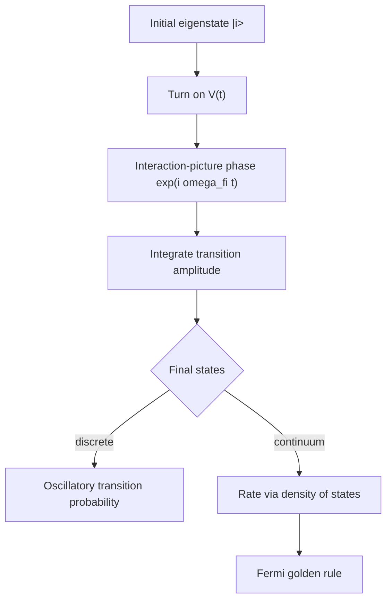

# Time-Dependent Perturbation Theory

Time-dependent perturbation theory predicts transitions. Instead of asking how an energy level shifts when the Hamiltonian is slightly changed, it asks how a system initially in one eigenstate develops amplitude to be found in another. This is the language of absorption, emission, decays, scattering, and Fermi's golden rule.

Sakurai derives the formalism in the interaction picture and uses constant and harmonic perturbations to reach the golden rule. Ballentine treats time-dependent phenomena alongside decay, beats, and adiabatic behavior. The Gottfried-named notes follow a similar interaction-picture route. Schiff's older treatment often emphasizes explicit integrals of transition amplitudes in wave mechanics.

## Expanding amplitudes in the interaction picture

Split the Hamiltonian as

$$
H(t)=H_0+V(t),
$$

where

$$
H_0|n\rangle=E_n|n\rangle.
$$

In the interaction picture,

$$
V_I(t)=e^{iH_0t/\hbar}V(t)e^{-iH_0t/\hbar}.
$$

The interaction-picture state obeys

$$
i\hbar{d\over dt}|\psi_I(t)\rangle=V_I(t)|\psi_I(t)\rangle.
$$

Expand it in the stationary basis of $H_0$,

$$
|\psi_I(t)\rangle=\sum_n c_n(t)|n\rangle.
$$

Projection with $\langle f\vert $ gives the exact coupled equations

$$
i\hbar\dot c_f(t)=\sum_n
V_{fn}(t)e^{i\omega_{fn}t}c_n(t).
$$

If the initial state is $\vert i\rangle$, zeroth order sets $c_n^{(0)}=\delta_{ni}$. Substituting these constant coefficients on the right-hand side and integrating produces the first-order amplitude below. The approximation is controlled by the size of the accumulated transition amplitudes, not by the matrix element alone.

If the system begins in $\vert i\rangle$, the first-order amplitude for a transition to $\vert f\rangle$ is

$$
c_f^{(1)}(t)=-{i\over\hbar}\int_0^t
\langle f|V(t')|i\rangle e^{i\omega_{fi}t'}\,dt',
$$

where

$$
\omega_{fi}={E_f-E_i\over \hbar}.
$$

The transition probability to first order is

$$
P_{i\to f}(t)\approx |c_f^{(1)}(t)|^2.
$$

For a continuum of final states, probabilities are converted into rates by multiplying by a density of states.

## Finite-time energy resolution and resonance

For a constant perturbation turned on from $0$ to $t$, with $V_{fi}=\langle f\vert V\vert i\rangle$,

$$
c_f^{(1)}(t)=-{iV_{fi}\over\hbar}\int_0^t e^{i\omega_{fi}t'}dt'
={V_{fi}\over\hbar}{1-e^{i\omega_{fi}t}\over \omega_{fi}}.
$$

Thus

$$
P_{i\to f}(t)=
{4|V_{fi}|^2\over \hbar^2\omega_{fi}^2}
\sin^2{\omega_{fi}t\over 2}.
$$

For a harmonic perturbation,

$$
V(t)=W e^{-i\omega t}+W^\dagger e^{i\omega t},
$$

large transition probability occurs near resonance:

$$
E_f-E_i\approx \hbar\omega
$$

for absorption from the $W$ term, with the opposite sign for stimulated emission depending on convention.

Fermi's golden rule is

$$
\Gamma_{i\to f}={2\pi\over\hbar}|V_{fi}|^2\rho(E_f),
$$

where $\rho(E_f)$ is the density of final states at the energy selected by conservation. More precisely, the transition rate into a continuum is

$$
d\Gamma={2\pi\over\hbar}|\langle f|V|i\rangle|^2\delta(E_f-E_i)\,d\rho_f.
$$

To see the delta function emerge, write the constant-coupling result in terms of the energy mismatch $\Delta E=E_f-E_i$:

$$
|c_f^{(1)}(t)|^2
={|V_{fi}|^2t^2\over\hbar^2}
\operatorname{sinc}^2\left({\Delta E\,t\over2\hbar}\right),
$$

where $\operatorname{sinc}x=\sin x/x$. Its height grows as $t^2$ while its energy width shrinks as $\hbar/t$. The area grows linearly with $t$. In the distributional sense,

$$
{t\over2\pi\hbar}
\operatorname{sinc}^2\left({\Delta E\,t\over2\hbar}\right)
\longrightarrow\delta(\Delta E).
$$

Integrating over a smooth density of final states and dividing by $t$ yields the golden rule. Weak coupling, a dense continuum, and an observation time long compared with microscopic oscillation periods are all needed. Exponential decay is an intermediate-time approximation rather than an exact law at every time.

## From one final level to a continuum

| Perturbation | Amplitude feature | Physical interpretation |
|---|---|---|
| constant for finite time | sinc-like energy width | short pulses broaden energy selection |
| harmonic drive | resonance at $\omega_{fi}\approx \omega$ | absorption or stimulated emission |
| continuum coupling | linear growth of total probability | constant transition rate |
| strong resonant two-level drive | Rabi oscillations | first-order theory eventually fails |

## Worked example: constant coupling between two levels

**Problem.** A system starts in $\vert i\rangle$. A constant perturbation with matrix element $V_{fi}$ is turned on for time $t$. Find the first-order transition probability to $\vert f\rangle$.

**Method.**

1. Start from

$$
c_f^{(1)}(t)=-{i\over\hbar}V_{fi}\int_0^t e^{i\omega_{fi}t'}dt'.
$$

2. Integrate:

$$
\int_0^t e^{i\omega t'}dt'={e^{i\omega t}-1\over i\omega}.
$$

3. Substitute:

$$
c_f^{(1)}(t)=-{iV_{fi}\over\hbar}{e^{i\omega_{fi}t}-1\over i\omega_{fi}}
={V_{fi}\over\hbar\omega_{fi}}\left(1-e^{i\omega_{fi}t}\right).
$$

4. Take the modulus squared:

$$
|1-e^{i\omega t}|^2=(1-e^{i\omega t})(1-e^{-i\omega t})
=2-2\cos\omega t.
$$

5. Use

$$
2-2\cos\omega t=4\sin^2{\omega t\over2}.
$$

6. Therefore

$$
P_{i\to f}(t)=
{4|V_{fi}|^2\over\hbar^2\omega_{fi}^2}
\sin^2{\omega_{fi}t\over2}.
$$

**Checked answer.** When $\omega_{fi}\to0$, use $\sin x\sim x$ to get $P\approx \vert V_{fi}\vert ^2t^2/\hbar^2$, as expected for a resonant weak coupling at short time.

## Worked example: a golden-rule rate and linewidth

**Problem.** A state couples to a continuum with approximately constant matrix element $V_0$ and density of states $\rho(E)=\rho_0$ near the final energy. Find the transition rate.

**Method.**

1. Use Fermi's golden rule:

$$
\Gamma={2\pi\over\hbar}|V_{fi}|^2\rho(E_f).
$$

2. Insert the approximation

$$
|V_{fi}|^2\approx |V_0|^2,
\qquad
\rho(E_f)\approx\rho_0.
$$

3. The rate is

$$
\Gamma={2\pi\over\hbar}|V_0|^2\rho_0.
$$

4. The survival probability under the exponential approximation is

$$
P_{\mathrm{surv}}(t)\approx e^{-\Gamma t}.
$$

5. The lifetime is

$$
\tau={1\over \Gamma}.
$$

If $\Gamma$ is a probability-decay rate, the corresponding energy width is of order

$$
\Delta E=\hbar\Gamma.
$$

Indeed, a survival amplitude proportional to $e^{-\Gamma t/2}e^{-iE_0t/\hbar}$ has Fourier amplitude

$$
{1\over E-E_0+i\hbar\Gamma/2},
$$

whose squared modulus is a Lorentzian with full width at half maximum $\hbar\Gamma$. The lifetime and spectral width are therefore Fourier-linked, with convention-dependent factors if amplitude and probability decay rates are named identically.

**Checked answer.** The dimensions are correct: $\vert V_0\vert ^2\rho_0/\hbar$ has units of inverse time when $\rho_0$ is states per energy.

## Where first order stops working

- Using first-order perturbation theory after transition probability is no longer small.
- Forgetting the oscillatory phase $e^{i\omega_{fi}t}$ in the interaction-picture matrix element.
- Treating the golden rule as valid for a single isolated final level. It is a continuum-rate result.
- Ignoring density of states. The matrix element alone is not a rate.
- Assuming exact exponential decay at arbitrarily short and long times. It is an approximation over an intermediate regime.
- Mixing angular frequency and ordinary frequency; factors of $2\pi$ matter.
- Applying resonance formulas without checking which part of $V(t)$ corresponds to absorption or emission under the chosen sign convention.

The central object in time-dependent perturbation theory is phase accumulation. A matrix element may be nonzero, but if the phase $e^{i\omega_{fi}t}$ oscillates rapidly, contributions from different times cancel. Near resonance, the phase varies slowly and the amplitude can accumulate coherently. This is the physical origin of energy selection in long-time transitions and of broad spectral response for short pulses.

First-order amplitudes are amplitudes, not probabilities. If several indistinguishable paths lead to the same final state, their amplitudes must be added before squaring. If final states are distinguishable or unobserved, probabilities may be summed. This distinction is the same interference logic seen in spin and path integrals, now applied to transition histories. It becomes essential in multi-photon processes, decay channels, and scattering.

The golden rule should always be accompanied by its conditions. The final states must form a dense enough continuum, the coupling must be weak enough that the initial state is not strongly depleted over the times considered, and the observation time must be long enough for the sinc-squared energy window to become narrow. At very short times, transition probability is quadratic in time; at intermediate times it can look exponential after summing over a continuum; at very long times, exact models may deviate again.

Driven two-level systems are the boundary between perturbation theory and exact dynamics. Weak off-resonant driving is well described by first-order transition amplitudes. Strong resonant driving produces Rabi oscillations, where probability flows back and forth and first-order theory eventually predicts probabilities larger than one. When that happens, the issue is not arithmetic but the breakdown of the perturbative approximation.

Selection rules still matter in time-dependent problems. A harmonic electric-dipole perturbation contains an operator such as $\mathbf r\cdot\mathbf E$, so parity and angular momentum determine which transitions have nonzero matrix elements before any time integral is evaluated. Resonance cannot create a transition whose matrix element is zero by symmetry. Conversely, a nonzero matrix element far from resonance may produce only a small bounded oscillation.

Pulse duration controls energy resolution. A perturbation applied for a short time has a broad frequency spectrum, so it can drive a range of transitions. A long nearly monochromatic drive selects a narrow energy window. This is the time-energy Fourier relationship behind spectroscopy, and it is more precise than saying energy is "violated" for short times. The full system still evolves according to the time-dependent Hamiltonian; the finite-time amplitude simply has a broadened response.

For checks, take limits. At $t=0$ transition probabilities must vanish. For very weak coupling they should scale as $\vert V\vert ^2$. Near resonance they should grow much more efficiently than far off resonance. If these trends fail, the phase convention or time integral is likely wrong.

## Harmonic driving and the rotating-wave approximation

A sinusoidal drive contains positive- and negative-frequency pieces. In the interaction picture, one piece can rotate slowly near a chosen transition while the other rotates at roughly twice the transition frequency. Over many cycles the rapidly rotating contribution largely cancels. Dropping it gives the rotating-wave approximation.

For a two-level system, the resulting effective Hamiltonian is constant in a suitable rotating frame. Its eigenvalue splitting defines a generalized Rabi frequency determined by the drive strength and detuning. On exact resonance, population oscillates completely between the two levels when no damping is present. Off resonance, the oscillation is faster but its maximum transfer is reduced.

First-order perturbation theory captures the initial rise of the transition amplitude. It cannot capture repeated return of population because it keeps the initial amplitude essentially fixed. The exact two-level solution restores unitarity and bounds all probabilities. Comparing the first small-time segment of a Rabi oscillation with the perturbative result is a useful consistency test.

The rotating-wave approximation is controlled by a separation of frequencies, not solely by weak transition probability. Very strong or ultrashort drives invalidate it, producing counter-rotating effects and shifts of the apparent resonance. A drive far from resonance can also generate energy shifts even when real population transfer stays small.

## Pulse shapes and Fourier spectra

The first-order transition amplitude is the Fourier component of the applied time dependence evaluated at the transition frequency, multiplied by the relevant matrix element. A rectangular pulse produces a sinc-shaped response with side lobes. A smooth Gaussian pulse produces a Gaussian frequency profile. Abrupt switching spreads spectral weight broadly because it introduces high-frequency components.

Pulse area controls resonant rotation in an ideal two-level model, while pulse duration controls frequency selectivity. Short pulses address a broad band of transitions. Long pulses distinguish nearby lines but require coherence to survive for the longer interaction. Experimental pulse design balances these two demands.

If several pulses are applied, amplitudes created at different times acquire phases between pulses and interfere. Ramsey spectroscopy uses two separated short pulses so that the free-evolution phase becomes a sensitive measure of detuning. Treating the pulses as independent probabilities would erase the interference fringes and miss the central signal.

## Selection rules before time integration

The perturbing operator determines which matrix elements can be nonzero. An electric dipole interaction has odd parity and vector angular character. It connects opposite-parity states subject to angular-momentum constraints. A magnetic dipole or electric quadrupole interaction obeys different rules and can weakly access transitions forbidden at electric-dipole order.

Selection rules depend on the approximations used. Configuration mixing, external fields, relativistic terms, or higher multipoles can give a nominally forbidden line a small intensity. The word forbidden normally means that the leading matrix element vanishes by symmetry, not that every possible coupling vanishes exactly.

Degenerate initial or final subspaces require basis care. The perturbation may couple only one linear combination while leaving orthogonal combinations dark. Diagonalizing the coupling within the degenerate manifold identifies bright and dark states and avoids assigning a basis-dependent transition probability to an arbitrary degenerate vector.

## Decay laws beyond the golden-rule window

At very short times, unitary evolution gives a survival probability with a quadratic departure from one. A constant exponential would instead have a linear initial decrease, so exact decay cannot be exponential at the origin. Repeated sufficiently frequent ideal measurements can exploit the quadratic regime and inhibit transition, the quantum Zeno effect.

At intermediate times, a smooth continuum and weak coupling often produce an excellent exponential approximation. The golden-rule rate then sets the lifetime, and the Fourier transform gives a Lorentzian spectral line. Depletion of the initial state must be included to extend the constant-rate result beyond a small transition probability.

At extremely long times, spectral bounds and threshold behavior can produce nonexponential power-law tails. These regimes are often difficult to observe, but they clarify that the golden rule is an asymptotic approximation under a specific ordering of time and coupling limits.

Stimulated and spontaneous processes also need distinction. A classical time-dependent perturbation describes absorption and stimulated emission driven by an applied field. Spontaneous emission requires quantizing the electromagnetic field so that the atom couples to vacuum modes. The golden-rule structure survives, but the final-state continuum includes photon states and their density of modes.

## Related pages

- [Quantum dynamics and pictures](/physics/quantum-mechanics/quantum-dynamics-pictures)
- [Time-independent perturbation theory](/physics/quantum-mechanics/time-independent-perturbation-theory)
- [Scattering theory](/physics/quantum-mechanics/scattering-theory)
- [Density operator, entanglement, and decoherence](/physics/quantum-mechanics/density-operator-entanglement-decoherence)
- [Measurement and interpretation](/physics/quantum-mechanics/measurement-interpretation)
