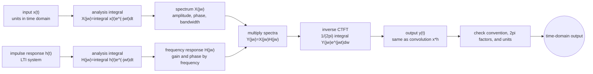

# Continuous-Time Fourier Transform

The continuous-time Fourier transform extends Fourier analysis from periodic signals to aperiodic signals. Instead of a line spectrum at harmonics of one fundamental frequency, an aperiodic signal is represented by a continuous spectrum $X(j\omega)$. The transform answers how much of each complex exponential $e^{j\omega t}$ is present in the signal.

For LTI systems, the CTFT turns convolution into multiplication. This is the main computational payoff: differential equations, filters, and cascade systems become algebraic in frequency. The transform also gives a precise language for bandwidth, ideal filtering, modulation, and sampling.

## Transform convention and existence

The continuous-time Fourier transform of $x(t)$ is

$$
X(j\omega)=\int_{-\infty}^{\infty}x(t)e^{-j\omega t}\,dt.
$$

The inverse transform is

$$
x(t)=\frac{1}{2\pi}\int_{-\infty}^{\infty}X(j\omega)e^{j\omega t}\,d\omega.
$$

The notation $X(j\omega)$ emphasizes the connection to the Laplace transform evaluated on the imaginary axis. Some fields write the same transform as $X(\omega)$. In these notes, $X(j\omega)$ is used for consistency with systems notation.

The CTFT exists in the ordinary integral sense for many absolutely integrable signals:

$$
\int_{-\infty}^{\infty}|x(t)|\,dt<\infty.
$$

Signals that are not absolutely integrable can still have transforms in a generalized sense. Important examples include

$$
\delta(t) \leftrightarrow 1,
\qquad
1 \leftrightarrow 2\pi\delta(\omega),
\qquad
e^{j\omega_0 t}\leftrightarrow 2\pi\delta(\omega-\omega_0).
$$

The Fourier transform of an impulse-shifted signal follows from the sifting property:

$$
\delta(t-t_0) \leftrightarrow e^{-j\omega t_0}.
$$

For real-valued $x(t)$, the transform has conjugate symmetry:

$$
X(-j\omega)=X^*(j\omega).
$$

Equivalently, the magnitude is even and the phase is odd, apart from phase jumps where the magnitude is zero.

Absolute integrability is sufficient for a bounded continuous transform, but it is not necessary. A finite-energy signal may have a Fourier transform in the mean-square sense even when the defining integral is not absolutely convergent. Constant signals and undamped sinusoids require distributions. The three settings should not be mixed casually: ordinary functions, energy-equivalence classes, and generalized functions permit different manipulations.

If $x(t)$ is absolutely integrable, then

$$
|X(j\omega)|
\le \int_{-\infty}^{\infty}|x(t)|\,dt.
$$

Under mild regularity assumptions, $X(j\omega)$ also approaches zero as $\vert \omega\vert \to\infty$. A jump in time does not prevent a transform from existing, but it usually produces slowly decaying spectral tails. Smoothness and decay trade across the transform: repeated time differentiation corresponds to repeated multiplication by $j\omega$.

## Properties and where their factors come from

Linearity:

$$
a x_1(t)+b x_2(t) \leftrightarrow aX_1(j\omega)+bX_2(j\omega).
$$

Time shifting:

$$
x(t-t_0)\leftrightarrow e^{-j\omega t_0}X(j\omega).
$$

The time-shift phase factor follows by substituting $\tau=t-t_0$ in the analysis integral:

$$
\begin{aligned}
\mathcal F\{x(t-t_0)\}
&=\int_{-\infty}^{\infty}x(t-t_0)e^{-j\omega t}\,dt\\
&=\int_{-\infty}^{\infty}x(\tau)e^{-j\omega(\tau+t_0)}\,d\tau\\
&=e^{-j\omega t_0}X(j\omega).
\end{aligned}
$$

Its magnitude is one, so a pure delay changes spectral phase without changing spectral magnitude.

Frequency shifting, or modulation by a complex exponential:

$$
e^{j\omega_0 t}x(t)\leftrightarrow X(j(\omega-\omega_0)).
$$

Time scaling:

$$
x(a t)\leftrightarrow \frac{1}{|a|}X\left(j\frac{\omega}{a}\right),\qquad a\ne 0.
$$

The absolute value appears because changing variables reverses the integration limits when $a\lt 0$. Compression in time by $\vert a\vert \gt 1$ broadens the spectrum and reduces its amplitude by $1/\vert a\vert $. The factor preserves total area under the time signal and is consistent with the energy scaling in Parseval's relation.

Differentiation in time:

$$
\frac{d}{dt}x(t)\leftrightarrow j\omega X(j\omega),
$$

when boundary terms vanish or the identity is interpreted distributionally.

Multiplication by time:

$$
t x(t)\leftrightarrow j\frac{d}{d\omega}X(j\omega).
$$

Convolution:

$$
x(t)*h(t)\leftrightarrow X(j\omega)H(j\omega).
$$

To see the convolution property, insert

$$
y(t)=\int_{-\infty}^{\infty}x(\tau)h(t-\tau)\,d\tau
$$

into the transform integral and exchange the order of integration. The inner transform of $h(t-\tau)$ contributes $e^{-j\omega\tau}H(j\omega)$; the remaining integral is $X(j\omega)$. Conditions justifying the exchange are usually suppressed in engineering calculations, but absolute integrability is one sufficient condition.

Multiplication in time:

$$
x(t)h(t)\leftrightarrow \frac{1}{2\pi}X(j\omega)*H(j\omega),
$$

where the convolution on the right is with respect to $\omega$.

Parseval's relation:

$$
\int_{-\infty}^{\infty}|x(t)|^2\,dt
=\frac{1}{2\pi}\int_{-\infty}^{\infty}|X(j\omega)|^2\,d\omega.
$$

More generally, Parseval's inner-product identity is

$$
\int_{-\infty}^{\infty}x(t)y^*(t)\,dt
=\frac{1}{2\pi}
\int_{-\infty}^{\infty}X(j\omega)Y^*(j\omega)\,d\omega.
$$

Taking $y=x$ gives energy conservation between domains, with the normalization factor determined by the chosen transform convention.

For an LTI system with impulse response $h(t)$, the frequency response is

$$
H(j\omega)=\int_{-\infty}^{\infty}h(t)e^{-j\omega t}\,dt.
$$

If $y=x*h$, then

$$
Y(j\omega)=X(j\omega)H(j\omega).
$$

Thus $H(j\omega)$ scales and phase-shifts each frequency component of the input.

The CTFT should be read with units in mind. If $t$ is measured in seconds, then $\omega$ is radians per second and $d\omega$ carries radians per second. The inverse transform has the factor $1/(2\pi)$ because angular frequency is being used. If a text uses ordinary frequency $f$ in hertz, the transform pair is usually written with $e^{-j2\pi f t}$ and the inverse has no $1/(2\pi)$ factor. Mixing these conventions is a common source of wrong constants.

Bandwidth is the part of the frequency axis where $X(j\omega)$ is nonzero or practically significant. A strictly bandlimited signal has exact zero spectrum outside a finite interval, which is an idealization. Real signals are often treated as effectively bandlimited when energy outside a band is small enough to ignore. Sampling and filtering results should state whether the assumption is exact or approximate.

The CTFT can also be viewed as a limiting case of Fourier series. As the period of a periodic extension grows, harmonic spacing becomes smaller and line coefficients approach a continuous spectral density. This intuition explains why aperiodic signals use integrals over frequency while periodic signals use sums over harmonics.

Duality is another useful guide. Narrow signals in time tend to have broad spectra, and broad smooth signals tend to have concentrated spectra. Rectangular pulses and sinc spectra show the relation directly. Sharp time-domain edges demand high-frequency content.

## A map of the common operations

| Property | Time-domain operation | Frequency-domain result |
|---|---|---|
| Linearity | $a x_1+b x_2$ | $aX_1+bX_2$ |
| Time shift | $x(t-t_0)$ | $e^{-j\omega t_0}X(j\omega)$ |
| Modulation | $e^{j\omega_0t}x(t)$ | $X(j(\omega-\omega_0))$ |
| Time scaling | $x(a t)$ | $\frac{1}{\vert a\vert }X(j\omega/a)$ |
| Differentiation | $dx/dt$ | $j\omega X(j\omega)$ |
| Convolution | $x*h$ | $XH$ |
| Multiplication | $xh$ | $\frac{1}{2\pi}X*H$ |

The input and impulse response are analyzed separately, multiplied in frequency, and synthesized by the inverse transform. Time-domain functions become continuous spectra indexed by angular frequency, then return to a time-domain output. The convention check catches $2\pi$ and unit errors.

## Worked example: transform of a decaying exponential

Problem: Find the CTFT of

$$
x(t)=e^{-a t}u(t), \qquad a>0.
$$

Method:

1. Start from the definition:

$$
X(j\omega)=\int_{-\infty}^{\infty}e^{-a t}u(t)e^{-j\omega t}\,dt.
$$

2. The unit step restricts the integral to $t\ge 0$:

$$
X(j\omega)=\int_{0}^{\infty}e^{-a t}e^{-j\omega t}\,dt.
$$

3. Combine exponents:

$$
X(j\omega)=\int_{0}^{\infty}e^{-(a+j\omega)t}\,dt.
$$

4. Since $a\gt 0$, the exponential decays and

$$
\int_{0}^{\infty}e^{-(a+j\omega)t}\,dt
=\left[-\frac{1}{a+j\omega}e^{-(a+j\omega)t}\right]_{0}^{\infty}.
$$

5. The upper limit is zero. The lower limit contributes $-1/(a+j\omega)$ inside the bracket, so

$$
X(j\omega)=\frac{1}{a+j\omega}.
$$

Checked answer:

$$
e^{-a t}u(t)\leftrightarrow \frac{1}{a+j\omega},\qquad a>0.
$$

Magnitude and phase are

$$
|X(j\omega)|=\frac{1}{\sqrt{a^2+\omega^2}},
\qquad
\angle X(j\omega)=-\tan^{-1}\frac{\omega}{a}.
$$

The transform is largest at low frequency because the time signal is a smooth one-sided decay.

## Worked example: filtering a rectangular spectrum

Problem: Suppose an LTI system has ideal lowpass response

$$
H(j\omega)=
\begin{cases}
1, & |\omega|\le 5,\\
0, & |\omega|>5,
\end{cases}
$$

and the input spectrum is

$$
X(j\omega)=
\begin{cases}
2, & |\omega|\le 3,\\
1, & 3<|\omega|\le 8,\\
0, & |\omega|>8.
\end{cases}
$$

Find $Y(j\omega)$.

Method:

1. For an LTI system,

$$
Y(j\omega)=X(j\omega)H(j\omega).
$$

2. The system passes frequencies with $\vert \omega\vert \le 5$ and removes frequencies with $\vert \omega\vert \gt 5$.

3. On $\vert \omega\vert \le 3$, both $X$ and $H$ are nonzero:

$$
Y(j\omega)=2\cdot 1=2.
$$

4. On $3\lt \vert \omega\vert \le 5$, the input spectrum has value $1$ and the filter still passes:

$$
Y(j\omega)=1\cdot 1=1.
$$

5. On $5\lt \vert \omega\vert \le 8$, the input has value $1$ but the filter is zero:

$$
Y(j\omega)=1\cdot 0=0.
$$

6. Outside $\vert \omega\vert \gt 8$, the input is already zero.

Checked answer:

$$
Y(j\omega)=
\begin{cases}
2, & |\omega|\le 3,\\
1, & 3<|\omega|\le 5,\\
0, & |\omega|>5.
\end{cases}
$$

The output bandwidth is limited by the filter cutoff, not by the original input support.

## Worked example: rectangular pulse and its bandwidth scale

Let

$$
x(t)=
\begin{cases}
1, & |t|\le T/2,\\
0, & |t|>T/2.
\end{cases}
$$

Starting from the definition,

$$
\begin{aligned}
X(j\omega)
&=\int_{-T/2}^{T/2}e^{-j\omega t}\,dt\\
&=\left.\frac{e^{-j\omega t}}{-j\omega}\right|_{-T/2}^{T/2}\\
&=\frac{e^{-j\omega T/2}-e^{j\omega T/2}}{-j\omega}\\
&=\frac{2\sin(\omega T/2)}{\omega}.
\end{aligned}
$$

Define $\operatorname{sinc}(u)=\sin u/u$. Then

$$
X(j\omega)=T\operatorname{sinc}\left(\frac{\omega T}{2}\right).
$$

At $\omega=0$, the apparent quotient $0/0$ is resolved by the limit $\sin u/u\to1$, giving $X(0)=T$. That equals the area under $x(t)$, as the transform definition at zero frequency requires.

The first spectral zeros occur when

$$
\frac{\omega T}{2}=\pm\pi,
\qquad
\omega=\pm\frac{2\pi}{T}.
$$

Doubling the pulse duration halves the main-lobe width. The rectangular pulse is time-limited but not bandlimited: its sinc tails extend to every frequency. The abrupt endpoints are responsible for the slow $1/\vert \omega\vert $ envelope.

Parseval supplies a check. The time-domain energy is

$$
E=\int_{-T/2}^{T/2}1\,dt=T.
$$

Consequently the spectral integral must satisfy

$$
\frac{1}{2\pi}
\int_{-\infty}^{\infty}
T^2\operatorname{sinc}^2\left(\frac{\omega T}{2}\right)d\omega
=T.
$$

## Impulses and line spectra

An undamped complex exponential has infinite energy and is not absolutely integrable, yet it represents one exact frequency. Its transform is an impulse:

$$
e^{j\omega_0t}\leftrightarrow2\pi\delta(\omega-\omega_0).
$$

Using Euler's identity gives the cosine pair

$$
\cos(\omega_0t)
\leftrightarrow
\pi\delta(\omega-\omega_0)
+\pi\delta(\omega+\omega_0).
$$

The two impulses are required because a real sinusoid contains conjugate positive- and negative-frequency components. Their weights are impulse areas, not finite plotted heights.

Multiplication of an ordinary function by an impulse samples that function:

$$
H(j\omega)\delta(\omega-\omega_0)
=H(j\omega_0)\delta(\omega-\omega_0).
$$

An LTI system therefore scales a sinusoid by the frequency response evaluated at its frequency. If the input is real, conjugate symmetry of a real system's response ensures that the output remains real.

## Inversion, discontinuities, and phase

Fourier inversion reconstructs a signal from all frequencies at once. At a point where a sufficiently regular signal is continuous, the inverse integral returns the signal value. At a finite jump, symmetric Fourier reconstruction converges to the midpoint of the left and right limits:

$$
x_{\text{reconstructed}}(t_0)
=\frac{x(t_0^-)+x(t_0^+)}{2}.
$$

Changing a function at one isolated time does not change its ordinary Fourier transform because a single point has zero measure in the defining integral. The midpoint convention therefore causes no contradiction. Near a sharp jump, truncated frequency reconstruction produces oscillatory overshoot. Adding more bandwidth narrows the oscillatory region but does not remove the limiting peak fraction; this is the continuous-transform counterpart of the Gibbs phenomenon in Fourier series.

Magnitude and phase carry different information. A time delay leaves magnitude unchanged and adds the linear phase term $-\omega t_0$. Two signals can have identical magnitude spectra and very different time shapes if their phases differ. For real signals, conjugate symmetry couples the two sides of the frequency axis, but it does not make phase optional.

For a system response written as

$$
H(j\omega)=|H(j\omega)|e^{j\phi(\omega)},
$$

the phase delay is $-\phi(\omega)/\omega$ for a sinusoid, while group delay is

$$
\tau_g(\omega)=-\frac{d\phi}{d\omega}.
$$

If phase is linear across the occupied input band, all spectral components receive the same delay and the waveform shape is preserved apart from magnitude scaling. Nonlinear phase gives frequency-dependent delay and can distort a broadband waveform even when $\vert H(j\omega)\vert $ is flat.

Phase must be unwrapped before differentiating numerically. A displayed phase often jumps by $2\pi$ because angles are reported in a principal interval; those representational jumps are not physical group-delay impulses.

## Symmetry shortcuts

Even and odd structure reduces transform work. If $x(t)$ is real and even, its transform is real and even:

$$
X(j\omega)=2\int_0^\infty x(t)\cos(\omega t)\,dt.
$$

If $x(t)$ is real and odd, its transform is imaginary and odd:

$$
X(j\omega)=-2j\int_0^\infty x(t)\sin(\omega t)\,dt.
$$

Every real signal can be decomposed into even and odd parts. The even part determines the real spectral component, and the odd part determines the imaginary component. A computed transform that violates these symmetry relations usually contains a sign error or a missed time shift.

The value at zero frequency has a direct interpretation:

$$
X(0)=\int_{-\infty}^{\infty}x(t)\,dt.
$$

It is the signed area of the signal. Conversely, when the inverse integral is valid at $t=0$,

$$
x(0)=\frac{1}{2\pi}\int_{-\infty}^{\infty}X(j\omega)\,d\omega.
$$

These relations are quick checks for transform tables. They also show why a zero-area pulse has no DC component even if its instantaneous amplitude is large.

## Numerical transforms are finite observations

Computing a spectrum from sampled data does not evaluate the ideal CTFT directly. Sampling makes the spectrum periodic in frequency, while observing only a finite time interval multiplies the signal by a window and convolves its spectrum with the window transform. The discrete Fourier transform then samples that windowed spectrum on a finite frequency grid.

Frequency resolution is set mainly by observation duration, not by adding more samples over the same interval. A longer record narrows the transform of the window and separates nearby tones more clearly. Increasing the sampling rate instead extends the unaliased frequency range. Zero-padding adds interpolated display points between existing DFT samples; it does not recover information absent from the original record.

Spectral leakage is the spreading produced when a finite record cuts through a component that is not periodic within the observation window. Window functions trade main-lobe width against sidelobe level. The appropriate choice depends on whether the goal is resolving close tones, estimating amplitude near a strong interferer, or measuring broadband energy.

## Transform errors worth checking first

- Forgetting the $1/(2\pi)$ factor in the inverse CTFT and in the multiplication property.
- Treating the CTFT of a periodic sinusoid as an ordinary function instead of impulses in frequency.
- Confusing time shift with frequency shift. A time shift multiplies the spectrum by a phase ramp; modulation shifts the spectrum.
- Assuming a Fourier transform exists as an ordinary integral for every useful signal. Constants and sinusoids require generalized transforms.
- Dropping phase information. Magnitude alone is not enough to reconstruct a general signal.

## Related pages

- [Fourier Series for Periodic Signals](/physics/signals-systems/fourier-series-periodic-signals)
- [LTI Systems and Convolution](/physics/signals-systems/lti-systems-convolution)
- [Sampling, Aliasing, and Reconstruction](/physics/signals-systems/sampling-aliasing-reconstruction)
- [Frequency Response and Filtering](/physics/signals-systems/frequency-response-filtering)
- [Laplace Transform and ROC](/physics/signals-systems/laplace-transform-roc)
