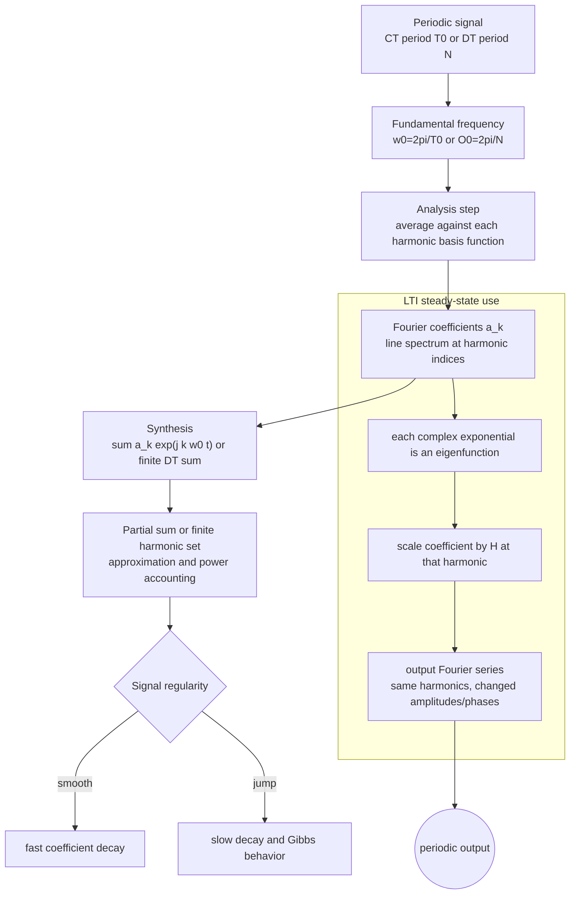

# Fourier Series for Periodic Signals

Fourier series represent periodic signals as weighted sums of harmonically related complex exponentials. The idea is powerful because complex exponentials are eigenfunctions of LTI systems: when a sinusoidal component passes through an LTI system, only its amplitude and phase change. A periodic signal can therefore be analyzed component by component in frequency.

Continuous-time and discrete-time Fourier series share the same conceptual structure, but their details differ. Continuous-time periodic signals generally require infinitely many harmonics. Discrete-time periodic sequences have only finitely many distinct harmonics over one period because discrete-time frequency repeats every $2\pi$.

Fourier introduced trigonometric expansions while studying heat conduction, where separation of variables produces sinusoidal spatial modes. The early claim that broad classes of functions could be represented by such series forced mathematicians to sharpen ideas of function, convergence, and orthogonality. Modern signal analysis keeps the same construction but usually uses complex exponentials because differentiation, time shifting, and LTI response become algebraic.

The representation does not assert that a square wave is physically assembled from preexisting sinusoids. It says the harmonic functions form a basis in which the waveform can be analyzed and reconstructed under a stated convergence notion. That distinction matters near discontinuities, where pointwise equality and mean-square equality give different descriptions of the limiting behavior.

## Two harmonic bases

For a continuous-time periodic signal with fundamental period $T_0$ and fundamental angular frequency

$$
\omega_0=\frac{2\pi}{T_0},
$$

the complex exponential Fourier series is

$$
x(t)=\sum_{k=-\infty}^{\infty}a_k e^{j k\omega_0 t}.
$$

The coefficients are

$$
a_k=\frac{1}{T_0}\int_{T_0}x(t)e^{-j k\omega_0 t}\,dt,
$$

where $\int_{T_0}$ means integration over any complete period.

For a discrete-time periodic sequence with fundamental period $N$, the discrete-time Fourier series is

$$
x[n]=\sum_{k=0}^{N-1}a_k e^{j(2\pi/N)kn}.
$$

The coefficients are

$$
a_k=\frac{1}{N}\sum_{n=0}^{N-1}x[n]e^{-j(2\pi/N)kn}.
$$

The coefficient sequence is periodic in $k$ with period $N$:

$$
a_{k+N}=a_k.
$$

For real continuous-time signals, the coefficients satisfy conjugate symmetry:

$$
a_{-k}=a_k^*.
$$

For real discrete-time periodic sequences,

$$
a_{N-k}=a_k^*
$$

with indices interpreted modulo $N$.

The trigonometric continuous-time series is

$$
x(t)=A_0+\sum_{k=1}^{\infty}\left(A_k\cos(k\omega_0 t)+B_k\sin(k\omega_0 t)\right).
$$

The complex form is usually cleaner for system analysis, while the trigonometric form is sometimes easier to read physically.

The two continuous-time forms are equivalent. Using Euler's identities and grouping the $+k$ and $-k$ terms gives, for a real signal,

$$
A_0=a_0,
\qquad
A_k=a_k+a_{-k}=2\operatorname{Re}a_k,
$$

$$
B_k=j(a_k-a_{-k})=-2\operatorname{Im}a_k.
$$

Conversely,

$$
a_k=\frac{A_k-jB_k}{2},
\qquad
a_{-k}=\frac{A_k+jB_k}{2}.
$$

Normalization conventions vary. Some trigonometric forms write the constant as $A_0/2$ instead of $A_0$. Coefficients must be interpreted together with the synthesis formula that defines them.

## Orthogonality and coefficient extraction

The orthogonality of complex exponentials over one period is the key identity. In continuous time,

$$
\frac{1}{T_0}\int_{T_0}e^{j k\omega_0 t}e^{-j m\omega_0 t}\,dt
=
\begin{cases}
1, & k=m,\\
0, & k\ne m.
\end{cases}
$$

In discrete time,

$$
\frac{1}{N}\sum_{n=0}^{N-1}e^{j(2\pi/N)kn}e^{-j(2\pi/N)mn}
=
\begin{cases}
1, & k=m \pmod N,\\
0, & \text{otherwise}.
\end{cases}
$$

These identities isolate a single coefficient when the signal is multiplied by a conjugate harmonic and averaged over one period.

For continuous time, insert the synthesis series into the coefficient calculation:

$$
\begin{aligned}
\frac{1}{T_0}\int_{T_0}x(t)e^{-jm\omega_0t}\,dt
&=\frac{1}{T_0}\int_{T_0}
\sum_ka_ke^{j(k-m)\omega_0t}\,dt\\
&=\sum_ka_k\delta_{km}\\
&=a_m.
\end{aligned}
$$

The coefficient is a projection of the signal onto one normalized basis function. Fourier series is therefore an infinite-dimensional version of resolving a vector into orthogonal coordinate components. Parseval's relation is the corresponding statement that squared length equals the sum of squared component magnitudes.

Parseval's relation connects time-domain average power to coefficient magnitudes. For continuous time,

$$
P_x=\frac{1}{T_0}\int_{T_0}|x(t)|^2\,dt
=\sum_{k=-\infty}^{\infty}|a_k|^2.
$$

For discrete time,

$$
P_x=\frac{1}{N}\sum_{n=0}^{N-1}|x[n]|^2
=\sum_{k=0}^{N-1}|a_k|^2.
$$

If a periodic signal is the input to an LTI system with frequency response $H(j\omega)$, then

$$
x(t)=\sum_k a_k e^{j k\omega_0 t}
$$

produces

$$
y(t)=\sum_k a_k H(jk\omega_0)e^{j k\omega_0 t}.
$$

For discrete time, the factor is $H(e^{j2\pi k/N})$. This result is one reason Fourier series appears immediately after LTI systems.

At jump discontinuities, the Fourier series converges to the midpoint of the left and right limits under standard Dirichlet conditions:

$$
\frac{x(t_0^-)+x(t_0^+)}{2}.
$$

Near jumps, partial sums show overshoot known as the Gibbs phenomenon. Increasing the number of harmonics narrows the oscillatory region but does not remove the limiting overshoot.

Coefficient patterns reveal signal structure. A real and even continuous-time signal has real and even coefficients. A real and odd signal has purely imaginary, odd-symmetric coefficients in the complex form. Half-wave symmetry often removes even harmonics. These facts provide checks on coefficient signs and factors.

The DC coefficient is the average value over one period. In continuous time,

$$
a_0=\frac{1}{T_0}\int_{T_0}x(t)\,dt.
$$

In discrete time,

$$
a_0=\frac{1}{N}\sum_{n=0}^{N-1}x[n].
$$

If a waveform spends equal positive and negative area over a period, $a_0$ should be zero. If the signal is always nonnegative, a negative $a_0$ is a warning sign.

Fourier series also separates waveform smoothness from spectral decay. Signals with jumps have coefficients that decay slowly, typically like $1/\vert k\vert $. Signals with more smooth derivatives have faster coefficient decay. Sharp edges therefore require many harmonics to approximate accurately.

If a periodic signal is differentiable and its derivative has a Fourier series, integration by parts gives

$$
a_k^{(x')}=jk\omega_0a_k^{(x)}.
$$

Thus an integrable derivative forces $k a_k$ to remain controlled, giving faster decay than for a signal with jumps. Repeating the argument connects additional smooth derivatives with additional powers of $1/k$.

## Continuous-time and discrete-time series side by side

| Feature | CT Fourier series | DT Fourier series |
|---|---|---|
| Signal type | periodic $x(t)$ | periodic $x[n]$ |
| Fundamental frequency | $\omega_0=2\pi/T_0$ | $\Omega_0=2\pi/N$ |
| Synthesis | $\sum_{k=-\infty}^{\infty}a_k e^{jk\omega_0t}$ | $\sum_{k=0}^{N-1}a_k e^{j(2\pi/N)kn}$ |
| Analysis | $\frac{1}{T_0}\int_{T_0}x(t)e^{-jk\omega_0t}dt$ | $\frac{1}{N}\sum_{n=0}^{N-1}x[n]e^{-j(2\pi/N)kn}$ |
| Number of distinct harmonics | countably infinite | $N$ |
| Power relation | $P=\sum_{k=-\infty}^{\infty}\vert a_k\vert ^2$ | $P=\sum_{k=0}^{N-1}\vert a_k\vert ^2$ |

Analysis and synthesis connect a periodic signal with a line spectrum at harmonics of its fundamental frequency. An LTI system scales each line by its response at that harmonic. Smooth signals need fewer significant modes than signals with jumps.

## Worked example: CTFS coefficients of a square wave

Problem: Let $x(t)$ be periodic with period $T_0=2\pi$ and

$$
x(t)=
\begin{cases}
1, & 0<t<\pi,\\
-1, & -\pi<t<0.
\end{cases}
$$

Find the complex Fourier series coefficients.

Method:

1. The fundamental frequency is

$$
\omega_0=\frac{2\pi}{2\pi}=1.
$$

2. Use the coefficient formula:

$$
a_k=\frac{1}{2\pi}\int_{-\pi}^{\pi}x(t)e^{-jkt}\,dt.
$$

3. Split the integral:

$$
a_k=\frac{1}{2\pi}
\left(
\int_{-\pi}^{0}(-1)e^{-jkt}\,dt
+\int_{0}^{\pi}e^{-jkt}\,dt
\right).
$$

4. For $k\ne 0$,

$$
\int e^{-jkt}\,dt=\frac{e^{-jkt}}{-jk}.
$$

Therefore

$$
a_k=\frac{1}{2\pi}
\left(
-\frac{1-e^{jk\pi}}{-jk}
+\frac{e^{-jk\pi}-1}{-jk}
\right).
$$

5. Since $e^{jk\pi}=e^{-jk\pi}=(-1)^k$,

$$
a_k=\frac{1}{2\pi}
\left(
\frac{1-(-1)^k}{jk}
+\frac{(-1)^k-1}{-jk}
\right).
$$

The two terms are equal, so

$$
a_k=\frac{1}{2\pi}\frac{2(1-(-1)^k)}{jk}
=\frac{1-(-1)^k}{j\pi k}.
$$

6. For even $k$, $1-(-1)^k=0$. For odd $k$, $1-(-1)^k=2$:

$$
a_k=
\begin{cases}
\frac{2}{j\pi k}, & k \text{ odd},\\
0, & k \text{ even}.
\end{cases}
$$

7. The DC coefficient is

$$
a_0=\frac{1}{2\pi}\left(-\pi+\pi\right)=0.
$$

Checked answer: The signal is odd, so coefficients are purely imaginary and odd-symmetric, which agrees with $a_k=2/(j\pi k)$ for odd $k$ and zero otherwise.

## Worked example: DTFS coefficients of a period-4 sequence

Problem: A periodic sequence has one period

$$
x[0]=1,\quad x[1]=2,\quad x[2]=1,\quad x[3]=0.
$$

Find its DTFS coefficients.

Method:

1. The period is $N=4$, so

$$
a_k=\frac{1}{4}\sum_{n=0}^{3}x[n]e^{-j(2\pi/4)kn}.
$$

2. Simplify the frequency factor:

$$
e^{-j(2\pi/4)kn}=e^{-j(\pi/2)kn}.
$$

3. Compute each coefficient.

For $k=0$:

$$
a_0=\frac{1}{4}(1+2+1+0)=1.
$$

For $k=1$:

$$
a_1=\frac{1}{4}\left(1+2e^{-j\pi/2}+e^{-j\pi}+0\right).
$$

Use $e^{-j\pi/2}=-j$ and $e^{-j\pi}=-1$:

$$
a_1=\frac{1}{4}(1-2j-1)=-\frac{j}{2}.
$$

For $k=2$:

$$
a_2=\frac{1}{4}\left(1+2e^{-j\pi}+e^{-j2\pi}\right)
=\frac{1}{4}(1-2+1)=0.
$$

For $k=3$:

$$
a_3=\frac{1}{4}\left(1+2e^{-j3\pi/2}+e^{-j3\pi}\right).
$$

Use $e^{-j3\pi/2}=j$ and $e^{-j3\pi}=-1$:

$$
a_3=\frac{1}{4}(1+2j-1)=\frac{j}{2}.
$$

Checked answer:

$$
a_0=1,\qquad a_1=-\frac{j}{2},\qquad a_2=0,\qquad a_3=\frac{j}{2}.
$$

Because $x[n]$ is real, $a_3=a_1^*$, as expected.

## Worked example: square wave through a lowpass system

Use the square wave from the first example as the input to a continuous-time LTI system with

$$
H(j\omega)=\frac{1}{1+j\omega/\omega_c}.
$$

The input fundamental frequency is $\omega_0=1$, and its nonzero coefficients are $a_k=2/(j\pi k)$ for odd $k$. Each output coefficient is

$$
b_k=a_kH(jk\omega_0)
=\frac{2}{j\pi k}
\frac{1}{1+jk/\omega_c},
\qquad k\ \text{odd}.
$$

Even harmonics and DC remain zero because an LTI system cannot create frequencies absent from the input. Take $\omega_c=2$. The positive fundamental is multiplied by

$$
H(j)=\frac{1}{1+j/2}
=0.8-j0.4.
$$

Its magnitude and phase are

$$
|H(j)|=\frac{1}{\sqrt{1+(1/2)^2}}
\approx0.894,
\qquad
\angle H(j)=-\tan^{-1}(1/2)
\approx-26.6^\circ.
$$

The third harmonic is multiplied by

$$
H(j3)=\frac{1}{1+j3/2},
$$

whose magnitude is $1/\sqrt{1+(3/2)^2}\approx0.555$. Higher harmonics are attenuated still more. The output has rounded transitions because reconstructing a sharp edge requires the very harmonics that the lowpass system suppresses.

The steady-state output is

$$
y(t)=\sum_{k=-\infty}^{\infty}b_ke^{jkt}.
$$

No convolution integral is needed once the input coefficients and sampled frequency response are known.

## Convergence and finite partial sums

Several notions of convergence coexist. Mean-square convergence says that the average squared error over one period tends to zero. It is the natural result for finite-power periodic signals and follows from the completeness of the harmonic basis. Pointwise convergence asks what happens at each time. Under common Dirichlet conditions—finite numbers of extrema and discontinuities over a period, with absolute integrability—the series converges to the signal at continuity points and to the midpoint at a jump.

The $K$th symmetric partial sum is

$$
S_K(t)=\sum_{k=-K}^{K}a_ke^{jk\omega_0t}.
$$

It can also be written as a convolution over one period with the Dirichlet kernel. That kernel becomes narrower as $K$ grows but retains oscillatory sidelobes. Near a jump, the resulting overshoot approaches about nine percent of the jump height. Its horizontal extent shrinks, so mean-square error still tends to zero even though the peak overshoot does not vanish.

Replacing a hard truncation with tapered coefficient weights reduces sidelobes at the cost of a wider transition. Fejér summation, which averages successive partial sums, uses a nonnegative kernel and converges more gently for many signals. The tradeoff mirrors windowing in finite-record spectral analysis.

Fourier coefficients are unique in the mean-square sense. If two square-integrable periodic signals have the same coefficients, they can differ only on a set of zero measure. Values assigned at isolated discontinuity points do not affect any coefficient.

## Why the truncated series is the best harmonic fit

Consider approximating a signal with harmonics from $-K$ through $K$:

$$
\hat x(t)=\sum_{k=-K}^{K}c_ke^{jk\omega_0t}.
$$

Measure error by mean squared value over a period,

$$
E=\frac{1}{T_0}\int_{T_0}|x(t)-\hat x(t)|^2\,dt.
$$

Orthogonality splits the error into the energy in omitted Fourier coefficients plus squared coefficient mismatches:

$$
E=\sum_{|k|>K}|a_k|^2
+\sum_{|k|\le K}|a_k-c_k|^2.
$$

The minimum occurs at $c_k=a_k$ for every retained harmonic. A Fourier partial sum is therefore the least-mean-square approximation among all combinations of the same harmonics. Another choice might reduce error at selected points, but it cannot reduce the period-averaged squared error.

Parseval also quantifies truncation directly:

$$
E_K=\sum_{|k|>K}|a_k|^2.
$$

This gives a principled rule for choosing how many modes to keep when an energy-error tolerance is specified. Signals with rapidly decaying coefficients meet the tolerance with fewer terms.

## Duty cycle controls the line spectrum

Let a periodic pulse train have period $T_0$, amplitude $A$, and pulse width $\tau$, centered at zero in each period. Define duty cycle $D=\tau/T_0$. Its coefficients are

$$
\begin{aligned}
a_k
&=\frac{1}{T_0}\int_{-\tau/2}^{\tau/2}
Ae^{-jk\omega_0t}\,dt\\
&=AD\operatorname{sinc}(k\pi D),
\end{aligned}
$$

where $\operatorname{sinc}(u)=\sin u/u$. For $k=0$, the limiting value is $a_0=AD$, equal to the waveform average.

Narrowing the pulse decreases duty cycle and spreads significant coefficients across more harmonics. The zeros occur when $kD$ is a nonzero integer. For $D=1/2$, every nonzero even harmonic vanishes. Centering the pulse makes the coefficients real and even; shifting it by $t_0$ multiplies each line by $e^{-jk\omega_0t_0}$ without changing magnitudes.

This example connects the series of a periodic pulse train to the transform of one isolated rectangular pulse. The line amplitudes sample a sinc-shaped envelope at harmonic frequencies. As the period grows while the pulse remains fixed, harmonic spacing shrinks and the scaled line spectrum approaches a continuous Fourier transform.

## Why discrete time has only $N$ distinct harmonics

For a period-$N$ sequence, harmonic indices $k$ and $k+N$ give identical basis sequences:

$$
e^{j(2\pi/N)(k+N)n}
=e^{j(2\pi/N)kn}e^{j2\pi n}
=e^{j(2\pi/N)kn}.
$$

There are exactly $N$ distinct exponentials, matching the $N$ samples in one period. They form an orthogonal basis for the vector space of complex period-$N$ sequences. DTFS analysis is therefore an invertible change of coordinates in a finite-dimensional space.

This also explains the periodic coefficient index. Writing an infinite synthesis sum would count the same basis vectors repeatedly. Choosing indices $0$ through $N-1$ or a centered set around zero changes labels, not the represented sequence.

If $N$ is even, $k=N/2$ is the Nyquist harmonic $e^{j\pi n}=(-1)^n$ and is its own negative-frequency partner modulo $N$. DC has the same self-paired property. Conjugate-symmetry bookkeeping for real sequences must treat those two indices separately.

## Errors that change the coefficient set

- Using Fourier transform formulas for a periodic signal without recognizing the spectrum is made of lines.
- Forgetting the $1/T_0$ or $1/N$ factor in the analysis equation.
- Summing DTFS over infinitely many distinct harmonics. Only $N$ harmonics are distinct for period $N$.
- Assuming the Fourier series equals the original value exactly at a jump. It converges to the midpoint under standard conditions.
- Losing conjugate symmetry checks for real signals; they are useful for catching sign errors.

See also: [Periodicity, Energy, and Power](/physics/signals-systems/periodicity-energy-power) · [LTI Systems and Convolution](/physics/signals-systems/lti-systems-convolution) · [Continuous-Time Fourier Transform](/physics/signals-systems/continuous-time-fourier-transform) · [Discrete-Time Fourier Transform](/physics/signals-systems/discrete-time-fourier-transform) · [Frequency Response and Filtering](/physics/signals-systems/frequency-response-filtering)

