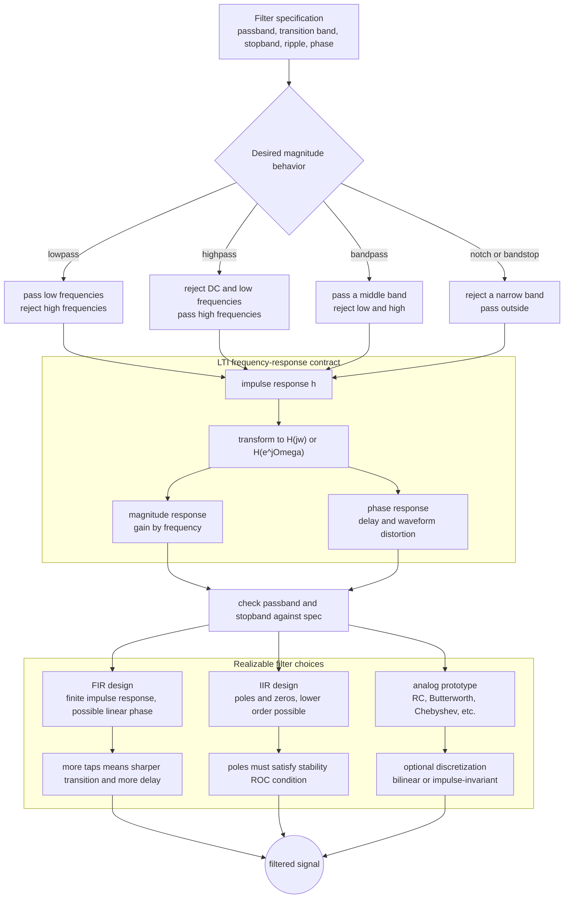

# Frequency Response and Filtering

Frequency response describes how an LTI system changes sinusoidal or complex exponential components. If the input contains a component at frequency $\omega$, the output contains the same frequency multiplied by a complex number. The magnitude of that number is the gain, and its angle is the phase shift. Filtering is the design or use of frequency response to pass desired components and suppress undesired ones.

Fourier transforms, Laplace transforms, and $z$-transforms meet here. In continuous time, the frequency response is $H(j\omega)$. In discrete time, it is $H(e^{j\Omega})$. In both cases, it comes from the impulse response and acts through multiplication in the frequency domain.

## Why complex exponentials pass through unchanged in form

For a continuous-time LTI system with impulse response $h(t)$, the frequency response is

$$
H(j\omega)=\int_{-\infty}^{\infty}h(t)e^{-j\omega t}\,dt.
$$

If the input is a complex exponential

$$
x(t)=e^{j\omega t},
$$

then the output is

$$
y(t)=H(j\omega)e^{j\omega t}.
$$

This eigenfunction property follows from convolution:

$$
\begin{aligned}
y(t)
&=\int_{-\infty}^{\infty}h(\tau)e^{j\omega(t-\tau)}\,d\tau\\
&=e^{j\omega t}\int_{-\infty}^{\infty}h(\tau)e^{-j\omega\tau}\,d\tau\\
&=H(j\omega)e^{j\omega t}.
\end{aligned}
$$

For a discrete-time LTI system,

$$
H(e^{j\Omega})=\sum_{n=-\infty}^{\infty}h[n]e^{-j\Omega n}.
$$

If

$$
x[n]=e^{j\Omega n},
$$

then

$$
y[n]=H(e^{j\Omega})e^{j\Omega n}.
$$

Magnitude response is

$$
|H(j\omega)| \quad \text{or} \quad |H(e^{j\Omega})|.
$$

Phase response is

$$
\angle H(j\omega) \quad \text{or} \quad \angle H(e^{j\Omega}).
$$

A lowpass filter passes low frequencies and attenuates high frequencies. A highpass filter does the reverse. A bandpass filter passes a middle band. A bandstop or notch filter suppresses a middle band while passing lower and higher frequencies.

The cutoff frequency is a boundary between passband and stopband. For practical filters, passband ripple, stopband attenuation, and transition width replace the impossible ideal brick-wall response.

For a real sinusoid, use conjugate exponentials. If a real LTI system has response $H(j\omega_0)=\vert H\vert e^{j\phi}$, then

$$
A\cos(\omega_0t+\theta)
\longmapsto
A|H(j\omega_0)|
\cos(\omega_0t+\theta+\phi).
$$

The steady-state frequency is unchanged. Transient terms can still appear when initial energy is stored in a physical system; frequency response describes the zero-state sinusoidal steady state.

## Ideal responses and the cost of realizability

For an LTI system,

$$
Y(j\omega)=H(j\omega)X(j\omega)
$$

or

$$
Y(e^{j\Omega})=H(e^{j\Omega})X(e^{j\Omega}).
$$

Thus filtering can be understood as pointwise spectral multiplication. If $H$ is zero over a frequency interval, components in that interval are removed. If $H$ has magnitude greater than one, those components are amplified.

Ideal continuous-time lowpass response:

$$
H_{\text{LP}}(j\omega)=
\begin{cases}
1, & |\omega|\le \omega_c,\\
0, & |\omega|>\omega_c.
\end{cases}
$$

Its impulse response is proportional to a sinc:

$$
h_{\text{LP}}(t)=\frac{\sin(\omega_c t)}{\pi t}.
$$

This impulse response extends infinitely in both time directions, so the ideal lowpass filter is noncausal and not directly realizable without delay and approximation.

An ideal highpass filter can be formed as

$$
H_{\text{HP}}(j\omega)=1-H_{\text{LP}}(j\omega).
$$

In the time domain this corresponds to

$$
h_{\text{HP}}(t)=\delta(t)-h_{\text{LP}}(t).
$$

For discrete-time FIR filters, the frequency response is a finite sum:

$$
H(e^{j\Omega})=\sum_{k=0}^{M}b_k e^{-j\Omega k}.
$$

For recursive IIR filters described by

$$
y[n]+\sum_{k=1}^{N}a_k y[n-k]=\sum_{k=0}^{M}b_k x[n-k],
$$

the system function is

$$
H(z)=\frac{\sum_{k=0}^{M}b_k z^{-k}}{1+\sum_{k=1}^{N}a_k z^{-k}}.
$$

The frequency response is $H(e^{j\Omega})$ if the unit circle is in the ROC. Poles near the unit circle create peaks in the magnitude response; zeros on the unit circle create exact notches.

Filter specifications usually separate passband, transition band, and stopband. In the passband, the filter should preserve desired components within an allowed ripple. In the stopband, the filter should attenuate undesired components by a specified amount. The transition band is the frequency interval where the response moves from passband to stopband. Narrow transition bands require longer FIR filters or higher-order IIR filters.

Phase matters when waveform shape matters. A linear-phase filter delays all frequency components by the same group delay, preserving the shape of broadband pulses apart from delay and magnitude shaping. Nonlinear phase can smear transients even when the magnitude response looks acceptable. Audio, communications, and measurement systems therefore often specify both magnitude and phase behavior.

Write $H=\vert H\vert e^{j\phi}$. Phase delay is $-\phi/\omega$ and group delay is

$$
\tau_g(\omega)=-\frac{d\phi}{d\omega}
$$

in continuous time, or the same derivative with respect to $\Omega$ in samples for discrete time. A linear phase $\phi=-\omega t_d+\phi_0$ gives constant group delay $t_d$. Phase must be unwrapped before differentiation; jumps caused only by reporting angles modulo $2\pi$ are not physical delay spikes.

Ideal filters are useful reference models, but realizable filters trade sharpness, delay, ripple, and stability. A causal approximation to an ideal lowpass response cannot have both finite delay and a perfectly sharp cutoff.

The ideal lowpass impulse response decays only as $1/\vert t\vert $ and extends before $t=0$. Shifting it by a finite delay cannot make the left tail vanish. Truncating and delaying gives a realizable FIR approximation, but multiplication by a finite window in time convolves the brick-wall spectrum with the window spectrum. Transition width and ripple appear together.

No causal stable filter can respond to a frequency component before enough samples or time have arrived to identify it. Narrow frequency discrimination requires a long observation memory. This time-frequency tradeoff underlies the growing delay or order needed as the transition band narrows.

## Filter families and design choices

| Filter type | Passes | Rejects | Ideal response sketch |
|---|---|---|---|
| Lowpass | DC and low frequencies | high frequencies | $\vert \omega\vert \le \omega_c$ |
| Highpass | high frequencies | DC and low frequencies | $\vert \omega\vert \ge \omega_c$ |
| Bandpass | middle band | low and high bands | $\omega_1\le \vert \omega\vert \le \omega_2$ |
| Bandstop / notch | low and high bands | middle band | remove around $\omega_0$ |
| Allpass | all magnitudes | none by magnitude | changes phase only |

Ideal frequency goals lead to realizable LTI systems through an impulse response. Magnitude controls passband and stopband behavior; phase controls delay and waveform distortion. FIR, IIR, and analog-prototype filters make different tradeoffs in transition width, order, and stability.

| Choice | Main strength | Main cost |
|---|---|---|
| FIR | Exact linear phase is possible; no feedback instability | More taps for a narrow transition |
| IIR | Sharp magnitude response with lower order | Nonlinear phase and stability constraints |
| Minimum phase | Least delay for a given causal magnitude response | Phase is fixed by magnitude under stated conditions |
| Allpass cascade | Changes phase without changing magnitude | Adds delay and implementation complexity |

The names Butterworth, Chebyshev, and elliptic refer to different rational approximation criteria. Butterworth magnitude is maximally flat at zero frequency. Chebyshev designs accept ripple in one band for a sharper transition. Elliptic designs accept ripple in both passband and stopband for the smallest order among the classical choices at a given specification. The choice follows the allowed ripple and phase behavior, not a universal ranking.

## Decibels, Bode plots, and cascades

Magnitude in decibels is

$$
G_{\mathrm{dB}}(\omega)=20\log_{10}|H(j\omega)|.
$$

The factor 20 is used because power is proportional to squared voltage or field magnitude when impedance is fixed. A magnitude of $1/\sqrt2$ is approximately $-3.01$ dB, while factors $1/2$ and $1/10$ are about $-6.02$ dB and $-20$ dB.

Cascaded responses multiply:

$$
H_{\text{total}}=H_1H_2\cdots H_m.
$$

Their dB magnitudes and phases add. This makes logarithmic Bode plots useful for rational systems. A first-order pole contributes an asymptotic slope change of $-20$ dB per decade after its corner and approaches $-90^\circ$ phase. A first-order zero contributes the opposite trends. Exact curves change gradually around each corner; straight-line asymptotes are estimates.

For the RC lowpass,

$$
20\log_{10}|H(j\omega)|
=-10\log_{10}(1+\omega^2R^2C^2).
$$

Well above cutoff, magnitude is approximately $1/(\omega RC)$, giving the $-20$ dB per decade slope.

## Worked example 1: RC lowpass frequency response

Problem: A first-order continuous-time lowpass system has impulse response

$$
h(t)=\frac{1}{RC}e^{-t/(RC)}u(t).
$$

Find $H(j\omega)$ and the magnitude response.

Method:

1. Use the CTFT pair

$$
e^{-a t}u(t)\leftrightarrow \frac{1}{a+j\omega}, \qquad a>0.
$$

2. Here

$$
a=\frac{1}{RC}
$$

and the impulse response has scale $1/(RC)$.

3. Therefore

$$
H(j\omega)=\frac{1}{RC}\frac{1}{\frac{1}{RC}+j\omega}.
$$

4. Multiply numerator and denominator by $RC$:

$$
H(j\omega)=\frac{1}{1+j\omega RC}.
$$

5. The magnitude is

$$
|H(j\omega)|=\frac{1}{\sqrt{1+(\omega RC)^2}}.
$$

6. At $\omega=0$,

$$
|H(j0)|=1.
$$

7. At $\omega=1/(RC)$,

$$
|H(j\omega)|=\frac{1}{\sqrt{2}},
$$

which is the usual $-3$ dB cutoff point.

Checked answer:

$$
H(j\omega)=\frac{1}{1+j\omega RC},
\qquad
|H(j\omega)|=\frac{1}{\sqrt{1+(\omega RC)^2}}.
$$

The system passes low frequencies and attenuates high frequencies.

## Worked example 2: notch frequency from FIR zeros

Problem: Consider the discrete-time FIR filter

$$
y[n]=x[n]-2\cos(\Omega_0)x[n-1]+x[n-2].
$$

Show that it has notches at $\Omega=\pm\Omega_0$.

Method:

1. The impulse response is

$$
h[n]=\delta[n]-2\cos(\Omega_0)\delta[n-1]+\delta[n-2].
$$

2. The frequency response is

$$
H(e^{j\Omega})=1-2\cos(\Omega_0)e^{-j\Omega}+e^{-j2\Omega}.
$$

3. Factor the expression using zeros at $e^{\pm j\Omega_0}$:

$$
H(z)=1-2\cos(\Omega_0)z^{-1}+z^{-2}
=\left(1-e^{j\Omega_0}z^{-1}\right)\left(1-e^{-j\Omega_0}z^{-1}\right).
$$

4. Evaluate on the unit circle, $z=e^{j\Omega}$:

$$
H(e^{j\Omega})
=\left(1-e^{j\Omega_0}e^{-j\Omega}\right)
\left(1-e^{-j\Omega_0}e^{-j\Omega}\right).
$$

Equivalently,

$$
H(e^{j\Omega})
=\left(1-e^{-j(\Omega-\Omega_0)}\right)
\left(1-e^{-j(\Omega+\Omega_0)}\right)
$$

This product shows that the response is zero when either factor is zero. The direct substitution below checks the cancellation without relying only on the factorization.

5. At $\Omega=\Omega_0$:

$$
H(e^{j\Omega_0})
=1-2\cos(\Omega_0)e^{-j\Omega_0}+e^{-j2\Omega_0}.
$$

Use $2\cos(\Omega_0)=e^{j\Omega_0}+e^{-j\Omega_0}$:

$$
H(e^{j\Omega_0})
=1-(e^{j\Omega_0}+e^{-j\Omega_0})e^{-j\Omega_0}+e^{-j2\Omega_0}.
$$

Simplify:

$$
H(e^{j\Omega_0})
=1-(1+e^{-j2\Omega_0})+e^{-j2\Omega_0}=0.
$$

6. At $\Omega=-\Omega_0$, the same conjugate-symmetry argument gives

$$
H(e^{-j\Omega_0})=0.
$$

Checked answer: The filter has exact notches at $\Omega=\pm\Omega_0$. Its zeros lie on the unit circle at $z=e^{j\Omega_0}$ and $z=e^{-j\Omega_0}$.

## Worked example: filter a two-tone signal

Let the RC lowpass have $RC=1\ \mathrm{ms}$, and let

$$
x(t)=2\cos(100t)+\cos(5000t).
$$

For each tone,

$$
H(j\omega)=\frac{1}{1+j\omega RC}.
$$

At $\omega_1=100$ rad/s, $\omega_1RC=0.1$, so

$$
|H(j100)|=\frac{1}{\sqrt{1+0.1^2}}
\approx0.995,
$$

$$
\angle H(j100)=-\tan^{-1}(0.1)
\approx-5.71^\circ.
$$

At $\omega_2=5000$ rad/s, $\omega_2RC=5$, giving

$$
|H(j5000)|=\frac{1}{\sqrt{26}}
\approx0.196,
$$

$$
\angle H(j5000)=-\tan^{-1}(5)
\approx-78.7^\circ.
$$

The zero-state steady-state output is

$$
y_{ss}(t)
\approx1.99\cos(100t-5.71^\circ)
+0.196\cos(5000t-78.7^\circ).
$$

The low-frequency tone is almost unchanged, while the high-frequency tone is reduced by roughly a factor of five and strongly phase shifted. Any startup transient from the capacitor's initial condition is separate from this frequency-response calculation and decays with time constant $RC$.

## Poles, zeros, and stability

For rational systems, zeros suppress frequencies near their angular locations and poles enhance them. In discrete time, distance to the unit circle matters: a pole at radius $r\lt 1$ and angle $\Omega_0$ produces a resonance near $\Omega_0$ that becomes narrower and taller as $r$ approaches one. A zero exactly on the unit circle produces an exact null at its angle.

Pole-zero geometry alone does not establish a system's frequency response. The ROC must include the frequency contour: the imaginary axis for a continuous-time Laplace transform or the unit circle for a $z$-transform. A causal rational discrete-time system is BIBO stable only when all poles lie strictly inside the unit circle. Marginal pole locations on the unit circle generally prevent absolute summability even when a formal sinusoidal expression can be written away from the pole.

Moving zeros or poles to sharpen one part of a response affects other properties. A narrow notch is sensitive to coefficient quantization and frequency drift. A high-Q pole pair rings longer in time. The same pole radius that narrows a resonance also lengthens its transient decay.

## Magnitude alone does not determine every filter

Multiplying a stable response by an allpass factor changes phase while leaving magnitude unchanged on the frequency contour. A first-order discrete-time example is

$$
A(z)=\frac{z^{-1}-a^*}{1-az^{-1}},
\qquad |a|<1.
$$

On the unit circle, numerator and denominator have equal magnitudes, so $\vert A(e^{j\Omega})\vert =1$. Cascading this section with another filter preserves its magnitude response and modifies group delay.

Among causal stable systems with a given compatible magnitude, a minimum-phase realization places all zeros in the stable region and has the smallest associated delay in a precise energy-concentration sense. Reflecting a zero across the unit circle can preserve magnitude up to a scale factor while changing phase. Equal magnitude plots therefore do not imply equal transient behavior.

Filtering also cannot generally separate components that occupy the same frequencies. If desired signal and noise overlap spectrally, a fixed LTI magnitude response attenuates both together. Additional structure—statistical models, time variation, multiple sensors, or nonlinear processing—is needed. Calling every denoising operation a frequency filter can conceal that limitation.

Real-time and offline filtering have different causality constraints. An offline zero-phase operation can filter forward and backward, canceling phase distortion but using future samples and squaring the magnitude response. Such an operation is useful for recorded data but cannot be implemented as a causal live system without delay and prediction.

## Specification and interpretation mistakes

- Calling a filter ideal without noticing whether its impulse response is causal or finite-duration.
- Ignoring phase response. Two systems can have similar magnitude responses but different waveform distortion.
- Evaluating $H(z)$ on the unit circle when the unit circle is outside the ROC.
- Assuming poles near the unit circle are always bad. They can be useful for resonance, but they reduce stability margin in causal IIR filters.
- Mixing continuous-time cutoff $\omega_c$ in rad/s with discrete-time cutoff $\Omega_c$ in rad/sample.

See also: [Continuous-Time Fourier Transform](/physics/signals-systems/continuous-time-fourier-transform) · [Discrete-Time Fourier Transform](/physics/signals-systems/discrete-time-fourier-transform) · [Laplace Transform and ROC](/physics/signals-systems/laplace-transform-roc) · [Z-Transform and ROC](/physics/signals-systems/z-transform-roc) · [Sampling, Aliasing, and Reconstruction](/physics/signals-systems/sampling-aliasing-reconstruction)

