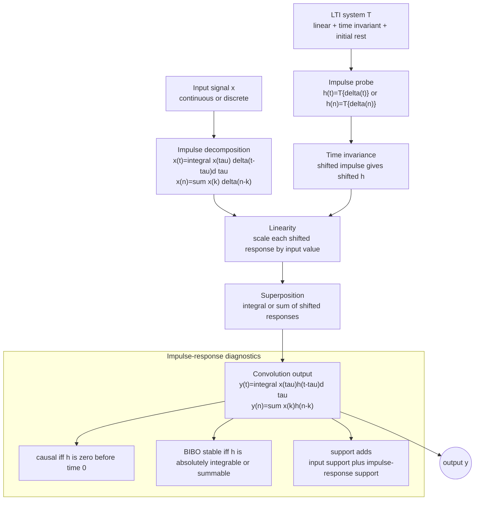

# LTI Systems and Convolution

Linear time-invariant systems are the central model class in signals and systems because they are both expressive and computable. Linearity lets responses add, and time invariance lets a shifted input impulse produce a shifted copy of one fixed response. From these two facts, the output for any input is obtained by convolution with the impulse response.

Convolution is often introduced as a formula, but its meaning is constructive. Break the input into weighted impulses. Pass each impulse through the system. Shift and scale the impulse response for each piece. Add all those responses. In continuous time this addition becomes an integral; in discrete time it becomes a sum.

## From impulse decomposition to convolution

The impulse response of a continuous-time system is the output when the input is $\delta(t)$:

$$
h(t)=T\{\delta(t)\}.
$$

The impulse response of a discrete-time system is

$$
h[n]=T\{\delta[n]\}.
$$

For a continuous-time LTI system, the input can be represented as

$$
x(t)=\int_{-\infty}^{\infty}x(\tau)\delta(t-\tau)\,d\tau.
$$

By time invariance,

$$
T\{\delta(t-\tau)\}=h(t-\tau).
$$

By linearity, the output is

$$
y(t)=\int_{-\infty}^{\infty}x(\tau)h(t-\tau)\,d\tau.
$$

This is the continuous-time convolution of $x$ and $h$, written

$$
y(t)=(x*h)(t).
$$

For a discrete-time LTI system,

$$
x[n]=\sum_{k=-\infty}^{\infty}x[k]\delta[n-k],
$$

so

$$
y[n]=\sum_{k=-\infty}^{\infty}x[k]h[n-k].
$$

This is discrete-time convolution:

$$
y[n]=(x*h)[n].
$$

Convolution has equivalent forms:

$$
(x*h)(t)=\int_{-\infty}^{\infty}h(\tau)x(t-\tau)\,d\tau,
$$

and

$$
(x*h)[n]=\sum_{k=-\infty}^{\infty}h[k]x[n-k].
$$

For a causal continuous-time LTI system,

$$
h(t)=0 \quad \text{for } t<0.
$$

For a causal discrete-time LTI system,

$$
h[n]=0 \quad \text{for } n<0.
$$

BIBO stability for an LTI system is equivalent to absolute integrability or summability:

$$
\int_{-\infty}^{\infty}|h(t)|\,dt<\infty
$$

for continuous time, and

$$
\sum_{n=-\infty}^{\infty}|h[n]|<\infty
$$

for discrete time.

## Algebra of interconnected LTI systems

Convolution is commutative:

$$
x*h=h*x.
$$

For continuous time, this follows from the change of variables $\lambda=t-\tau$. For discrete time, it follows from the index substitution $\ell=n-k$. Commutativity means either signal can be flipped and shifted in the graphical convolution procedure, but it does not mean the physical roles of input and impulse response are identical.

Convolution is associative:

$$
x*(h_1*h_2)=(x*h_1)*h_2.
$$

This property explains why cascaded LTI systems have an equivalent impulse response

$$
h_{\text{eq}}=h_1*h_2.
$$

Convolution is distributive:

$$
x*(h_1+h_2)=x*h_1+x*h_2.
$$

This explains parallel interconnections of LTI systems.

The impulse is the identity element:

$$
x(t)*\delta(t)=x(t), \qquad x[n]*\delta[n]=x[n].
$$

Shifting an impulse response shifts the output:

$$
x(t)*\delta(t-t_0)=x(t-t_0),
$$

and

$$
x[n]*\delta[n-n_0]=x[n-n_0].
$$

For differential equation systems with zero initial rest, impulse response can be found by solving the equation with impulse input or by transform methods. For difference equation systems, $h[n]$ is found by setting $x[n]=\delta[n]$ and recursively computing the output, assuming initial rest.

Graphical convolution is easiest when treated as an overlap problem. First identify where $x(\tau)$ is nonzero. Then identify where $h(t-\tau)$ or $h[n-k]$ is nonzero for a fixed output time or sample. The output is the area or sum of the product over the overlap. For rectangular pulses this reduces to overlap length; for ramps and exponentials the integrand changes over the overlap and the integral must be evaluated on each range.

Support gives a quick check. If $x(t)$ is supported on $[a,b]$ and $h(t)$ is supported on $[c,d]$, then $x*h$ is supported on $[a+c,b+d]$, assuming no exact cancellations. In discrete time, if one sequence occupies indices $a$ through $b$ and another occupies $c$ through $d$, the convolution occupies $a+c$ through $b+d$. This support rule catches many off-by-one and endpoint mistakes.

Convolution also explains why LTI systems are easy to interconnect. In cascade, impulse responses convolve. In parallel, impulse responses add. In feedback, the equivalent impulse response can often be described by an infinite convolution series or by transform-domain algebra, provided the feedback interconnection is stable and well-defined. These interconnection rules are not generic system rules; they rely on LTI structure.

The impulse response is sometimes more informative than the original equation. A short finite impulse response means the system has finite memory. A long decaying impulse response means old inputs continue to matter but with decreasing influence. A nondecaying impulse response warns that bounded inputs may produce unbounded or persistent accumulated effects.

The order of a cascade does not matter for ideal LTI blocks because convolution is commutative. Physical implementations may still differ through saturation, quantization, overflow, noise injection, or nonzero initial conditions. Those effects lie outside the ideal zero-state LTI model.

## Causality, memory, and stability from $h$

Causality follows directly from convolution. If $h(t)=0$ for negative time, then at time $t$ the integrand can be nonzero only when $t-\tau\ge0$, or $\tau\le t$. The output depends only on present and past input values. Conversely, if $h(t_0)\ne0$ for some $t_0\lt 0$, an impulse applied at time zero produces a nonzero output before the input, violating causality.

A continuous-time LTI system is memoryless only when its impulse response is a scaled impulse,

$$
h(t)=K\delta(t),
$$

which gives $y(t)=Kx(t)$. In discrete time the corresponding condition is $h[n]=K\delta[n]$. Any nonzero response at another delay makes the output depend on a different input time.

Absolute integrability is sufficient for BIBO stability. If $\vert x(t)\vert \le M_x$, then

$$
\begin{aligned}
|y(t)|
&\le\int_{-\infty}^{\infty}|x(\tau)||h(t-\tau)|\,d\tau\\
&\le M_x\int_{-\infty}^{\infty}|h(\lambda)|\,d\lambda.
\end{aligned}
$$

The last integral is finite and independent of $t$. Necessity can be shown by choosing a bounded input that matches the conjugate phase or sign of a reversed impulse response over a growing interval. If the absolute integral diverges, such an input makes the output unbounded. The discrete-time proof uses the same argument with sums.

Stability here means bounded input produces bounded output. It differs from finite-energy response, asymptotic state stability, and numerical stability. For standard finite-dimensional causal systems these notions are related, but they are not interchangeable without assumptions.

## Step response and initial conditions

The step response is

$$
s(t)=(h*u)(t).
$$

For a causal system,

$$
s(t)=\int_0^t h(\tau)\,d\tau,
$$

so $h(t)=ds(t)/dt$ wherever ordinary differentiation applies. In discrete time,

$$
s[n]=\sum_{k=-\infty}^{n}h[k],
\qquad
h[n]=s[n]-s[n-1].
$$

Step response is easier to measure in many physical systems, while impulse response is more convenient mathematically. The two contain equivalent zero-state information for an LTI system.

For a constant-coefficient differential or difference equation, convolution assumes initial rest. Nonzero initial conditions add a zero-input response that cannot be inferred from input convolution alone. Treating a transfer-function response as the complete solution when stored energy is present omits that term.

## The impulse-response construction

The input is decomposed into shifted impulses, time invariance supplies shifted copies of $h$, and linearity scales and sums them into the convolution integral or sum. Causality, BIBO stability, and support follow from the resulting impulse response.

| LTI fact | Continuous time | Discrete time |
|---|---|---|
| Impulse response | $h(t)=T\{\delta(t)\}$ | $h[n]=T\{\delta[n]\}$ |
| Convolution | $y(t)=\int x(\tau)h(t-\tau)d\tau$ | $y[n]=\sum_k x[k]h[n-k]$ |
| Causality | $h(t)=0$ for $t\lt 0$ | $h[n]=0$ for $n\lt 0$ |
| BIBO stability | $\int \vert h(t)\vert dt\lt \infty$ | $\sum_n \vert h[n]\vert \lt \infty$ |
| Identity | $\delta(t)$ | $\delta[n]$ |

## Worked example: continuous-time convolution of two pulses

Problem: Let

$$
x(t)=u(t)-u(t-2),
\qquad
h(t)=u(t)-u(t-3).
$$

Find $y(t)=x(t)*h(t)$.

Method:

1. Interpret the signals. $x(t)$ is a unit-height rectangle on $0\le t\lt 2$. $h(t)$ is a unit-height rectangle on $0\le t\lt 3$.

2. The convolution integral is

$$
y(t)=\int_{-\infty}^{\infty}x(\tau)h(t-\tau)\,d\tau.
$$

3. The factor $x(\tau)$ is nonzero for

$$
0\le \tau<2.
$$

4. The factor $h(t-\tau)$ is nonzero when

$$
0\le t-\tau<3.
$$

This is equivalent to

$$
t-3<\tau\le t.
$$

5. The integrand equals $1$ where the intervals overlap:

$$
[0,2) \cap (t-3,t].
$$

Therefore $y(t)$ equals the length of that overlap.

6. Work by ranges of $t$:

If $t\lt 0$, no overlap:

$$
y(t)=0.
$$

If $0\le t\lt 2$, the overlap is from $0$ to $t$, length $t$:

$$
y(t)=t.
$$

If $2\le t\lt 3$, the shorter pulse is fully inside the longer overlap window, length $2$:

$$
y(t)=2.
$$

If $3\le t\lt 5$, the overlap is from $t-3$ to $2$, length $5-t$:

$$
y(t)=5-t.
$$

If $t\ge 5$, no overlap:

$$
y(t)=0.
$$

Checked answer:

$$
y(t)=
\begin{cases}
0, & t<0,\\
t, & 0\le t<2,\\
2, & 2\le t<3,\\
5-t, & 3\le t<5,\\
0, & t\ge 5.
\end{cases}
$$

The support length is $2+3=5$, as expected for convolution of two right-starting finite pulses.

## Worked example: discrete-time convolution

Problem: Compute $y[n]=x[n]*h[n]$ for

$$
x[n]=\delta[n]+2\delta[n-1]+\delta[n-2],
$$

and

$$
h[n]=\delta[n]-\delta[n-1].
$$

Method:

1. Use impulse shifting:

$$
x*h=(\delta[n]+2\delta[n-1]+\delta[n-2])*h[n].
$$

2. Distribute convolution:

$$
y[n]=\delta[n]*h[n]+2\delta[n-1]*h[n]+\delta[n-2]*h[n].
$$

3. Convolution with a shifted impulse shifts $h$:

$$
y[n]=h[n]+2h[n-1]+h[n-2].
$$

4. Substitute $h[n]=\delta[n]-\delta[n-1]$:

$$
y[n]=(\delta[n]-\delta[n-1])
+2(\delta[n-1]-\delta[n-2])
+(\delta[n-2]-\delta[n-3]).
$$

5. Collect like impulse terms:

$$
y[n]=\delta[n]+\delta[n-1]-\delta[n-2]-\delta[n-3].
$$

Checked answer: The output samples are $1$ at $n=0$, $1$ at $n=1$, $-1$ at $n=2$, $-1$ at $n=3$, and $0$ elsewhere. Direct summation gives the same result.

## Worked example: response of a first-order system to a pulse

Let

$$
h(t)=e^{-t}u(t),
\qquad
x(t)=u(t)-u(t-T),
$$

with $T\gt 0$. Since $x(t)$ is the difference of two steps, linearity and time invariance give

$$
y(t)=(h*u)(t)-(h*u)(t-T).
$$

First find the step response:

$$
\begin{aligned}
s(t)
&=\int_{-\infty}^{\infty}e^{-\tau}u(\tau)u(t-\tau)\,d\tau\\
&=\int_0^t e^{-\tau}\,d\tau\\
&=1-e^{-t},
\end{aligned}
$$

for $t\ge0$, and zero otherwise. Thus

$$
y(t)=(1-e^{-t})u(t)
-(1-e^{-(t-T)})u(t-T).
$$

Written by time range,

$$
y(t)=
\begin{cases}
0, & t<0,\\
1-e^{-t}, & 0\le t<T,\\
e^{-(t-T)}-e^{-t}, & t\ge T.
\end{cases}
$$

For $t\ge T$, factor the decay:

$$
y(t)=(e^T-1)e^{-t}.
$$

The output rises toward its unit-step steady value while the pulse is on. At $t=T$ the input turns off; the output is continuous and then decays to zero. Continuity follows because this impulse response contains no direct-feedthrough impulse.

## Convolution in the transform domains

Fourier, Laplace, and $z$ transforms convert convolution into multiplication. For the CTFT,

$$
Y(j\omega)=X(j\omega)H(j\omega).
$$

This does not replace the time-domain definition. It supplies a different calculation route and reveals how the system treats each frequency. Laplace and $z$ transforms additionally encode convergence and are often better for causal exponentials and differential equations.

Transform multiplication also explains cascade algebra. Each block contributes one multiplicative factor, so rearranging ideal factors does not change the product. Inverse transformation returns the same convolved impulse response.

For finite discrete sequences, a DFT product gives circular convolution. Linear convolution has length $L_x+L_h-1$ and can be computed by padding both sequences to at least that length before taking DFTs. Insufficient padding wraps the tail onto the beginning; that is a different operation, not a numerical approximation error.

## Useful checks before integrating

Several features of a convolution can be predicted without evaluating it. Support endpoints add. If both functions are nonnegative, the result must be nonnegative. If both are causal, the result is causal. If one factor is even and the other odd, their convolution is odd; even convolved with even is even.

Areas multiply when the integrals converge:

$$
\int_{-\infty}^{\infty}(x*h)(t)\,dt
=\left(\int x(t)\,dt\right)
\left(\int h(t)\,dt\right).
$$

For an LTI system, the second factor is its DC gain $H(0)$. A unit-area smoothing kernel preserves the area of the input. A zero-area impulse response removes DC.

Differentiation can be moved between convolution factors under suitable conditions:

$$
\frac{d}{dt}(x*h)
=\frac{dx}{dt}*h
=x*\frac{dh}{dt}.
$$

This identity is useful with steps and impulses. Since $du/dt=\delta$, differentiating a step response recovers the impulse response. Boundary impulses must be retained when differentiating piecewise signals; ignoring them gives an incomplete result.

For normalized nonnegative $h(t)$, convolution forms a weighted local average of $x$. Rapid fluctuations tend to cancel while slowly varying components survive, which is the time-domain view of lowpass filtering. If $h$ has positive and negative lobes, convolution can instead detect changes or selected patterns. The operation itself is neutral; smoothing depends on the shape of the kernel.

The peak of a convolution is not generally the product of peaks. Each output value is an accumulated overlap, so width matters as much as height. A narrow tall pulse and a broad short pulse can have the same area and produce similar responses when the system varies slowly over their durations.

## A reliable graphical procedure

For $y(t)=\int x(\tau)h(t-\tau)d\tau$, first express both functions against the dummy axis $\tau$. Flip $h(\tau)$ to get $h(-\tau)$, shift it by $t$ to get $h(t-\tau)$, then find the product with $x(\tau)$. Breakpoints occur when endpoints or formula changes in the shifted function cross endpoints or breakpoints of the fixed function.

Writing the overlap as inequalities is safer than relying only on a sketch. If $x$ is supported on $[a,b]$ and $h$ on $[c,d]$, then $h(t-\tau)$ is nonzero for $t-d\le\tau\le t-c$. The integration limits are

$$
\max(a,t-d)\le\tau\le\min(b,t-c).
$$

The overlap exists when the lower limit does not exceed the upper limit. Changes in which argument wins each maximum or minimum determine the piecewise ranges of $t$.

## Errors in setting up the overlap

- Forgetting the flip in graphical convolution. The term is $h(t-\tau)$ or $h[n-k]$, not $h(t+\tau)$.
- Using LTI convolution for a system that is linear but time-varying, or time-invariant but nonlinear.
- Confusing impulse response with step response. The step response is the convolution of $h$ with $u$.
- Dropping boundary cases in finite pulse convolution. Draw overlap intervals and compute lengths.
- Assuming causal means stable. A causal impulse response can still fail absolute integrability or summability.

See also: [System Properties](/physics/signals-systems/system-properties) · [Continuous-Time Fourier Transform](/physics/signals-systems/continuous-time-fourier-transform) · [Discrete-Time Fourier Transform](/physics/signals-systems/discrete-time-fourier-transform) · [Laplace Transform and ROC](/physics/signals-systems/laplace-transform-roc) · [Z-Transform and ROC](/physics/signals-systems/z-transform-roc)

