# Modulation and Communication Systems

Modulation moves signal content from one frequency range to another. In communication systems, a low-frequency message can be shifted to a high-frequency carrier so it can be transmitted efficiently, separated from other users, or matched to an antenna and channel. In signals and systems language, modulation is multiplication in time, which becomes convolution or shifting in frequency.

The simplest modulation models are built from sinusoids and Fourier transform properties. Amplitude modulation shifts spectra by multiplying a message by a carrier. Frequency modulation changes the instantaneous phase derivative. Sampling can also be viewed as modulation by an impulse train, which produces repeated spectral copies.

## Moving a baseband spectrum to a carrier

Let $m(t)$ be a message signal. Complex modulation by $e^{j\omega_c t}$ produces

$$
x(t)=m(t)e^{j\omega_c t}.
$$

By the CTFT frequency-shifting property,

$$
X(j\omega)=M(j(\omega-\omega_c)).
$$

Real sinusoidal modulation by a cosine is

$$
x(t)=m(t)\cos(\omega_c t).
$$

Using

$$
\cos(\omega_c t)=\frac{1}{2}\left(e^{j\omega_c t}+e^{-j\omega_c t}\right),
$$

the spectrum is

$$
X(j\omega)=\frac{1}{2}M(j(\omega-\omega_c))+\frac{1}{2}M(j(\omega+\omega_c)).
$$

Thus a real carrier creates upper and lower shifted copies of the message spectrum.

Conventional amplitude modulation with carrier is often written

$$
s(t)=A_c\left[1+k_a m(t)\right]\cos(\omega_c t),
$$

where $A_c$ is carrier amplitude and $k_a$ is amplitude sensitivity. The term $A_c\cos(\omega_c t)$ is the transmitted carrier, and $A_c k_a m(t)\cos(\omega_c t)$ contains the message sidebands.

Double-sideband suppressed-carrier modulation is

$$
s_{\text{DSB-SC}}(t)=m(t)\cos(\omega_c t).
$$

Synchronous demodulation multiplies the modulated signal by a locally generated carrier and then lowpass filters:

$$
2s_{\text{DSB-SC}}(t)\cos(\omega_c t)
=2m(t)\cos^2(\omega_c t)
=m(t)\left[1+\cos(2\omega_c t)\right].
$$

An ideal lowpass filter removes the $2\omega_c$ term and recovers $m(t)$, assuming carrier phase and frequency match.

Angle modulation represents a carrier as

$$
s(t)=A_c\cos(\theta_i(t)),
$$

where the instantaneous angular frequency is

$$
\omega_i(t)=\frac{d\theta_i(t)}{dt}.
$$

For frequency modulation,

$$
\omega_i(t)=\omega_c+k_f m(t),
$$

so

$$
\theta_i(t)=\omega_c t+k_f\int_{-\infty}^{t}m(\tau)\,d\tau.
$$

## Sidebands, bandwidth, and carrier recovery

Multiplication in time corresponds to frequency-domain convolution:

$$
x(t)c(t)\leftrightarrow \frac{1}{2\pi}X(j\omega)*C(j\omega).
$$

When $c(t)=\cos(\omega_c t)$, its transform is

$$
C(j\omega)=\pi\delta(\omega-\omega_c)+\pi\delta(\omega+\omega_c).
$$

Convolving $M(j\omega)$ with these impulses shifts the spectrum:

$$
m(t)\cos(\omega_c t)
\leftrightarrow
\frac{1}{2}M(j(\omega-\omega_c))+\frac{1}{2}M(j(\omega+\omega_c)).
$$

For distortion-free amplitude modulation with carrier, the envelope should not cross zero. A common sufficient condition is

$$
|k_a m(t)|<1
$$

for all $t$. If this is violated, envelope detection can fail because overmodulation folds the envelope.

Frequency-division multiplexing relies on nonoverlapping shifted spectra. If messages $m_1(t)$ and $m_2(t)$ are bandlimited to $B_1$ and $B_2$, carriers should be separated enough that their sidebands do not overlap:

$$
|\omega_{c1}-\omega_{c2}|>B_1+B_2
$$

in angular-frequency units, with guard bands in practical systems.

Sampling is a special modulation process:

$$
x_p(t)=x(t)\sum_{n=-\infty}^{\infty}\delta(t-nT).
$$

Multiplication by the impulse train creates periodic spectral replicas:

$$
X_p(j\omega)=\frac{1}{T}\sum_{k=-\infty}^{\infty}X(j(\omega-k\omega_s)).
$$

This is the same equation used in the sampling theorem. In communication terms, the impulse train is a carrier with infinitely many spectral lines.

Carrier placement is a bandwidth allocation problem. For DSB-SC or conventional AM with a message bandwidth $B$, the transmitted positive-frequency band extends roughly from $\omega_c-B$ to $\omega_c+B$. If $\omega_c$ is too small, the lower sideband can overlap baseband or cross zero frequency. If multiple users share a channel, guard bands are inserted because practical filters do not have infinitely sharp edges.

Coherent demodulation assumes the receiver oscillator has the same frequency and phase as the transmitter carrier. A phase error changes the recovered amplitude and can mix message components into an unwanted quadrature channel. A frequency error creates a slowly rotating phase term that may sound like beating in audio or produce symbol rotation in digital communication. These effects are system issues, but they are predicted by the same multiplication and frequency-shift properties.

Angle modulation is different from ordinary multiplication. FM does not simply shift the message spectrum by a carrier. The instantaneous frequency varies with the message, and the resulting spectrum can contain many sidebands. Narrowband FM can be approximated with a small number of terms, but wideband FM requires bandwidth rules such as Carson's rule in communication courses.

In baseband-equivalent analysis, engineers often use complex envelopes to avoid carrying both positive and negative carrier bands explicitly. The real transmitted waveform is recovered by taking the real part after multiplication by $e^{j\omega_c t}$. This notation is compact, but the underlying frequency-shift rules are the same ones shown here.

## Carrier AM and power efficiency

For a single-tone message normalized as $m(t)=\cos\omega_mt$, conventional AM is

$$
s(t)=A_c[1+\mu\cos(\omega_mt)]\cos(\omega_ct),
$$

where $\mu$ is the modulation index. Expanding the product gives

$$
\begin{aligned}
s(t)
&=A_c\cos(\omega_ct)\\
&\quad+\frac{A_c\mu}{2}\cos((\omega_c+\omega_m)t)\\
&\quad+\frac{A_c\mu}{2}\cos((\omega_c-\omega_m)t).
\end{aligned}
$$

The message appears in two sidebands, while the carrier line contains no message variation. For a resistive load $R$, the carrier power is $A_c^2/(2R)$ and each sideband power is $A_c^2\mu^2/(8R)$. Total power is

$$
P_T=P_c\left(1+\frac{\mu^2}{2}\right).
$$

At the largest envelope-safe single-tone value $\mu=1$, only one third of total transmitted power lies in the sidebands. DSB-SC suppresses the uninformative carrier and requires coherent recovery in exchange.

Single-sideband modulation removes one of the two redundant sidebands of a real message. It occupies message bandwidth $B$ rather than the $2B$ required by DSB. Generating and demodulating it requires phase-selective or complex-signal methods because a simple real multiplication creates both copies.

## In-phase and quadrature representation

A real passband waveform centered near $\omega_c$ can be written

$$
s(t)=I(t)\cos(\omega_ct)-Q(t)\sin(\omega_ct)
=\operatorname{Re}\left\{[I(t)+jQ(t)]e^{j\omega_ct}\right\}.
$$

The complex envelope $I(t)+jQ(t)$ stores the two baseband degrees of freedom. Orthogonal carriers can share the same radio-frequency band because coherent multiplication and lowpass filtering separate them. If the receiver's local oscillator has phase error $\phi$, recovered components are rotated:

$$
\begin{bmatrix}
I_r\\Q_r
\end{bmatrix}
=
\begin{bmatrix}
\cos\phi&-\sin\phi\\
\sin\phi&\cos\phi
\end{bmatrix}
\begin{bmatrix}
I\\Q
\end{bmatrix}.
$$

A common phase error therefore mixes the channels rather than merely scaling both. A frequency offset makes the rotation angle grow with time.

Complex-envelope notation also clarifies negative frequency. The analytic or complex baseband signal carries one shifted spectral copy; taking the real part generates the conjugate copy required for a real transmitted waveform.

## Transmitter and receiver signal flow

```mermaid
flowchart LR
  Message["Baseband message m(t)<br/>bandwidth B"] --> TXChoice{"Transmitter mapping"}

  subgraph AM["Amplitude modulation path"]
    direction TB
    Carrier["carrier cos(omega_c t)"] --> Mixer["multiply by carrier<br/>DSB-SC or conventional AM"]
    Message --> Mixer
    Mixer --> Sidebands["shifted spectra<br/>copies around +/- omega_c"]
    Sidebands --> TXFilter["bandpass filter and power amplifier"]
  end

  subgraph Angle["Angle modulation path"]
    direction TB
    Message --> Integrate["integrate or scale message<br/>instantaneous phase/frequency law"]
    Integrate --> FM["FM/PM waveform<br/>many sidebands possible"]
  end

  TXChoice -- "AM or DSB-SC" --> Carrier
  TXChoice -- "FM or PM" --> Integrate
  TXFilter --> Channel["Channel<br/>attenuation, noise, bandwidth limits"]
  FM --> Channel

  subgraph RX["Receiver recovery"]
    direction TB
    Channel --> RF["front-end bandpass and gain"]
    RF --> Sync{"carrier/phase reference available?"}
    Sync -- "yes" --> Coherent["coherent mixer<br/>multiply by local oscillator"]
    Sync -- "no, AM envelope" --> Envelope["envelope detector<br/>requires no overmodulation"]
    Coherent --> LP["lowpass filter<br/>remove image near 2 omega_c"]
    Envelope --> LP
    LP --> Recover["recovered baseband estimate"]
  end

  Recover --> Check["check guard bands, carrier offset, phase error, and aliasing"]
  Check --> Out(("received message"))
```



The AM path mixes the message with a carrier to create sidebands, while the angle-modulation path maps the message into instantaneous phase or frequency. The receiver separates coherent mixing from envelope detection and lowpass recovery.

| Modulation type | Time-domain form | Spectrum effect | Typical recovery |
|---|---|---|---|
| Complex modulation | $m(t)e^{j\omega_c t}$ | one-sided shift by $\omega_c$ | multiply by $e^{-j\omega_c t}$ |
| DSB-SC AM | $m(t)\cos\omega_c t$ | upper and lower sidebands | synchronous demodulation |
| Conventional AM | $A_c[1+k_am(t)]\cos\omega_c t$ | carrier plus sidebands | envelope detector if not overmodulated |
| Sampling | $x(t)\sum_n\delta(t-nT)$ | repeated spectral copies | ideal lowpass if no aliasing |
| FM | $A_c\cos(\omega_ct+k_f\int m)$ | bandwidth depends on deviation | frequency discriminator or PLL |

## Worked example: spectrum of DSB-SC modulation

Problem: A message $m(t)$ has spectrum

$$
M(j\omega)=0 \quad \text{for } |\omega|>1000\pi.
$$

The transmitted signal is

$$
s(t)=m(t)\cos(10000\pi t).
$$

Find the occupied positive-frequency sideband intervals.

Method:

1. The message is bandlimited to

$$
\omega_M=1000\pi.
$$

2. The carrier angular frequency is

$$
\omega_c=10000\pi.
$$

3. Cosine modulation creates two shifted copies:

$$
S(j\omega)=\frac{1}{2}M(j(\omega-\omega_c))
+\frac{1}{2}M(j(\omega+\omega_c)).
$$

4. The positive-frequency copy centered at $+\omega_c$ occupies

$$
\omega_c-\omega_M\le \omega\le \omega_c+\omega_M.
$$

5. Substitute values:

$$
10000\pi-1000\pi\le \omega\le 10000\pi+1000\pi.
$$

Thus

$$
9000\pi\le \omega\le 11000\pi.
$$

6. In hertz, divide by $2\pi$:

$$
4500\le f\le 5500 \ \text{Hz}.
$$

Checked answer: The positive-frequency sideband occupies $4500$ Hz to $5500$ Hz. A symmetric negative-frequency copy occupies $-5500$ Hz to $-4500$ Hz.

## Worked example: synchronous demodulation scale

Problem: Let

$$
s(t)=m(t)\cos(\omega_c t).
$$

The receiver multiplies by $2\cos(\omega_c t)$ and then applies an ideal lowpass filter that passes the message band and rejects frequencies around $2\omega_c$. Show the recovered signal.

Method:

1. Multiply:

$$
v(t)=2s(t)\cos(\omega_c t)
=2m(t)\cos^2(\omega_c t).
$$

2. Use the identity

$$
\cos^2(\omega_c t)=\frac{1+\cos(2\omega_c t)}{2}.
$$

3. Substitute:

$$
v(t)=2m(t)\frac{1+\cos(2\omega_c t)}{2}.
$$

4. Simplify:

$$
v(t)=m(t)+m(t)\cos(2\omega_c t).
$$

5. The first term is the baseband message. The second term is a copy shifted around $\pm 2\omega_c$.

6. The ideal lowpass filter passes $m(t)$ and rejects $m(t)\cos(2\omega_c t)$, assuming the carrier is high enough that the shifted term does not overlap the message band.

Checked answer:

$$
y(t)=m(t).
$$

If the receiver had multiplied by only $\cos(\omega_c t)$ instead of $2\cos(\omega_c t)$, the recovered baseband would be $m(t)/2$.

## Worked example: effect of coherent phase error

Let the received DSB-SC signal be $s(t)=m(t)\cos\omega_ct$, but let the receiver multiply by $2\cos(\omega_ct+\phi)$. Then

$$
\begin{aligned}
v(t)
&=2m(t)\cos\omega_ct\cos(\omega_ct+\phi)\\
&=m(t)\left[
\cos\phi+\cos(2\omega_ct+\phi)
\right].
\end{aligned}
$$

After lowpass filtering,

$$
y(t)=m(t)\cos\phi.
$$

A $30^\circ$ phase error produces gain $\cos30^\circ=\sqrt3/2\approx0.866$. At $90^\circ$, the recovered output is zero even though the received radio-frequency signal is present. In a quadrature receiver, the missing component appears in the other channel as a rotation rather than being destroyed.

If the local oscillator also has frequency offset $\Delta\omega$, replace $\phi$ by $\Delta\omega t+\phi$. The recovered message is multiplied by a time-varying cosine, causing fading or spectral spreading. Carrier tracking is therefore part of coherent reception.

## Single-tone FM and its sidebands

For $m(t)=A_m\cos\omega_mt$, frequency modulation becomes

$$
s(t)=A_c\cos(\omega_ct+\beta\sin\omega_mt),
$$

where the modulation index is

$$
\beta=\frac{k_fA_m}{\omega_m}
=\frac{\Delta\omega}{\omega_m}.
$$

Unlike AM, the exact FM spectrum contains carrier-spaced sidebands at $\omega_c\pm n\omega_m$ for all nonnegative integers $n$. Their amplitudes are governed by Bessel functions $J_n(\beta)$. The total power remains constant because the envelope amplitude $A_c$ does not vary.

When $\beta\ll1$, retain only first-order terms:

$$
\begin{aligned}
s(t)
&\approx A_c\cos\omega_ct
-A_c\beta\sin\omega_mt\sin\omega_ct\\
&=A_c\cos\omega_ct
+\frac{A_c\beta}{2}
\left[
\cos((\omega_c+\omega_m)t)
-\cos((\omega_c-\omega_m)t)
\right].
\end{aligned}
$$

Narrowband FM resembles a carrier plus two sidebands, but their relative phases differ from ordinary AM. For larger deviation, many sidebands matter. Carson's engineering estimate for occupied bandwidth in hertz is $2(\Delta f+B_m)$, where $\Delta f$ is peak frequency deviation and $B_m$ is highest significant message frequency. It is an approximation for spectral containment, not an exact support boundary.

## Numerical check of coherent recovery

```python
import numpy as np
import matplotlib.pyplot as plt
from scipy.signal import butter, filtfilt

fs = 20_000
t = np.arange(0, 0.05, 1 / fs)
message = np.cos(2 * np.pi * 200 * t) + 0.5 * np.cos(2 * np.pi * 500 * t)
fc = 3_000

s = message * np.cos(2 * np.pi * fc * t)
mixed = 2 * s * np.cos(2 * np.pi * fc * t)

b, a = butter(6, 800 / (fs / 2), btype="low")
recovered = filtfilt(b, a, mixed)

plt.figure(figsize=(9, 4))
plt.plot(t, message, label="message")
plt.plot(t, recovered, "--", label="recovered")
plt.xlim(0, 0.02)
plt.grid(True)
plt.legend()
plt.tight_layout()
plt.show()
```

## What the channel changes

A linear time-invariant channel with response $H_c(j\omega)$ multiplies the transmitted spectrum. If magnitude and phase are nearly constant across the occupied band, it mainly supplies attenuation and delay. Frequency-selective magnitude distorts the message spectrum; nonlinear phase gives different delays to different components. An equalizer attempts to compensate over the signal band, but deep channel nulls cannot be inverted without greatly amplifying noise.

Additive noise is commonly modeled as a separate random signal at the receiver input. Modulation does not remove it; modulation chooses where the desired spectrum sits and how the receiver projects the noisy waveform back to baseband. Bandpass and lowpass filters limit the admitted noise bandwidth along with the desired signal.

For coherent DSB-SC, multiplication by the local oscillator shifts both the desired band and nearby noise to baseband. Components far from the selected carrier are moved outside the recovery lowpass band and rejected. This frequency selectivity allows several users to occupy disjoint carrier bands.

Envelope detection trades receiver simplicity for stricter waveform conditions. The conventional AM envelope must remain nonnegative and the carrier must be large enough to provide a usable reference. Fading or overmodulation can make the envelope cross zero and introduce distortion. Coherent detection can recover suppressed-carrier signals but needs carrier phase and frequency estimation.

## Guard bands and a multiplexing calculation

Suppose message 1 is bandlimited to $B_1=3$ kHz and message 2 to $B_2=5$ kHz. They are DSB-modulated onto carriers $f_{c1}=20$ kHz and $f_{c2}=30$ kHz. Their positive-frequency occupied bands are

$$
[17,23]\ \mathrm{kHz}
$$

and

$$
[25,35]\ \mathrm{kHz}.
$$

The gap between them is $25-23=2$ kHz. That is the available guard band for transition regions and frequency uncertainty. If the second carrier were moved to $27$ kHz, its lower edge would be $22$ kHz, overlapping the first band between $22$ and $23$ kHz.

At the receiver, a bandpass filter selects one transmitted band before demodulation. After mixing down, a lowpass filter with cutoff matched to that message rejects the image around twice the carrier and out-of-band noise. Neither filter can have a zero-width transition, so the nominal nonoverlap condition is not enough by itself; component tolerances and oscillator drift consume part of the guard band.

Frequency planning must also respect real-signal symmetry. Negative-frequency copies are not additional users; they are the conjugate partners required by a real waveform. Bandwidth is normally quoted on the positive-frequency passband, while transform calculations retain both sides.

## Complex mixing and images

Real cosine mixing produces two shifts because a cosine contains positive- and negative-frequency exponentials. Complex mixing by $e^{-j\omega_ct}$ produces one shift. Receivers that form both in-phase and quadrature samples can implement this complex operation and distinguish positive from negative frequency around the carrier.

If only one real mixing channel is used, bands equally spaced above and below the local oscillator can map onto the same baseband frequencies. They are image bands. A front-end bandpass filter or an image-reject architecture is needed when an unwanted signal occupies the mirror location.

After sampling, aliases create another kind of image because discrete-time frequency is periodic. Carrier selection, analog filtering, and sample rate must be designed together; a band that is separated in continuous frequency can fold onto the desired digital band after sampling.

## Assumptions that commonly get lost

- Forgetting the factor $1/2$ introduced by cosine modulation.
- Expecting envelope detection to work for DSB-SC. A suppressed-carrier signal needs coherent recovery or another carrier-recovery method.
- Letting sidebands overlap when choosing carrier frequencies for multiplexing.
- Treating FM bandwidth as just the message bandwidth. Frequency deviation also matters.
- Missing the connection between sampling and modulation by an impulse train.

<div className="see-also">

See also: [Continuous-Time Fourier Transform](/physics/signals-systems/continuous-time-fourier-transform) · [Sampling, Aliasing, and Reconstruction](/physics/signals-systems/sampling-aliasing-reconstruction) · [Frequency Response and Filtering](/physics/signals-systems/frequency-response-filtering) · [Fourier Series for Periodic Signals](/physics/signals-systems/fourier-series-periodic-signals)

</div>
