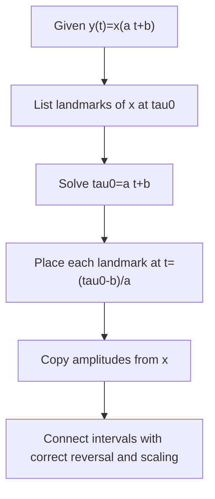

# Signals and Time Transformations

A signal is a function that carries information through variation. In this course the independent variable is usually time, but the same ideas apply to space, sample index, or any ordered coordinate. A continuous-time signal $x(t)$ is defined for real $t$, while a discrete-time signal $x[n]$ is defined only for integer $n$. The distinction is not cosmetic: continuous-time formulas use integrals and real-valued delays, while discrete-time formulas use sums and integer shifts.

Time transformations are the first language for describing how signals move, stretch, flip, or line up with other signals. They also prepare the ground for convolution, sampling, Fourier analysis, and modulation. When a problem asks for $x(2-t)$ or $x[3n+1]$, it is asking how the input graph or sequence is re-indexed before values are read.

## Signals as functions and sequences

A continuous-time signal is a mapping

$$
x:\mathbb{R}\to\mathbb{C}, \qquad t\mapsto x(t).
$$

A discrete-time signal is a mapping

$$
x:\mathbb{Z}\to\mathbb{C}, \qquad n\mapsto x[n].
$$

Signals may be real-valued or complex-valued. A complex signal can be written as

$$
x(t)=x_R(t)+j x_I(t),
$$

where $j^2=-1$. Its magnitude and phase are

$$
|x(t)|=\sqrt{x_R^2(t)+x_I^2(t)}, \qquad \angle x(t)=\tan^{-1}\frac{x_I(t)}{x_R(t)},
$$

with quadrant handled by an atan2 convention in computation.

The most common elementary continuous-time signals are:

$$
u(t)=
\begin{cases}
1, & t\ge 0,\\
0, & t<0,
\end{cases}
\qquad
\delta(t)
$$

where $u(t)$ is the unit step and $\delta(t)$ is the unit impulse. The impulse is not an ordinary function; it is defined by its sifting property,

$$
\int_{-\infty}^{\infty} x(t)\delta(t-t_0)\,dt=x(t_0).
$$

The analogous discrete-time signals are

$$
u[n]=
\begin{cases}
1, & n\ge 0,\\
0, & n<0,
\end{cases}
\qquad
\delta[n]=
\begin{cases}
1, & n=0,\\
0, & n\ne 0.
\end{cases}
$$

The discrete-time impulse has the exact expansion property

$$
x[n]=\sum_{k=-\infty}^{\infty}x[k]\delta[n-k].
$$

In continuous time, an analogous representation is

$$
x(t)=\int_{-\infty}^{\infty}x(\tau)\delta(t-\tau)\,d\tau.
$$

These two identities are more than notation. They say that a signal can be rebuilt from shifted impulses weighted by its own values, which is the conceptual root of convolution.

A time transformation of a continuous-time signal often has the form

$$
y(t)=x(a t+b).
$$

If $a\gt 0$, the signal is time-scaled by $1/a$ and shifted. If $a\lt 0$, it is also time-reversed. To locate features, solve the equation

$$
\tau=a t+b
$$

for $t$. A feature originally located at $\tau=\tau_0$ appears in $y(t)$ at

$$
t=\frac{\tau_0-b}{a}.
$$

For discrete time,

$$
y[n]=x[a n+b]
$$

is only directly meaningful at integer values of $a n+b$. If $a$ and $b$ are integers, the expression samples the original sequence at integer indices. When $\vert a\vert \gt 1$, values of $x[k]$ are skipped; when $a=-1$, the sequence is reversed; when $b$ changes, the sequence is shifted.

Even and odd parts are useful decompositions:

$$
x_e(t)=\frac{x(t)+x(-t)}{2}, \qquad x_o(t)=\frac{x(t)-x(-t)}{2}.
$$

They satisfy

$$
x(t)=x_e(t)+x_o(t), \qquad x_e(-t)=x_e(t), \qquad x_o(-t)=-x_o(t).
$$

The same formulas hold for $x[n]$.

Even and odd decomposition is unique. Adding the two expressions recovers $x$, while replacing $t$ by $-t$ verifies their symmetry. For a real signal, the even and odd parts are real. For a complex signal, time symmetry is separate from conjugate symmetry; $x(-t)=x^*(t)$ is a different condition.

Other elementary signals are built from steps and impulses. A finite rectangular pulse can be written as

$$
u(t-a)-u(t-b),
\qquad a<b.
$$

It equals one on the interval from $a$ to $b$, subject to the chosen value of the step at endpoints. A ramp is $r(t)=tu(t)$, and differentiation gives $dr/dt=u(t)$ away from the origin with the distributional boundary term handled consistently.

Complex exponentials unify growth, decay, and oscillation:

$$
e^{(\sigma+j\omega)t}=e^{\sigma t}e^{j\omega t}.
$$

The real part $\sigma$ controls the envelope and $\omega$ controls rotation in the complex plane. Euler's identity turns real sinusoids into pairs of complex exponentials, which later become the natural eigenfunctions of LTI systems.

## Mapping time landmarks instead of moving a sketch

The order of visual operations matters when transforming $x(a t+b)$. A reliable method is to transform the independent variable, not the picture by memory. Set $\tau=a t+b$, map old feature locations $\tau_0$ to new locations $t=(\tau_0-b)/a$, and then copy the old value. This prevents the common left-right confusion caused by expressions such as $x(2-t)$.

The impulse scaling rule in continuous time is

$$
\delta(a t)=\frac{1}{|a|}\delta(t), \qquad a\ne 0.
$$

More generally, if $g(t)$ has simple roots $t_i$,

$$
\delta(g(t))=\sum_i \frac{\delta(t-t_i)}{|g'(t_i)|}.
$$

This rule has no direct counterpart for the discrete-time impulse, because a discrete impulse is an ordinary sequence value rather than a distribution spread over a real axis.

Step and impulse are connected by differentiation and integration:

$$
\frac{d}{dt}u(t)=\delta(t), \qquad \int_{-\infty}^{t}\delta(\tau)\,d\tau=u(t).
$$

In discrete time the corresponding relation is a first difference:

$$
u[n]-u[n-1]=\delta[n].
$$

For complex exponentials, continuous-time and discrete-time signals again differ in an important way:

$$
x(t)=e^{s t}, \qquad x[n]=z^n.
$$

Continuous-time complex exponentials have distinct frequencies for all distinct real $\omega$ in $e^{j\omega t}$. Discrete-time complex exponentials satisfy

$$
e^{j(\omega+2\pi k)n}=e^{j\omega n}
$$

for every integer $k$, so discrete-time frequency is periodic with period $2\pi$.

The affine argument can be factored in two ways:

$$
at+b=a\left(t+\frac{b}{a}\right).
$$

One may describe this as a shift followed by scaling or derive it by mapping landmarks. Verbal operation order is prone to mistakes because horizontal transformations act inside the argument and negative $a$ reverses inequality directions. Solving $\tau=at+b$ handles all cases at once.

Amplitude transformations are separate from time transformations. In

$$
y(t)=A,x(at+b)+C,
$$

$A$ scales and possibly reflects values vertically, while $C$ adds a vertical offset. Neither changes the time locations of features. The parameters $a$ and $b$ change locations but do not alter sampled amplitudes inherited from $x$.

## Continuous-time impulse rules

The unit impulse has unit area and zero width in the distributional description. Shifting moves its sampling location:

$$
\int x(t)\delta(t-t_0)\,dt=x(t_0).
$$

Multiplying by a continuous function samples that function:

$$
f(t)\delta(t-t_0)=f(t_0)\delta(t-t_0).
$$

The scaling factor in $\delta(at)=\delta(t)/\vert a\vert $ preserves area under a change of variables. Ignoring it leads to wrong convolution and transform constants. For an affine argument,

$$
\delta(at+b)=\frac{1}{|a|}
\delta\left(t+\frac{b}{a}\right).
$$

The derivative $\delta'(t)$ acts by

$$
\int f(t)\delta'(t-t_0)\,dt=-f'(t_0),
$$

where the minus sign follows from integration by parts. Such generalized derivatives appear when differentiating signals with jumps.

## A table for common time transformations

| Operation | Continuous-time form | Effect on feature at $t=t_0$ or $n=n_0$ | Discrete-time caution |
|---|---|---|---|
| Delay | $x(t-t_d)$ | feature moves to $t_0+t_d$ | $x[n-n_d]$ needs integer $n_d$ |
| Advance | $x(t+t_d)$ | feature moves to $t_0-t_d$ | finite stored sequences may lose samples |
| Reversal | $x(-t)$ | feature moves to $-t_0$ | $x[-n]$ reverses around $n=0$ |
| Scaling | $x(a t)$ | feature moves to $t_0/a$ | $x[a n]$ skips samples if $\vert a\vert \gt 1$ |
| Affine transform | $x(a t+b)$ | feature moves to $(t_0-b)/a$ | integer indexing is required |

## Worked example: transforming a rectangular pulse

Problem: Let

$$
x(t)=
\begin{cases}
2, & -1\le t\le 3,\\
0, & \text{otherwise}.
\end{cases}
$$

Find and describe $y(t)=x(2-t)$.

Method:

1. Introduce the old variable $\tau=2-t$.
2. The nonzero part of $x(\tau)$ occurs when

$$
-1\le \tau\le 3.
$$

3. Substitute $\tau=2-t$:

$$
-1\le 2-t\le 3.
$$

4. Solve both sides carefully. From $-1\le 2-t$,

$$
-3\le -t \quad \Rightarrow \quad t\le 3.
$$

From $2-t\le 3$,

$$
-t\le 1 \quad \Rightarrow \quad t\ge -1.
$$

5. Combine the inequalities:

$$
-1\le t\le 3.
$$

Therefore

$$
y(t)=
\begin{cases}
2, & -1\le t\le 3,\\
0, & \text{otherwise}.
\end{cases}
$$

Check: The endpoints of the original pulse are $\tau=-1$ and $\tau=3$. They map to

$$
t=\frac{\tau-2}{-1}=2-\tau.
$$

So $\tau=-1$ maps to $t=3$, and $\tau=3$ maps to $t=-1$. The interval is reversed but has the same endpoints. Since the pulse is constant over that interval, the reversal is not visually obvious. A nonconstant ramp would show the flip.

## Worked example: decomposing a sequence into shifted impulses

Problem: Write the finite sequence

$$
x[-1]=4,\qquad x[0]=-2,\qquad x[2]=3,
$$

with all other samples equal to zero, as a sum of shifted impulses.

Method:

1. Start from the discrete-time expansion

$$
x[n]=\sum_{k=-\infty}^{\infty}x[k]\delta[n-k].
$$

2. Keep only the nonzero samples:

$$
x[n]=x[-1]\delta[n-(-1)]+x[0]\delta[n-0]+x[2]\delta[n-2].
$$

3. Substitute the sample values:

$$
x[n]=4\delta[n+1]-2\delta[n]+3\delta[n-2].
$$

Check each index:

- At $n=-1$, $\delta[0]=1$ in the first term and the others are zero, so $x[-1]=4$.
- At $n=0$, the middle term gives $-2$.
- At $n=2$, the last term gives $3$.
- At all other integer $n$, every impulse term is zero.

The answer is

$$
x[n]=4\delta[n+1]-2\delta[n]+3\delta[n-2].
$$

## Worked example: affine transformation of a ramp segment

Let

$$
x(t)=
\begin{cases}
t+1, & -1\le t\le2,\\
0, & \text{otherwise},
\end{cases}
$$

and find $y(t)=x(1-2t)$.

Set $\tau=1-2t$. The endpoints map according to

$$
t=\frac{1-\tau}{2}.
$$

Thus $\tau=-1$ maps to $t=1$, and $\tau=2$ maps to $t=-1/2$. The nonzero interval is therefore

$$
-\frac12\le t\le1.
$$

Within that interval, substitute the transformed argument into the ramp formula:

$$
y(t)=(1-2t)+1=2-2t.
$$

Hence

$$
y(t)=
\begin{cases}
2-2t, & -\frac12\le t\le1,\\
0, & \text{otherwise}.
\end{cases}
$$

At the left endpoint, $y(-1/2)=3$, matching $x(2)=3$. At the right endpoint, $y(1)=0$, matching $x(-1)=0$. The original rising ramp becomes a falling ramp, and its duration changes from three units to $3/2$, consistent with compression by $\vert a\vert =2$.

## Discrete-time scaling is resampling

For a sequence, $x[2n]$ keeps only the even-indexed samples. It is often called compression, but no rule supplies the missing odd-indexed values. If

$$
x[-2]=a,
\quad x[-1]=b,
\quad x[0]=c,
\quad x[1]=d,
\quad x[2]=e,
$$

then $x[2n]$ contains $a,c,e$ at indices $-1,0,1$ and discards $b,d$.

An expression such as $x[n/2]$ is undefined at odd $n$ unless a convention is added. In multirate signal processing, expansion by two is defined by

$$
y[n]=
\begin{cases}
x[n/2], & n\ \text{even},\\
0, & n\ \text{odd}.
\end{cases}
$$

Interpolation filtering then fills the inserted zeros. It is misleading to treat $x[n/2]$ as though a discrete sequence already contained values between integer samples.

For $x[an+b]$ with integer $a$ and $b$, solve $k=an+b$ for landmarks, but retain only integer $n$. A source sample can disappear when $(k-b)/a$ is not an integer. Negative $a$ combines reversal with decimation.

## What a plotted signal leaves unspecified

A drawn continuous curve may be an exact mathematical function or only an interpolation between measurements. A stem plot for a discrete sequence defines values only at its stems; connecting lines are usually visual guides, not signal values. Treating a discrete plot as a continuous curve can create nonexistent crossings and fractional-index samples.

Endpoint conventions also matter when steps define pulses. The value assigned to $u(0)$ may be zero, one, or one half. For ordinary integrals and Fourier transforms, changing isolated endpoint values has no effect. For discrete-time sequences, the sample at the endpoint contributes a full term and cannot be ignored.

Units change under normalization. Continuous time may be seconds, distance, or another real coordinate. Discrete index $n$ is dimensionless; physical sample time is $t=nT_s$. A delay of $n_0$ samples corresponds to $n_0T_s$ seconds only after the sampling interval is known.

## Support, sidedness, and duration

The support of a signal is the set of times or indices where it is nonzero, with measure-theoretic qualifications when needed. A right-sided continuous-time signal is zero before some finite time $t_0$; a left-sided signal is zero after some finite time. A two-sided signal extends indefinitely in both directions. These labels describe support, not causality: causality is a property of a system, although causal impulse responses are right-sided at zero.

A time shift translates support. If $x(t)$ is supported on a set $S$, then $x(t-t_0)$ is supported on $S+t_0$. Scaling by nonzero $a$ maps support through $t=S/a$, reversing order when $a\lt 0$. Multiplying two signals intersects their supports, while adding them gives support contained in the union; cancellation can make it smaller.

Duration behaves predictably for continuous affine scaling. A finite interval of length $L$ becomes length $L/\vert a\vert $ under $x(at+b)$. Amplitude does not change unless an outside multiplier is present. Energy, however, changes by the same time-scale factor because integration includes $dt$:

$$
\int|x(at)|^2dt
=\frac{1}{|a|}\int|x(\tau)|^2d\tau.
$$

This distinguishes geometric compression from amplitude scaling.

## Deterministic and random descriptions

A deterministic signal is specified by a formula, table, or reproducible rule. A random signal is modeled as a collection of possible functions indexed by an outcome; one observed function is a realization. The continuous-versus-discrete distinction concerns the independent variable and is separate from randomness.

Likewise, quantized and discrete-time are different ideas. Sampling discretizes time while amplitudes may remain continuous-valued. Quantization restricts amplitudes to levels while time may be continuous or discrete. A digital representation normally uses both sampling and quantization.

Signal models omit aspects of the physical source. A voltage trace may be treated as continuous even though it is recorded by sampled hardware, or as discrete after acquisition. The appropriate model depends on the operation being analyzed. Sampling rate, bandwidth, and interpolation assumptions determine whether transitions between the models are faithful.

Complex signals are often bookkeeping devices for real systems. The analytic representation combines a real waveform with a quadrature component so modulation and filtering can be described with one complex envelope. Measured voltage remains real; the complex form stores amplitude and phase compactly.

## Re-indexing mistakes

- Shifting in the wrong direction. $x(t-t_0)$ is delayed by $t_0$, while $x(t+t_0)$ is advanced by $t_0$.
- Reversing before locating the new origin. For $x(a t+b)$, solve $\tau=a t+b$ rather than relying on a memorized picture operation.
- Treating $\delta(t)$ as a tall narrow ordinary function in algebra. The continuous-time impulse is defined by integration behavior.
- Forgetting that $x[2n]$ is not a compressed version containing every sample. It reads only even-indexed samples of $x[n]$.
- Assuming discrete-time frequencies are unique. Frequencies separated by $2\pi$ produce the same sequence.

## Related pages

- [Periodicity, Energy, and Power](/physics/signals-systems/periodicity-energy-power)
- [System Properties](/physics/signals-systems/system-properties)
- [LTI Systems and Convolution](/physics/signals-systems/lti-systems-convolution)
- [Discrete-Time Fourier Transform](/physics/signals-systems/discrete-time-fourier-transform)
