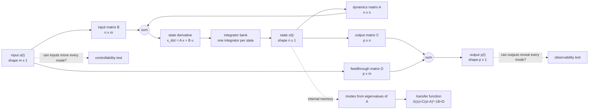

# State-Space Introduction

State-space models describe systems using internal variables rather than only input-output equations. A state is a minimal set of variables that, together with the future input, determines the future output. This viewpoint is especially useful for multi-input multi-output systems, interconnected systems, simulation, and modern control.

In a signals and systems course, state space complements convolution and transform methods. Convolution emphasizes the impulse response of an LTI system. Transform methods emphasize poles, zeros, and frequency response. State space emphasizes first-order vector dynamics and internal structure. The same system can often be represented in all three ways.

## State variables and first-order dynamics

A continuous-time linear time-invariant state-space model is

$$
\frac{d}{dt}q(t)=Aq(t)+Bx(t),
$$

$$
y(t)=Cq(t)+Dx(t).
$$

Here $q(t)$ is the state vector, $x(t)$ is the input, $y(t)$ is the output, and $A,B,C,D$ are constant matrices of compatible dimensions. Many books use $x(t)$ for the state, but these notes use $q(t)$ for state to avoid conflict with the input signal $x(t)$.

A discrete-time LTI state-space model is

$$
q[n+1]=Aq[n]+Bx[n],
$$

$$
y[n]=Cq[n]+Dx[n].
$$

The matrix $A$ controls internal dynamics. The matrix $B$ injects the input into the state. The matrix $C$ maps state to output. The matrix $D$ is a direct feedthrough term from input to output.

For continuous time, the zero-input response is

$$
q_{\text{zi}}(t)=e^{At}q(0),
$$

where the matrix exponential is

$$
e^{At}=I+At+\frac{A^2t^2}{2!}+\frac{A^3t^3}{3!}+\cdots.
$$

The zero-state response is

$$
q_{\text{zs}}(t)=\int_{0}^{t}e^{A(t-\tau)}Bx(\tau)\,d\tau.
$$

Thus

$$
q(t)=e^{At}q(0)+\int_{0}^{t}e^{A(t-\tau)}Bx(\tau)\,d\tau.
$$

For discrete time,

$$
q[n]=A^n q[0]+\sum_{k=0}^{n-1}A^{n-1-k}B x[k].
$$

The continuous-time transfer function for zero initial conditions is

$$
H(s)=C(sI-A)^{-1}B+D.
$$

The discrete-time transfer function is

$$
H(z)=C(zI-A)^{-1}B+D.
$$

## Solving the state equation

State-space models convert higher-order scalar equations into first-order vector equations. For example, a second-order differential equation can be represented by choosing state variables such as position and velocity. First-order vector form makes interconnection, simulation, and eigenvalue analysis systematic.

The continuous-time solution can be derived with an integrating factor. Since $A$ commutes with its exponential,

$$
\frac{d}{dt}\left(e^{-At}q(t)\right)
=e^{-At}Bx(t).
$$

Integrating from $t_0$ to $t$ and multiplying by $e^{At}$ gives

$$
q(t)=e^{A(t-t_0)}q(t_0)
+\int_{t_0}^{t}e^{A(t-\tau)}Bx(\tau)\,d\tau.
$$

The state-transition matrix is $\Phi(t,t_0)=e^{A(t-t_0)}$ for an LTI model. It satisfies

$$
\Phi(t_2,t_0)=\Phi(t_2,t_1)\Phi(t_1,t_0),
$$

which expresses propagation through an intermediate time. For time-varying $A(t)$, the transition matrix still exists under suitable conditions but is not generally the ordinary exponential of an integral because matrices at different times may not commute.

The eigenvalues of $A$ are the natural modes of the system. In continuous time, a mode associated with eigenvalue $\lambda$ behaves like $e^{\lambda t}$. For causal finite-dimensional LTI systems, internal asymptotic stability requires

$$
\operatorname{Re}(\lambda_i)<0
$$

for every eigenvalue of $A$. In discrete time, modes behave like $\lambda^n$, and internal asymptotic stability requires

$$
|\lambda_i|<1.
$$

The transfer function denominator is related to

$$
\det(sI-A)
$$

or

$$
\det(zI-A),
$$

although pole-zero cancellations can hide internal modes from the input-output transfer function. This is one reason state-space analysis can reveal behavior that a transfer function alone may obscure.

For a continuous-time state-space model with impulse input and zero initial state, the impulse response is

$$
h(t)=Ce^{At}Bu(t)+D\delta(t)
$$

in the single-input single-output case. The $D\delta(t)$ term represents direct feedthrough.

For discrete time, the impulse response is

$$
h[0]=D,
$$

and for $n\ge 1$,

$$
h[n]=CA^{n-1}B.
$$

These formulas connect state space back to convolution.

State choice is not unique. If $q(t)$ is a valid state, then $\tilde q(t)=Pq(t)$ is also a valid state for any invertible matrix $P$, with transformed matrices

$$
\tilde A=PAP^{-1},\qquad \tilde B=PB,\qquad \tilde C=CP^{-1},\qquad \tilde D=D.
$$

The transfer function is unchanged by this similarity transformation. This means state variables are coordinates for internal behavior, not directly observable physical quantities unless they are chosen that way.

Two structural ideas often appear after the introductory treatment. Controllability asks whether inputs can move the state through the whole state space. Observability asks whether outputs contain enough information to determine the state. A transfer function can hide uncontrollable or unobservable modes through pole-zero cancellation, while a state-space model can expose them. For this introductory page, the important point is that state space contains internal information beyond the external input-output formula.

For numerical simulation, state-space form is practical because first-order update rules are natural for computers. Continuous-time models can be integrated with ODE solvers, and discrete-time models can be iterated directly. This is one reason state-space notation is common in control, estimation, signal processing, and physics-based modeling.

The input-output transfer function assumes zero initial conditions, but state-space equations naturally include nonzero initial state. This distinction matters physically. A circuit capacitor may already be charged, a mass may already be moving, or a filter memory may contain previous samples. Transform methods can handle these cases, but state space makes the stored internal information explicit from the start.

Dimensions are a useful sanity check. If the state has length $m$, then $A$ is $m\times m$. For a single input, $B$ is $m\times 1$. For a single output, $C$ is $1\times m$. Checking matrix shapes often catches an incorrect state choice before any algebra is done.

## From internal dynamics to a transfer function

Take the unilateral initial state as zero and apply the Laplace transform:

$$
sQ(s)=AQ(s)+BX(s).
$$

Rearranging,

$$
Q(s)=(sI-A)^{-1}BX(s).
$$

Substitution into $Y=CQ+DX$ yields

$$
Y(s)=\left[C(sI-A)^{-1}B+D\right]X(s).
$$

The matrix inverse therefore links internal modes to the input-output transfer matrix. For multiple inputs and outputs, $H(s)$ is a matrix; its $(i,j)$ entry maps input $j$ to output $i$ with all other inputs zero.

The roots of $\det(sI-A)$ are eigenvalues of $A$, but a particular transfer entry may omit a mode if $B$ cannot excite it or $C$ cannot see it. A pole-zero cancellation in a reduced input-output formula can hide an unstable internal state. Minimal realizations contain no uncontrollable or unobservable modes and have the smallest state dimension for that transfer behavior.

## How the matrices connect



Inputs pass through $B$, states feed back through $A$, an integrator bank stores internal memory, and outputs combine the state term with direct feedthrough. The dotted arrows mark modal structure, controllability, and observability.

| Representation | Main object | Best for | Typical equation |
|---|---|---|---|
| Convolution | impulse response $h$ | LTI input-output response | $y=x*h$ |
| Fourier response | $H(j\omega)$ or $H(e^{j\Omega})$ | filtering and spectra | $Y=HX$ |
| Laplace / $z$ | $H(s)$ or $H(z)$ with ROC | poles, stability, transients | rational system functions |
| State space | $A,B,C,D$ | internal dynamics and MIMO systems | $\dot q=Aq+Bx$ |

## Controllability and observability

For an $n$-state continuous- or discrete-time LTI system, form the controllability matrix

$$
\mathcal C=
\begin{bmatrix}
B&AB&A^2B&\cdots&A^{n-1}B
\end{bmatrix}.
$$

The system is controllable when $\mathcal C$ has rank $n$. The columns describe state directions reachable through input action propagated by the dynamics. If rank is smaller, some internal combination cannot be moved by the available inputs.

The observability matrix is

$$
\mathcal O=
\begin{bmatrix}
C\\CA\\CA^2\\\vdots\\CA^{n-1}
\end{bmatrix}.
$$

Full column rank means the initial state can be inferred from a finite sequence or interval of ideal output observations when the input is known. Lack of observability means at least one state direction produces no distinguishable output.

For the second-order model used below,

$$
A=
\begin{bmatrix}
0&1\\-2&-3
\end{bmatrix},
\quad
B=
\begin{bmatrix}0\\1\end{bmatrix},
\quad
C=\begin{bmatrix}1&0\end{bmatrix}.
$$

Then

$$
\mathcal C=
\begin{bmatrix}
0&1\\1&-3
\end{bmatrix},
\qquad
\mathcal O=
\begin{bmatrix}
1&0\\0&1
\end{bmatrix}.
$$

Both determinants are nonzero, so the realization is controllable and observable. Its two eigenmodes appear in the transfer function.

## Exact conversion from continuous to sampled state updates

If the input is held constant on each sampling interval of length $T_s$, integrate the continuous solution from $kT_s$ to $(k+1)T_s$. The exact discrete model is

$$
q[k+1]=A_dq[k]+B_dx[k],
$$

with

$$
A_d=e^{AT_s},
$$

$$
B_d=\int_0^{T_s}e^{A\tau}B\,d\tau.
$$

The output matrices are usually $C_d=C$ and $D_d=D$ for samples taken at the update instants. If $A$ is invertible,

$$
B_d=A^{-1}(A_d-I)B,
$$

though the integral formula remains valid when $A$ is singular.

Continuous eigenvalue $\lambda$ maps to discrete eigenvalue $e^{\lambda T_s}$. The open left half-plane maps inside the unit circle, matching the two stability conditions. Forward Euler instead uses $A_d\approx I+AT_s$ and $B_d\approx T_sB$; it is an approximation whose stability can fail for a step size that is too large.

## Choosing and changing state coordinates

A valid state must summarize all past information needed to predict the future once future input is known. It need not be a measured output, and it should not include redundant variables. Capacitor voltages and inductor currents are natural circuit states because they store energy. Position and velocity are natural mechanical states for a second-order mass system.

Choosing $q_1=y$, $q_2=\dot y$, and so on gives a phase-variable realization of a scalar differential equation. Other choices can improve numerical conditioning or expose physical structure. Modal coordinates diagonalize $A$ when it has a complete eigenvector basis, separating independent modes:

$$
PAP^{-1}=\operatorname{diag}(\lambda_1,\ldots,\lambda_n).
$$

If $A$ is defective, Jordan form contains coupling within generalized modes. Jordan form is valuable theoretically but can be numerically fragile near repeated eigenvalues; real Schur forms are often preferred in computation.

Similarity transformations preserve eigenvalues, transfer functions, controllability, and observability. They do not preserve the numerical values or physical interpretation of individual state components. A state estimate expressed in one coordinate system must be transformed before comparing it with another realization.

Scaling matters numerically. If one state is measured in micrometers and another in megavolts, their raw magnitudes can differ enormously. An equivalent rescaling can improve matrix conditioning without changing input-output behavior. Units still constrain the matrix entries: elements of $A$ map state units per second, while $B$ maps input units into state-rate units.

## Computing the matrix exponential

If $A=P\Lambda P^{-1}$ is diagonalizable, then

$$
e^{At}=Pe^{\Lambda t}P^{-1},
$$

where $e^{\Lambda t}$ places $e^{\lambda_it}$ on the diagonal. This directly reveals modal growth, decay, and oscillation. Complex-conjugate eigenvalues combine to give real oscillatory responses when $A$ is real.

The matrix exponential is always invertible, with inverse $e^{-At}$. It also commutes with $A$ and satisfies the semigroup law $e^{A(t_1+t_2)}=e^{At_1}e^{At_2}$. These facts follow from the power series because every term is a power of the same matrix.

Computing $e^{At}$ from a truncated power series is rarely the best numerical method for a general matrix. Reliable libraries use algorithms such as scaling and squaring with rational approximations. For small symbolic problems, diagonalization or the Cayley-Hamilton theorem often gives a readable closed form.

Repeated eigenvalues do not always yield pure exponentials. A Jordan block of size two produces terms proportional to $te^{\lambda t}$. Stability still depends on the exponential part: such polynomial factors decay when $\operatorname{Re}\lambda\lt 0$ but grow or persist when the eigenvalue lies on the stability boundary.

## Internal stability versus input-output stability

If every eigenvalue of $A$ is stable, the finite-dimensional system is internally asymptotically stable and its zero-input state decays to zero. The converse can fail when considering only a particular transfer function. An unstable state may be unreachable from the input or invisible at the output, so its pole cancels or never appears in that channel.

For a minimal realization, BIBO stability of the proper rational transfer function and asymptotic stability of $A$ agree. Without minimality, one must inspect the internal modes separately. Hidden instability can still matter through initial conditions, modeling errors, or perturbations that weakly couple the canceled mode.

Direct feedthrough $D$ affects causality and high-frequency gain but adds no dynamic state. A strictly proper transfer function has $D=0$. A merely proper transfer function may have nonzero $D$, meaning the output changes instantaneously with the input in the ideal model.

## Worked example: building a state model from a differential equation

Problem: Convert the differential equation

$$
\frac{d^2y}{dt^2}+3\frac{dy}{dt}+2y=x(t)
$$

to continuous-time state-space form using

$$
q_1(t)=y(t), \qquad q_2(t)=\frac{dy}{dt}.
$$

Method:

1. Write the first state equation:

$$
\frac{dq_1}{dt}=q_2.
$$

2. Use the differential equation to solve for the second derivative:

$$
\frac{d^2y}{dt^2}=x(t)-3\frac{dy}{dt}-2y.
$$

3. Substitute states:

$$
\frac{dq_2}{dt}=x(t)-3q_2(t)-2q_1(t).
$$

4. Arrange in matrix form:

$$
\frac{d}{dt}
\begin{bmatrix}
q_1\\
q_2
\end{bmatrix}
=
\begin{bmatrix}
0 & 1\\
-2 & -3
\end{bmatrix}
\begin{bmatrix}
q_1\\
q_2
\end{bmatrix}
+
\begin{bmatrix}
0\\
1
\end{bmatrix}
x(t).
$$

5. The output is $y=q_1$, so

$$
y(t)=
\begin{bmatrix}
1 & 0
\end{bmatrix}
\begin{bmatrix}
q_1\\
q_2
\end{bmatrix}
+0\cdot x(t).
$$

Checked answer:

$$
A=
\begin{bmatrix}
0 & 1\\
-2 & -3
\end{bmatrix},
\quad
B=
\begin{bmatrix}
0\\
1
\end{bmatrix},
\quad
C=
\begin{bmatrix}
1 & 0
\end{bmatrix},
\quad
D=0.
$$

The eigenvalues of $A$ are $-1$ and $-2$, matching the natural modes of the differential equation.

The transfer function supplies a cross-check:

$$
\begin{aligned}
H(s)
&=C(sI-A)^{-1}B\\
&=\frac{1}{s^2+3s+2}\\
&=\frac{1}{(s+1)(s+2)}.
\end{aligned}
$$

Its poles agree with the eigenvalues, and there is no direct term because $D=0$.

## Worked example: impulse response from discrete-time state space

Problem: A discrete-time system is defined by

$$
q[n+1]=0.5q[n]+x[n],
$$

$$
y[n]=q[n],
$$

with zero initial state. Find its impulse response.

Method:

1. Identify matrices:

$$
A=0.5,\qquad B=1,\qquad C=1,\qquad D=0.
$$

2. For discrete-time state space, the impulse response satisfies

$$
h[0]=D=0.
$$

3. For $n\ge 1$,

$$
h[n]=CA^{n-1}B.
$$

4. Substitute scalar values:

$$
h[n]=1\cdot (0.5)^{n-1}\cdot 1=(0.5)^{n-1},\qquad n\ge 1.
$$

5. Combine with the step:

$$
h[n]=(0.5)^{n-1}u[n-1].
$$

Checked answer:

$$
h[0]=0,\quad h[1]=1,\quad h[2]=0.5,\quad h[3]=0.25,\quad \ldots
$$

The system is causal and stable because the state eigenvalue has magnitude $0.5\lt 1$.

## Numerical verification

```python
import numpy as np
from scipy.signal import StateSpace, impulse
import matplotlib.pyplot as plt

A = np.array([[0, 1], [-2, -3]], dtype=float)
B = np.array([[0], [1]], dtype=float)
C = np.array([[1, 0]], dtype=float)
D = np.array([[0]], dtype=float)

eigvals = np.linalg.eigvals(A)
print("continuous-time eigenvalues:", eigvals)

sys = StateSpace(A, B, C, D)
t, y = impulse(sys, T=np.linspace(0, 8, 400))

n = np.arange(0, 12)
h_dt = np.where(n >= 1, 0.5 ** (n - 1), 0.0)

fig, ax = plt.subplots(1, 2, figsize=(10, 3))
ax[0].plot(t, y)
ax[0].set_title("CT impulse response")
ax[0].grid(True)

ax[1].stem(n, h_dt)
ax[1].set_title("DT state-space impulse response")
ax[1].grid(True)
plt.tight_layout()
plt.show()
```

## State-coordinate and stability mistakes

- Using $x(t)$ for both input and state without clarifying notation.
- Forgetting the direct feedthrough term $D$, especially in impulse-response formulas.
- Assuming transfer-function stability always reveals internal stability. Hidden modes can be canceled in input-output form.
- Confusing continuous-time stability conditions with discrete-time ones. CT uses left half-plane; DT uses inside the unit circle.
- Treating state variables as unique. Many different state choices can represent the same input-output behavior.

<div className="see-also">

See also: [System Properties](/physics/signals-systems/system-properties) · [LTI Systems and Convolution](/physics/signals-systems/lti-systems-convolution) · [Laplace Transform and ROC](/physics/signals-systems/laplace-transform-roc) · [Z-Transform and ROC](/physics/signals-systems/z-transform-roc) · [Frequency Response and Filtering](/physics/signals-systems/frequency-response-filtering)

</div>
