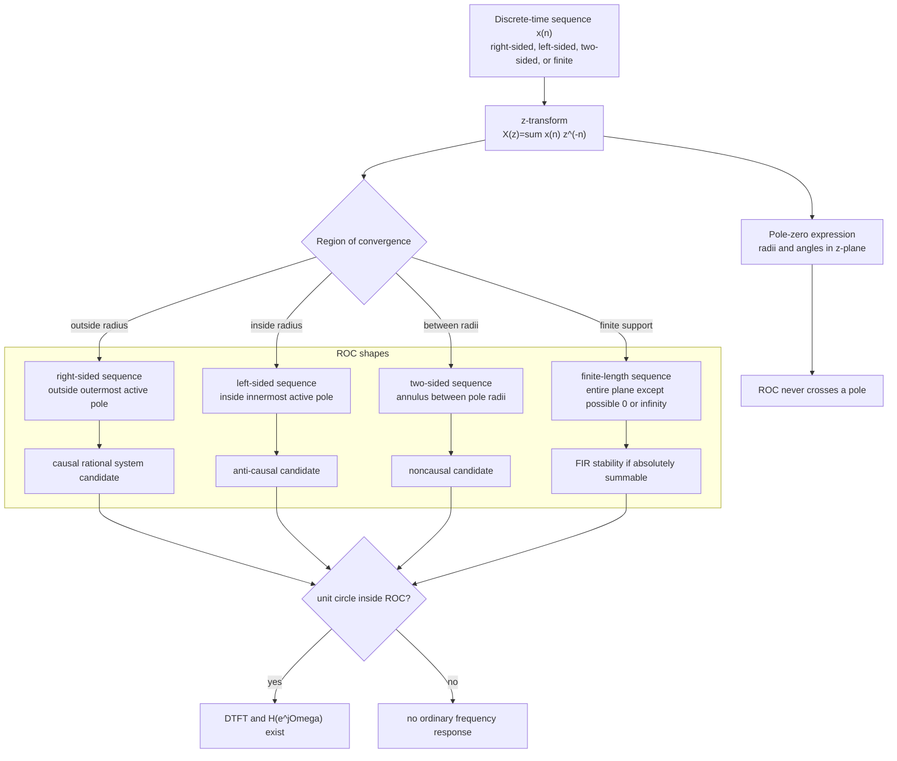

# Z-Transform and ROC

The $z$-transform is the discrete-time counterpart of the Laplace transform. It represents sequences using the complex variable $z=re^{j\Omega}$ and provides a natural language for recursive difference equations, digital filters, poles, zeros, stability, and causality. The DTFT is obtained by evaluating the $z$-transform on the unit circle when that circle lies in the region of convergence.

As with the Laplace transform, the region of convergence is part of the answer. The same rational expression can describe a right-sided sequence, a left-sided sequence, or a two-sided sequence depending on the ROC. In digital signal processing, many system questions reduce to locating poles relative to the unit circle.

## Bilateral transform and the region of convergence

The bilateral $z$-transform of a sequence $x[n]$ is

$$
X(z)=\sum_{n=-\infty}^{\infty}x[n]z^{-n}.
$$

The unilateral $z$-transform is

$$
X_+(z)=\sum_{n=0}^{\infty}x[n]z^{-n}.
$$

The bilateral transform is used for signal and LTI system properties. The unilateral transform is useful for solving difference equations with initial conditions.

The region of convergence, or ROC, is the set of $z$ values for which the sum converges. For rational transforms, the ROC is an annulus centered at the origin:

$$
r_1<|z|<r_2,
$$

possibly with $r_1=0$ or $r_2=\infty$. The ROC never includes poles.

The DTFT is obtained on the unit circle if $\vert z\vert =1$ lies in the ROC:

$$
X(e^{j\Omega})=X(z)\bigg|_{z=e^{j\Omega}}.
$$

Important transform pairs include, for $\vert z\vert \gt \vert a\vert $,

$$
a^n u[n]\leftrightarrow \frac{1}{1-a z^{-1}},
$$

and, for $\vert z\vert \lt \vert a\vert $,

$$
-a^n u[-n-1]\leftrightarrow \frac{1}{1-a z^{-1}}.
$$

Again, the expression is identical but the ROC and sequence are different.

For an LTI system with impulse response $h[n]$, the system function is

$$
H(z)=\sum_{n=-\infty}^{\infty}h[n]z^{-n}.
$$

If $y[n]=x[n]*h[n]$, then

$$
Y(z)=X(z)H(z),
$$

with ROC at least including the intersection of the ROCs, except for possible pole-zero cancellations.

The transform can be viewed as a DTFT on a circle of radius $r$. Set $z=re^{j\Omega}$:

$$
X(re^{j\Omega})
=\sum_n x[n]r^{-n}e^{-j\Omega n}.
$$

For fixed $r$, this is the DTFT of the exponentially weighted sequence $x[n]r^{-n}$. The ROC lists the radii for which that weighted sum converges. The ordinary DTFT is the special radius $r=1$.

The ROC is connected for a rational bilateral transform because convergence must hold between adjacent pole radii. It cannot contain a pole. Zeros do not by themselves bound convergence, although exact pole-zero cancellation can change the reduced expression and must be interpreted together with the original sequence or system realization.

## Transform operations and sidedness

Linearity:

$$
a x_1[n]+b x_2[n]\leftrightarrow aX_1(z)+bX_2(z).
$$

Time shifting:

$$
x[n-n_0]\leftrightarrow z^{-n_0}X(z),
$$

with possible ROC changes at $0$ or $\infty$ depending on finite-length terms.

Multiplication by $a^n$:

$$
a^n x[n]\leftrightarrow X\left(\frac{z}{a}\right).
$$

Time reversal:

$$
x[-n]\leftrightarrow X(z^{-1}).
$$

Convolution:

$$
x[n]*h[n]\leftrightarrow X(z)H(z).
$$

For rational $H(z)$,

$$
H(z)=\frac{B(z)}{A(z)}.
$$

Poles are values of $z$ where $H(z)$ becomes unbounded; zeros are values where it becomes zero. In digital filters, zeros can create frequency nulls and poles can create resonances or instability.

For a causal rational LTI system, the ROC is outside the outermost pole. For a left-sided anti-causal system, the ROC is inside the innermost pole. For a two-sided sequence, the ROC is an annulus between pole radii.

BIBO stability for a discrete-time LTI system requires absolute summability:

$$
\sum_{n=-\infty}^{\infty}|h[n]|<\infty.
$$

In $z$-transform terms, for rational systems, stability is equivalent to the unit circle being in the ROC. If the system is both causal and rational, then stability is equivalent to all poles lying strictly inside the unit circle:

$$
|p_i|<1.
$$

The frequency response of a stable system is

$$
H(e^{j\Omega})=H(z)\bigg|_{z=e^{j\Omega}}.
$$

This provides a direct bridge from pole-zero diagrams to filter magnitude and phase.

The shape of the ROC follows from powers of $z^{-n}$. For a right-sided sequence, convergence depends on large positive $n$, so the ROC is outside the largest active pole. For a left-sided sequence, convergence depends on large negative $n$, so the ROC is inside the smallest active pole. For a two-sided sequence, both tails must converge, so the ROC is an annulus between pole radii.

Finite-length sequences are special. A finite right-sided sequence has a $z$-transform that is a polynomial in $z^{-1}$, so it has no finite poles except possibly at $z=0$ depending on how the expression is written. Such FIR systems are BIBO stable because their impulse responses are absolutely summable. Recursive IIR systems can be stable too, but only if their pole and ROC conditions satisfy the unit-circle test.

Pole-zero diagrams are qualitative frequency-response tools. A point on the unit circle near a pole usually gives a large magnitude because the denominator is small. A point on the unit circle near a zero usually gives a small magnitude because the numerator is small. Exact zeros on the unit circle create exact frequency nulls.

The $z$ variable also encodes delay naturally. A factor of $z^{-1}$ represents a one-sample delay in a transfer function. Digital filters are therefore commonly written as polynomials in $z^{-1}$: the coefficients directly multiply present and delayed samples in a difference equation. Reading powers of $z^{-1}$ as delays helps connect algebraic expressions to block diagrams.

As with the Laplace transform, repeated poles produce polynomial factors in the sequence. A repeated pole at $z=a$ can create terms like $n a^n u[n]$. The pole magnitude still controls exponential decay or growth, while the polynomial factor changes the transient envelope.

Initial- and final-value relations can shorten some calculations. For a right-sided sequence with appropriate convergence,

$$
x[0]=\lim_{z\to\infty}X(z).
$$

If the relevant limits exist and $(1-z^{-1})X(z)$ has no poles on or outside the unit circle except possibly a simple pole at one, then

$$
\lim_{n\to\infty}x[n]
=\lim_{z\to1}(1-z^{-1})X(z).
$$

The pole condition cannot be omitted. Algebraically evaluating the right side for an oscillating or divergent sequence may produce a misleading number.

## Inversion by series and partial fractions

A rational expression is inverted only after the ROC is known. Long division in powers of $z^{-1}$ produces a right-sided series when expanded about $z=\infty$. Expansion in positive powers of $z$ produces a left-sided series about $z=0$.

For distinct poles, partial fractions reduce the problem to basic pairs. Suppose

$$
X(z)=\frac{1}{(1-az^{-1})(1-bz^{-1})}
=\frac{A}{1-az^{-1}}+\frac{B}{1-bz^{-1}}.
$$

Solving gives

$$
A=\frac{a}{a-b},
\qquad
B=-\frac{b}{a-b}.
$$

If the ROC is outside both poles, both terms are right-sided. If it is inside both, both are left-sided. If $\vert a\vert \lt \vert z\vert \lt \vert b\vert $, the $a$ term is right-sided and the $b$ term is left-sided, producing a two-sided sequence.

Repeated factors require terms of increasing order. The pair

$$
\frac{1}{(1-az^{-1})^2}
\leftrightarrow
(n+1)a^nu[n]
$$

for an exterior ROC illustrates the polynomial multiplier created by a double pole.

## How poles, ROC, and the unit circle fit together



Sidedness determines whether the ROC extends outward, inward, or between pole radii, while finite sequences form a special FIR case. The unit-circle test connects convergence to stability and frequency response.

| Sequence/system type | ROC shape | Stability condition | Causality clue |
|---|---|---|---|
| Right-sided $a^n u[n]$ | $\vert z\vert \gt \vert a\vert $ | stable if $\vert a\vert \lt 1$ | causal candidate |
| Left-sided $-a^n u[-n-1]$ | $\vert z\vert \lt \vert a\vert $ | stable if $\vert a\vert \gt 1$ | anti-causal candidate |
| Two-sided sequence | annulus between poles | unit circle inside annulus | noncausal |
| Causal rational LTI | outside outermost pole | all poles inside unit circle | causal |
| FIR filter | whole plane except maybe $z=0$ | always stable if finite coefficients | causal if right-sided |

## Worked example: same rational expression, different sequence

Problem: Interpret

$$
X(z)=\frac{1}{1-\frac{1}{2}z^{-1}}
$$

for two possible ROCs.

Method:

1. Identify the pole. The denominator is zero when

$$
1-\frac{1}{2}z^{-1}=0.
$$

Multiply by $z$:

$$
z-\frac{1}{2}=0,
$$

so the pole is

$$
z=\frac{1}{2}.
$$

2. If the ROC is

$$
|z|>\frac{1}{2},
$$

the sequence is right-sided:

$$
x[n]=\left(\frac{1}{2}\right)^n u[n].
$$

3. If the ROC is

$$
|z|<\frac{1}{2},
$$

the sequence is left-sided:

$$
x[n]=-\left(\frac{1}{2}\right)^n u[-n-1].
$$

4. Check the right-sided case:

$$
\sum_{n=0}^{\infty}\left(\frac{1}{2}\right)^n z^{-n}
=\sum_{n=0}^{\infty}\left(\frac{1}{2}z^{-1}\right)^n
=\frac{1}{1-\frac{1}{2}z^{-1}},
$$

which converges when

$$
\left|\frac{1}{2}z^{-1}\right|<1
\quad \Rightarrow \quad
|z|>\frac{1}{2}.
$$

Checked answer: Both sequences share the same rational expression. The ROC determines whether the sequence is right-sided or left-sided.

## Worked example: stability of a causal digital filter

Problem: A causal LTI system has

$$
H(z)=\frac{1}{1-1.2z^{-1}+0.32z^{-2}}.
$$

Determine whether it is stable.

Method:

1. Find the poles by solving

$$
1-1.2z^{-1}+0.32z^{-2}=0.
$$

2. Multiply by $z^2$:

$$
z^2-1.2z+0.32=0.
$$

3. Factor:

$$
z^2-1.2z+0.32=(z-0.8)(z-0.4).
$$

4. The poles are

$$
z=0.8,\qquad z=0.4.
$$

5. Because the system is causal, the ROC is outside the outermost pole:

$$
|z|>0.8.
$$

6. The unit circle $\vert z\vert =1$ lies in this ROC.

Checked answer: The system is BIBO stable. For a causal rational system, the same conclusion follows from the pole magnitudes:

$$
0.8<1,\qquad 0.4<1.
$$

Both poles are inside the unit circle.

## Worked example: solve a difference equation with initial state

Consider

$$
y[n]-\frac12y[n-1]=u[n],
$$

with $y[-1]=2$. Use the unilateral transform, for which

$$
\mathcal Z_+\{y[n-1]\}
=z^{-1}Y_+(z)+y[-1].
$$

Transforming the equation gives

$$
Y_+(z)-\frac12\left[z^{-1}Y_+(z)+2\right]
=\frac{1}{1-z^{-1}}.
$$

Collect the output terms:

$$
Y_+(z)(1-\tfrac12z^{-1})
=1+\frac{1}{1-z^{-1}}.
$$

Therefore

$$
Y_+(z)=
\frac{2-z^{-1}}
{(1-z^{-1})(1-\tfrac12z^{-1})}.
$$

Partial fractions give

$$
Y_+(z)=
\frac{2}{1-z^{-1}}
-\frac{0}{1-\tfrac12z^{-1}},
$$

so

$$
y[n]=2u[n].
$$

Direct substitution checks the result: $y[0]-\tfrac12y[-1]=2-1=1$, and for later samples $2-1=1$. The chosen initial state already places the system at the constant-input equilibrium, so no decaying transient appears.

If instead $y[-1]=0$, the solution would contain both the forced constant term and a transient proportional to $(1/2)^n$. The bilateral transfer function describes the zero-state part; the unilateral equation keeps the initial condition explicitly.

## Pole-zero geometry on the unit circle

Factor a rational response as

$$
H(z)=K\frac{\prod_m(z-z_m)}{\prod_k(z-p_k)}.
$$

At $z=e^{j\Omega}$, its magnitude is

$$
|H(e^{j\Omega})|
=|K|\frac{\prod_m|e^{j\Omega}-z_m|}
{\prod_k|e^{j\Omega}-p_k|}.
$$

Magnitude is a ratio of distances from the unit-circle evaluation point to zeros and poles. As the point rotates with $\Omega$, proximity to a zero creates attenuation and proximity to a pole creates enhancement. Phase is the sum of zero angles minus the sum of pole angles plus the constant phase.

A zero at $z=1$ removes DC; a zero at $z=-1$ removes the Nyquist frequency. Complex zeros of a real-coefficient filter occur in conjugate pairs. Poles close to the unit circle create long-lived ringing because their impulse-response terms decay slowly as $\vert p\vert ^n$.

Poles and zeros at the origin often encode delays or advances after powers of $z$ are cleared. Multiplying by $z^{-d}$ delays a sequence by $d$ samples and adds $d$ poles at the origin in one polynomial representation, but it does not change magnitude on the unit circle.

## Finite sequences and endpoints of the ROC

If a sequence has finite support $n_1\le n\le n_2$, its transform is a finite Laurent polynomial:

$$
X(z)=\sum_{n=n_1}^{n_2}x[n]z^{-n}.
$$

There are no convergence issues at finite nonzero $z$. The only excluded endpoints can be zero or infinity. A finite right-sided sequence beginning at zero contains nonnegative powers of $z^{-1}$ and may have a pole at zero. A finite left-sided sequence ending at zero contains nonnegative powers of $z$ and may diverge at infinity. A sequence supported on both positive and negative indices can exclude both endpoints while converging everywhere else.

Zeros at the origin can cancel apparent poles introduced by rewriting a polynomial with a common denominator. The ROC should be stated after cancellations that truly occur in the transform, while delays and advances should still be tracked for interpreting support.

FIR system stability follows immediately from finite support: the absolute sum of finitely many coefficients is finite. Causality is separate. A symmetric linear-phase FIR centered at zero is noncausal as written, but a finite delay can shift all taps to nonnegative indices without altering magnitude response.

## Causality and stability are joint ROC statements

Saying that all poles lie inside the unit circle proves stability only after causality fixes the ROC outside the outermost pole. The same pole set can support a left-sided ROC inside the innermost pole, possibly excluding the unit circle. Conversely, a noncausal two-sided rational system can be stable when its annular ROC contains the unit circle.

For a causal rational transfer function, poles strictly inside the unit circle are both necessary and sufficient for BIBO stability after unstable pole-zero cancellations have been removed from a minimal input-output description. Internal implementations can retain canceled modes, so state-space stability may require inspecting the unreduced realization.

The unit-circle criterion also ensures that the impulse response has a DTFT. It does not require the input transform to exist for every possible input. Frequency-response analysis of a stable system can still be applied to generalized sinusoidal inputs through the eigenfunction property.

## Numerical pole and frequency check

```python
import numpy as np
import matplotlib.pyplot as plt

# H(z)=1/(1 - 1.2 z^-1 + 0.32 z^-2)
den = np.array([1.0, -1.2, 0.32])
poles = np.roots(den)
print("poles:", poles)
print("causal stable:", np.all(np.abs(poles) < 1))

Omega = np.linspace(-np.pi, np.pi, 1000)
z = np.exp(1j * Omega)
H = 1 / (1 - 1.2 * z**-1 + 0.32 * z**-2)

fig, ax = plt.subplots(1, 2, figsize=(10, 4))
circle = plt.Circle((0, 0), 1, fill=False, color="gray")
ax[0].add_artist(circle)
ax[0].plot(poles.real, poles.imag, "xr", markersize=10)
ax[0].set_aspect("equal", adjustable="box")
ax[0].set_title("Pole-zero view")
ax[0].grid(True)

ax[1].plot(Omega, np.abs(H))
ax[1].set_title("Frequency response magnitude")
ax[1].grid(True)
plt.tight_layout()
plt.show()
```

## ROC mistakes that alter the sequence

- Giving a $z$-transform without its ROC when the inverse sequence is requested.
- Assuming right-sided and causal always mean stable. A causal pole outside the unit circle is unstable.
- Evaluating $H(e^{j\Omega})$ when the unit circle is not in the ROC.
- Forgetting that the ROC of a rational transform cannot include poles.
- Mixing powers of $z$ and $z^{-1}$ when finding poles. Clear denominators before solving.

## Related pages

- [Discrete-Time Fourier Transform](/physics/signals-systems/discrete-time-fourier-transform)
- [LTI Systems and Convolution](/physics/signals-systems/lti-systems-convolution)
- [Frequency Response and Filtering](/physics/signals-systems/frequency-response-filtering)
- [State-Space Introduction](/physics/signals-systems/state-space-introduction)
