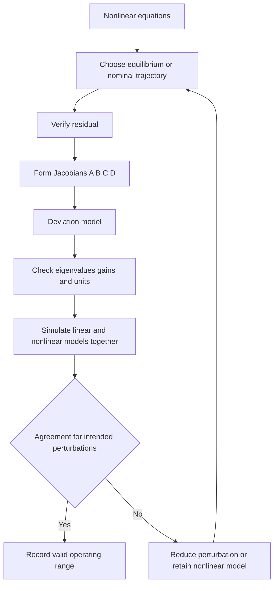

# Nonlinear Systems and Linearization

Most physical models become nonlinear once their full operating range is retained. Flow through an orifice scales like a square root, aerodynamic drag can scale like speed squared, actuator commands clip at hardware limits, and rigid-body geometry introduces sines and products of states.

Linearization replaces the nonlinear vector field by its tangent map at a stated operating point or along a stated trajectory. The resulting model predicts small deviations. Its matrices have no meaning without the point where their derivatives were evaluated, and local stability says little about behavior far from that point.

## Start with the operating condition

Write a smooth nonlinear model as

$$
\dot{\mathbf x}
=\mathbf f(\mathbf x,\mathbf u),
\qquad
\mathbf y
=\mathbf g(\mathbf x,\mathbf u).
$$

An equilibrium input--state pair satisfies

$$
\mathbf f(\bar{\mathbf x},\bar{\mathbf u})=\mathbf0.
$$

Its output is $\bar{\mathbf y}=\mathbf g(\bar{\mathbf x},\bar{\mathbf u})$. Define deviations

$$
\delta\mathbf x=\mathbf x-\bar{\mathbf x},
\qquad
\delta\mathbf u=\mathbf u-\bar{\mathbf u},
\qquad
\delta\mathbf y=\mathbf y-\bar{\mathbf y}.
$$

A first-order multivariable Taylor expansion gives

$$
\mathbf f(\bar{\mathbf x}+\delta\mathbf x,
\bar{\mathbf u}+\delta\mathbf u)
=
\mathbf f(\bar{\mathbf x},\bar{\mathbf u})
+A\delta\mathbf x+B\delta\mathbf u
+\mathbf r_f,
$$

where

$$
A=\left.\frac{\partial\mathbf f}{\partial\mathbf x}\right|_{\bar{\mathbf x},\bar{\mathbf u}},
\qquad
B=\left.\frac{\partial\mathbf f}{\partial\mathbf u}\right|_{\bar{\mathbf x},\bar{\mathbf u}}.
$$

For a twice continuously differentiable model, the remainder is second order:

$$
\|\mathbf r_f\|
=O\left(
\|(\delta\mathbf x,\delta\mathbf u)\|^2
\right).
$$

At an equilibrium the constant term vanishes, leaving

$$
\delta\dot{\mathbf x}
=A\delta\mathbf x+B\delta\mathbf u.
$$

The output expansion is

$$
\delta\mathbf y
=C\delta\mathbf x+D\delta\mathbf u,
$$

with $C=\partial\mathbf g/\partial\mathbf x$ and $D=\partial\mathbf g/\partial\mathbf u$ at the same point. These equations use deviation variables. If absolute variables are needed, restore the offsets explicitly.

## What the eigenvalues can and cannot prove

For the unforced deviation system,

$$
\delta\dot{\mathbf x}=A\delta\mathbf x,
$$

the eigenvalues of $A$ determine linear stability. If every eigenvalue has negative real part, the nonlinear equilibrium is locally asymptotically stable under standard smoothness assumptions. If any eigenvalue has positive real part, the nonlinear equilibrium is unstable.

When no eigenvalue has zero real part, the equilibrium is **hyperbolic**. Nearby nonlinear trajectories have the same qualitative stable and unstable structure as the linearization, though not necessarily the same timing or geometry.

Eigenvalues on the imaginary axis make first-order analysis inconclusive. Two scalar examples have the same zero linearization at $x=0$:

$$
\dot x=-x^3,
\qquad
\dot x=+x^3.
$$

For the first, $x\dot x=-x^4\lt 0$ away from zero, so trajectories move toward the origin. For the second they move away. Both have $f'(0)=0$. Higher-order terms or a Lyapunov function are needed.

Local asymptotic stability also does not imply global stability. Other equilibria, finite escape, saturation, or a limited basin of attraction may lie outside the neighborhood where the tangent model is accurate.

## Linearizing along a trajectory

An operating point need not be constant. Let nominal signals $\mathbf x_0(t)$ and $\mathbf u_0(t)$ satisfy

$$
\dot{\mathbf x}_0
=\mathbf f(\mathbf x_0,\mathbf u_0).
$$

Set $\mathbf x=\mathbf x_0+\delta\mathbf x$ and $\mathbf u=\mathbf u_0+\delta\mathbf u$. The first-order perturbation model is

$$
\delta\dot{\mathbf x}
=A(t)\delta\mathbf x+B(t)\delta\mathbf u,
$$

where

$$
A(t)
=\left.\frac{\partial\mathbf f}{\partial\mathbf x}
\right|_{\mathbf x_0(t),\mathbf u_0(t)},
\qquad
B(t)
=\left.\frac{\partial\mathbf f}{\partial\mathbf u}
\right|_{\mathbf x_0(t),\mathbf u_0(t)}.
$$

No constant residual appears because the nominal trajectory satisfies the nonlinear dynamics. If the chosen reference does not satisfy them, an affine forcing error remains:

$$
\mathbf d(t)
=\mathbf f(\mathbf x_0,\mathbf u_0)-\dot{\mathbf x}_0.
$$

Trajectory linearization produces a linear time-varying model. It is used in gain scheduling, extended Kalman filters, trajectory optimization, and local tracking control. Freezing $A(t)$ at one instant is an additional approximation and can miss time-varying growth.



## Smooth nonlinearities versus switching elements

A Jacobian requires differentiability. Common smooth elements behave predictably:

| Element | Local derivative | Consequence |
|---|---|---|
| $\sin x$ | $\cos\bar x$ | restoring gain changes with angle |
| $x_1x_2$ | $(\bar x_2,\bar x_1)$ | coupling can vanish at the origin |
| $\sqrt x$ | $1/(2\sqrt{\bar x})$ | slope grows near zero |
| $x^2$ | $2\bar x$ | first-order effect vanishes at zero |

Saturation is piecewise smooth. Away from its corners,

$$
\operatorname{sat}(u)=
\begin{cases}
u_{\max},&u>u_{\max},\\
u,&u_{\min}<u<u_{\max},\\
u_{\min},&u<u_{\min}.
\end{cases}
$$

Its slope is one in the interior and zero in either saturated region. A model linearized while saturated correctly reports zero incremental control authority, but it cannot predict when a perturbation crosses back into the linear region.

Coulomb friction, backlash, relays, dead zones, and quantizers can be nondifferentiable or history-dependent. Assigning one derivative at a switching point hides important behavior such as stick--slip motion or limit cycles. Piecewise-affine models, hybrid automata, describing functions, complementarity systems, or direct nonlinear simulation may be more honest tools.

## Numerical Jacobians without fooling oneself

When analytic derivatives are awkward, a centered difference estimates a Jacobian column:

$$
\frac{\partial\mathbf f}{\partial x_i}
\approx
\frac{
\mathbf f(\bar{\mathbf x}+h_i\mathbf e_i,\bar{\mathbf u})
-\mathbf f(\bar{\mathbf x}-h_i\mathbf e_i,\bar{\mathbf u})
}{2h_i}.
$$

The truncation error is $O(h_i^2)$ for smooth functions, but roundoff grows as $h_i$ becomes tiny. State scaling matters: one step size is unsuitable when one state is measured in micrometers and another in thousands of kelvin.

A useful check repeats the estimate for several $h_i$ values and looks for a plateau. Automatic differentiation avoids subtractive cancellation and is often preferable for large differentiable models. Complex-step differentiation can give high accuracy for analytic code,

$$
f'(x)\approx\frac{\operatorname{Im}f(x+ih)}{h},
$$

but fails when the implementation discards complex parts or uses nonanalytic operations such as absolute value and branching.

The operating residual should be checked before any derivative:

$$
\|\mathbf f(\bar{\mathbf x},\bar{\mathbf u})\|\ll1
$$

in meaningful scaled units. A large residual means the purported equilibrium is wrong, and the homogeneous deviation model will omit a constant drift.

## Worked example: a tank with square-root outflow

Let

$$
A_t\dot h=q_{\mathrm{in}}-k\sqrt h,
$$

with $A_t=2$, $k=0.6$, and nominal inflow $\bar q=1.2$. The equilibrium condition is

$$
0=\bar q-k\sqrt{\bar h}.
$$

Therefore

$$
\sqrt{\bar h}=\frac{1.2}{0.6}=2,
\qquad
\bar h=4.
$$

The state equation is

$$
f(h,q)=\frac1{A_t}(q-k\sqrt h).
$$

Its derivatives are

$$
\frac{\partial f}{\partial h}
=-\frac{k}{2A_t\sqrt h},
\qquad
\frac{\partial f}{\partial q}
=\frac1{A_t}.
$$

At the operating point,

$$
A_\ell
=-\frac{0.6}{2(2)(2)}
=-0.075,
\qquad
B_\ell=0.5.
$$

The local model is

$$
\delta\dot h
=-0.075\,\delta h+0.5\,\delta q.
$$

For a constant small input change $\delta q$, the steady deviation is

$$
\delta h_{\mathrm{ss}}
=-\frac{B_\ell}{A_\ell}\delta q
=\frac{0.5}{0.075}\delta q.
$$

With $\delta q=0.1$,

$$
\delta h_{\mathrm{ss}}\approx0.6667.
$$

The exact new equilibrium is

$$
h_{\mathrm{new}}
=\left(\frac{1.3}{0.6}\right)^2
\approx4.6944,
$$

so the exact change is $0.6944$. The first-order estimate is close but not exact. The local time constant is

$$
\tau=-\frac1{A_\ell}\approx13.33.
$$

At a much lower level the derivative magnitude increases, and both gain and time constant change. A single linear tank model should not be carried across the full level range.

## Worked example: downward and upright pendulum

For a damped pendulum with torque input,

$$
\ddot\theta
+\frac{b}{m\ell^2}\dot\theta
+\frac g\ell\sin\theta
=\frac1{m\ell^2}\tau.
$$

Choose $x_1=\theta$ and $x_2=\dot\theta$:

$$
\begin{aligned}
\dot x_1&=x_2,\\
\dot x_2&=-\frac g\ell\sin x_1
-\frac b{m\ell^2}x_2
+\frac1{m\ell^2}u.
\end{aligned}
$$

At the downward equilibrium $(\bar x_1,\bar x_2,\bar u)=(0,0,0)$,

$$
A_{\downarrow}
=
\begin{bmatrix}
0&1\\
-g/\ell&-b/(m\ell^2)
\end{bmatrix},
\qquad
B=
\begin{bmatrix}
0\\
1/(m\ell^2)
\end{bmatrix}.
$$

For positive damping, both eigenvalues have negative real part. Now linearize at the upright equilibrium $(\pi,0,0)$. Since $\cos\pi=-1$,

$$
A_{\uparrow}
=
\begin{bmatrix}
0&1\\
+g/\ell&-b/(m\ell^2)
\end{bmatrix}.
$$

Its characteristic polynomial is

$$
\lambda^2+\frac b{m\ell^2}\lambda-\frac g\ell=0.
$$

The constant term is negative, so the two real roots have opposite signs. The upright equilibrium is unstable without feedback. The same nonlinear plant yields different local models because the tangent of $\sin\theta$ changes sign between the two equilibria.

## Worked example: a zero Jacobian that says nothing

Solve

$$
\dot x=-x^3
$$

by separation for $x(0)=x_0\ne0$:

$$
\frac{dx}{x^3}=-dt.
$$

Integrating,

$$
-\frac1{2x^2}=-t-\frac1{2x_0^2}.
$$

Rearranging,

$$
x(t)
=\frac{x_0}{\sqrt{1+2x_0^2t}}.
$$

The state approaches zero algebraically. Yet the linearization is

$$
\delta\dot x=f'(0)\delta x=0,
$$

which predicts a constant perturbation and cannot establish asymptotic stability. Replacing the equation by $\dot x=+x^3$ keeps the same linearization but sends nonzero states away from zero. Higher-order information distinguishes them.

## Side-by-side validation in MATLAB

Code is useful here because the approximation needs an operating-range check, not only a symbolic Jacobian.

```matlab
clear; clc; close all;

At = 2.0;
k = 0.6;
qbar = 1.2;
hbar = (qbar / k)^2;

Alin = -k / (2 * At * sqrt(hbar));
Blin = 1 / At;

for dq = [0.02, 0.1, 0.6]
    tankNL = @(t, h) (qbar + dq - k * sqrt(max(h, 0))) / At;
    tankLin = @(t, dh) Alin * dh + Blin * dq;

    [tn, hn] = ode45(tankNL, [0 80], hbar);
    [tl, dh] = ode45(tankLin, [0 80], 0);

    figure(1); hold on;
    plot(tn, hn - hbar, 'LineWidth', 1.2);
    plot(tl, dh, '--', 'LineWidth', 1.2);
end

grid on;
xlabel('Time');
ylabel('Height deviation');
title('Tank: nonlinear solid, linearized dashed');
```

As $\delta q$ shrinks, the response error should decrease faster than the perturbation itself because the omitted Taylor term is second order. If the two responses fail to converge as the perturbation is reduced, check the operating point, offsets, signs, and solver tolerances before blaming nonlinearity.

## A review checklist for a saved linear model

- Store $\bar{\mathbf x}$, $\bar{\mathbf u}$, and $\bar{\mathbf y}$ beside $A$, $B$, $C$, and $D$.
- Record state order, input order, units, parameter values, and derivative convention.
- Verify the equilibrium residual and compare analytic derivatives with finite differences.
- Perturb one state or input at a time and compare initial slopes in both models.
- Repeat nonlinear-versus-linear simulations at decreasing perturbation sizes.
- Check whether a trajectory, saturation boundary, or switching surface was crossed.
- Treat eigenvalues near the imaginary axis cautiously; neglected nonlinear terms may control the result.
- Do not infer a global region of attraction from a local state matrix.

## Lyapunov analysis beyond the Jacobian

A Lyapunov function is a scalar $V(\mathbf x)$ that behaves like an energy near an equilibrium. If

$$
V(\mathbf0)=0,
\qquad
V(\mathbf x)>0
$$

near the origin and

$$
\dot V
=\nabla V\cdot\mathbf f(\mathbf x)<0
$$

away from it, the equilibrium is locally asymptotically stable. If the conditions hold globally and $V$ grows without bound as $\|\mathbf x\|$ grows, they can establish global asymptotic stability.

For a stable linear system $\dot{\mathbf x}=A\mathbf x$, choose any positive definite $Q$ and solve

$$
A^TP+PA=-Q.
$$

When $A$ is Hurwitz, the solution $P$ is positive definite. Then

$$
V=\mathbf x^TP\mathbf x
$$

satisfies

$$
\dot V=-\mathbf x^TQ\mathbf x<0.
$$

The same quadratic function can certify a neighborhood of stability for a nonlinear system written as

$$
\dot{\mathbf x}
=A\mathbf x+\mathbf r(\mathbf x),
$$

provided the remainder is small enough that the negative quadratic term dominates. Bounding that remainder turns a local linear conclusion into an explicit conservative region.

Lyapunov analysis also resolves some cases with zero eigenvalues. For $\dot x=-x^3$, take $V=x^2/2$. Then $\dot V=-x^4$, proving asymptotic stability despite the inconclusive zero Jacobian.

## Linearization under state feedback

Suppose a controller uses

$$
\delta\mathbf u=-K\delta\mathbf x.
$$

The closed-loop linearization is

$$
\delta\dot{\mathbf x}
=(A-BK)\delta\mathbf x.
$$

Designing $K$ from $(A,B)$ places or optimizes local closed-loop modes. Applying the same controller to the nonlinear plant gives those dynamics only near the design point. Actuator saturation can invalidate the assumed input, and integral action can continue accumulating while saturated, producing windup.

Anti-windup logic, reference governors, and constrained model-predictive control address different parts of that problem. None expands the validity of the plant Jacobian automatically. A controller can also move the operating point, so the equilibrium must be recomputed with the feedback and reference included.

Controllability of $(A,B)$ is a local property. A nonlinear system may be locally controllable even when a particular linearization loses rank, and the reverse implications require hypotheses. The product-input system

$$
\dot x=u x
$$

has $B=\partial(ux)/\partial u=x$. At $x=0$, the linearized input matrix is zero, accurately reflecting that no input can move the state away from exactly zero. At nonzero operating states, input authority reappears.

## Feedback linearization is a different operation

Taylor linearization approximates a nonlinear model. **Feedback linearization** attempts to cancel nonlinearities exactly through a coordinate change and input transformation over a region.

For a scalar system

$$
\dot x=f(x)+g(x)u,
$$

if $g(x)\ne0$, choose

$$
u=\frac{v-f(x)}{g(x)}.
$$

The transformed dynamics are exactly

$$
\dot x=v.
$$

No small-deviation assumption was used. The method fails where $g(x)=0$, may demand unavailable input magnitudes, and can be fragile when $f$ or $g$ is uncertain. For multi-state systems, relative degree and internal zero dynamics determine whether exact cancellation yields a stable useful model.

The distinction matters in documentation. A block diagram labeled "linearized" should say whether it is a tangent approximation, a scheduled family of tangent models, or an exactly transformed closed-loop model.

## Gain scheduling across an operating envelope

When one Jacobian is accurate only locally, compute models at several operating points:

$$
(A_i,B_i,C_i,D_i,
\bar x_i,\bar u_i).
$$

Controllers designed at those points can be interpolated using a scheduling variable such as speed, altitude, or tank level. The schedule must correspond to a measurable variable and vary slowly enough, or be analyzed as a genuinely time-varying closed loop.

Interpolating stable controller gains does not guarantee that every interpolated closed-loop system is stable. Nor does stability at each frozen operating point guarantee stability under rapid scheduling. A common Lyapunov function, parameter-dependent Lyapunov analysis, or direct nonlinear simulation may be needed.

Bumpless transfer also matters. If controller states or equilibrium offsets jump when the schedule changes, the actuator command can jump even when the plant state is continuous. Storing offsets with each local model and initializing controller states consistently prevents an implementation artifact from being mistaken for plant nonlinearity.

## Estimation uses the same Jacobians

An extended Kalman filter propagates a nonlinear state estimate with $\mathbf f$ and evolves covariance using the state Jacobian $A(t)$. At a measurement, it linearizes $\mathbf g$ to obtain $C(t)$. The estimated trajectory, not a fixed design equilibrium, supplies the operating point.

Poor scaling or a wrong Jacobian can make the covariance misleading even when the nominal state integration looks plausible. Finite-difference checks should be performed at representative estimated states. Strong nonlinearities can make a first-order Gaussian approximation inadequate; sigma-point, particle, or ensemble methods then offer alternatives with different computational costs and assumptions.

Linearization error and process noise are not interchangeable. Inflating noise covariances may hide a modeling error for one data set while degrading consistency elsewhere. Innovation statistics and Monte Carlo coverage tests are better diagnostics than visual fit alone.

## Estimating a local validity radius

If the Hessian of each component of $\mathbf f$ is bounded in a neighborhood, Taylor's theorem gives a quantitative remainder bound. Schematically,

$$
\|\mathbf r_f\|
\leq\frac12M
\|\delta\mathbf z\|^2,
\qquad
\delta\mathbf z=
\begin{bmatrix}
\delta\mathbf x\\
\delta\mathbf u
\end{bmatrix}.
$$

The constant $M$ bounds the relevant second derivatives in the chosen norm. Comparing this bound with $\|A\delta\mathbf x+B\delta\mathbf u\|$ gives a defensible perturbation scale rather than relying only on the phrase “small signal.”

The bound can be conservative, especially when different curvature terms cancel. Simulation sweeps then refine it: scale one perturbation direction by factors of two and verify that the absolute discrepancy decreases approximately quadratically before numerical errors dominate. Different directions may have very different validity radii, so a single spherical operating envelope is often a poor description.

<div className="see-also">

See also: [State-Space Representation](/physics/simulation/state-space-representation) · [Linear Systems, Transfer Functions, and Modes](/physics/simulation/linear-systems-transfer-functions-modes) · [Simulink Block Diagrams](/physics/simulation/simulink-block-diagrams) · [Numerical Integration Methods](/physics/simulation/numerical-integration-methods) · [System Properties](/physics/signals-systems/system-properties)

</div>
