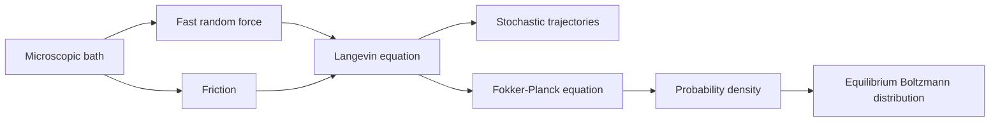

# Brownian Motion, Langevin, and Fokker-Planck Dynamics

Brownian motion is the statistical mechanics of a slow observed variable coupled to many fast microscopic degrees of freedom. Instead of tracking every solvent molecule, one writes an effective stochastic equation with friction and noise. Schwabl develops this route through Langevin equations and derives the corresponding Fokker-Planck equations for probability densities.

The key lesson is balance. Friction alone would drain energy; noise alone would heat without bound. Equilibrium requires a fluctuation-dissipation relation tying the noise strength to the damping coefficient and temperature.

## From a microscopic bath to an effective equation

The free Langevin equation for a particle of mass $m$ is

$$
m\dot v=-\gamma v+\eta(t),
$$

where $\gamma$ is the friction coefficient and $\eta(t)$ is a random force with

$$
\langle \eta(t)\rangle=0,
\qquad
\langle \eta(t)\eta(t')\rangle=2\gamma k_BT\,\delta(t-t').
$$

In a force field $F(x)=-\partial_x U(x)$,

$$
m\dot v=-\gamma v+F(x)+\eta(t),
\qquad
\dot x=v.
$$

The overdamped Langevin equation is

$$
\gamma\dot x=F(x)+\eta(t).
$$

For overdamped motion in one dimension, the probability density $P(x,t)$ obeys the Smoluchowski equation

$$
{\partial P\over \partial t}
=-{\partial\over \partial x}\left({F\over \gamma}P\right)
+D{\partial^2P\over \partial x^2},
$$

with diffusion constant

$$
D={k_BT\over \gamma}.
$$

The two reductions hidden here should be kept separate. First, the solvent has been replaced by a drag force and a random force. That step assumes that the tracked coordinate evolves much more slowly than the bath correlations. Second, the inertial term $m\dot v$ has been dropped. That further assumes observation times much longer than $\tau=m/\gamma$. White noise can be a good bath model while the overdamped approximation is still poor at very short times.

It is often cleaner to write the overdamped equation as a stochastic differential equation,

$$
dx=a(x)\,dt+\sqrt{2D}\,dW_t,
\qquad
a(x)={F(x)\over\gamma},
$$

where the Wiener increment has $\langle dW_t\rangle=0$ and $\langle dW_t^2\rangle=dt$. Unlike $\eta(t)$, $dW_t$ is an object that can be integrated. Formally setting $\eta(t)\,dt=\sqrt{2\gamma k_BT}\,dW_t$ connects the two notations.

## From trajectories to a density

The Fokker--Planck equation can be obtained from one short-time step. During $\Delta t$,

$$
\Delta x=a(x)\Delta t+\sqrt{2D\Delta t}\,\xi,
$$

with $\xi$ a standard normal variable. The first two conditional moments are

$$
\langle\Delta x\mid x\rangle=a(x)\Delta t,
\qquad
\langle(\Delta x)^2\mid x\rangle=2D\Delta t+O(\Delta t^2).
$$

Expanding the density after one step in powers of $\Delta x$ and retaining terms of order $\Delta t$ gives

$$
{\partial P\over\partial t}
=-{\partial\over\partial x}(aP)
+D{\partial^2P\over\partial x^2}.
$$

The first term transports probability with the deterministic drift. The second spreads it because increments have variance proportional to elapsed time. Higher moments vanish quickly enough for Gaussian white noise; jump processes instead lead to master equations or nonlocal evolution equations.

Written as a continuity equation,

$$
{\partial P\over \partial t}=-{\partial J\over \partial x},
\qquad
J={F\over \gamma}P-D{\partial P\over \partial x},
$$

it also states how boundary conditions act. A reflecting wall imposes $J=0$. An absorbing wall imposes $P=0$ and allows normalization to decrease; the lost probability is the probability that a trajectory has already hit the wall.

For a conservative force $F=-U'$, zero current requires

$$
{P'\over P}=-{U'\over\gamma D}.
$$

Thus $P\propto e^{-U/(\gamma D)}$. Agreement with the canonical density $e^{-\beta U}$ fixes $\gamma D=k_BT$. The Einstein relation is therefore the condition that the stochastic dynamics have the desired equilibrium measure, not an optional empirical add-on.

## Ballistic motion, velocity memory, and diffusion

For free overdamped diffusion,

$$
{\partial P\over \partial t}=D{\partial^2P\over \partial x^2}.
$$

Starting at $x=0$, the solution is Gaussian:

$$
P(x,t)={1\over \sqrt{4\pi Dt}}
\exp\left(-{x^2\over 4Dt}\right),
$$

and the mean-square displacement is

$$
\langle x^2(t)\rangle=2Dt
$$

in one dimension. In $d$ dimensions,

$$
\langle |\mathbf x(t)-\mathbf x(0)|^2\rangle=2dDt.
$$

For the velocity Langevin equation, the deterministic relaxation time is

$$
\tau={m\over \gamma}.
$$

The velocity autocorrelation function is

$$
\langle v(t)v(0)\rangle={k_BT\over m}e^{-\gamma |t|/m}.
$$

Integrating the autocorrelation gives the diffusion constant:

$$
D=\int_0^\infty \langle v(t)v(0)\rangle\,dt
={k_BT\over \gamma}.
$$

This is the Einstein relation. It is an elementary form of fluctuation-dissipation: equilibrium fluctuations determine dissipative transport.

The stationary solution of the Fokker-Planck equation in a potential is the Boltzmann distribution

$$
P_{\mathrm{eq}}(x)={1\over Z}e^{-\beta U(x)}
$$

when $D=k_BT/\gamma$. If the noise strength and damping are inconsistent, the process does not relax to the correct thermal equilibrium.

The underdamped and overdamped descriptions apply on different time scales. At times short compared with $\tau=m/\gamma$, the particle remembers its velocity and motion is approximately ballistic:

$$
\langle x^2(t)\rangle\approx {k_BT\over m}t^2.
$$

At times long compared with $\tau$, velocity memory has decayed and diffusion becomes linear in time:

$$
\langle x^2(t)\rangle\approx 2Dt.
$$

Experiments on colloids can observe both regimes if temporal resolution is high enough.

Equilibrium in a closed system usually means zero probability current, not merely a time-independent density. In nonequilibrium steady states, $P$ can be stationary while currents circulate; such states require driving or reservoirs and lie beyond the simplest equilibrium Brownian model.

The free underdamped equation can be solved explicitly. Multiplying by $e^{t/\tau}$ gives

$$
v(t)=v(0)e^{-t/\tau}+{1\over m}\int_0^t e^{-(t-s)/\tau}\eta(s)\,ds.
$$

At thermal equilibrium $\langle v(0)^2\rangle=k_BT/m$. Contracting the noise terms then yields the exponential velocity correlation quoted above. Integrating velocity twice gives the full mean-square displacement,

$$
\langle[x(t)-x(0)]^2\rangle
=2D\left[t-\tau\left(1-e^{-t/\tau}\right)\right].
$$

For $t\ll\tau$, expand the exponential: the bracket is $t^2/(2\tau)+O(t^3)$, so the result is $(k_BT/m)t^2$. For $t\gg\tau$, it is $2Dt$ with a constant offset $-2D\tau$. The crossover follows from one formula rather than two unrelated laws.

## Confinement and relaxation: the Ornstein--Uhlenbeck process

For $U(x)=kx^2/2$, the overdamped equation becomes

$$
dx=-{k\over\gamma}x\,dt+\sqrt{2D}\,dW_t.
$$

Its solution for a fixed initial value $x_0$ is Gaussian, because it is a linear combination of Gaussian increments. The mean and variance are

$$
\langle x(t)\rangle=x_0e^{-t/t_r},
\qquad
\operatorname{Var}x(t)={k_BT\over k}\left(1-e^{-2t/t_r}\right),
\qquad
t_r={\gamma\over k}.
$$

The long-time variance $k_BT/k$ agrees with equipartition, $k\langle x^2\rangle/2=k_BT/2$. There are now two relaxation scales in an underdamped trap: momentum relaxes on $m/\gamma$, while position relaxes on roughly $\gamma/k$ in the strongly damped limit. Treating both as one generic ``Brownian time'' can hide which approximation is being used.

The harmonic model appears in optical trapping and also supplies a local approximation near any stable minimum. Near $x_*$, write $U(x)\simeq U(x_*)+U''(x_*)(x-x_*)^2/2$; the curvature then sets the positional relaxation rate.

The underdamped density retains both position and velocity. Its evolution is the Kramers equation,

$$
{\partial P\over\partial t}
=-v{\partial P\over\partial x}
-{\partial\over\partial v}\left[{F(x)-\gamma v\over m}P\right]
+{\gamma k_BT\over m^2}{\partial^2P\over\partial v^2}.
$$

Substitution verifies that the stationary density is

$$
P_{\mathrm{eq}}(x,v)\propto
\exp\left[-\beta\left({mv^2\over2}+U(x)\right)\right].
$$

The streaming term $-v\partial_xP$ moves probability through real space, while force, friction, and velocity diffusion act in velocity space. Integrating the Kramers equation over $v$ produces a continuity equation for the spatial density, but not a closed diffusion equation: a momentum-current term remains. Smoluchowski dynamics emerges only after velocity has nearly equilibrated and that current can be eliminated. The distinction matters near sudden forcing, hard collisions, or rapidly moving boundaries.

There is also a useful response interpretation of the Einstein relation. Apply a small constant force $f$ to the overdamped particle. Its mean drift speed is $\langle\dot x\rangle=f/\gamma$, so the mobility is $\mu=1/\gamma$. With no applied force, the same particle spreads with coefficient $D$. Thermal equilibrium relates the spontaneous spreading to the response coefficient:

$$
D=\mu k_BT.
$$

This form survives beyond a spherical colloid. Mobility and diffusion may become tensors, and each component obeys the corresponding equilibrium relation when time-reversal assumptions and thermalization conditions hold.

## Escape, memory, and extensions

The same formalism also describes activated escape. In a double-well potential, noise occasionally drives a system over an energy barrier. At weak noise, escape rates have Arrhenius form

$$
r\propto e^{-\Delta U/(k_BT)}.
$$

The prefactor depends on damping and potential curvature. This connects stochastic dynamics to chemical reaction rates, nucleation, and switching of order parameters near metastable states.

Schwabl's treatment of critical dynamics uses Langevin-type equations for coarse-grained order parameters. There the "coordinate" is not a particle position but a field such as magnetization density. The same questions recur: What is the deterministic relaxation law, what noise correlator enforces equilibrium, and which conservation laws change the dynamic universality class?

The Markov assumption is another approximation. A true microscopic bath has finite correlation times, and eliminating it exactly can produce memory friction and colored noise. The simple Langevin equation is valid when bath correlations decay quickly compared with the slow variable's evolution. If this separation fails, generalized Langevin equations are needed:

$$
m\dot v(t)=-\int_0^t \Gamma(t-t')v(t')\,dt' + \eta(t).
$$

The fluctuation-dissipation relation then ties the memory kernel $\Gamma$ to the colored-noise correlation.

Boundary conditions turn diffusion into first-passage physics. Absorbing boundaries model reactions or escape, while reflecting boundaries model confinement. Many measurable quantities are not just densities at a time but hitting probabilities and mean first-passage times. This is one reason Brownian motion remains central in chemical physics and soft matter.

For example, let $T(x)$ be the mean time for unbiased diffusion on $0\lt x\lt L$ to reach either absorbing endpoint. A short-time conditioning step gives the backward equation $D T''(x)=-1$, with $T(0)=T(L)=0$. Integrating twice,

$$
T(x)=-{x^2\over2D}+C_1x+C_2.
$$

The boundary values give $C_2=0$ and $C_1=L/(2D)$, hence

$$
T(x)={x(L-x)\over2D}.
$$

Starting in the middle takes $L^2/(8D)$ on average. The result scales as length squared, as expected for diffusion, and also shows that an absorbing-boundary problem asks a different question from the free-space Gaussian propagator.

When the noise amplitude depends on position, stochastic calculus conventions matter. Ito and Stratonovich interpretations can lead to different drift terms for the same formal equation. The additive-noise Langevin equations above avoid that ambiguity, but multiplicative noise appears naturally in coarse-grained variables, chemical reaction networks, and diffusion in inhomogeneous media.

Fokker-Planck equations encode modeling assumptions about coarse-graining, time-scale separation, and noise interpretation.

They also provide a direct route to numerical simulation. One may either integrate stochastic trajectories and estimate distributions from many paths, or solve the deterministic equation for $P(x,t)$. Agreement between these two descriptions is a useful check that drift, diffusion, and boundary conditions have been implemented consistently.

Time discretization needs one statistical check beyond convergence of a smooth ordinary differential equation. For free diffusion, each numerical increment should have mean zero and variance $2D\Delta t$; halving $\Delta t$ halves the increment variance but does not make an individual path smooth. A Wiener path is continuous with probability one yet almost surely nowhere differentiable. Accordingly, a finite-difference ``velocity'' over a time bin has a variance that grows as the bin narrows. The velocity in the overdamped equation is formal, unlike the physical velocity retained in underdamped dynamics.

Ensemble averages and time averages should also be distinguished. For ordinary confined Brownian motion, a sufficiently long stationary trajectory can estimate equilibrium moments. Free diffusion has no normalizable stationary position distribution, so averaging $x^2$ along one path is not the same operation as averaging $x(t)^2$ over many paths started together. Ergodicity claims must specify the observable and the stationary process to which they refer.

In higher dimensions the diffusion tensor can be anisotropic, especially in crystals, membranes, or complex fluids. Then $D$ is a matrix and the Fokker-Planck equation uses tensor diffusion. The scalar formulas here are the isotropic limit, chosen because they expose the core fluctuation-dissipation structure.



| Description | Equation | Object evolved |
|---|---:|---|
| Langevin | $\gamma\dot x=F+\eta$ | individual noisy trajectory |
| Fokker-Planck | $\partial_tP=-\partial_x(AP)+\partial_x^2(DP)$ | probability density |
| Diffusion | $\partial_tP=D\partial_x^2P$ | density without drift |
| Smoluchowski | drift plus diffusion | overdamped thermal relaxation |

## Worked example 1: Mean-square displacement from the diffusion equation

Problem: Show that the one-dimensional diffusion equation implies $\langle x^2(t)\rangle=2Dt$ for a normalized density that decays at infinity.

Method:

1. Start with

$$
{\partial P\over \partial t}=D{\partial^2P\over \partial x^2}.
$$

2. Differentiate the second moment:

$$
{d\over dt}\langle x^2\rangle
=\int_{-\infty}^{\infty}x^2{\partial P\over \partial t}\,dx
=D\int x^2{\partial^2P\over \partial x^2}\,dx.
$$

3. Integrate by parts once:

$$
\int x^2P''\,dx
=\left[x^2P'\right]_{-\infty}^{\infty}
-\int 2xP'\,dx.
$$

The boundary term vanishes.

4. Integrate by parts again:

$$
-\int 2xP'\,dx
=-\left[2xP\right]_{-\infty}^{\infty}
+2\int P\,dx
=2.
$$

5. Therefore

$$
{d\over dt}\langle x^2\rangle=2D.
$$

For a particle starting at the origin, $\langle x^2(0)\rangle=0$, so

$$
\langle x^2(t)\rangle=2Dt.
$$

Checked answer: the result depends only on normalization and boundary decay, not on the detailed Gaussian solution.

## Worked example 2: Velocity autocorrelation and diffusion

Problem: Given

$$
\langle v(t)v(0)\rangle={k_BT\over m}e^{-t/\tau},
\qquad \tau={m\over \gamma},
$$

compute $D$.

Method:

1. Use the Green-Kubo relation for diffusion:

$$
D=\int_0^\infty \langle v(t)v(0)\rangle\,dt.
$$

2. Substitute:

$$
D={k_BT\over m}\int_0^\infty e^{-t/\tau}\,dt.
$$

3. Evaluate the integral:

$$
\int_0^\infty e^{-t/\tau}\,dt=\tau.
$$

4. Therefore

$$
D={k_BT\over m}\tau
={k_BT\over m}{m\over \gamma}
={k_BT\over \gamma}.
$$

Checked answer: the mass cancels in the long-time diffusion constant, although it controls the short-time relaxation scale.

## Checking the diffusion law numerically

```python
import numpy as np

def simulate_overdamped(T=1.0, gamma=2.0, dt=1e-3, steps=20_000, seed=0):
    rng = np.random.default_rng(seed)
    kB = 1.0
    D = kB * T / gamma
    x = 0.0
    xs = []
    for _ in range(steps):
        x += np.sqrt(2 * D * dt) * rng.normal()
        xs.append(x)
    return np.array(xs), D

xs, D = simulate_overdamped()
times = np.arange(1, len(xs) + 1) * 1e-3
print("D", D)
print("final x^2", xs[-1] ** 2)
print("ensemble estimate needs many paths; theory final <x^2>", 2 * D * times[-1])
```

## Modelling checks that catch most errors

- If friction and noise strength are chosen independently, inspect the stationary density. Its effective temperature is generally not the stated bath temperature.
- A single stochastic trajectory is jagged and does not obey the Fokker--Planck equation pointwise. The density obtained from an ensemble of such trajectories does.
- Overdamped dynamics erase the ballistic regime. They are inappropriate when the sampling interval is comparable to $m/\gamma$.
- Boundary conditions carry physical meaning. Reflecting and absorbing endpoints give different normalization, currents, and first-passage statistics even with the same differential operator.
- White noise is a distribution, not an ordinary rapidly fluctuating function. Expressions involving its square require a discretization or stochastic-calculus convention.
- For position-dependent noise, stating only a symbolic equation such as $dx=b(x)\,dW_t$ is incomplete. Ito and Stratonovich readings differ by a drift term.

<div className="see-also">

See also: [Linear response, fluctuation-dissipation, and Onsager theory](/physics/statistical-mechanics/linear-response-fluctuation-dissipation-and-onsager-theory) · [Boltzmann equation and transport](/physics/statistical-mechanics/boltzmann-equation-and-transport) · [Irreversibility, master equations, and finite-temperature field theory](/physics/statistical-mechanics/irreversibility-master-equations-and-finite-temperature-field-theory) · [Markov chains](/math/probability-and-random-variables/markov-chains) · [Poisson processes](/math/probability-and-random-variables/poisson-random-variables-and-processes)

</div>
