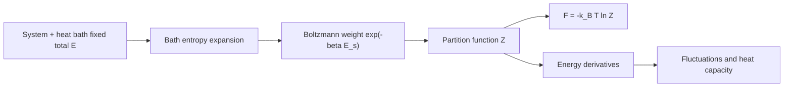

# Canonical Ensemble and Fluctuations

The canonical ensemble describes a system that can exchange energy with a heat bath while its volume and particle number remain fixed. It is the workhorse of equilibrium statistical mechanics because many laboratory systems are closer to fixed temperature than fixed energy, and because the partition function turns sums over states into thermodynamic potentials.

Schwabl derives the canonical density by embedding the system in a larger microcanonical universe. The bath's entropy supplies the Boltzmann factor, and the system's partition function normalizes it. Fluctuations, response functions, and thermodynamic stability all follow from derivatives of this one object.

## How a heat bath produces Boltzmann weights

Let the small system be in microstate $i$ with energy $E_i$, while the combined system and reservoir have fixed energy $E_{\mathrm{tot}}$. The number of compatible reservoir states is $\Omega_B(E_{\mathrm{tot}}-E_i)$, so the probability of $i$ is proportional to that number. Expanding the reservoir entropy gives

$$
\begin{aligned}
S_B(E_{\mathrm{tot}}-E_i)
&=S_B(E_{\mathrm{tot}})-E_i{\partial S_B\over\partial E_B}
+{E_i^2\over2}{\partial^2S_B\over\partial E_B^2}+\cdots\\
&=S_B(E_{\mathrm{tot}})-{E_i\over T_B}
-{E_i^2\over2T_B^2C_{V,B}}+\cdots .
\end{aligned}
$$

Since $\Omega_B=e^{S_B/k_B}$, the leading state-dependent factor is $e^{-E_i/(k_BT_B)}$. The next term estimates the error made by treating the reservoir temperature as fixed. A large positive bath heat capacity suppresses that correction.

Normalization then introduces the partition function. For inverse temperature

For inverse temperature

$$
\beta={1\over k_BT},
$$

the quantum canonical density matrix is

$$
\rho={e^{-\beta H}\over Z},
\qquad
Z=\mathrm{Tr}\,e^{-\beta H}.
$$

For a classical system,

$$
Z={1\over h^{3N}N!}\int dq\,dp\,e^{-\beta H(q,p)}.
$$

The Helmholtz free energy is

$$
F(T,V,N)=-k_BT\ln Z.
$$

Canonical averages are

$$
\langle A\rangle={1\over Z}\mathrm{Tr}\,A e^{-\beta H}.
$$

When $A$ commutes with $H$, this is an ordinary weighted average over energy eigenstates. When it does not, the trace formula remains valid, but operator ordering matters in correlation functions.

For indistinguishable classical particles the $N!$ removes the overcounting from particle labels, while powers of $h$ make the phase-space integral dimensionless. Classical mechanics alone does not determine the size of a phase-space cell; quantum mechanics supplies it. Omitting $N!$ produces the Gibbs paradox and a nonextensive mixing entropy.

## Derivatives of $\ln Z$ and what they measure

The energy follows from the partition function:

$$
\langle E\rangle
=-\frac{\partial}{\partial \beta}\ln Z.
$$

The energy variance is the second derivative:

$$
\langle(\Delta E)^2\rangle
=\frac{\partial^2}{\partial \beta^2}\ln Z
=-\frac{\partial \langle E\rangle}{\partial \beta}.
$$

Using $\partial/\partial\beta=-k_BT^2\partial/\partial T$, one obtains the fluctuation formula

$$
\langle(\Delta E)^2\rangle=k_BT^2 C_V.
$$

This is a central bridge between fluctuations and response. A large heat capacity means the system can absorb energy with little temperature change, and it also means its canonical energy distribution is broad in absolute terms. Relative fluctuations still vanish for macroscopic systems because both $C_V$ and $\langle E\rangle$ are extensive.

The canonical entropy can be written as

$$
S=-k_B\mathrm{Tr}\,\rho\ln\rho
=k_B(\ln Z+\beta\langle E\rangle).
$$

Since $F=E-TS$, one also has

$$
S=-\left({\partial F\over \partial T}\right)_{V,N},
\qquad
p=-\left({\partial F\over \partial V}\right)_{T,N}.
$$

The equipartition theorem follows for classical quadratic degrees of freedom. If the Hamiltonian contains a term $a x^2$, then

$$
\langle a x^2\rangle={1\over 2}k_BT.
$$

The virial theorem generalizes this structure and is especially useful for classical gases and bound systems:

$$
\left\langle x_i{\partial H\over \partial x_i}\right\rangle=k_BT
$$

under the usual assumptions that boundary terms vanish.

Equipartition follows by integration by parts rather than by assuming that energy is shared equally. For one classical coordinate $x$ appearing in $H$, consider

$$
\left\langle x{\partial H\over\partial x}\right\rangle
={1\over Z}\int dx\,x{\partial H\over\partial x}e^{-\beta H}.
$$

Because $(\partial_xH)e^{-\beta H}=-(1/\beta)\partial_xe^{-\beta H}$, integration by parts leaves $1/\beta=k_BT$ when the boundary term vanishes. If $H$ contains $ax^2$, then $x\partial_xH=2ax^2$, giving $\langle ax^2\rangle=k_BT/2$. A coordinate constrained to a finite interval, a nonquadratic term, or a quantum operator need not contribute $k_BT/2$ to the mean energy.

Partition-function derivatives generate cumulants, not only means. If

$$
K(\beta)=\ln Z(\beta),
$$

then

$$
\langle E\rangle=-K'(\beta),
\qquad
\langle(\Delta E)^2\rangle=K''(\beta),
\qquad
\langle(\Delta E)^3\rangle=-K'''(\beta).
$$

Response functions and fluctuations are therefore tightly connected. A singular heat capacity at a continuous transition is also a statement that energy fluctuations become anomalously large.

For a normal extensive system, $\langle E\rangle\sim N$ and $C_V\sim N$. Therefore the root-mean-square fluctuation scales as $\sqrt{N}$ and

$$
{\sqrt{\langle(\Delta E)^2\rangle}\over\langle E\rangle}
\sim {1\over\sqrt N}.
$$

Canonical energy is never exactly fixed, but its relative width becomes tiny for macroscopic matter. This concentration underlies equivalence with the microcanonical ensemble away from phase coexistence, long-range interactions, and other cases where additivity or concavity fails. For a finite sample, the difference can remain measurable.

The energy distribution itself combines density of states and Boltzmann weight:

$$
P(E)={\Omega(E)e^{-\beta E}\over Z}.
$$

Writing $\Omega(E)=e^{S(E)/k_B}$ shows that its exponent is $S(E)/k_B-\beta E$. The most probable energy $E_*$ satisfies

$$
{1\over k_B}{\partial S\over\partial E}\bigg|_{E_*}=\beta,
$$

which is equality between the system temperature and the bath temperature. Expanding about $E_*$ gives

$$
{S(E)\over k_B}-\beta E
\simeq \text{constant}-{(E-E_*)^2\over2k_BT^2C_V}.
$$

Thus the central part of the canonical energy distribution is Gaussian with the variance obtained from derivatives of $\ln Z$. The argument assumes a smooth, concave entropy. Near a first-order transition, two competing maxima may remain, producing a bimodal distribution rather than one Gaussian peak.

## Why the Helmholtz free energy is the controlled potential

At fixed $T,V,N$, equilibrium minimizes $F=E-TS$. To connect this thermodynamic statement to $Z$, use $\rho=e^{-\beta H}/Z$ in the Gibbs entropy:

$$
\begin{aligned}
S&=-k_B\operatorname{Tr}(\rho\ln\rho)\\
&=-k_B\operatorname{Tr}\rho(-\beta H-\ln Z)\\
&=k_B\beta\langle E\rangle+k_B\ln Z.
\end{aligned}
$$

Then $\langle E\rangle-TS=-k_BT\ln Z$. Differentiating the thermodynamic identity $dF=-S\,dT-p\,dV+\mu\,dN$ recovers entropy and pressure from $F$.

The free energy has a variational property. For any trial density matrix $\sigma$,

$$
F\le \mathrm{Tr}\,\sigma H+k_BT\,\mathrm{Tr}\,\sigma\ln\sigma .
$$

The minimum is reached at $\sigma=e^{-\beta H}/Z$. This Gibbs-Bogoliubov inequality is a standard route to mean-field approximations: choose a solvable trial Hamiltonian, minimize the variational free energy, and interpret the optimum as an effective field or quasiparticle description. Schwabl's later molecular-field theory fits this broader pattern.

The inequality follows from nonnegative relative entropy. With $\rho=e^{-\beta H}/Z$,

$$
k_BT\,D(\sigma\Vert\rho)
=\operatorname{Tr}(\sigma H)+k_BT\operatorname{Tr}(\sigma\ln\sigma)-F\ge0.
$$

Thus the variational approximation has a definite direction: every normalized trial state gives an upper bound on the true free energy. A low variational value does not by itself guarantee accurate correlation functions, since distinct trial states may have close free energies.

## Factorization and temperature limits

Canonical calculations also require attention to degeneracy. If an energy $E_n$ has degeneracy $g_n$, its contribution is $g_ne^{-\beta E_n}$. Entropy often comes as much from degeneracy as from energy. In a spin system, for example, a macrostate with nearly equal up and down spins has huge combinatorial degeneracy even if its energy is not minimal. The canonical distribution balances this entropy against the Boltzmann energy penalty.

At low temperature, $Z$ is dominated by the ground state and the first few excitations. At high temperature, many states contribute, and classical approximations may become valid if quantum level spacings are small compared with $k_BT$. This low/high temperature reasoning is used repeatedly for oscillators, molecular rotations, phonons, and magnetic systems.

The same derivative machinery also gives generalized forces. If the Hamiltonian depends on an external parameter $\lambda$, then

$$
{\partial F\over \partial \lambda}
=\left\langle{\partial H\over \partial \lambda}\right\rangle.
$$

Pressure is the case where $\lambda=V$ with a sign convention, magnetization is the case where $\lambda=B$, and elastic stress follows from differentiating with respect to strain. The canonical ensemble generates equations of state for any controlled parameter, not only energy averages.

When the parameter enters linearly, the fluctuation relation takes an especially transparent form. Suppose

$$
H=H_0-fX,
$$

where $f$ is an applied field and $X$ is its conjugate observable. Differentiating at fixed temperature gives

$$
{\partial\ln Z\over\partial f}=\beta\langle X\rangle,
$$

and a second derivative gives

$$
{\partial\langle X\rangle\over\partial f}
=\beta\left(\langle X^2\rangle-\langle X\rangle^2\right).
$$

Magnetic susceptibility is obtained with $X$ equal to magnetization; an isothermal compressibility has an analogous volume-fluctuation form in an ensemble where volume may change. The choice of ensemble matters because a variable held fixed cannot fluctuate. Cross derivatives similarly produce covariances between different observables.

These formulas also impose stability. Variances are nonnegative, so the response to a field coupled as $-fX$ is nonnegative under the stated constraints. Likewise $C_V\ge0$ in the canonical ensemble. In differential terms, $\ln Z$ is convex in every linear coupling, while $F$ is concave in the corresponding applied field. A calculated negative variance or wrong curvature usually signals a sign error, an inconsistent stationary point, or use of a metastable branch beyond its range.

## What the ensemble does and does not assume

The canonical distribution is an equilibrium statement. It assigns probabilities without specifying how the system explores states or how quickly it thermalizes. A glass, an integrable model, or a system separated by high barriers may fail to sample the canonical measure on experimental time scales even if that measure is mathematically well defined. Dynamics and ergodicity enter when replacing ensemble averages by measurements along one history.

Nor must the bath exchange energy through weak instantaneous collisions. Weak system--bath coupling is mainly needed so that the subsystem energy and Hamiltonian remain identifiable and the interaction energy can be neglected in ordinary thermodynamics. At strong coupling, tracing out the bath still gives a reduced state, but it need not equal $e^{-\beta H_S}/Z_S$ for the bare subsystem Hamiltonian.

Finite-size calculations should also distinguish the most probable energy from the mean. A skewed canonical distribution can place them at different values even though both converge to the same energy density as size grows. Near phase coexistence the distribution may have two peaks, and its mean can lie in a low-probability valley between them. Reporting only $\langle E\rangle$ then hides the phase structure; a histogram or higher cumulants carry information that heat capacity alone does not.

For finite systems, canonical energy fluctuations are not negligible background. They can dominate calorimetry of nanoscale systems, clusters, and mesoscopic conductors. The thermodynamic limit hides them, but the fluctuation formulas remain exact and measurable.

| Quantity | Canonical formula | Thermodynamic role |
|---|---:|---|
| Partition function | $Z=\mathrm{Tr}\,e^{-\beta H}$ | normalization and generator |
| Free energy | $F=-k_BT\ln Z$ | potential at fixed $T,V,N$ |
| Mean energy | $\langle E\rangle=-\partial_\beta\ln Z$ | caloric equation |
| Heat capacity | $C_V=(\partial E/\partial T)_{V,N}$ | response to temperature |
| Energy variance | $\langle(\Delta E)^2\rangle=k_BT^2C_V$ | equilibrium fluctuation |

If the Hamiltonian splits into independent pieces, $H=H_1+H_2$ with separate state labels, then $Z=Z_1Z_2$ and $F=F_1+F_2$. Additivity of free energy is therefore encoded as multiplication of state sums. Weak interactions can be treated as corrections to this factorization; strong interactions generally prevent it and are the source of collective behavior.

## A finite-size model: many independent two-level units

Take $N$ distinguishable, noninteracting units, each with energies $0$ and $\epsilon$. The one-unit partition function is $z=1+e^{-\beta\epsilon}$, so factorization gives

$$
Z_N=z^N=(1+e^{-\beta\epsilon})^N.
$$

Expanding the binomial displays the degeneracy explicitly:

$$
Z_N=\sum_{n=0}^N {N\choose n}e^{-\beta n\epsilon}.
$$

Here $n$ is the number of excited units and ${N\choose n}$ counts which units are excited. The excitation probability of one unit is

$$
p={e^{-\beta\epsilon}\over1+e^{-\beta\epsilon}}
={1\over e^{\beta\epsilon}+1}.
$$

Consequently $n$ has a binomial distribution. Step by step,

$$
\langle E\rangle=\epsilon\langle n\rangle=N\epsilon p,
$$

and

$$
\langle(\Delta E)^2\rangle
=\epsilon^2\operatorname{Var}n
=N\epsilon^2p(1-p).
$$

Differentiating the mean gives

$$
C_V=Nk_B(\beta\epsilon)^2p(1-p),
$$

so $k_BT^2C_V=N\epsilon^2p(1-p)$, exactly matching the direct variance. The mean energy is proportional to $N$, its standard deviation to $\sqrt N$, and its relative fluctuation to $N^{-1/2}$. The example supplies an explicit finite-system version of the general scaling argument.

The heat capacity has a broad maximum, the Schottky anomaly. It falls at low temperature because excitations are rare and at high temperature because changing temperature barely changes two nearly equal populations. No phase transition occurs: the partition function of a finite collection of independent units is analytic for positive temperature.

## Worked example 1: Two-level system in the canonical ensemble

Problem: A system has energies $0$ and $\epsilon$. Find $Z$, $\langle E\rangle$, and $C_V$.

Method:

1. Sum the Boltzmann weights:

$$
Z=1+e^{-\beta\epsilon}.
$$

2. Compute the mean energy:

$$
\langle E\rangle
={0\cdot 1+\epsilon e^{-\beta\epsilon}\over 1+e^{-\beta\epsilon}}
={\epsilon\over e^{\beta\epsilon}+1}.
$$

3. Differentiate with respect to temperature. Let $x=\beta\epsilon=\epsilon/(k_BT)$:

$$
\langle E\rangle={\epsilon\over e^x+1},
\qquad
{dx\over dT}=-{x\over T}.
$$

4. Then

$$
C_V={d\langle E\rangle\over dT}
=\epsilon\left[-{e^x\over (e^x+1)^2}\right]\left[-{x\over T}\right]
=k_B x^2{e^x\over (e^x+1)^2}.
$$

Checked answer: $C_V$ vanishes at very low $T$ because the excited state is frozen out, and at very high $T$ because both levels are nearly equally populated.

## Worked example 2: Energy fluctuation of a harmonic oscillator

Problem: A quantum oscillator has levels $E_n=\hbar\omega(n+1/2)$. Compute $\langle E\rangle$ and the variance.

Method:

1. The partition function is a geometric series:

$$
Z=\sum_{n=0}^{\infty}e^{-\beta\hbar\omega(n+1/2)}
={e^{-\beta\hbar\omega/2}\over 1-e^{-\beta\hbar\omega}}.
$$

2. Its logarithm is

$$
\ln Z=-{\beta\hbar\omega\over 2}
-\ln(1-e^{-\beta\hbar\omega}).
$$

3. Differentiate:

$$
\langle E\rangle=-\partial_\beta\ln Z
=\hbar\omega\left({1\over 2}+{1\over e^{\beta\hbar\omega}-1}\right).
$$

4. The variance is

$$
\langle(\Delta E)^2\rangle
=-\partial_\beta\langle E\rangle
=(\hbar\omega)^2
{e^{\beta\hbar\omega}\over (e^{\beta\hbar\omega}-1)^2}.
$$

Checked answer: the zero-point energy contributes to $\langle E\rangle$ but not to the variance because it is a constant shift.

## Checks on a canonical calculation

- The classical partition function must be dimensionless. Its phase-space measure needs both $h^{3N}$ and, for identical particles, $N!$.
- Canonical energy fluctuates; microcanonical energy does not. Formulas for the variance cannot be transferred between the ensembles without changing the constraint.
- A constant shift $H\mapsto H+C$ multiplies $Z$ by $e^{-\beta C}$. Probabilities and heat capacity are unchanged, but $F$ and mean energy both shift by $C$.
- Equipartition fails for a quantum mode whose level spacing is not small compared with $k_BT$. Frozen modes contribute exponentially little to the heat capacity.
- The chain rule is a frequent source of sign and temperature-power errors: $\partial_\beta=-k_BT^2\partial_T$.
- A negative canonical heat capacity would imply a negative energy variance and is impossible for a stable canonical equilibrium. Negative heat capacities can occur under microcanonical constraints in nonadditive systems, so the ensemble must be stated.

See also: [Microcanonical ensemble and entropy](/physics/statistical-mechanics/microcanonical-ensemble-and-entropy) · [Grand canonical ensemble and particle exchange](/physics/statistical-mechanics/grand-canonical-ensemble-and-particle-exchange) · [Classical ideal gas and Maxwell distribution](/physics/statistical-mechanics/classical-ideal-gas-and-maxwell-distribution) · [Harmonic oscillator in quantum mechanics](/physics/quantum-mechanics/harmonic-oscillator-ladder-operators) · [Thermodynamics](/physics/thermodynamics/intro)

