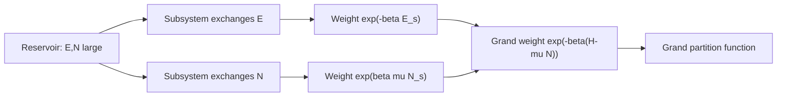

# Grand Canonical Ensemble and Particle Exchange

The grand canonical ensemble describes a system that exchanges both energy and particles with a reservoir. It is the natural language for gases, adsorption, chemical equilibrium, quantum occupation numbers, and field-theoretic many-body systems. Instead of fixing $N$ exactly, it fixes the mean particle number through the chemical potential $\mu$.

In Schwabl's development, the grand ensemble completes the hierarchy from isolated systems to open subsystems. It also prepares the notation for ideal Fermi and Bose gases, where each single-particle state can be treated as a small subsystem exchanging particles with the rest.

## Opening the particle boundary

Let $N$ be the particle-number operator. The grand canonical density matrix is

$$
\rho={e^{-\beta(H-\mu N)}\over \mathcal Z},
\qquad
\mathcal Z=\mathrm{Tr}\,e^{-\beta(H-\mu N)}.
$$

The grand potential is

$$
\Phi_G=-k_BT\ln\mathcal Z.
$$

Many texts denote it by $\Omega$; $\Phi_G$ avoids confusion with the microcanonical density of states. Thermodynamics gives

$$
\Phi_G=E-TS-\mu N=-pV
$$

for a homogeneous bulk system. The average particle number and energy are generated by

$$
\langle N\rangle
={1\over \beta}{\partial \ln\mathcal Z\over \partial \mu},
\qquad
\langle H-\mu N\rangle
=-\partial_\beta\ln\mathcal Z
$$

when $\mu$ is held fixed in the second derivative.

The fugacity is

$$
z=e^{\beta\mu}.
$$

For a classical ideal gas,

$$
\mathcal Z=\sum_{N=0}^{\infty} z^N Z_N
=\exp\left({zV\over \lambda_T^3}\right),
\qquad
\lambda_T={h\over \sqrt{2\pi m k_BT}}.
$$

## Deriving the grand weight

The grand ensemble is obtained by expanding the reservoir entropy in both energy and particle number. If the subsystem has energy $E_s$ and particle number $N_s$, the reservoir has $E_{\mathrm{tot}}-E_s$ and $N_{\mathrm{tot}}-N_s$. To first order,

$$
S_R(E_{\mathrm{tot}}-E_s,N_{\mathrm{tot}}-N_s)
\approx S_R
-{E_s\over T}
+{\mu N_s\over T}.
$$

The subsystem weight is therefore

$$
P(s)\propto e^{-\beta(E_s-\mu N_s)}.
$$

The sign of the chemical-potential term follows from the reservoir identity

$$
dS={1\over T}dE+{p\over T}dV-{\mu\over T}dN.
$$

When the subsystem gains one particle, the reservoir loses one, so its entropy changes by $+\mu/T$ times the subsystem gain. A positive $\mu$ favors larger $N$ at fixed state energy; a negative $\mu$ penalizes it. Only energy differences and a consistent reference for $\mu$ enter the probability.

Summing the grand weight by particle-number sector gives

$$
\mathcal Z(T,V,\mu)=\sum_{N=0}^\infty e^{\beta\mu N}Z_N(T,V).
$$

The formula is a generating function for canonical partition functions. Conversely, the coefficient of $z^N$ recovers $Z_N$. Canonical and grand-canonical calculations reorganize the same state counting, though they impose different fluctuations at finite size.

## The grand potential as a Legendre transform

Starting with $dE=T\,dS-p\,dV+\mu\,dN$, define $\Phi_G=E-TS-\mu N$. Differentiation gives

$$
d\Phi_G=-S\,dT-p\,dV-N\,d\mu.
$$

Hence $S=-(\partial\Phi_G/\partial T)_{V,\mu}$, $p=-(\partial\Phi_G/\partial V)_{T,\mu}$, and $N=-(\partial\Phi_G/\partial\mu)_{T,V}$. Extensivity supplies $\Phi_G=-pV$ only for a homogeneous bulk phase with negligible surface terms. A finite droplet, interface, or trapped gas needs the more general potential.

At fixed $T,V,\mu$, stable equilibrium minimizes $\Phi_G$. This makes phase comparison direct: two homogeneous phases coexist when they have the same pressure at the common temperature and chemical potential.

## Fluctuations, response, and compressibility

Number fluctuations are controlled by derivatives of $\ln\mathcal Z$:

$$
\langle(\Delta N)^2\rangle
=k_BT\left({\partial \langle N\rangle\over \partial \mu}\right)_{T,V}.
$$

For a classical ideal gas, $\langle N\rangle=zV/\lambda_T^3$, so the number distribution is Poisson:

$$
P(N)=e^{-\langle N\rangle}{\langle N\rangle^N\over N!},
\qquad
\langle(\Delta N)^2\rangle=\langle N\rangle.
$$

The distribution follows without a separate probabilistic assumption. The weight of the $N$-particle sector is

$$
P(N)={z^NZ_N\over\mathcal Z}
=\exp\left(-{zV\over\lambda_T^3}\right)
{(zV/\lambda_T^3)^N\over N!}.
$$

Its parameter is exactly the mean. Subvolumes of a dilute ideal gas consequently have Poisson number statistics when correlations and boundary effects can be neglected. In a canonical container with fixed total number, the count in one subvolume is instead binomial; it approaches Poisson only when the observed region is a small fraction of a large reservoir.

In second quantization, noninteracting quantum particles have

$$
H=\sum_\alpha \epsilon_\alpha n_\alpha,
\qquad
N=\sum_\alpha n_\alpha.
$$

The grand partition function factorizes over single-particle levels:

$$
\mathcal Z_{\mathrm{F}}=\prod_\alpha\left(1+ze^{-\beta\epsilon_\alpha}\right),
\qquad
\mathcal Z_{\mathrm{B}}=\prod_\alpha {1\over 1-ze^{-\beta\epsilon_\alpha}}.
$$

This factorization leads directly to the Fermi-Dirac and Bose-Einstein distributions.

For one level set $x=ze^{-\beta\epsilon}$. Fermions allow $n=0,1$, so $\mathcal Z_\epsilon=1+x$. Bosons allow $n=0,1,2,\ldots$, so the geometric series gives $\mathcal Z_\epsilon=(1-x)^{-1}$ when $x\lt 1$. Multiplying independent level factors and taking a logarithm turns products into sums:

$$
\ln\mathcal Z_F=\sum_\alpha\ln(1+x_\alpha),
\qquad
\ln\mathcal Z_B=-\sum_\alpha\ln(1-x_\alpha).
$$

Applying $x\partial_x$ to either single-level logarithm gives its mean occupation,

$$
\langle n_\alpha\rangle
={1\over e^{\beta(\epsilon_\alpha-\mu)}\pm1},
$$

with plus for fermions and minus for bosons. A second application of the same derivative yields the occupation variances below. The entire difference between ideal Fermi and Bose thermodynamics begins with the permitted integers in this one-level sum.

The chemical potential has several complementary meanings. Thermodynamically it is the change in free energy when a particle is added:

$$
\mu=\left({\partial F\over \partial N}\right)_{T,V}.
$$

Statistically it is the Lagrange multiplier that fixes $\langle N\rangle$. Physically it controls diffusive equilibrium: particles flow, on average, from higher chemical potential to lower chemical potential until the chemical potentials match. In mixtures and reactions, equality or stoichiometric balance of chemical potentials replaces the simpler equality of temperature used for energy exchange.

Number fluctuations are not just noise; they encode compressibility. For a one-component system,

$$
\langle(\Delta N)^2\rangle
=k_BT\left({\partial N\over \partial \mu}\right)_{T,V}.
$$

Since the isothermal compressibility is related to density response, large density fluctuations occur near liquid-gas criticality. In a stable macroscopic phase away from criticality, $\Delta N\sim \sqrt{N}$ and relative fluctuations vanish. Near a critical point, the same formula warns that the grand ensemble becomes visually and physically fluctuation dominated.

To connect number response to compressibility, use the Gibbs--Duhem relation at fixed temperature, $dp=n\,d\mu$. Since $N=nV$,

$$
\left({\partial N\over\partial\mu}\right)_{T,V}
=Vn^2\kappa_T,
\qquad
\kappa_T={1\over n}\left({\partial n\over\partial p}\right)_T.
$$

Therefore

$$
{\langle(\Delta N)^2\rangle\over\langle N\rangle}
=nk_BT\kappa_T.
$$

For a classical ideal gas, $\kappa_T=1/(nk_BT)$ and the ratio is one, matching Poisson statistics. Repulsive correlations generally suppress the ratio; strong density fluctuations near criticality enhance it.

Energy and number also fluctuate together. Differentiating with respect to $\beta$ while holding fugacity rather than $\mu$ fixed generates moments of $H$, whereas holding $\mu$ fixed generates moments of $H-\mu N$. Stating which variables remain fixed prevents missing covariance terms such as $\langle\Delta H\,\Delta N\rangle$.

## Occupation numbers for independent particles

The grand ensemble is the cleanest language for occupation-number statistics. For one level, the variance is

$$
\langle(\Delta n)^2\rangle
=f(1-f)
$$

for fermions and

$$
\langle(\Delta n)^2\rangle
=f(1+f)
$$

for bosons. The signs are not cosmetic. Pauli exclusion suppresses fluctuations, while Bose enhancement increases them. Photon bunching and Fermi degeneracy pressure are two experimentally important consequences of these formulas.

Finally, equivalence with the canonical ensemble assumes ordinary short-range systems in the thermodynamic limit. If one studies small systems, phase coexistence, long-range forces, or constrained particle numbers, grand-canonical fluctuations may represent a different physical preparation rather than a harmless calculational convenience.

The grand potential is especially useful because it is extensive in volume at fixed $T$ and $\mu$. For a homogeneous phase,

$$
\Phi_G=-pV,
$$

so pressure can be computed directly from $\ln\mathcal Z$ without first solving for the Helmholtz free energy. Quantum ideal gases are therefore often treated by computing $\Phi_G$, then deriving $N$, $S$, and $E$ by differentiation.

In phase coexistence problems, fixed $\mu$ is also natural. Two phases can exchange particles until their chemical potentials are equal. At coexistence the grand potentials per volume compete; the stable phase is the one with lower $\Phi_G$ under the imposed reservoir conditions. This viewpoint is the particle-exchange analogue of minimizing $F$ at fixed $N$.

Adsorption gives a concrete use case. A surface in contact with a gas does not have a fixed number of adsorbed particles; sites fill and empty according to the gas chemical potential. Simple lattice adsorption models are grand-canonical systems, and their coverage curves are occupation-number problems. When adsorbates interact, the same framework becomes a lattice gas and can show cooperative transitions.

The ensemble also clarifies chemical equilibrium. Reactions change particle numbers of several species while conserving atoms and charge. Equilibrium is obtained by minimizing the appropriate thermodynamic potential subject to those conservation laws, which leads to stoichiometric relations among chemical potentials.

For a reaction written $\sum_i\nu_i A_i=0$, let an infinitesimal reaction advance change particle numbers by $dN_i=\nu_i\,d\xi$. At fixed temperature and pressure,

$$
dG=\sum_i\mu_i\,dN_i
=\left(\sum_i\nu_i\mu_i\right)d\xi.
$$

Equilibrium requires

$$
\sum_i\nu_i\mu_i=0.
$$

If the sum is negative, increasing the reaction extent lowers $G$; if positive, the reverse direction is favored. Conservation laws restrict the allowed $dN_i$, so individual chemical potentials need not vanish. For particle exchange of the same species between two regions, the rule reduces to equality of their chemical potentials.

In an ideal mixture, each species has its own fugacity and mean number. At low density,

$$
\mu_i=k_BT\ln(n_i\lambda_{T,i}^3)+\mu_i^{\mathrm{int}},
$$

where the internal-state term depends on the chosen molecular reference. Substitution into the stoichiometric condition produces mass-action relations. Nonideal solutions replace number densities by activities, which preserve the chemical-potential structure while absorbing interaction corrections.

The chemical potential is therefore an experimentally meaningful control variable rather than an arbitrary algebraic device.

## Limits of ensemble equivalence

For a macroscopic short-range system in a single stable phase, fixing $N$ or fixing $\mu$ gives the same bulk equation of state after matching the mean density. Relative number fluctuations shrink with size. The ensembles can still differ for observables that directly measure those fluctuations, for finite systems, or near phase transitions.

Long-range interactions and global constraints need extra care. Charge neutrality, for example, may forbid the independent particle-number fluctuations suggested by an unconstrained grand ensemble. In simulations, a grand-canonical move also requires inserting or deleting a particle with the correct acceptance weight; treating $\mu$ as a mere target density can violate detailed balance.

The chemical potential includes whatever energy convention defines the species. Shifting every one-particle energy by a constant $C$ while shifting $\mu$ by the same $C$ leaves all occupations unchanged. Reaction and phase-equilibrium statements are invariant only when energy zeros are transformed consistently. Comparing bare numerical values of chemical potentials taken from different reference conventions has no physical meaning.

At zero temperature, $\mu$ can coincide with a particle-addition threshold rather than an ordinary thermal control parameter. In a gapped finite system, a range of $\mu$ may select the same integer ground-state particle number. The smooth relation between $\mu$ and mean density is a thermodynamic-limit expectation, not a rule for every small quantum system.

Reservoir contact also assumes the subsystem boundary does not dominate its energy. If surface or coupling energies are comparable to the bulk contribution, assigning a separate $H$, $N$, and grand potential to the subsystem becomes convention dependent.

| Ensemble | Fixed externally | Fluctuates | Potential |
|---|---:|---:|---|
| Microcanonical | $E,V,N$ | none of these | $S(E,V,N)$ |
| Canonical | $T,V,N$ | $E$ | $F(T,V,N)$ |
| Grand canonical | $T,V,\mu$ | $E,N$ | $\Phi_G(T,V,\mu)$ |

## Worked example 1: Classical ideal gas from the grand partition function

Problem: Use

$$
\mathcal Z=\exp\left({zV\over \lambda_T^3}\right)
$$

to derive $\langle N\rangle$ and $pV=\langle N\rangle k_BT$.

Method:

1. Compute the mean particle number:

$$
\langle N\rangle
=z{\partial \ln\mathcal Z\over \partial z}
=z{\partial\over \partial z}\left({zV\over \lambda_T^3}\right)
={zV\over \lambda_T^3}.
$$

2. The grand potential is

$$
\Phi_G=-k_BT\ln\mathcal Z
=-k_BT{zV\over \lambda_T^3}.
$$

3. For a homogeneous system, $\Phi_G=-pV$, so

$$
pV=k_BT{zV\over \lambda_T^3}.
$$

4. Substitute the result for $\langle N\rangle$:

$$
pV=\langle N\rangle k_BT.
$$

Checked answer: the ideal-gas law emerges with $\langle N\rangle$ because $N$ fluctuates in this ensemble.

## Worked example 2: Occupation of one fermionic level

Problem: A single fermionic state has energy $\epsilon$. Find its average occupation in the grand ensemble.

Method:

1. Fermion occupation is restricted to $n=0,1$.
2. The single-level grand partition function is

$$
\mathcal Z_\epsilon
=\sum_{n=0}^1 e^{-\beta(\epsilon-\mu)n}
=1+e^{-\beta(\epsilon-\mu)}.
$$

3. The average occupation is

$$
\langle n\rangle
={0\cdot 1+1\cdot e^{-\beta(\epsilon-\mu)}
\over
1+e^{-\beta(\epsilon-\mu)}}.
$$

4. Simplify:

$$
\langle n\rangle
={1\over e^{\beta(\epsilon-\mu)}+1}.
$$

Checked answer: this is the Fermi-Dirac distribution. The plus sign in the denominator is the signature of Pauli exclusion.

## Worked example 3: one-site adsorption

Consider one adsorption site that may be empty or hold one molecule. Let the occupied state have energy $-\varepsilon$ relative to the empty state, with $\varepsilon\gt 0$. The grand weights are

$$
w_0=1,
\qquad
w_1=e^{-\beta(-\varepsilon-\mu)}=e^{\beta(\mu+\varepsilon)}.
$$

The one-site grand partition function is

$$
\mathcal Z_1=1+e^{\beta(\mu+\varepsilon)}.
$$

Since occupation $n$ is either zero or one, the mean coverage is

$$
\theta=\langle n\rangle
={e^{\beta(\mu+\varepsilon)}\over1+e^{\beta(\mu+\varepsilon)}}
={1\over1+e^{-\beta(\mu+\varepsilon)}}.
$$

At $\mu=-\varepsilon$, empty and occupied states have equal grand energy and $\theta=1/2$. The variance is

$$
\langle(\Delta n)^2\rangle=\theta(1-\theta),
$$

largest at half coverage. For $M$ independent sites, $\mathcal Z=\mathcal Z_1^M$ and the number adsorbed is binomial. Interactions between occupied sites destroy the factorization and can turn a smooth filling curve into cooperative behavior.

## Checks on signs and constraints

- The reservoir or the desired mean number fixes $\mu$; it is not a free normalization parameter after the physical state is specified.
- Particle number fluctuates. An unqualified $N$ in a grand-canonical thermodynamic formula normally denotes its mean.
- The symbol $\Omega$ is used for both density of states and grand potential in different books, so the definition must be checked before differentiating it.
- For bosons the product requires $ze^{-\beta\epsilon_0}\lt 1$. Approach to equality indicates macroscopic ground-state occupation, not permission to continue past a divergent geometric series.
- Fermionic levels admit zero or one particle; bosonic levels admit every nonnegative integer. The different sums produce the sign change in their occupation laws.
- When differentiating in $\beta$, say whether $\mu$ or $z$ is fixed. They are related by $z=e^{\beta\mu}$, so these derivatives are not interchangeable.

## Related pages

- [Canonical ensemble and fluctuations](/physics/statistical-mechanics/canonical-ensemble-and-fluctuations)
- [Quantum statistics and ideal quantum gases](/physics/statistical-mechanics/quantum-statistics-and-ideal-quantum-gases)
- [Bose gases, photons, and phonons](/physics/statistical-mechanics/bose-gases-photons-and-phonons)
- [Identical particles in quantum mechanics](/physics/quantum-mechanics/identical-particles-symmetrization)
- [Thermodynamics](/physics/thermodynamics/intro)
