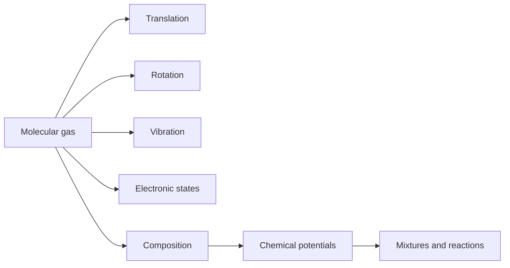

# Molecular Gases, Mixtures, and Solutions

Real molecules have internal structure. Translation gives the ideal-gas law, but rotations, vibrations, electronic states, and nuclear spin contribute to entropy and heat capacity. Mixtures and dilute solutions add another layer: the entropy of mixing and the chemical potentials of components determine partial pressures, osmotic pressure, vapor-pressure shifts, and reaction equilibria.

Schwabl treats these topics as applications of the same partition-function method. The molecular partition function factorizes when internal modes are weakly coupled, while mixture thermodynamics follows from the dependence of free energy on particle numbers $N_i$.

## Factoring a molecular partition function

For a dilute ideal molecular gas with separable degrees of freedom,

$$
Z_N={1\over N!}\left(
{V\over \lambda_T^3}z_{\mathrm{int}}
\right)^N,
$$

where

$$
z_{\mathrm{int}}=z_{\mathrm{rot}}z_{\mathrm{vib}}z_{\mathrm{elec}}\cdots .
$$

For a linear rigid rotor with rotational constant energy scale $\epsilon_{\mathrm{rot}}=\hbar^2/(2I)$,

$$
z_{\mathrm{rot}}=\sum_{\ell=0}^{\infty}(2\ell+1)e^{-\beta \epsilon_{\mathrm{rot}}\ell(\ell+1)}.
$$

At high temperature, with symmetry number $\sigma$,

$$
z_{\mathrm{rot}}\approx {T\over \sigma\Theta_{\mathrm{rot}}},
\qquad
\Theta_{\mathrm{rot}}={\epsilon_{\mathrm{rot}}\over k_B}.
$$

A harmonic vibrational mode has

$$
z_{\mathrm{vib}}
={e^{-\beta\hbar\omega/2}\over 1-e^{-\beta\hbar\omega}}.
$$

For an ideal mixture of species $i$,

$$
F=\sum_i N_i k_BT
\left[
\ln\left({N_i\lambda_i^3\over V z_{\mathrm{int},i}}\right)-1
\right].
$$

The chemical potential is

$$
\mu_i=\left({\partial F\over \partial N_i}\right)_{T,V,N_{j\ne i}}.
$$

Factorization means that a molecular state can be labeled independently by translational and internal quantum numbers and that its energy is a sum. It is an approximation even for an isolated molecule: centrifugal distortion couples rotation and vibration, while electronic potential surfaces set vibrational and rotational constants. It remains accurate when those couplings are smaller than the energy resolution needed.

The zero of internal energy also matters. Keeping the vibrational zero-point factor changes the internal energy and absolute free energy but not the vibrational heat capacity. Binding energies must be retained when comparing different chemical species, because a constant for one species is not a common constant for the reaction.

## Rotational and vibrational temperature scales

For a linear rotor at $T\gg\Theta_{\mathrm{rot}}$, the level sum may be approximated by an integral:

$$
\sum_{\ell=0}^\infty(2\ell+1)e^{-\Theta_{\mathrm{rot}}\ell(\ell+1)/T}
\simeq\int_0^\infty(2\ell+1)e^{-\Theta_{\mathrm{rot}}\ell(\ell+1)/T}\,d\ell.
$$

With $u=\ell(\ell+1)$, the integral is $T/\Theta_{\mathrm{rot}}$. Division by the symmetry number prevents counting orientations related by an exchange of identical nuclei as different molecular configurations.

For one harmonic vibration, differentiation gives

$$
U_{\mathrm{vib}}={\hbar\omega\over2}
+{\hbar\omega\over e^{\hbar\omega/(k_BT)}-1},
$$

and

$$
C_{V,\mathrm{vib}}
=k_Bx^2{e^x\over(e^x-1)^2},
\qquad x={\hbar\omega\over k_BT}.
$$

For $x\gg1$, the heat capacity is exponentially small. For $x\ll1$, it approaches $k_B$, corresponding to one quadratic kinetic and one quadratic potential term. A diatomic gas therefore moves from translational $3k_B/2$ per molecule, to $5k_B/2$ when two rotations activate, and toward $7k_B/2$ after its vibration becomes classical, before dissociation or electronic excitation intervenes.

## Ideal mixtures and the entropy of composition

The ideal mixture chemical potential is

$$
\mu_i=k_BT\ln\left({n_i\lambda_i^3\over z_{\mathrm{int},i}}\right),
\qquad n_i={N_i\over V}.
$$

The pressure is additive:

$$
p=\sum_i n_i k_BT,
\qquad
p_i=n_i k_BT.
$$

This is Dalton's law of partial pressures.

The entropy of mixing for ideal gases at fixed $T$ and $p$ is

$$
\Delta S_{\mathrm{mix}}
=-k_B\sum_i N_i\ln x_i,
$$

where $x_i=N_i/\sum_j N_j$ is the mole fraction. The expression is positive because $0\lt x_i\lt 1$.

One derivation compares each species before and after removal of partitions. Species $i$ expands isothermally from its initial volume $V_i=x_iV$ to the full volume $V$. Its entropy change is

$$
\Delta S_i=N_ik_B\ln{V\over V_i}=-N_ik_B\ln x_i.
$$

Summing gives the mixing formula. It applies to distinguishable species in an ideal mixture. For identical samples there is only one species and no composition label to rearrange, so the apparent contribution vanishes.

For a dilute solute, osmotic pressure obeys the van't Hoff law

$$
\Pi V=N_s k_BT,
$$

where $N_s$ is the solute particle number. This is formally the ideal-gas law for solute particles, even though they move in a solvent.

Chemical equilibrium follows by minimizing free energy subject to stoichiometric constraints. For a reaction

$$
\sum_i \nu_i A_i=0,
$$

equilibrium requires

$$
\sum_i \nu_i\mu_i=0.
$$

In ideal mixtures this becomes a law of mass action: products of concentrations raised to stoichiometric powers equal a temperature-dependent equilibrium constant.

Let the reaction extent change particle numbers by $dN_i=\nu_i\,d\xi$. At fixed $T,V$,

$$
dF=\sum_i\mu_i\,dN_i
=\left(\sum_i\nu_i\mu_i\right)d\xi.
$$

The stationary condition is the chemical-potential relation above. Substituting the ideal-gas form gives

$$
\sum_i\nu_i\mu_i^circ(T)
+k_BT\ln\prod_i\left({p_i\over p^\circ}\right)^{\nu_i}=0,
$$

or

$$
\prod_i\left({p_i\over p^\circ}\right)^{\nu_i}=K_p(T).
$$

The standard pressure $p^\circ$ keeps logarithms dimensionless. Molecular masses, rotational and vibrational factors, electronic degeneracies, and reaction energy all enter $K_p(T)$ through the standard chemical potentials. The equilibrium constant is independent of the initial composition, while the equilibrium reaction extent is not.

The temperature dependence of heat capacity is a map of molecular energy scales. Translational modes are active whenever the gas itself is classical; rotations activate when $k_BT$ exceeds rotational spacings; vibrations often require much higher temperatures; electronic excitations are usually frozen unless low-lying states exist.

The nuclear spin contribution is subtle because it affects state counting without necessarily changing energy in a simple way. Homonuclear molecules have exchange-symmetry restrictions coupling rotational quantum numbers to nuclear spin symmetry. This is the origin of ortho and para forms in molecules such as hydrogen. Schwabl includes such effects to emphasize that indistinguishability is not limited to ideal monatomic quantum gases; it also constrains molecular spectra.

Mixture entropy also resolves the Gibbs paradox. Mixing two different gases increases entropy because final macrostates contain new composition arrangements. Mixing two samples of the same gas does not produce a thermodynamic entropy of mixing once the $N!$ indistinguishability factor is included. The paradox appears only if identical classical particles are incorrectly labeled.

For dilute solutions, the solvent often acts as a reservoir setting temperature and pressure, while the solute contributes an ideal mixing term at leading order. Colligative properties depend primarily on the number of solute particles, not their microscopic identity. Osmotic pressure, boiling-point elevation, and freezing-point depression then follow from chemical-potential equality in the ideal dilute-solution approximation.

Chemical reactions combine all these ideas. The equilibrium constant contains translational factors, internal partition functions, and binding-energy differences. Changing temperature shifts equilibrium because it changes the relative statistical weights of reactant and product molecular states.

For nonlinear rigid molecules, three rotational quadratic degrees of freedom become active at high temperature rather than the two of a linear rotor. Their classical rotational energy is $3k_BT/2$ per molecule. A molecule with $s$ atoms has $3s-6$ normal vibrational modes if nonlinear and $3s-5$ if linear; each fully classical harmonic mode contributes $k_B$ to $C_V$. These counts are high-temperature limits, not promises that all modes are populated before the molecule dissociates.

The constant-pressure heat capacity adds the work needed for expansion. For an ideal gas with temperature-independent internal mode contributions,

$$
C_P-C_V=Nk_B.
$$

Thus a rigid linear molecule in its classical rotational regime has $C_V=5Nk_B/2$ and $C_P=7Nk_B/2$. When vibrational activation occurs across the temperature range, the heat capacities vary smoothly and the ratio $C_P/C_V$ is no longer one fixed molecular number.

It helps to organize molecular gases by temperature windows. At very low temperature, translation may still be classical for a dilute gas, but rotations and vibrations can be frozen. At intermediate temperatures, rotations of many molecules are active and add heat capacity. At high temperatures, vibrations contribute and chemical dissociation or electronic excitation may become relevant. Each newly populated mode changes both energy and entropy, so calorimetric measurements can reveal microscopic spectra.

## Osmosis and colligative effects

Mixtures also illustrate why chemical potential is more fundamental than concentration alone. Two species at equal concentration can have different chemical potentials if their masses, internal partition functions, or interactions differ. Equilibrium across a membrane or phase boundary is controlled by equality of the appropriate chemical potentials, not by equal concentration. In ideal dilute limits, this reduces to familiar concentration laws; outside those limits, activity coefficients are needed.

For a liquid solution, write

$$
\mu_i(T,p,\{x_j\})=\mu_i^\circ(T,p)+k_BT\ln a_i,
\qquad a_i=\gamma_i x_i.
$$

An ideal solution has activity coefficient $\gamma_i=1$. Equality of solvent chemical potential between liquid and vapor then gives Raoult's law, $p_0=x_0p_0^*$, when the vapor is ideal and the solvent reference is pure liquid. A dilute solute often follows Henry's law instead, with its vapor partial pressure proportional to $x_i$ but with a species-dependent constant. These laws use different reference states and should not be swapped merely because both are linear in concentration.

Activity coefficients approach their ideal limits only in the appropriate composition range. Electrostatic interactions make electrolyte solutions particularly slow to become ideal, while association can reduce the number of independently moving solute particles. Osmotic and freezing-point measurements therefore probe both particle count and departures from ideality.

Schwabl's inclusion of solutions and reactions makes the point that statistical mechanics is not only a theory of gases and magnets. The same partition-function logic underlies physical chemistry: vapor pressure lowering, osmotic pressure, surface-tension shifts, and reaction equilibrium are all consequences of minimizing thermodynamic potentials with particle-number constraints.

Surface effects enter when particle numbers near interfaces are not negligible. Curvature changes pressure across an interface through surface tension, and it can shift vapor pressure for small droplets. These corrections are not captured by the bulk ideal-mixture formula, but they use the same chemical-potential equality condition once surface free energy is included.

Isotopic substitution offers a clean test of the partition-function picture. Changing nuclear mass alters translational wavelengths, rotational moments of inertia, and vibrational frequencies while leaving the electronic potential surface nearly unchanged. Equilibrium constants can therefore show isotope effects even when classical chemical bonding looks the same. Zero-point energy differences are often especially important at low temperature.

At sufficiently high temperature, a fixed molecular species may cease to be a useful description because dissociation and ionization open new composition sectors. Their partition functions must be included through chemical equilibrium rather than counted as ever more internal excitations of the intact molecule.

In solution problems, one must distinguish solvent molecules, solute formula units, and dissociated ions. Colligative properties count independently moving solute particles, so electrolytes can produce larger effects than nonelectrolytes at the same formula concentration.

| Contribution | Partition factor | Heat-capacity behavior |
|---|---:|---|
| Translation | $V/\lambda_T^3$ | $3k_B/2$ per molecule |
| Linear rotation | $\sum_\ell(2\ell+1)e^{-\beta\epsilon_\ell}$ | activates near $\Theta_{\mathrm{rot}}$ |
| Vibration | $e^{-x/2}/(1-e^{-x})$ | frozen for $T\ll \hbar\omega/k_B$ |
| Electronic states | $\sum_j g_j e^{-\beta E_j}$ | often frozen at ordinary $T$ |
| Mixing | combinatorial $N_i!$ factors | entropy from composition |



## Worked example 1: High-temperature rotational heat capacity

Problem: A heteronuclear diatomic molecule is in the high-temperature rotational regime. Show that rotations contribute $k_B$ per molecule to $C_V$.

Method:

1. At high temperature,

$$
z_{\mathrm{rot}}\approx {T\over \Theta_{\mathrm{rot}}}.
$$

2. The rotational internal energy is

$$
U_{\mathrm{rot}}
=-{\partial\over \partial\beta}\ln z_{\mathrm{rot}}.
$$

3. Since $T=1/(k_B\beta)$,

$$
\ln z_{\mathrm{rot}}
=\ln T-\ln\Theta_{\mathrm{rot}}
=-\ln\beta-\ln(k_B\Theta_{\mathrm{rot}}).
$$

4. Differentiate:

$$
U_{\mathrm{rot}}
=-{\partial\over \partial\beta}(-\ln\beta+\text{constant})
={1\over \beta}=k_BT.
$$

5. Therefore

$$
C_{V,\mathrm{rot}}={\partial U_{\mathrm{rot}}\over \partial T}=k_B.
$$

Checked answer: a linear rotor has two quadratic rotational degrees of freedom, each contributing $(1/2)k_BT$.

## Worked example 2: Entropy of mixing for a binary ideal gas

Problem: Mix $N_A=N_B=N$ ideal gas molecules at the same $T$ and $p$. Find $\Delta S_{\mathrm{mix}}$.

Method:

1. Mole fractions are

$$
x_A=x_B={1\over 2}.
$$

2. Use

$$
\Delta S_{\mathrm{mix}}
=-k_B\sum_i N_i\ln x_i.
$$

3. Substitute:

$$
\Delta S_{\mathrm{mix}}
=-k_B\left[N\ln{1\over 2}+N\ln{1\over 2}\right].
$$

4. Since $\ln(1/2)=-\ln 2$,

$$
\Delta S_{\mathrm{mix}}=2Nk_B\ln 2.
$$

Checked answer: the entropy is positive and extensive in the total number $2N$.

## Worked example 3: osmotic pressure from solvent equilibrium

Let a semipermeable membrane pass solvent but block a dilute solute. Pure solvent at pressure $p$ is in contact with solution at pressure $p+\Pi$. Equilibrium requires equal solvent chemical potentials:

$$
\mu_0^*(T,p)=\mu_0(T,p+\Pi,x_0).
$$

For an ideal solution,

$$
\mu_0(T,p+\Pi,x_0)
=\mu_0^*(T,p+\Pi)+k_BT\ln x_0.
$$

For small $\Pi$, $d\mu_0^*=\bar v_0\,dp$, so

$$
\mu_0^*(T,p+\Pi)\simeq\mu_0^*(T,p)+\bar v_0\Pi.
$$

Canceling the pure-solvent terms gives

$$
\bar v_0\Pi=-k_BT\ln x_0.
$$

In a dilute solution with $N_s\ll N_0$, $x_0=N_0/(N_0+N_s)$ and $-\ln x_0\simeq N_s/N_0$. Since $N_0\bar v_0\simeq V$,

$$
\Pi={N_sk_BT\over V}.
$$

The pressure arises from solvent chemical-potential balance; no claim that solute molecules form a literal gas inside the liquid is needed.

## Numerically summing rotational levels

```python
import numpy as np

def z_rot_linear(T, theta_rot, lmax=200, sigma=1):
    ell = np.arange(lmax + 1)
    terms = (2 * ell + 1) * np.exp(-theta_rot * ell * (ell + 1) / T)
    return terms.sum() / sigma

def mixing_entropy(Ns, kB=1.0):
    Ns = np.asarray(Ns, dtype=float)
    xs = Ns / Ns.sum()
    return -kB * np.sum(Ns * np.log(xs))

for T in [1, 5, 20, 100]:
    print(T, z_rot_linear(T, theta_rot=2.0))
print("mixing entropy", mixing_entropy([1000, 1000]))
```

## Bookkeeping that matters

- An internal mode contributes its classical equipartition value only when its level spacing is small compared with $k_BT$.
- Homonuclear rotation needs both a symmetry number and, when relevant, nuclear-spin statistical restrictions. They describe related but distinct counting effects.
- Entropy of mixing depends on physical distinguishability, not arbitrary particle labels.
- Mole fraction, number density, and partial pressure are proportional only under specific ideal-mixture conditions. The chemical-potential formula determines which variable belongs in a given equilibrium relation.
- Equilibrium constants vary with temperature because internal partition functions and energy differences vary in their statistical weight.
- Colligative effects count independently moving species. Dissociation, association, and ion correlations can change the effective particle count.

## Related pages

- [Classical ideal gas and Maxwell distribution](/physics/statistical-mechanics/classical-ideal-gas-and-maxwell-distribution)
- [Real gases, virial expansion, and van der Waals theory](/physics/statistical-mechanics/real-gases-virial-expansion-and-van-der-waals-theory)
- [Thermodynamic potentials and phase equilibrium](/physics/statistical-mechanics/thermodynamic-potentials-and-phase-equilibrium)
- [Grand canonical ensemble and particle exchange](/physics/statistical-mechanics/grand-canonical-ensemble-and-particle-exchange)
- [Thermodynamics](/physics/thermodynamics/intro)
