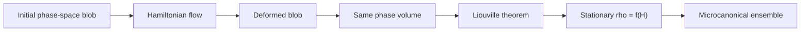

# Phase Space, Liouville Theorem, and Ergodicity

Classical statistical mechanics represents a microstate of $N$ particles by a point in $6N$-dimensional phase space. The statistical state is not a single point but a density $\rho(q,p,t)$ over many possible microscopic states compatible with the observed macrostate. The microscopic dynamics moves this density according to Hamilton's equations.

Hamiltonian flow preserves phase-space volume, but volume preservation alone does not imply thermalization. Stationarity, ergodicity, and mixing answer different questions and must be kept separate when connecting microscopic mechanics to equilibrium ensembles.

## Points, densities, and Hamiltonian flow

For $N$ particles in three spatial dimensions, write

$$
q=(q_1,\ldots,q_{3N}),\qquad p=(p_1,\ldots,p_{3N}).
$$

The phase-space density $\rho(q,p,t)$ satisfies

$$
\rho(q,p,t)\ge 0,\qquad
\int dq\,dp\,\rho(q,p,t)=1.
$$

Hamilton's equations are

$$
\dot q_i={\partial H\over \partial p_i},
\qquad
\dot p_i=-{\partial H\over \partial q_i}.
$$

The Poisson bracket of two functions $A(q,p)$ and $B(q,p)$ is

$$
\{A,B\}
=\sum_i \left(
{\partial A\over \partial q_i}{\partial B\over \partial p_i}
-{\partial A\over \partial p_i}{\partial B\over \partial q_i}
\right).
$$

A distribution is stationary when $\partial_t\rho=0$. A constant of motion $I(q,p)$ satisfies $\dot I=\{I,H\}=0$. Ergodicity, in its physical use, means that a typical trajectory on the energy surface samples that surface in such a way that long-time averages equal microcanonical phase-space averages.

## Deriving Liouville's equation

Probability conservation in the full phase space is a continuity equation,

$$
{\partial\rho\over\partial t}
+\sum_i\left[{partial(\rho\dot q_i)\over\partial q_i}
+{\partial(\rho\dot p_i)\over\partial p_i}\right]=0.
$$

Expanding the derivatives produces an advection term and the divergence of the phase-space velocity. Hamilton's equations make that divergence vanish because mixed derivatives of $H$ cancel. What remains is the Liouville equation

The Liouville equation follows by applying probability conservation in phase space:

$$
{\partial \rho\over \partial t}
=-\{\rho,H\}
=-\sum_i\left(
\dot q_i{\partial \rho\over \partial q_i}
+\dot p_i{\partial \rho\over \partial p_i}
\right).
$$

Equivalently,

$$
{d\over dt}\rho(q(t),p(t),t)=0.
$$

The phase-space density is constant along a Hamiltonian trajectory. This does not mean the system is static; it means the ensemble flows like an incompressible fluid. The incompressibility is

$$
\sum_i\left(
{\partial \dot q_i\over \partial q_i}
+{\partial \dot p_i\over \partial p_i}
\right)
=
\sum_i\left(
{\partial^2 H\over \partial q_i\partial p_i}
-{\partial^2 H\over \partial p_i\partial q_i}
\right)=0.
$$

Therefore a phase-space volume element transported by Hamiltonian dynamics preserves its volume. This is Liouville's theorem.

The same fact can be stated with the flow map $X_0\mapsto X_t$, where $X=(q,p)$. Its Jacobian $J(t)=\det(\partial X_t/\partial X_0)$ obeys

$$
{d\over dt}\ln J=\nabla_X\cdot\dot X=0,
$$

so $J(t)=1$ if it begins at one. Hamiltonian maps preserve more than volume: they preserve the symplectic two-form $\sum_i dq_i\wedge dp_i$. Volume preservation is a consequence of that stronger canonical structure. A generic incompressible flow need not be Hamiltonian.

## Stationary measures and conserved quantities

Any density of the form $\rho=f(H)$ is stationary for an isolated time-independent Hamiltonian because

$$
\{\rho,H\}=f'(H)\{H,H\}=0.
$$

The microcanonical distribution chooses a narrow shell in energy,

$$
\rho_{\mathrm{mc}}(q,p)
={1\over \Omega(E)}
\delta(E-H(q,p)),
$$

or a thin energy window when a literal delta function is too singular. Schwabl emphasizes that this is the basic equilibrium hypothesis for isolated systems. The canonical and grand canonical ensembles are then derived by considering small subsystems of a larger isolated whole.

If there are further integrals of motion $I_1,I_2,\ldots$, any function $f(H,I_1,I_2,\ldots)$ is also stationary. Energy alone does not identify the equilibrium measure. Momentum and angular momentum may need to be fixed; integrable systems possess enough conserved actions to confine trajectories to invariant tori. In quantum integrable systems, analogous constraints motivate generalized Gibbs ensembles.

A time-dependent Hamiltonian still generates a volume-preserving flow in the extended sense, but $f(H(q,p,t))$ is generally not stationary because the numerical value of $H$ changes along the driven trajectory. Dissipative equations are different: friction contracts phase-space volume unless extra bath variables or noise restore a larger Hamiltonian description.

## Ergodicity is a statement about averages

Ergodicity adds an interpretive layer. If time averages equal microcanonical averages, then the ensemble is not merely a calculational device; it predicts the result of long measurements on one system. However, exact ergodicity can fail in integrable systems, systems with conserved quantities beyond energy, and systems trapped in disconnected regions of phase space. Statistical mechanics remains powerful because weak perturbations, large dimensionality, and coarse macroscopic observables often make the microcanonical ensemble correct even when mathematical ergodicity is delicate.

It is also useful to separate three related but different ideas. Stationarity means the density does not change in time. Mixing means initially localized distributions are stretched and folded so that coarse-grained observations look uniform over the accessible region. Ergodicity means almost every trajectory has time averages equal to phase-space averages. A stationary distribution need not be mixing, and a system can be nonergodic while still giving accurate thermodynamics for a restricted class of observables. A one-dimensional harmonic oscillator periodically covers its energy ellipse and can be ergodic with respect to the uniform measure on that orbit, but it is not mixing: correlations recur exactly. Two uncoupled oscillators have separately conserved actions and are generally nonergodic on the larger surface of fixed total energy.

For an observable $A$, the two averages being compared are

$$
\overline A(X_0)=\lim_{\tau\to\infty}{1\over\tau}
\int_0^\tau A(X_t)\,dt
$$

and

$$
\langle A\rangle_E={1\over\Omega(E)}
\int d\Gamma\,A(X)\delta(E-H(X)).
$$

Ergodicity asserts equality for almost every initial point on the relevant energy surface and for suitable observables. It says nothing about how fast the limit is reached. Mixing is stronger and implies decay of correlations in a measure-theoretic sense. Experimental equilibration only needs the observables and time scales at hand to lose sensitivity to preparation; full mathematical mixing may be unnecessary.

## Fine-grained conservation and macroscopic irreversibility

Liouville's theorem also explains why irreversibility cannot follow from exact fine-grained Hamiltonian flow alone. A compact blob in phase space may stretch into thin filaments, but its volume is preserved. Macroscopic entropy increase appears when we replace the filamented exact density by a coarse-grained description that cannot resolve microscopic folds. This point is not a technicality: it is the core reason that kinetic theory needs an assumption such as molecular chaos and why recurrence objections can be logically sharp even when recurrence times are physically irrelevant.

For the fine-grained Gibbs entropy

$$
S_G=-k_B\int d\Gamma\,\rho\ln\rho,
$$

differentiate and insert the Liouville equation:

$$
{dS_G\over dt}
=k_B\int d\Gamma\,(1+\ln\rho)\{\rho,H\}.
$$

Integration by parts in phase space, with vanishing boundary terms, turns this into zero. Equivalently, each fluid element keeps both its volume and its density. A coarse partition replaces the filamented density by cell averages; mixing can then spread probability among more resolved cells and increase the corresponding coarse entropy. The increase depends on resolution and on the restriction to macroscopic variables.

Time reversal sharpens the issue. If all momenta of an isolated Hamiltonian system are reversed at some instant, the trajectory retraces its earlier path when the Hamiltonian is time-reversal invariant. Nothing in Hamilton's equations forbids an entropy-decreasing history. Such finely prepared reversed states occupy the same phase volume but are extraordinarily atypical relative to simple macroscopic preparation procedures.

Poincaré recurrence adds another constraint: a finite-volume, measure-preserving system returns arbitrarily close to almost every initial point after a sufficiently long time. The theorem gives no useful laboratory recurrence time, and macroscopic recurrence times grow enormously with system size. It nevertheless rules out literal convergence of the exact microscopic state to one permanent attractor. Equilibrium is instead expressed through stationary statistics and stable macroscopic observations.

Finally, the classical theorem has a quantum parallel. The von Neumann equation preserves the eigenvalues of $\rho$ under unitary time evolution, just as Liouville flow preserves phase-space volume. Therefore $\mathrm{Tr}\,\rho^n$ and the fine-grained von Neumann entropy are constants for a closed quantum system. Equilibrium statistical mechanics enters when one restricts attention to macroscopic data, subsystems, or coarse observables rather than the full microscopic state.

For a subsystem, unitary evolution of the whole can still increase entanglement entropy because correlations with the unobserved complement grow. Tracing out that complement produces nonunitary reduced dynamics. The classical analogue is marginalizing over unresolved degrees of freedom, which can generate apparent dissipation and stochasticity even though the complete flow remains Hamiltonian.

This perspective also explains why the thermodynamic limit is taken before many idealizations. A small Hamiltonian system may visibly remember its initial condition, while a macroscopic one distributes that information among an enormous number of degrees of freedom. The information is not destroyed in the exact equations, but it becomes practically inaccessible to the few macroscopic observables that define a thermodynamic state.

KAM theory supplies a warning against assuming that any weak perturbation produces global chaos. In a nearly integrable Hamiltonian system, many invariant tori survive sufficiently small perturbations, while resonant regions become chaotic. Phase space may then be mixed, with regular islands embedded in a chaotic sea. A trajectory cannot average over components it cannot enter, and equilibration times can be dominated by slow transport between partially connected regions.

Numerical integrators can obscure these distinctions. A generic time-stepping method may drift in energy or contract phase-space volume, creating artificial relaxation. Symplectic integrators preserve the canonical geometry and usually keep energy errors bounded over long runs, although they do not make a nonergodic model ergodic. Numerical agreement with an ensemble requires checks of conserved quantities, step-size dependence, and sampling across the accessible components.

Constraints change the measure as well as the dimension. Fixing total momentum, angular momentum, or a rigid bond restricts phase space to a submanifold with its induced measure. Simply deleting coordinates without the corresponding Jacobian can bias averages.



| Concept | Mathematical statement | Physical meaning |
|---|---:|---|
| Trajectory | $(q(t),p(t))$ | one microscopic history |
| Ensemble | $\rho(q,p,t)$ | many compatible microstates |
| Liouville equation | $\partial_t\rho=-\{\rho,H\}$ | density advected by Hamiltonian flow |
| Volume preservation | $d\Gamma(t)=d\Gamma(0)$ | no compression in phase space |
| Stationarity | $\{\rho,H\}=0$ | equilibrium candidate |
| Ergodicity | time average = shell average | single long run samples the shell |

## Worked example 1: Harmonic oscillator phase-space area

Problem: For a one-dimensional harmonic oscillator

$$
H={p^2\over 2m}+{1\over 2}m\omega^2 q^2,
$$

show that the phase-space orbit has area $2\pi E/\omega$ inside the energy ellipse.

Method:

1. The energy shell is

$$
{p^2\over 2mE}+{m\omega^2 q^2\over 2E}=1.
$$

2. Put it in ellipse form:

$$
{q^2\over a^2}+{p^2\over b^2}=1,
\qquad
a=\sqrt{2E\over m\omega^2},
\qquad
b=\sqrt{2mE}.
$$

3. The area inside an ellipse is $\pi ab$, so

$$
\Gamma(E)=\pi
\sqrt{2E\over m\omega^2}
\sqrt{2mE}
={2\pi E\over \omega}.
$$

4. The density of phase-space area per unit energy is

$$
{d\Gamma\over dE}={2\pi\over \omega}.
$$

Checked answer: the orbit itself is one-dimensional, but the number of states up to energy $E$ is proportional to the enclosed area. This is the classical precursor of the quantum spacing $\hbar\omega$.

## Worked example 2: Verifying stationarity of a canonical density

Problem: Show that

$$
\rho(q,p)={1\over Z}e^{-\beta H(q,p)}
$$

is stationary under Hamiltonian flow for a time-independent Hamiltonian.

Method:

1. Compute the Poisson bracket:

$$
\{\rho,H\}
=\sum_i\left(
{\partial \rho\over \partial q_i}{\partial H\over \partial p_i}
-{\partial \rho\over \partial p_i}{\partial H\over \partial q_i}
\right).
$$

2. Since $\rho=Z^{-1}e^{-\beta H}$,

$$
{\partial \rho\over \partial q_i}
=-\beta\rho{\partial H\over \partial q_i},
\qquad
{\partial \rho\over \partial p_i}
=-\beta\rho{\partial H\over \partial p_i}.
$$

3. Substitute:

$$
\begin{aligned}
\{\rho,H\}
&=\sum_i\left[
(-\beta\rho H_{q_i})H_{p_i}
-(-\beta\rho H_{p_i})H_{q_i}
\right]\\
&=0.
\end{aligned}
$$

4. Therefore

$$
\partial_t\rho=-\{\rho,H\}=0.
$$

Checked answer: any function of $H$ is stationary. The canonical form is selected not by stationarity alone, but by contact with a heat bath or by entropy maximization with fixed mean energy.

## Worked example 3: quasiperiodic motion on a torus

Take two uncoupled oscillators with angle variables

$$
\theta_1(t)=\theta_1(0)+\omega_1t,
\qquad
\theta_2(t)=\theta_2(0)+\omega_2t
$$

modulo $2\pi$. The actions, and therefore each oscillator energy, remain fixed. If $\omega_1/\omega_2=p/q$ is rational, both angles return after the common period $2\pi q/\omega_2$, so the orbit is a closed curve on the two-torus.

If the frequency ratio is irrational, the orbit is dense on that torus. For a Fourier mode $A=e^{i(n_1\theta_1+n_2\theta_2)}$,

$$
{1\over\tau}\int_0^\tau A(t)\,dt
=A(0){e^{i(n_1\omega_1+n_2\omega_2)\tau}-1
\over i\tau(n_1\omega_1+n_2\omega_2)}.
$$

For nonzero integer pair $(n_1,n_2)$, irrationality makes the denominator frequency nonzero, so the long-time average vanishes. This equals the uniform torus average. The motion can therefore be ergodic on its invariant torus while remaining nonergodic on the larger constant-total-energy surface, because the two separate actions never change.

## Numerical area-preservation check

```python
import numpy as np

def oscillator_flow(q0, p0, m=1.0, w=2.0, t=0.0):
    q = q0 * np.cos(w * t) + p0 / (m * w) * np.sin(w * t)
    p = p0 * np.cos(w * t) - m * w * q0 * np.sin(w * t)
    return q, p

# Transport a small rectangle and estimate its area by the shoelace formula.
corners = np.array([[-0.05, -0.05], [0.05, -0.05], [0.05, 0.05], [-0.05, 0.05]])
for time in [0.0, 0.7, 1.4]:
    moved = np.array([oscillator_flow(q, p, t=time) for q, p in corners])
    x, y = moved[:, 0], moved[:, 1]
    area = 0.5 * abs(np.dot(x, np.roll(y, -1)) - np.dot(y, np.roll(x, -1)))
    print(time, area)
```

## Distinctions that prevent wrong conclusions

- Liouville conservation fixes the fine-grained Gibbs entropy. Coarse-grained entropy and thermodynamic relaxation concern information discarded by the chosen observables.
- Stationarity does not select a unique ensemble. Every function of all conserved quantities is a candidate stationary density.
- Many degrees of freedom do not guarantee ergodicity. Extra integrals, invariant tori, glassy barriers, and disconnected components can retain memory.
- The preserved element is $dq\,dp$, not ordinary spatial volume $dq$. A gas can expand spatially while its phase-space volume remains unchanged.
- Under explicit driving, $f(H)$ need not be stationary even though the instantaneous Hamiltonian flow remains divergence-free.
- A dense trajectory need not explore the whole energy surface; it may be dense only within a lower-dimensional invariant set.

<div className="see-also">

See also: [Probability and density matrices](/physics/statistical-mechanics/probability-and-density-matrices) · [Microcanonical ensemble and entropy](/physics/statistical-mechanics/microcanonical-ensemble-and-entropy) · [Irreversibility, master equations, and finite-temperature field theory](/physics/statistical-mechanics/irreversibility-master-equations-and-finite-temperature-field-theory) · [Hamiltonian dynamics in quantum mechanics](/physics/quantum-mechanics/quantum-dynamics-pictures) · [Thermodynamics](/physics/thermodynamics/intro)

</div>
