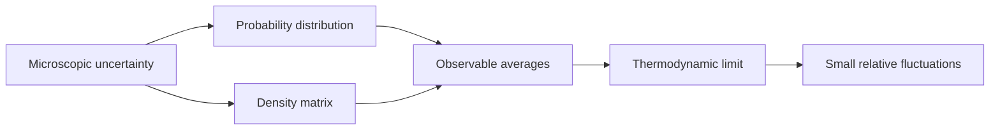

# Probability and Density Matrices

Statistical mechanics begins by replacing an impossible microscopic description with a precise probabilistic one. A gas with $10^{23}$ particles has a well-defined Hamiltonian, but the detailed microstate is neither measurable nor useful for thermodynamic questions. What matters is the probability distribution over microstates and the way macroscopic observables become sharply predictable when many weakly correlated degrees of freedom are combined.

The later ensembles are distributions or density matrices constrained by macroscopic data and by the microscopic equations of motion. The same language ties classical phase-space densities to quantum statistical operators.

## Probability distributions and generating functions

A random variable $X$ has probability density $w(x)$ when $w(x)\,dx$ is the probability that $X$ lies in $[x,x+dx]$. Normalization and expectation are

$$
\int_{-\infty}^{\infty} w(x)\,dx = 1,
\qquad
\langle F(X)\rangle = \int_{-\infty}^{\infty} F(x) w(x)\,dx .
$$

The moments and variance are

$$
\mu_n=\langle X^n\rangle,\qquad
\sigma^2=\langle (X-\langle X\rangle)^2\rangle
=\langle X^2\rangle-\langle X\rangle^2 .
$$

The characteristic function is the Fourier transform of the density,

$$
\phi(k)=\langle e^{-ikX}\rangle=\int e^{-ikx}w(x)\,dx ,
\qquad
w(x)=\int {dk\over 2\pi}e^{ikx}\phi(k).
$$

For many variables $X_i$, the covariance matrix is

$$
K_{ij}=\langle (X_i-\langle X_i\rangle)(X_j-\langle X_j\rangle)\rangle .
$$

For any real vector $u$, $u^TKu=\operatorname{Var}(\sum_i u_iX_i)\ge0$, so a valid covariance matrix is positive semidefinite. Its diagonal entries are variances and its normalized off-diagonal entries are correlation coefficients. Zero covariance means absence of linear correlation, not independence, except for special families such as a joint Gaussian distribution.

Conditioning is equally important in statistical mechanics. If $Y$ is a coarse macrovariable, the law of total variance reads

$$
\operatorname{Var}X
=\mathbb E[\operatorname{Var}(X\mid Y)]
+\operatorname{Var}(\mathbb E[X\mid Y]).
$$

It separates fluctuations within a macrostate from fluctuations caused by moving between macrostates, a useful distinction near phase coexistence.

Characteristic functions are useful because sums become products. If $X$ and $Y$ are independent, $\phi_{X+Y}(k)=\phi_X(k)\phi_Y(k)$. Taking a logarithm turns that product into a sum, which is why cumulants, rather than raw moments, add under convolution. For continuous variables the density depends on the coordinate measure; probabilities such as $w(x)dx$ are invariant under a change of variable only when the Jacobian is included.

## Density operators: mixtures without a preferred decomposition

In quantum mechanics, a pure state $\vert \psi\rangle$ defines the density operator

$$
\rho=|\psi\rangle\langle\psi|,\qquad
\langle A\rangle=\mathrm{Tr}\,\rho A .
$$

If $A=\sum_a aP_a$ is its spectral decomposition, the probability of outcome $a$ is $p(a)=\operatorname{Tr}(\rho P_a)$. The mean and variance retain their familiar forms,

$$
\langle A\rangle=\operatorname{Tr}(\rho A),
\qquad
(\Delta A)^2=\operatorname{Tr}(\rho A^2)-[\operatorname{Tr}(\rho A)]^2.
$$

Quantum uncertainty can remain even for a pure state, because the state need not be an eigenstate of the measured operator. Statistical mixing adds another source of spread. The density operator contains both, while a single observed variance generally does not separate them.

A mixed ensemble with states $\vert \psi_i\rangle$ and probabilities $p_i$ has

$$
\rho=\sum_i p_i |\psi_i\rangle\langle\psi_i|,
\qquad
\sum_i p_i=1,
\qquad
\mathrm{Tr}\,\rho=1.
$$

Pure states obey $\rho^2=\rho$ and $\mathrm{Tr}\,\rho^2=1$. A genuine mixed state has $\mathrm{Tr}\,\rho^2\lt 1$. This distinction becomes central when we use $Z=\mathrm{Tr}\,e^{-\beta H}$ rather than a single wavefunction to describe equilibrium.

Every density operator is Hermitian, positive semidefinite, and trace one. Conversely, every operator with those properties represents a quantum state. Positivity ensures $\langle\psi\vert \rho\vert \psi\rangle\ge0$ for every possible measurement vector. Its spectral decomposition

$$
\rho=\sum_a r_a|r_a\rangle\langle r_a|,
\qquad r_a\ge0,quad\sum_a r_a=1
$$

looks like a classical probability distribution over orthogonal states, but it need not coincide with the laboratory preparation. Different ensembles of nonorthogonal pure states can produce the same $\rho$ and cannot be distinguished by measurements on the system alone.

For a two-level system, every density matrix has the Bloch form

$$
\rho={1\over2}(I+\mathbf r\cdot\boldsymbol\sigma),
\qquad |\mathbf r|\le1.
$$

Its eigenvalues are $(1\pm\vert \mathbf r\vert )/2$. Pure states lie on the Bloch sphere with $\vert \mathbf r\vert =1$, the maximally mixed state lies at the center, and intermediate points are mixed. The purity is

$$
\operatorname{Tr}\rho^2={1+|\mathbf r|^2\over2}.
$$

Unitary evolution rotates the Bloch vector without changing its length, while decoherence or coupling to an unobserved environment can shrink it in the reduced description.

## Why extensive sums become sharp

The first structural result is the central limit theorem in its statistical-mechanical form. Let $X_1,\ldots,X_N$ be independent identically distributed random variables with mean $\mu$ and variance $\sigma^2$, and let

$$
Y=\sum_{i=1}^N X_i .
$$

Then for large $N$, the distribution of $Y$ approaches a Gaussian with

$$
\langle Y\rangle=N\mu,\qquad
\mathrm{Var}(Y)=N\sigma^2,\qquad
{\sqrt{\mathrm{Var}(Y)}\over \langle Y\rangle}
= {\sigma\over \mu\sqrt{N}} .
$$

Thermodynamic quantities are consequently reproducible. Energy, magnetization, and particle number have fluctuations of order $\sqrt{N}$ while their means are usually of order $N$, so relative fluctuations vanish in the thermodynamic limit.

The cumulant generating form of the characteristic function makes this transparent:

$$
\phi(k)=\exp\left[\sum_{n=1}^{\infty}{(-ik)^n\over n!} C_n\right],
$$

where $C_1=\mu$, $C_2=\sigma^2$, and higher cumulants describe non-Gaussian corrections. For $Y$, the characteristic function is $\phi_Y(k)=\phi(k)^N$. After centering and scaling by $\sqrt{N}$, the second cumulant survives and higher cumulants are suppressed by powers of $N^{-1/2}$.

For correlated variables,

$$
\operatorname{Var}\left(\sum_iX_i\right)
=\sum_i\operatorname{Var}X_i+2\sum_{i<j}\operatorname{Cov}(X_i,X_j).
$$

The familiar $N$ scaling holds when the covariance sum per degree of freedom remains finite. Long-range correlations can make the double sum grow faster, which is the fluctuation signature near a critical point. Heavy-tailed variables with infinite variance also lie outside the ordinary central limit theorem and can approach stable non-Gaussian laws.

## Stationarity and maximum entropy

For density matrices, the dynamical counterpart is the von Neumann equation,

$$
{\partial \rho\over \partial t}=-{i\over \hbar}[H,\rho].
$$

It is the quantum analogue of Liouville flow. A stationary equilibrium density matrix must commute with the Hamiltonian, $[H,\rho]=0$, which is why equilibrium ensembles can be written as functions of conserved operators such as $H$ and $N$.

Another key result is entropy as a functional of a distribution or density matrix:

$$
S=-k_B\sum_i p_i\ln p_i
\quad\text{or}\quad
S=-k_B\mathrm{Tr}\,\rho\ln\rho .
$$

Schwabl later derives the usual ensembles by maximizing this entropy subject to macroscopic constraints, or equivalently by considering weakly coupled subsystems of a microcanonical total system.

For a discrete classical distribution, maximize $S=-k_B\sum_ip_i\ln p_i$ subject to $\sum_ip_i=1$ and $\sum_ip_iE_i=\bar E$. With multipliers $\alpha$ and $\beta$,

$$
{\partial\over\partial p_i}
\left[-\sum_jp_j\ln p_j-\alpha\sum_jp_j-\beta\sum_jp_jE_j\right]=0,
$$

so $\ln p_i=-1-\alpha-\beta E_i$. Normalization gives

$$
p_i={e^{-\beta E_i}\over Z},
\qquad Z=\sum_ie^{-\beta E_i}.
$$

The quantum variational calculation gives the operator form $\rho=e^{-\beta H}/Z$. Other conserved expectation values add corresponding operators to the exponential. The constraints must be compatible; noncommuting constraints require care because the exponential does not factor into separate terms.

Two refinements are worth keeping in mind throughout the subject. First, independence is an idealization; many statistical-mechanical variables are weakly correlated rather than strictly independent. The central-limit conclusion remains useful when correlations decay fast enough that the system can be divided into many almost independent correlation volumes. If the correlation length $\xi$ is finite in $d$ dimensions, a macroscopic sample of volume $V$ contains roughly $V/\xi^d$ independent blocks, so relative fluctuations are suppressed by the square root of that number. This estimate fails near a critical point, where $\xi$ grows and fluctuations become macroscopic.

Second, entropy maximization is not a substitute for dynamics. It selects the least biased stationary distribution compatible with known constraints, but the list of constraints must come from conserved quantities and physical preparation. For an ordinary isolated gas, energy, volume, and particle number are enough. For an integrable or nearly integrable system, there may be many additional conserved quantities, and a simple microcanonical or canonical ensemble may not describe all relaxation phenomena. Schwabl's later discussion of irreversibility returns to this distinction between formal probability assignments and actual approach to equilibrium.

Coarse-graining changes the question being asked. A fine distribution can retain intricate correlations while its marginal for a macroscopic variable is nearly Gaussian. Replacing the joint state by a product of marginals discards mutual information; replacing a density matrix by its diagonal part in a chosen basis discards coherence. Such operations can increase entropy even though exact Hamiltonian or unitary evolution preserves the fine-grained entropy of the closed whole.

## Entropy, purity, and reduced states

In quantum notation, diagonalizing $\rho$ shows why the von Neumann entropy has the same form as the classical expression. If

$$
\rho=\sum_i p_i |i\rangle\langle i|,
$$

then

$$
S=-k_B\sum_i p_i\ln p_i.
$$

The basis-independent trace formula matters because the same mixed state can be represented by different convex decompositions into nonorthogonal pure states. The eigenvalues of $\rho$, not a particular story about preparation, determine entropy and equilibrium averages.

Entropy is zero for a pure quantum state and maximal for $I/d$ on a $d$-dimensional Hilbert space, where $S=k_B\ln d$. Purity and entropy order mixedness similarly for a qubit, but in higher dimension one scalar need not determine the other. Thermodynamic entropy also depends on which degrees of freedom and constraints are included, so it should not be identified carelessly with ignorance in one chosen basis.

Relative entropy provides a useful comparison between two distributions:

$$
D(p\Vert q)=\sum_i p_i\ln{p_i\over q_i}\ge0,
$$

with quantum version $D(\rho\Vert\sigma)=\operatorname{Tr}[\rho(\ln\rho-\ln\sigma)]$. Nonnegativity underlies the canonical free-energy variational principle. Relative entropy is asymmetric and can diverge when $q$ assigns zero weight where $p$ does not, so it is not an ordinary distance.

A subsystem of a pure entangled state can be mixed. If $\rho_{AB}=\vert \Psi\rangle\langle\Psi\vert $, the state accessible to measurements on $A$ is

$$
\rho_A=\operatorname{Tr}_B\rho_{AB}.
$$

For the Bell state $(\vert 00\rangle+\vert 11\rangle)/\sqrt2$, tracing out $B$ gives $\rho_A=I/2$. Its purity is $1/2$ and entropy is $k_B\ln2$, even though the joint state has purity one and entropy zero. This mixedness reflects entanglement rather than classical uncertainty about which joint pure state was prepared.

Classical and quantum correlations can be compared through mutual information. For two classical variables it is $I(X:Y)=D(p_{XY}\Vert p_Xp_Y)$; for a bipartite quantum state it is

$$
I(A:B)=S(\rho_A)+S(\rho_B)-S(\rho_{AB}).
$$

It vanishes only for a product state and counts total correlation, including but not limited to entanglement. Tracing out degrees of freedom can leave local equilibrium-looking states while correlations in the full state retain information about the preparation.

Expectation values are linear in $\rho$, which is why density matrices combine ensembles consistently. Entropy is concave rather than linear: mixing two distinct states generally increases entropy. Purity behaves in the opposite direction and is convex under mixing. These curvature properties formalize the difference between averaging measurement predictions and discarding knowledge of which preparation occurred.

Tomography reconstructs a finite-dimensional density matrix from measurements in several bases. One basis supplies populations only; phase-sensitive settings are needed for off-diagonal elements. Statistical noise may yield an unphysical raw matrix, so reconstruction enforces positivity and unit trace.

| Object | Classical probability | Quantum statistics | Typical use |
|---|---:|---:|---|
| State description | $w(x)$ or $\rho(q,p)$ | density operator $\rho$ | encode incomplete microscopic information |
| Normalization | $\int w(x)\,dx=1$ | $\mathrm{Tr}\,\rho=1$ | total probability |
| Observable average | $\int A(x)w(x)\,dx$ | $\mathrm{Tr}\,\rho A$ | macroscopic prediction |
| Pure state test | delta-like idealization | $\rho^2=\rho$ | one microscopic state |
| Mixed state test | broad distribution | $\mathrm{Tr}\,\rho^2\lt 1$ | statistical ensemble |
| Equilibrium condition | stationary under flow | $[H,\rho]=0$ | time-independent ensemble |



## Worked example 1: Central-limit scaling of energy fluctuations

Problem: A model solid has $N=10^{20}$ independent modes. Each mode has mean energy $\mu=4.0\times 10^{-21}\,\mathrm{J}$ and standard deviation $\sigma=3.0\times 10^{-21}\,\mathrm{J}$. Estimate the mean total energy, the standard deviation, and the relative fluctuation.

Method:

1. The total energy is $E=\sum_i X_i$.
2. The mean is additive:

$$
\langle E\rangle=N\mu
=10^{20}(4.0\times 10^{-21}\,\mathrm{J})
=0.40\,\mathrm{J}.
$$

3. The variance is additive for independent modes:

$$
\mathrm{Var}(E)=N\sigma^2.
$$

Thus

$$
\Delta E=\sqrt{N}\sigma
=10^{10}(3.0\times 10^{-21}\,\mathrm{J})
=3.0\times 10^{-11}\,\mathrm{J}.
$$

4. The relative fluctuation is

$$
{\Delta E\over \langle E\rangle}
={3.0\times 10^{-11}\over 0.40}
=7.5\times 10^{-11}.
$$

Checked answer: even though the microscopic mode energy is random, the macroscopic energy is effectively sharp. The suppression factor is $1/\sqrt{N}$.

## Worked example 2: Density matrix for a spin mixture

Problem: A spin-$1/2$ ensemble contains $70\%$ $\vert \uparrow_z\rangle$ and $30\%$ $\vert \downarrow_z\rangle$. Compute $\rho$, $\langle S_z\rangle$, and $\mathrm{Tr}\,\rho^2$.

Method:

1. In the basis $\{\vert \uparrow_z\rangle,\vert \downarrow_z\rangle\}$,

$$
\rho=0.7|\uparrow\rangle\langle\uparrow|
+0.3|\downarrow\rangle\langle\downarrow|
=
\begin{pmatrix}
0.7 & 0\\
0 & 0.3
\end{pmatrix}.
$$

2. The operator $S_z$ is

$$
S_z={\hbar\over 2}
\begin{pmatrix}
1 & 0\\
0 & -1
\end{pmatrix}.
$$

3. The expectation value is

$$
\langle S_z\rangle=\mathrm{Tr}\,\rho S_z
={\hbar\over 2}(0.7-0.3)
=0.2\hbar .
$$

4. The purity is

$$
\mathrm{Tr}\,\rho^2
=0.7^2+0.3^2
=0.58.
$$

Checked answer: $\mathrm{Tr}\,\rho^2\lt 1$, so this is mixed. It is not the pure spinor $\sqrt{0.7}\vert \uparrow\rangle+\sqrt{0.3}\vert \downarrow\rangle$, which would also contain off-diagonal coherence.

## Worked example 3: same populations, different coherence

Compare the mixture from the preceding example with

$$
|\psi\rangle=\sqrt{0.7}|\uparrow_z\rangle+
\sqrt{0.3}|\downarrow_z\rangle.
$$

Its density matrix is

$$
\rho_\psi=
\begin{pmatrix}
0.7 & \sqrt{0.21}\\
\sqrt{0.21} & 0.3
\end{pmatrix}.
$$

Both states give the same $z$-basis probabilities and the same $\langle S_z\rangle=0.2\hbar$. For $S_x=(\hbar/2)\begin{pmatrix}0&1\\1&0\end{pmatrix}$, however, the mixture gives zero while

$$
\langle S_x\rangle_\psi
=\operatorname{Tr}(\rho_\psi S_x)
=\hbar\sqrt{0.21}\approx0.458\hbar.
$$

Direct multiplication gives $\rho_\psi^2=\rho_\psi$ and $\operatorname{Tr}\rho_\psi^2=1$. Diagonal populations alone do not determine the state; off-diagonal coherence changes measurements in other bases.

## Numerical central-limit check

```python
import numpy as np

rng = np.random.default_rng(7)
N = 200_000
trials = 4_000

# Exponential variables are visibly non-Gaussian, but their sums become Gaussian.
samples = rng.exponential(scale=1.0, size=(trials, N // 1000))
sums = samples.sum(axis=1)

mean = sums.mean()
std = sums.std(ddof=1)
relative = std / mean

rho = np.diag([0.7, 0.3])
sz = 0.5 * np.array([[1.0, 0.0], [0.0, -1.0]])

print("sum mean", mean)
print("sum std", std)
print("relative fluctuation", relative)
print("<Sz>/hbar", np.trace(rho @ sz))
print("purity", np.trace(rho @ rho))
```

## Checks on probability calculations

- A classical mixture and a coherent superposition can have identical populations in one basis. Off-diagonal elements distinguish their predictions in other bases.
- Independent fluctuations add through variances, not standard deviations. Correlations add covariance terms.
- Microscopic variables need not be Gaussian for the ordinary central limit theorem, but finite variance and sufficiently weak dependence are essential.
- The identity $\rho^2=\rho$ holds only for pure states. Every density matrix still obeys positivity and unit trace.
- A probability density carries units inverse to its variable. Normalization and Jacobians cannot be dropped when changing coordinates.
- Stationarity $[H,\rho]=0$ permits many density matrices. Reservoir conditions or entropy constraints select a particular equilibrium ensemble.

## Related pages

- [Phase space, Liouville theorem, and ergodicity](/physics/statistical-mechanics/phase-space-liouville-ergodicity)
- [Canonical ensemble and fluctuations](/physics/statistical-mechanics/canonical-ensemble-and-fluctuations)
- [Density operators in quantum mechanics](/physics/quantum-mechanics/density-operator-entanglement-decoherence)
- [Characteristic functions and moments](/math/probability-and-random-variables/moment-and-characteristic-functions)
- [Central limit theorem](/math/probability-and-random-variables/weak-law-concentration-central-limit-theorem)
