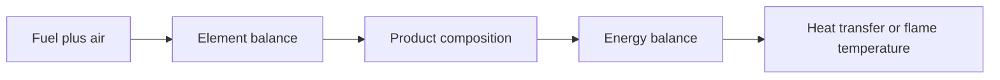

# Chemical Reactions and Combustion

Combustion analysis combines stoichiometry with the first law. Fuels react with oxygen, usually supplied by air, to form products such as carbon dioxide, water, nitrogen, excess oxygen, carbon monoxide, and unburned fuel. The mole balance determines product composition; the energy balance determines heat transfer or adiabatic flame temperature.

The major shift from nonreacting balances is that mass is conserved by element rather than by species. Methane disappears, but its carbon and hydrogen atoms remain in the products. Species composition must be established before an energy balance can be evaluated.

## Choose a reaction basis before balancing

- A **fuel** is a substance that releases energy during chemical reaction, commonly hydrocarbons such as methane, propane, gasoline approximations, or coal compositions.
- **Combustion** is rapid oxidation with heat release. Complete combustion of a hydrocarbon forms $CO_2$ and $H_2O$ when enough oxygen is available.
- **Theoretical air** or **stoichiometric air** is the exact amount of air needed for complete combustion with no free oxygen in products.
- **Excess air** is air supplied above theoretical. Percent excess air is $(\mathrm{actual}-\mathrm{theoretical})/\mathrm{theoretical}\times100\%$.
- **Equivalence ratio** compares actual fuel-air ratio with stoichiometric fuel-air ratio. Rich mixtures have equivalence ratio above 1; lean mixtures have it below 1.
- **Air-fuel ratio** may be molar or mass based. Always label the basis.
- **Enthalpy of formation** is the enthalpy change when a compound forms from stable elements at the reference state.
- **Enthalpy of combustion** is the heat released by complete combustion at specified reactant and product states.
- **Higher heating value** includes condensation of product water to liquid. **Lower heating value** leaves product water as vapor.
- **Adiabatic flame temperature** is the product temperature for adiabatic combustion with no work and specified reactant state.

Combustion equations are usually written on a kmol fuel basis. Air is modeled as $O_2+3.76N_2$ by moles for dry air. Nitrogen is often treated as inert in ordinary combustion temperatures, but at high temperatures some dissociation and $NO_x$ formation may matter.
Set the fuel basis, air model, allowed products, and enthalpy reference before substituting numbers. The species balance and energy balance answer different questions: atom counts fix the possible product amounts, while formation and sensible enthalpies determine heat transfer or product temperature. Balance the reaction first and convert between molar and mass quantities only afterward.

A kmol of fuel is usually the cleanest reaction basis. Complete the element balance before converting product amounts to mass or combining them with mass-based heating values.

For an oxygenated fuel $C_aH_bO_c$, the stoichiometric oxygen requirement for complete combustion is found from the product oxygen balance:

$$
\nu_{O_2,st}=a+\frac b4-\frac c2.
$$

Fuel-bound oxygen reduces required oxygen from air. Sulfur and other elements require corresponding product assumptions. The formula is only as good as the assumed complete products $CO_2$ and $H_2O$.

The equivalence ratio is

$$
\phi=\frac{(F/A)_{actual}}{(F/A)_{st}}
=\frac{(A/F)_{st}}{(A/F)_{actual}}.
$$

Thus $\phi\lt1$ denotes lean operation and $\phi\gt1$ rich operation. If excess-air fraction is $e$ and the fuel flow is fixed,

$$
\phi=\frac1{1+e}.
$$

Twenty percent excess air corresponds to $\phi=1/1.20=0.833$, not $0.80$.

## Balancing atoms, then enthalpy

For a hydrocarbon $C_aH_b$ undergoing complete stoichiometric combustion,

$$
C_aH_b+\left(a+\frac{b}{4}\right)(O_2+3.76N_2)
\rightarrow
aCO_2+\frac{b}{2}H_2O+3.76\left(a+\frac{b}{4}\right)N_2.
$$

For excess air fraction $e$,

$$
O_{2,actual}=(1+e)O_{2,stoich}
$$

and unused oxygen appears in products. The steady-flow reacting-system energy balance, neglecting kinetic and potential changes, can be written as

$$
Q-W=\sum N_p\left(\bar h_f^{\circ}+\Delta \bar h\right)_p
-\sum N_r\left(\bar h_f^{\circ}+\Delta \bar h\right)_r.
$$

For adiabatic combustion with no work,

$$
\sum N_p\left(\bar h_f^{\circ}+\Delta \bar h(T_p)\right)_p
=
\sum N_r\left(\bar h_f^{\circ}+\Delta \bar h(T_r)\right)_r.
$$

This equation is solved iteratively for product temperature because product sensible enthalpies depend on temperature. Product water phase matters for heating value and dew point. If water vapor condenses in exhaust, the recovered latent heat corresponds to the difference between higher and lower heating values.
After balancing a reaction, recount every element on the chosen fuel basis. For flame-temperature work, state whether heat capacities vary with temperature and whether dissociation is included; both choices can shift the result substantially.

Standard enthalpies of formation give the standard reaction enthalpy:

$$
\Delta H_{rxn}^\circ
=\sum_p N_p\bar h_{f,p}^\circ
-\sum_r N_r\bar h_{f,r}^\circ.
$$

Stable elements in their standard reference states have zero standard enthalpy of formation by convention. Their absolute enthalpy is not zero; the convention establishes a common datum. At temperatures other than the reference temperature, sensible enthalpy increments must be added separately.

For a steady combustor with no shaft work and negligible kinetic and potential changes, the sign convention $Q-W=H_p-H_r$ gives $Q\lt0$ when heat leaves the control volume. A quoted positive heating value normally reports the magnitude of heat released, so its sign convention differs from control-volume $Q$.

| Quantity | Lean combustion | Stoichiometric combustion | Rich combustion |
|---|---|---|---|
| Air supplied | more than theoretical | exactly theoretical | less than theoretical |
| Product oxygen | present | none ideally | none |
| CO or unburned fuel | usually small if complete | none ideally | likely |
| Equivalence ratio | $\lt 1$ | $1$ | $\gt 1$ |

## Methane with theoretical and excess air

**Problem.** Write the complete combustion equation for methane with theoretical air, then with $20\%$ excess air. Find the stoichiometric mass air-fuel ratio. Use $M_{CH4}=16\ \mathrm{kg/kmol}$, $M_{O2}=32$, and $M_{N2}=28$.

**Method.**

1. Stoichiometric oxygen for methane:

$$
CH_4+2O_2\rightarrow CO_2+2H_2O.
$$

2. Include air nitrogen:

$$
CH_4+2(O_2+3.76N_2)
\rightarrow CO_2+2H_2O+7.52N_2.
$$

3. Air mass per kmol fuel:

$$
m_{air}=2(32)+7.52(28)=64+210.56=274.56\ \mathrm{kg}.
$$

4. Fuel mass per kmol:

$$
m_f=16\ \mathrm{kg}.
$$

5. Stoichiometric air-fuel ratio:

$$
AFR=274.56/16=17.16\ \mathrm{kg\ air/kg\ fuel}.
$$

6. With $20\%$ excess air, oxygen supplied is $2(1.20)=2.4\ \mathrm{kmol}$. Products contain unused oxygen:

$$
CH_4+2.4(O_2+3.76N_2)
\rightarrow CO_2+2H_2O+0.4O_2+9.024N_2.
$$

**Checked answer.** The stoichiometric mass air-fuel ratio is about $17.2$. The excess-air equation conserves C, H, O, and N atoms.

## Wet and dry product analyses

Gas analyzers often report dry composition after water has been removed. The combustion balance itself commonly produces a wet basis that includes water vapor. Converting between them requires a new total mole count; the mole amounts of the nonwater species do not change.

**Problem.** Propane burns completely with $25\%$ excess dry air. Find wet and dry product mole fractions, assuming all product water remains vapor.

Stoichiometric oxygen for $C_3H_8$ is

$$
3+\frac84=5\ \text{kmol }O_2\text{ per kmol fuel}.
$$

Actual oxygen is

$$
1.25(5)=6.25\ \text{kmol}.
$$

The balanced equation is

$$
C_3H_8+6.25(O_2+3.76N_2)
\rightarrow3CO_2+4H_2O+1.25O_2+23.50N_2.
$$

The wet total is

$$
N_{wet}=3+4+1.25+23.50=31.75\ \text{kmol}.
$$

Thus

$$
y_{CO_2}=\frac3{31.75}=0.0945,
\qquad
y_{H_2O}=\frac4{31.75}=0.1260,
$$

$$
y_{O_2}=\frac{1.25}{31.75}=0.0394,
\qquad
y_{N_2}=\frac{23.50}{31.75}=0.7402.
$$

On a dry basis water is omitted and the new total is

$$
N_{dry}=3+1.25+23.50=27.75\ \text{kmol}.
$$

The dry fractions are therefore

$$
y_{CO_2,dry}=0.1081,
\quad y_{O_2,dry}=0.0450,
\quad y_{N_2,dry}=0.8468.
$$

Rounding accounts for the final decimal in each sum. Comparing a measured dry oxygen fraction directly with a wet calculation would give a false air estimate.

## Heat release from formation enthalpies

**Problem.** Calculate the standard enthalpy change for methane combustion with product water vapor,

$$
CH_4+2O_2\rightarrow CO_2+2H_2O(g),
$$

using $\bar h_f^\circ=-74.85$ MJ/kmol for $CH_4$, $-393.52$ MJ/kmol for $CO_2$, $-241.82$ MJ/kmol for $H_2O(g)$, and zero for $O_2$ in its reference state.

The product formation-enthalpy sum is

$$
\sum_pN_p\bar h_f^\circ
=(-393.52)+2(-241.82)
=-877.16\ \text{MJ/kmol fuel}.
$$

The reactant sum is

$$
\sum_rN_r\bar h_f^\circ=-74.85+2(0)
=-74.85\ \text{MJ/kmol fuel}.
$$

Hence

$$
\Delta H_{rxn}^\circ=-877.16-(-74.85)
=-802.31\ \text{MJ/kmol fuel}.
$$

The negative sign denotes an exothermic reaction under the thermodynamic sign convention. The lower heating value magnitude for this specified reference reaction is $802.31$ MJ/kmol because water remains vapor.

## A first estimate of adiabatic flame temperature

**Problem.** Estimate the adiabatic product temperature for stoichiometric methane-air combustion using a simplified constant product heat capacity. Take the lower heating value as $802,000\ \mathrm{kJ/kmol\ CH_4}$ and approximate the total product heat capacity as $\sum N_pc_{p,p}=0.333\ \mathrm{kJ/(mol\,K)}=333\ \mathrm{kJ/(kmol\ fuel\,K)}$ for the product mixture over the high-temperature range. Reactants enter at $298\ \mathrm{K}$.

**Method.**

1. For stoichiometric methane-air combustion:

$$
CH_4+2O_2+7.52N_2\rightarrow CO_2+2H_2O+7.52N_2.
$$

2. In a rough constant-$c_p$ adiabatic estimate, heat release raises product sensible enthalpy:

$$
LHV\approx \left(\sum N_pc_{p,p}\right)(T_{ad}-298).
$$

3. Solve:

$$
T_{ad}=298+\frac{802,000}{333}=298+2408=2706\ \mathrm{K}.
$$

4. Interpret carefully: real calculations use temperature-dependent heat capacities and may include dissociation, which usually lowers the flame temperature from a crude constant-$c_p$ estimate.

**Checked answer.** The estimate is about $2700\ \mathrm{K}$, a high but plausible first pass. It should not replace a full enthalpy-table calculation.

## Inferring air supply from product analysis

Measured flue-gas composition can be used in reverse to estimate air-fuel ratio. The cleanest approach chooses a basis such as $100$ kmol of dry products, assigns unknown fuel and water amounts, and writes carbon, hydrogen, oxygen, and nitrogen balances. Nitrogen often acts as a tracer for supplied dry air under the inert-nitrogen approximation.

For complete methane combustion with unknown excess-air factor $\lambda$,

$$
CH_4+2\lambda(O_2+3.76N_2)
\rightarrow CO_2+2H_2O+2(\lambda-1)O_2+7.52\lambda N_2.
$$

On a dry basis, total product moles are

$$
N_{dry}=1+2(\lambda-1)+7.52\lambda=9.52\lambda-1.
$$

If measured dry oxygen is $5.00\%$, then

$$
0.0500=\frac{2(\lambda-1)}{9.52\lambda-1}.
$$

Solving,

$$
0.476\lambda-0.050=2\lambda-2,
$$

$$
1.950=1.524\lambda,
$$

$$
\lambda=1.280.
$$

The inferred excess air is $28.0\%$ and equivalence ratio is $1/1.280=0.781$. This calculation assumes complete combustion, dry air of the stated composition, and no air leakage into the sampled exhaust. Carbon monoxide or unburned fuel would require additional measured species and balances.

## Rich combustion is not fixed by atom balances alone

With insufficient oxygen, merely balancing elements does not uniquely divide carbon among $CO_2$, $CO$, soot, and unburned hydrocarbons, nor hydrogen among water, hydrogen, and fuel fragments. An additional model or measurement is required. One might specify that all hydrogen forms water and distribute carbon using a measured CO-to-$CO_2$ ratio, or solve chemical equilibrium for an allowed species set.

Assuming complete combustion in a rich mixture can lead to negative product oxygen, an algebraic signal that the product set is impossible. It is better to recognize the missing species than to keep a balanced-looking equation with a negative coefficient.

Incomplete combustion generally releases less useful heat than full conversion to $CO_2$ and $H_2O$. Carbon monoxide retains chemical energy and is hazardous. Soot formation also affects radiation, deposits, and pollutant emissions, none of which are represented by a single equivalence ratio.

## Product-water dew point

Water vapor begins to condense when its partial pressure reaches the saturation pressure at the exhaust temperature. For ideal-gas products,

$$
P_{H_2O}=y_{H_2O}P.
$$

The dew-point temperature satisfies

$$
P_{sat,H_2O}(T_{dew})=P_{H_2O}.
$$

The vapor mole fraction must be on a wet basis. A dry analyzer excludes water and cannot be used directly without reconstructing the wet composition. Increasing excess air usually dilutes water vapor and lowers its partial pressure, tending to lower the dew point for the same fuel and total pressure.

Condensation changes recoverable heat. A condensing boiler cools products below their water dew point and recovers part of the latent heat, allowing efficiency quoted on an LHV basis to appear above $100\%$. No energy law is violated; the denominator excludes condensation heat that the device recovers. HHV-based efficiency remains below unity for the same boundary and operating state.

Acid-forming species can create higher or otherwise more restrictive dew points in real exhaust. Corrosion limits therefore cannot be inferred from water alone when sulfur or other contaminants are present.

## Flame temperature is a coupled composition problem

The constant-heat-capacity estimate gives intuition but overpredicts or underpredicts depending on the chosen average properties. A full adiabatic calculation evaluates each product's sensible enthalpy from the reference state and iterates on temperature. Heat capacities grow with temperature, so a room-temperature value is unsuitable over thousands of kelvins.

At high temperature, dissociation absorbs energy and changes product moles. Reactions such as carbon dioxide and water dissociation reduce the equilibrium flame temperature compared with a frozen complete-product calculation. Pressure can suppress dissociation reactions that increase gas moles, so equilibrium flame temperature may depend on pressure even when an elementary complete-combustion balance does not.

Preheating reactants increases their inlet sensible enthalpy and raises adiabatic flame temperature. Excess air adds mostly nitrogen and oxygen that must also be heated, usually lowering flame temperature. Heat loss, incomplete combustion, finite-rate mixing, and radiation lower measured temperatures further. “Adiabatic flame temperature” is therefore a specified ideal state, not a universal property of a fuel.

## Checks on a combustion calculation

- Balancing oxygen but forgetting nitrogen carried with air.
- Mixing molar and mass air-fuel ratios without conversion.
- Using lower heating value when product water is liquid, or higher heating value when it remains vapor.
- Assuming adiabatic flame temperature can be found without iteration when heat capacities vary strongly.
- Ignoring incomplete combustion products in rich mixtures.
- Comparing wet and dry gas analyses without removing water from the mole total.
- Assigning zero formation enthalpy to every reactant. Only stable elements in their specified reference states use that convention.
- Treating nitrogen as universally inert. It is a useful ordinary-temperature balance approximation, but high flame temperatures permit dissociation and nitrogen chemistry.

See also: [gas mixtures](/physics/thermodynamics/gas-mixtures) · [chemical and phase equilibrium](/physics/thermodynamics/chemical-and-phase-equilibrium) · [microscopic foundations](/physics/statistical-mechanics/intro) · [control-volume mass and energy analysis](/physics/thermodynamics/control-volume-mass-and-energy-analysis) · [gas-vapor mixtures and air conditioning](/physics/thermodynamics/gas-vapor-mixtures-and-air-conditioning)

